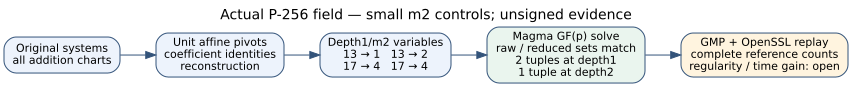

# Exact preprocessing and P-256 CAS qualification

Magma solved all four original presentations and their reduced versions
on two registered small P-256 controls. Complete-reference relation counts
and exact GMP/OpenSSL replay agree. Native affine-linear elimination
reduces the smallest dense ring from 13 variables to 1. These are unsigned
observations, PCC-20261116-2335a8 [pcc:unverified].



## Scope and actual execution

The target remains the registered P-256 curve over its actual 256-bit prime.
These controls have small factor-base domains, not smaller prime fields.
Both targets are deterministic planted controls.

| Control | Factor base | Columns / signed points | Target | Complete ordered tuples |
| --- | --- | --- | --- | ---: |
| depth 1/m2 | FB1hfa6130558c05 | 1 / 2 | infinity | 2 |
| depth 2/m2 | FB1hb6856918fe35 | 2 / 4 | finite | 1 |

Eight public calculator requests were submitted: three rejected, five
admitted. Requests 004/006 solve the raw four-arm controls;007/008 solve
their reduced versions. Request003 also checks the exact field and first
dense control. The full16-cell matched matrix is
[cas-unit-matrix.json](evidence/cas-unit-matrix.json); provider version is
2.30-1. Every original request/response is retained [pcc:unverified].

## Exact elimination

Given a pivot a*x+L=0 with constant a!=0, substitute x=-L/a everywhere and
store a reconstruction expression. The native code checks the pivot and
the coefficient identity f(x)-f(L)=(x-L)*Q using an independent telescoping
construction. Only identically zero equations are dropped. No relation
branch or exceptional addition chart is selected away. Tests cover72
systems (depths1/2/4, m2..7, four arms) and three corrupted-certificate
controls [pcc:unverified].

This is standard linear elimination, not a novel factor-base mechanism.
The Magma handbook already documents LinearElimination. The implementation
and its explicit reconstruction target solver work; variable count is
not a regularity or timing measurement.

| m2 control | Arm | Original / residual variables | Raw / reduced affine output-basis degree |
| --- | --- | --- | --- |
| depth 1 | dense | 13 / 1 | 2 / 2 |
| depth 1 | tower | 13 / 2 | 2 / 2 |
| depth 1 | paired | 17 / 4 | 2 / 2 |
| depth 1 | oriented | 17 / 4 | 2 / 2 |
| depth 2 | dense | 13 / 9 | 1 / 1 |
| depth 2 | tower | 15 / 11 | 1 / 1 |
| depth 2 | paired | 19 / 13 | 2 / 2 |
| depth 2 | oriented | 21 / 15 | 1 / 1 |

These degrees describe the basis returned at completion, **not degree of
regularity or maximum F4 matrix degree**. Preprocessing did not lower that
measured output degree. The paired-to-oriented2→1 at depth 2 concerns
different auxiliary covers with the same projected relation [pcc:unverified].

The larger native-only depth 4/m7 cases remain substantial: dense 83→69,
tower 104→90, paired 118→97, oriented 139→118 variables. Their input degrees
remain dense 9 and structured 3; no CAS run on them occurred here
[pcc:unverified].

## Relation sets and failures

Raw and reduced dense/tower/oriented return2 CAS assignments at depth 1 and 1
at depth 2; paired returns8 and 4. Their projected ordered tuples agree.
Orientation removes four auxiliary-sign copies per relation on these m2
controls; it is not a fourfold runtime result. The infinity target has
zero nonzero projected rows; the finite target has one. Neither supplies
a natural-yield or independent-rank result [pcc:unverified].

| Request | Rejected behavior | Correction before later data |
| --- | --- | --- |
| 001 | SetNthreads illegal; exit_code0 despite success=false | remove public-unit thread control |
| 002 | leading ideal closer lost under prompt handling; stale probe ideal reused | join closer and enable SetQuitOnError |
| 005 | Eltseq did not accept a Variety tuple | explicit coordinate sequence |

The first two responses printed plausible success markers after errors.
Strict whole-response admission rejected them. Their partial execution is
not an admitted solve. Original inputs, errors and source-bound amendments
remain available [pcc:unverified].

## Provenance and reproduction

Requests 001–006 retain input/request hashes and source history but did not
capture a separately copied immutable qualifier. Requests 007/008 add
read-only qualifier/native-replayer copies and distinct pre/post manifests.
Later build metadata is labelled post-call; do not treat it as pre-call
evidence. The server binary/image and host are not independently pinned.

Run the offline regression suite in a fresh directory:

```sh
research/p256_aux_smooth_20261114/continuation_20261116/run_checks.sh /tmp/aux-linear-001
```

It rebuilds 72 native cases, compares certificate bytes, replays retained
CAS results and checks malformed-batch/error rejection. It makes no HTTP
request. Do not automatically repeat submit_unit.sh calls as benchmarks.

Public units used one request at a time and a 25-second client cap; the
service advertises 1 GiB memory. Returned time/memory metadata are retained
without a qualified performance comparison. No EKS/L2 run,2x runtime
claim, maximum F4 degree or structured regularity was established.

## Remaining target

| Requirement | Status |
| --- | --- |
| Same-field base, ICV1/FB1 dumps | retained unchanged |
| Exact preprocessing/reconstruction | implemented;72 native cases and small CAS controls accepted, unsigned |
| Actual big-prime CAS execution | m2 depth 1/2 raw/reduced controls accepted |
| Intended depth 8 m2..7 baseline and2x stage gain | not run; admitted measurement backend remains open |
| Lower structured regularity / novelty / natural yield | not established by these controls |

Next is the original depth 8 matched panel after qualifying an exact-source
EKS/CAS image and admission, with paid preprocessing/reconstruction costs.
The depth 4 nine-column fixture and original protocol remain frozen. The
[named problem](../../../problems/p256-aligned-auxiliary-solver.md) stays open.

Main synchronization preserved the canonical ledger prefix and re-appended
four identical unsigned claim bodies through pcc.append_entry; receipt
retains both hash histories. Lesson verification accepts 183 materialized
entries. Another study's open record was not closed here. Root release-lib
cannot start locally because cargo is absent. New offline CI remains pending
publication; no full CI/merge success is inferred [pcc:unverified].

Sources: [calculator API](https://github.com/Magma-Maths/calculator/blob/main/README.md),
wrapper app/magma_cmd.py at 1e6267e22a19e75a6a3b6a3cc43bae3ce675e4a7,
[environment options](https://magma.maths.usyd.edu.au/magma/handbook/text/49),
[linear elimination](https://magma.maths.usyd.edu.au/magma/handbook/text/1447)
and the [original PKM review](../REPORT.md). KB unavailable: no exposed
tools and wrapper exits127; no novelty inference. Unsigned result bindings
include PCC-20261116-e52985,6b5f12,2335a8.

[PDF](report.pdf) · [diagram source](reduction.dot) · [protocol](PROTOCOL.md)
· [original benchmark protocol](../PROTOCOL.md)
