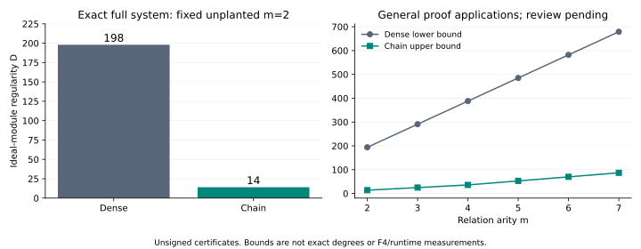
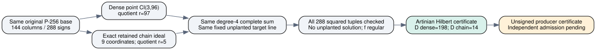

# Exact full m2 regularity certificate on the original P-256 base

The frozen unplanted m2 complete system has **ideal-module regularity 198
for GCB-dense and 14 for GCB-chain**, a 14.1x local algebraic reduction under
the same definition. This is a full generator-homogenization result, not
membership degree, input degree or final affine GB degree. The certificate
is producer-written and unsigned: PCC-20261117-644dc1 [pcc:unverified].

Target curve: `icv1-fp256-t89188191154553853111372247798585809583-f188c491`.
Original deterministic depth 8 base: `FB1h16882188194e`,144 columns / 288 signed
points, unchanged ICV1/FB1 wide format. No points were dropped, no auxiliary
ordinate/sign cover was added and no target logarithm was transported.

## Exact m2 proof and complete reference

Both arms use identical balanced RCB Algorithm1, the same fixed target and
target-isolating line, and no affine-linear preprocessing. There are no
free slope/inverse/group variables. The actual homogenized group polynomial
has degree 4 (pure-Y coefficient witness); it is stored as an exact circuit.
The equations were constructed before enumerating the reference relations.

| Complete fixed unplanted m2 system | GCB-dense | GCB-chain |
|---|---:|---:|
| Affine variables | 4 | 18 |
| Common homogenizing variables | 1 | 1 |
| Membership equations | 4 | 102 |
| Group equations | 1 | 1 |
| Input point-algebra quotient regularity | 194 | 10 |
| Full quotient regularity | 197 | 13 |
| **Full ideal regularity D** | **198** | **14** |
| Full Artinian length | 331776 | 331776 |

Dense membership is the exact retained point CI(3,96), not the unpruned
256-abscissa auxiliary fibre. Chain membership has51generators in 9 variables,
Hilbert numerator `[1,9,37,89,106,46]`, and exact quotient regularity 5.
The dimension certificate checks every retained point, H-free monic leading
terms, terminating division, full divisor-closed footprint/border and an
independent evaluation-rank calculation. This proves the homogeneous ideal
equals the reduced point ideal over the algebraic closure. It does not
claim an unexecuted S-pair loop passed. Claim a7827d [pcc:unverified].

The m2 reference checks every 82,944ordered tuple against affine GMP,
complete RCB and OpenSSL addition, for each preselected target. The planted
target has exactly `[193,262]` and `[262,193]`; both are replayed. The fixed
unplanted target has none. False positives/negatives are zero on these
complete instances. The two ordered planted tuples give the same row;
there is no independent-rank claim. Claim08e7b0 [pcc:unverified].

All geometric input points are precisely those rational tuples. Thus the
common unplanted group polynomial f is nonzero at every point and is a
nonzerodivisor on both reduced dimension 1 CM point algebras. For either
input Hilbert series h(t)/(1-t), the regular-element exact sequence gives
the full Artinian Hilbert polynomial `h(t)*(1+t+t^2+t^3)`. Its last nonzero
degree is the exact quotient regularity; add 1 for ideal regularity. Dense
Koszul shifts for CI(3,96,3,96,4) independently agree with 197/198. Chain's
last Hilbert coefficient is2116 in degree 13, giving14. Neither saturation
nor the general Gorenstein lower-bound lemma is needed for this result.
Both affine unplanted ideals are inconsistent; this result concerns their
actual unsaturated homogenized generators, as preregistered. It makes no
claim that an affine solver ran to degree198or14 [pcc:unverified].

## Preserved m2--7 scope

All12fixed planted/unplanted cells have cached matched equation/circuit
hashes and witness classification. Six planted target sums pass exact
GMP/OpenSSL replay;2862cached membership equations are checked. Every
reported relation is replayed.129 special complete-law controls include
identity, inverses, doubling and nonunit projective scales. The cubic gcd
with x^p-x certifies no rational 2-torsion; each fixed target line has an
exact nonsquare-discriminant certificate. Claim a373e6/08e7b0 [pcc:unverified].

`FULL_BOUND_PROOF.md` derives a full-system upper bound r+e, including
H-torsion, and a dense strict-CI lower bound r. With the now-concrete chain
quotient r=5, its applications are:

| m | Dense D lower | Chain D upper | Extra affine chain variables |
|---|---:|---:|---:|
| 2 | 194 | 14 | 14 |
| 3 | 291 | 25 | 21 |
| 4 | 388 | 36 | 28 |
| 5 | 485 | 53 | 35 |
| 6 | 582 | 70 | 42 |
| 7 | 679 | 87 | 49 |

This table supersedes the preliminary chain-span table in the frozen
`FULL_BOUND_PROOF.md`; the missing retained-generator obligation is now
closed by the concrete certificate. These are producer-derived bounds, not exact higher-m values or independent
theorem admission. Finite3x3-grid controls test the duality shift and
H-torsion formula on 1,024 subset/degree units (11,776 dimension checks); a
shift mutation is detected in 1,022 units. Finite tests do not establish the
general lemma. The exact unplanted m2 result above avoids that lemma.
Higher-m unplanted instances were not solved [pcc:unverified].

## Costs, failures and standing

Each chain point adds seven uniquely reconstructed coordinates. The larger
GB setup uses 25,915,095 GMP modular-reduction API calls, and its certificate
check uses 16,331,773; these are not field-equivalent solve counts. The bound
assembly/reference uses 7,152,413 such calls. Circuit nodes are not new ring
variables, and expanded high-m group coefficients were not materialized;
their expansion, solve time, RAM/disk traffic and EKS performance comparison
remain open. No runtime, affine F4, natural-yield or novelty claim follows.

The new four-feature lift hit its 30s bound with no certificate/replay.
Previous four CoCoA cells remain censored at 45s with zero admitted full
certificates; old public-service allowance remains exhausted. None was
rerun. Separate new native correctness phases have frozen finite bounds,
exit codes and byte replay; no paid or performance experiment was launched.

Every reported result remains `[pcc:unverified]`: hashes and local native
checks do not supply an independent signed verifier or Lean proof. The
2x numeric target is met by the exact m2 producer certificate. Keep the goal
active for admission and remaining full m2--7 obligations rather than
turning an unsigned certificate into an independently verified success.
No new leaderboard/fastest/rho conclusion is promoted.

## Reproduce / sources

Run `bash run_complete_replay.sh FRESH_DIR` for independent bounded replay
of this new package (it excludes old failed graph/CAS cells). The script
rebuilds native programs and compares deterministic JSONs to frozen inputs.
Protocols: COMPLETE_LAW_PROTOCOL.md, RETAINED_DEPTH8_PROTOCOL.md,
BOUND_ASSEMBLY_PROTOCOL.md and EXACT_M2_PROTOCOL.md. Evidence directories:
`complete-law-depth 8`, `retained-depth 8`, `bound-assembly`, `exact-m2`.

Primary references: RCB complete law Algorithm1 and exception condition,
https://joostrenes.nl/publications/complete.pdf ; Abbott/Kreuzer/Robbiano BM,
NATIVE_BUDGET.md; filtered-duality prior art/strict complete intersections,
https://csdlkhoahoc.hueuni.edu.vn/data/2018/11/OnTheCBP.pdf . Methods are
classical; no novelty claim. KB unavailable (wrapper127); fallback sources
and mathematical dependencies are explicit. Root Rust/Lean suites were
not run because those executables are absent in this environment.
