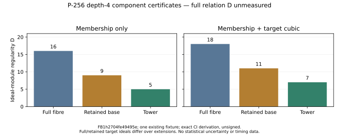
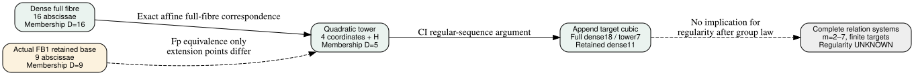

# Regularity-halving goal: exact component certificates, full goal open

The existing depth4 auxiliary membership block has ideal-module regularity
16 in its dense **full-fibre** presentation and5 in its quadratic tower.
The actual retained factor base has dense membership regularity9, so its
9-versus5 comparison does **not** meet2x. These are exact CI derivations
with native coefficient checks, unsigned and without a Lean certificate;
PCC-20261117-ceb084, source/derivation PCC-20261117-ba0875. Complete
relation regularity is unmeasured [pcc:unverified].





## Scope and reproducibility

Target `icv1-fp256-t89188191154553853111372247798585809583-f188c491`,
unchanged auxiliary construction `w^2=x^3-3x` over the actual P256 field.
Only its cyclic2-smooth subgroup is used; smoothness of the full order and
target-log transport are not asserted. Existing FB1 IDs, point-key codec
and storage format remain unchanged. No new base search or performance
experiment ran. [PROTOCOL.md](PROTOCOL.md) fixes the goal definition and
acceptance; [PROOF.md](PROOF.md) derives the component bounds.

| Requirement | Evidence/status |
| --- | --- |
| Fixed definition | D=reg(J), standard graded ideal module; quotient is D-1. Generator homogenization, saturation and F4 solving degree separated. |
| Exact component certificates | Three existing depth1/2/4 fixtures, all S-pairs and coefficient identities; Koszul/Hilbert data in evidence/native. Unsigned. |
| Falsification checks | Eleven corrupt certificates rejected; fresh-output refusal and actual file hashes checked. |
| Retained-base fairness | All full-fibre roots checked, retained/excluded factorization exact, target quadratic characters recorded. |
| Complete relation2x | **Open**: no admitted full-system regularity value. |
| m=2–7 / depth8 workload | **Open**: small m2 qualifier does not discharge original scope. |
| Relation correctness | No new relation reported. New CAS qualifier returned no relation output to replay. Prior continuation replay unchanged. |
| Runtime / novelty | Unmeasured/unestablished; not inferred from local degree. |

Producer observations above and table are covered only by unsigned component
artifacts, not independent signed standing [pcc:unverified].

Run native exact development checks without network:

```sh
bash research/p256_aux_smooth_20261114/goal_dreg_half_20261117/run_checks.sh /absolute/fresh/output
bash research/p256_aux_smooth_20261114/goal_dreg_half_20261117/build_complete.sh /absolute/fresh/export
```

The first command recompiles the native verifier, byte-compares committed
certificates and checks overwrite refusal. The second reconstructs identical
complete-system inputs from the frozen original reducer prefix. Neither
command submits a CAS request. Build flags: C++20/O2/Wall/Wextra/Werror;
GMP and OpenSSL, native local development, no timing admission.

## What the degree comparison means

The tower has d pairwise coprime leading squares. Its complete-intersection
quotient has Hilbert numerator(1+t)^d and regularity d; the ideal regularity
is d+1. The dense full fibre has one degree2^d generator. Appending the target
cubic is regular on the membership quotient and adds2 to regularity. The
native checks establish the necessary finite-fibre/nonzero-section facts.
These are **unsaturated generator homogenizations**; infinity contributions
are retained and affine F4 matrix degrees are unknown [pcc:unverified].

| Depth | FB1 | Full fibre / retained columns | Membership D: full / retained / tower | With cubic D: full / retained / tower |
| --- | --- | ---: | --- | --- |
| 1 | FB1hfa6130558c05 | 2 / 1 | 2 / 1 / 2 | 4 / 3 / 4 |
| 2 | FB1hb6856918fe35 | 4 / 2 | 4 / 2 / 3 | 6 / 4 / 5 |
| 4 | FB1h2704fe49495e | 16 / 9 | 16 / 9 / 5 | 18 / 11 / 7 |

Exact derived values from evidence/native; one existing fixture per depth,
unsigned producer evidence, no statistical uncertainty [pcc:unverified].

Seven depth4 full-fibre abscissae do not lift to P256 over Fp; they do lift
over extensions. Thus the tower/retained target ideals differ geometrically.
Adding full group-law constraints can change regularity in either direction;
the component bound supplies no bound for that new ideal. The full-fibre
16-to5 ratio is excluded from goal promotion [pcc:unverified].

Companion `quadratic.identity.json`, `IDC1hfd07bef9fab74b95`, follows the
repository's identity.certificate/v1 format for the universal quadratic
expansion. That schema samples over2^61-1, **not P256**, at32 deterministic
points. The native issuer also checks P256 coefficients separately. The
official Rust checker was unavailable, and proof=null; this companion
does not establish the CI theorem or independent standing [pcc:unverified].

## Complete-system qualification and retained failures

The native exporter applies identical exact affine-linear preprocessing to
both arms, homogenizes each **residual generator**, and checks H=1 recovery
coefficientwise. Original/residual systems, reconstruction certificates and
Magma programs for finite planted depth2/4 m2 cells were frozen and published
before submission under PCC-20261117-867055 [pcc:unverified].

Two public-service requests consumed the frozen allowance:

1. Request001: HTTP200/transport0, success=false/exit1. The public service
   forbids Alarm(20); execution stopped before the CI probe. Retained under
   evidence/api001, PCC-20261117-a7e5de.
2. Amendment2 explicitly removed that one control line, disclosed the
   service300-second cap versus25-second HTTP cap, and used the one remaining
   request on depth2. Request002 timed out after25003ms with zero received
   bytes/curl28; remote outcome unknown. Retained under evidence/api002,
   PCC-20261117-3b7fda. No regularity or relation result admitted; no retry.

These are infrastructure/development failures, not evidence of a mathematical
obstruction. Depth4 was **not submitted**. No result is inferred from the
absence of a public response [pcc:unverified].

Initial native v1 also failed compilation; its frozen source and full log
are retained, with successor correction in AMENDMENT1. An unpublished claim
accidentally used an absolute scratch subject. Its original bytes and ledger
row are preserved, with an appended withdrawal note and expected verifier
rejection under evidence/errors. The portable replacement is ceb084; no
source or old ledger row was rewritten [pcc:unverified].

## Next discriminating obligation

Obtain a runnable exact graded-resolution verifier for the **complete**
homogeneous systems, first on the frozen finite depth4 cell. Preserve the
same linear preprocessing and retained-base challenger. A minimal resolution
or independent exact certificate must replace the current null values;
then extend to the original m=2–7/depth8 scope. The goal stays active and
draft PR4555 remains unfinished. No automatic third CAS call or full-depth
relation attempt is scheduled.

Sources: primary manuals and PKC2016 reference in PROTOCOL.md; unchanged
source-linked review in ../REPORT.md. KB and conductor unavailable as
recorded. No novelty claim. Previous study graphs checked and left unchanged:
../construction.svg and ../continuation_20261116/reduction.svg;
new diagram/plot report only this successor's component evidence.
