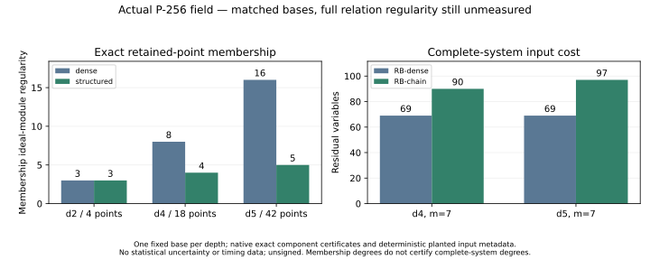
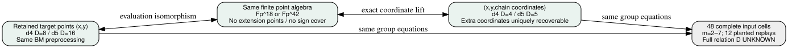

# Exact retained membership: 8→4 and16→5; complete-system goal open

At the actual P256 field, the same18signed factor-base points have membership
ideal regularity8 in target coordinates and4 with auxiliary-chain coordinates.
For42signed points the values are16 and5. Both arms receive the same
degree-compatible Buchberger–Möller preprocessing. These are saturated
**membership** ideals, including target ordinates and both signs; not just
abscissa polynomials. Native certificates/replay pass, but remain unsigned
(PCC-20261117-ed749f). Complete relation regularity is not established
[pcc:unverified].





Target: `icv1-fp256-t89188191154553853111372247798585809583-f188c491`.
The original ICV1/FB1 format, deterministic seed, retained target points and
auxiliary2-smooth subgroup construction are unchanged. No target logarithm
transport or novel underlying algorithm is asserted.

| Depth / base | Signed points | Affine variables: dense / chain | Membership D: dense / chain |
| --- | ---: | ---: | ---: |
| d2 / FB1hb6856918fe35 | 4 | 2 / 3 | 3 / 3 |
| d4 / FB1h2704fe49495e | 18 | 2 / 5 | 8 / 4 |
| d5 / FB1h8bc0ab2ed2af | 42 | 2 / 6 | 16 / 5 |

Exact native values, one fixed base per depth; no statistical or timing
claim. The d2 neutral control and added variables are retained. Abscissa-only
controls are separately recorded, never substituted for signed points
[pcc:unverified].

## Why these are regularity certificates

The payload contains retained point coordinates, a degree-compatible affine
GB, its homogenization, standard monomials and Hilbert numerator. Every
generator vanishes on all points. The checker verifies all S-pairs (using
the product criterion where applicable), an independently recomputed
evaluation rank, divisor-closed footprint and complete border coverage.
Homogeneous S-pairs are checked directly with H last. All leading monomials
are H-free, so the coordinate algebra is a graded free Fp[H] module with
that finite standard basis [pcc:unverified].

Thus H is regular and the quotient is CM of dimension1. If r is the largest
degree of a standard monomial, the quotient regularity is r and **ideal**
regularity is r+1. This is not a final-GB-degree proxy. For d4, the dense
Hilbert numerator is `[1,2,3,3,3,3,2,1]`, versus structured `[1,5,8,4]`:
r=7 versus3, D=8 versus4 [pcc:unverified].

The N-dimensional quotient evaluates isomorphically onto N distinct retained
rational points. Hence these are their exact radical ideals, including over
the algebraic closure. Projection forgets the added chain coordinates;
the inverse uses the fixed rational chain maps, with nonzero denominators
on the retained set. This removes the old full-fibre extension-point mismatch.
There is no auxiliary ordinate/sign cover [pcc:unverified].

Twelve native signed/abscissa cells and36corrupt-certificate checks pass;
wrong D, an altered generator and a repeated point are rejected in every
cell. A fresh-directory replay is byte-identical. Source/derivation and
all raw certificates are in `retained_basis.cpp`, RETAINED_PROTOCOL.md and
evidence/retained-native. Standing is producer-only [pcc:unverified].

## Complete-system integration and cost

The cached-basis bridge constructs48paired inputs: depths4/5, m=2–7,
planted/unplanted, RB-dense/RB-chain. It retains every group-law equation,
replaces point constraints only, and applies the same frozen affine-linear
preprocessor. Twelve planted identities receive exact GMP/OpenSSL replay;
24original/reconstructed planted systems satisfy every equation. Unplanted
targets were exported, not solved (PCC-20261117-dc7483) [pcc:unverified].

| Planted m7 input | Residual variables | Residual equations | Residual terms | Input degree |
| --- | ---: | ---: | ---: | ---: |
| d4 RB-dense | 69 | 212 | 1048 | 8 |
| d4 RB-chain | 90 | 240 | 1230 | 3 |
| d5 RB-dense | 69 | 212 | 1300 | 16 |
| d5 RB-chain | 97 | 303 | 2532 | 4 |

These are deterministic input counts, not complete-system regularities or
solve costs. More variables/terms must be charged. Native BM setup and
verification API counters are separate in the summary; they are not
field-equivalent operations. Base construction certificates and bridge
setup/validation counters are recorded. Complete solve/RAM/disk-traffic
measurements and original depth8 remain open [pcc:unverified].

Every original/reduced input and reconstruction has a manifest hash. m2
payloads are materialized for review; higher-m inputs reconstruct from
the published source and cached coefficients. No solved relation truth
table, fixed factor-base choice or relation search is used by this bridge.
The affine algebras match over the algebraic closure; the projective
embeddings and generator homogenizations need not match [pcc:unverified].

## Complete-system CAS failures retained

The official CoCoA5.4.0 archive matched vendor SHA256 and its known-answer
unit passed at the full256-bit modulus: CI ideal regularity4/quotient3 and
linear ideal1/quotient0. The initial partial download and serializer compiler
failure were preserved before correction. No invalid binary was executed
[pcc:unverified].

All four **old frozen complete-system** units reached their45-second cap and
exited124; no complete certificate was admitted. Three printed partial
ideal-regularity assertions6,8,13 before timing out in the Betti stage; the
fourth printed only its start marker. Those assertions are **unadmitted
partial outputs**, not accepted values (PCC-20261117-0033dc). No failed cell
was retried. The strict qualification bound was240seconds, including the
known-answer probe and two25-second membership runs. No new public CAS
request or runtime experiment ran [pcc:unverified].

## Reproduce and continue

```sh
bash research/p256_aux_smooth_20261114/goal_dreg_half_20261117/run_retained_checks.sh /absolute/fresh/proof-check
bash research/p256_aux_smooth_20261114/goal_dreg_half_20261117/build_retained_bridge.sh /absolute/fresh/bridge
```

The wrapper's constituent native commands were executed; wrapper syntax is
checked without spending another qualification run. Both commands are
offline. Local C++20/O2/Wall/Wextra/Werror, GMP/OpenSSL; no L2 timing
admission. CoCoA software identity is in evidence/cocoa-toolchain.json.

The full goal remains active in draft PR4567. Next obligations are an exact
complete-ideal certificate and original m=2–7/depth8 validation. The proposed
finite-point/complete-projective-law route is in FINITE_POINT_ROUTE.md;
its bound is an unsigned derivation, not an implemented improvement. No
full-system2x, end-to-end speedup or novelty follows from this component
[pcc:unverified].

Sources read: Abbott–Kreuzer–Robbiano, Computing Zero-Dimensional Schemes,
section3 Theorem3.1 (link in NATIVE_BUDGET.md); official CoCoA NewZZmod/reg
manuals; Renes–Costello–Batina2015/1060 section3/4 for the unexecuted next
route. KB/conductor remained unavailable. Existing frozen reports and
graphs remain byte-identical; current successor graphs are above.
