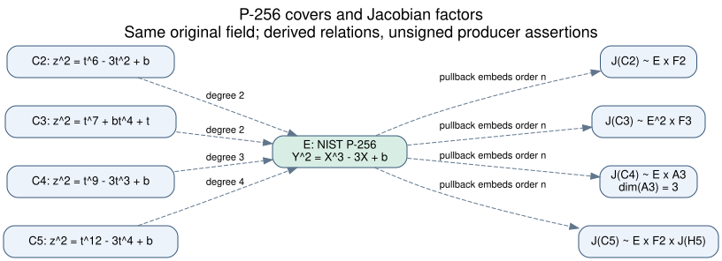

# P-256 covers in genera 2, 3, 4 and 5

Explicit equations, subgroup transfers, and a native reproducibility package for
the four requested higher-genus curves. See [REPORT-v2.md](REPORT-v2.md) and
[REPORT.pdf](REPORT.pdf) for the construction, quotient factors, and DLP analysis.

**Standing:** producer assertions and local correctness checks, not independently
signed verification. No new speed, novelty, or key-recovery claim. [pcc:unverified]

PCC records: [initial written study](../../pcc/claims/PCC-20261115-02c341.json)
and [producer execution record](../../pcc/claims/PCC-20261115-7b1b1f.json).
Neither has an independently signed verification verdict.

`REPORT.md` is the immutable first draft pinned by the initial study claim.
The active `REPORT-v2.md` clarifies the final integration paragraph after the
prose linter flagged the draft's negative mention of a catalog capability claim.
The mathematical content is unchanged; REPORT.pdf renders the active version.
The [active study record](../../pcc/claims/PCC-20261115-7c905f.json) pins that
version; its standing is also unverified.

## Native reproduction

From the repository root, with Rust, rustfmt and Clippy installed:

```sh
bash research/p256_genus_dlp_20261115/native/check.sh
```

This formats/checks/tests the standalone native crate, runs four deterministic
correctness commands, and compares their outputs with the committed JSON:

```sh
cargo run --release --locked --manifest-path research/p256_genus_dlp_20261115/native/Cargo.toml -- verify
cargo run --release --locked --manifest-path research/p256_genus_dlp_20261115/native/Cargo.toml -- toy-correctness
cargo run --release --locked --manifest-path research/p256_genus_dlp_20261115/native/Cargo.toml -- toy-zeta
cargo run --release --locked --manifest-path research/p256_genus_dlp_20261115/native/Cargo.toml -- certificates
```

The active code is Rust. It includes its own arbitrary-precision arithmetic and
reuses the repository's existing identity-certificate checker by source path.
It is a study-specific, variable-time correctness tool, not a production API or
a replacement for the shared library's checked curve constructors.

Genus-3/4 arithmetic has one rational point at infinity and explicit Mumford
encodings. The genus-2/5 models have two rational infinity points: their geometry
and point counts are checked, while their general divisor arithmetic remains
unsupported. Complementary-factor orders over the actual P-256 field have not
been computed. [pcc:unverified]

## Evidence and source history

- [Native outputs](results/), [validation record](VALIDATION.md), and
  [proof map](PROOF_MAP.md).
- [Frozen original Python project](historical/python-project-bfaa543.zip),
  original local commit `bfaa543`, SHA-256
  `fb566fcd241b0daccd8e4a259652d8920c3e0560e44e210a76bf7dbe428a7210`.
- [Original JSON outputs](historical/results/) remain byte-for-byte unchanged.
  They are historical producer self-checks, including any legacy boolean labels;
  they do not confer repository proof standing. Their files stay loose because
  the native exact-point-count replay resolves the toy-zeta fixture by path.
- The original project's Python workflow remains inside the frozen archive;
  it is not installed as this repository's execution path. Native checks above
  are executable locally; no new repository-wide CI workflow is added.
- Existing shared library, catalogs, leaderboards, and benchmark claims are
  unchanged. The study contributes no matched performance measurement.

The source and historical artifacts were imported from the earlier standalone
project. The Rust implementation is the active replacement required by this
repository's language policy; none of the archived Python is invoked by it.

## Diagram and managed rendering



The repository artifact bot moved `factors.png` into its managed store and
recorded its hash in `.artifacts.json`. The SVG remains directly viewable
on GitHub and REPORT.pdf embeds the inspected diagram. To rebuild the report's
PNG locally from its committed source, use Graphviz:

```sh
dot -Tpng -Gdpi=150 research/p256_genus_dlp_20261115/factors.dot -o research/p256_genus_dlp_20261115/factors.png
```

Keep the artifact manifest and managed ignore rules. The bot's storage change
does not alter the source equations or native correctness outputs.

## All-cover classification framework

The follow-on [classification framework](classification/README.md) includes all
finite covers through function-field extensions and Frobenius, with structural
hyperelliptic/quadratic descriptions, general traits, a worked catalogue and
actual-field Smith prerequisite checks. It is a representation framework, not
an implemented enumeration of every isomorphism class. See the inspected
[seven-page report](classification/FRAMEWORK.pdf) and
[validation boundaries](classification/VALIDATION.md). [pcc:unverified]
