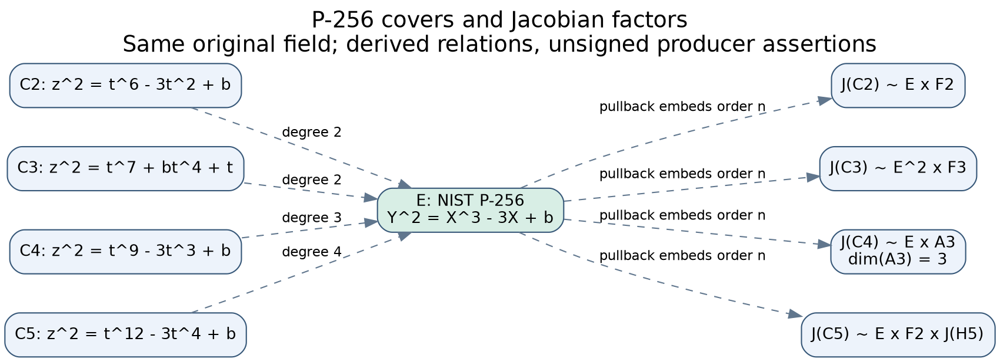

# Construction and scope

This study records the four requested explicit covers of NIST P-256, their
Jacobian subgroup transfers, and additional quotient factors. Mathematical
derivations and executable checks below are producer assertions, pending the
repository's independent signed verification. No novelty or performance claim
is made. Identity receipts and formalization boundaries are in
[PROOF_MAP.md](PROOF_MAP.md). [pcc:unverified]

Write $E:Y^2=X^3-3X+b$ over the standard P-256 field $\mathbb F_p$, with
$p=2^{256}-2^{224}+2^{192}+2^{96}-1$ and the coefficient and prime group order
from SEC 2, section 2.4.2. The exact constants are in `native/src/lib.rs` and
the frozen source snapshot. All four covers stay over this same field.

| Genus | Curve | Map to $E$: $(X,Y)$ | Degree |
|---|---|---|---:|
| 2 | $z^2=t^6-3t^2+b$ | $(t^2,z)$ | 2 |
| 3 | $z^2=t^7+bt^4+t$ | $(t+t^{-1},z/t^2)$ | 2 |
| 4 | $z^2=t^9-3t^3+b$ | $(t^3,z)$ | 3 |
| 5 | $z^2=t^{12}-3t^4+b$ | $(t^4,z)$ | 4 |

Use the smooth projective models. The actual coefficient satisfies $b\ne0$ and
$b^2\ne4$. For degrees 2, 3 and 4, separability of $f(t^d)$ follows from
separability of $f(X)=X^3-3X+b$ and $f(0)\ne0$. The genus-3 polynomial
$t(t^6+bt^3+1)$ is squarefree under the same conditions in characteristic
greater than three. The degrees 6, 7, 9 and 12 give exactly genera 2, 3, 4 and 5.
The displayed affine maps extend to the projective curves. [pcc:unverified]

# The transferred DLP

For a cover $\pi:C\to E$ of degree $d$, define
$\Phi(P)=\pi^*([P-O])$ in $J(C)=\operatorname{Pic}^0(C)$. The standard
pullback-norm identity gives

$$\pi_*\pi^*=[d],\qquad
  \Phi([k]P)=[k]\Phi(P).$$

On the P-256 subgroup of prime order $n$, each $d\in\{2,3,4\}$ is coprime
to $n$, so pullback is injective and its inverse on the image is

$$\Psi=[d^{-1}\bmod n]\pi_*.$$

These maps require divisor and field arithmetic, not a discrete logarithm.
Consequently the image DLP and the original P-256 DLP reduce efficiently to
one another with the same scalar. This is a reduction statement, not a lower
bound on every possible attack. [pcc:unverified]

For $P=(u,v)$, the canonical odd-degree image encodings are particularly simple:

$$\Phi_3(P)=(t^3-ut^2+t,\;vt^2),\qquad
  \Phi_4(P)=(t^3-u,\;v).$$

The original public point can be read directly from these coefficients.
For genus 3 the pullback of $O$ is $\infty+(0,0)$; adding the branch point
$(0,0)$ to the affine fiber gives the displayed pair because its class relative
to infinity has order two. For genus 4 the pullback is $3\infty$.
For genera 2 and 5 the pullbacks are respectively
$\infty_++\infty_-$ and $2\infty_++2\infty_-$; their two-infinity arithmetic
is explicitly excluded from this implementation. [pcc:unverified]

# Quotient factors

The following relations are isogenies over the original P-256 field. They imply
products of Frobenius polynomials and of rational group orders, not an
isomorphism of finite groups or of principal polarizations. [pcc:unverified]

For genus 2, define

$$F_2:v^2=u^3-3u^2+b^2,\qquad
 (u,v)=(b/t^2,bz/t^3).$$

Together with the map to $E$, the differential pullbacks are $-2dt/z$ and
$2t\,dt/z$, which span the differential space. Hence
$J(C_2)\sim E\times F_2$. [pcc:unverified]

For genus 3, $p\equiv1\pmod3$, so a primitive cube root $\zeta$ lies in
$\mathbb F_p$. Besides the original map to $E$, use

$$ (X,Y)=(\zeta t+\zeta^2/t,z/t^2),\qquad
 F_3:v^2=u^3+bu^2+u,\quad (u,v)=(t^3,tz).$$

The three differential pullbacks are $(t^2-1)dt/z$,
$(\zeta t^2-\zeta^2)dt/z$ and $3t\,dt/z$. Their independence gives
$J(C_3)\sim E^2\times F_3$. The base-field cube-root condition is essential
to this particular splitting. Xarles's Theorem 1 and its remark already describe
closely related genus-3 constructions with an $E^2$ factor; this study makes no
novelty claim for that structure. [pcc:unverified]

For genus 4, the connected norm kernel supplies a three-dimensional abelian
complement $A_3$, with $J(C_4)\sim E\times A_3$. Its simplicity and actual-field
order have not been determined here. [pcc:unverified]

For genus 5, the quotients $(u,v)=(t^2,z)$ and $(t^2,tz)$ give $C_2$ and
$H_5:v^2=u^7-3u^3+bu$, respectively. Their differential pullbacks span the
odd and even monomials of the genus-5 differential basis, giving
$J(C_5)\sim J(C_2)\times J(H_5)\sim E\times F_2\times J(H_5)$.
Further splitting of $J(H_5)$ has not been determined. [pcc:unverified]

Thus the actual-field group orders satisfy
$\#J(C_2)=n\#F_2$, $\#J(C_3)=n^2\#F_3$,
$\#J(C_4)=n\#A_3$ and $\#J(C_5)=n\#F_2\#J(H_5)$.
An $n^2$ factor in an ambient order does not imply a cyclic subgroup of order
$n^2$. [pcc:unverified]

# Hardness interpretation

The transferred subgroup has order approximately $2^{256}$ in every genus.
The conventional classical generic attack estimate is therefore about
$2^{128}$ group operations. The inverse transfer allows that attack to be run
directly on $E$. Approximate ambient orders $p^g$ do not enlarge this subgroup.
For a different base point elsewhere in a Jacobian, analyze its subgroup order
and projections onto the complementary factors separately. Their actual-field
orders and hardness remain unassessed here. [pcc:unverified]

For context, the standard fixed-genus double-large-prime hyperelliptic
index-calculus heuristic is $\widetilde O(p^{2-2/g})$ for $g\ge3$; the
genus-2 comparison has exponent one. With the original 256-bit field, those
field-size exponents correspond to about 256, 341.3, 384 and 409.6 bits of
work for genera 2 through 5, respectively. These are quoted asymptotic
comparisons, not measured costs or lower bounds for this structured family.
They do not improve on the inherited P-256 attack estimate. The GTTD primary
PDF was inaccessible from this runtime; the quotation is cross-checked against
the repository's existing assessment and must not be treated as a new primary
source audit. [pcc:unverified]

The earlier $\log_2(q)\approx256/g$ group-size rule of thumb concerns choosing
a different field for a different cryptosystem. It does not describe these
same-field covers. A prime base field also has no proper smaller subfield to
which ordinary Weil restriction can descend. [pcc:unverified]

# Reproduction and boundaries

`native/check.sh` checks the four P-256-field equations and squarefreeness,
the genus-3/4 transferred generator orders and scalar compatibility, toy known-answer
DLPs, and exact toy extension-field point counts. The toy zeta fixture uses
$q=7,b=1$, not the P-256 reduction ($b\equiv0\pmod7$ would make some covers
singular). Its full Frobenius polynomials, including the complementary curves,
replay the frozen historical output and the factorization identities.
These are producer correctness checks, not independently signed verification.
[pcc:unverified]

The native toy subgroup orders are 109, 4111 and 7229 over fields of orders
1009, 4001 and 65537. Known scalars are recovered by independent polynomial
Jacobian arithmetic for genera 3 and 4. No time, scaling exponent, matched-rho
speedup, or P-256 DLP recovery is measured. The historical Python addition
counts are retained as fixtures and are not promoted to performance evidence.
[pcc:unverified]

The identity receipts use the pre-existing repository checker over
$2^{61}-1$, with 32 derived evaluation points and 16 extra producer-selected
checker points. Their `proof` field is null. This probabilistic finite-field
receipt does not prove the full geometric isogeny statements or independently
sign the execution. Lean ring-identity sources are included, but local Lean
checking is unavailable; the exact proof gaps are listed in `PROOF_MAP.md`.
[pcc:unverified]

# Sources checked and integration

- [Xarles, arXiv:1303.4220](https://arxiv.org/abs/1303.4220), Theorem 1,
  its remark and Corollary 3: primary PDF read; prior genus-3 and genus-at-most-5
  constructions with two independent maps.
- [SEC 2, section 2.4.2](https://www.secg.org/sec2-v2.pdf): standard parameter
  reference, retained from the original project.
- [Gaudry, Thome, Theriault and Diem](https://doi.org/10.1090/S0025-5718-06-01900-4),
  Mathematics of Computation 76 (2007), 475--492: fixed-genus index-calculus
  reference; DOI metadata checked in the original project, primary AMS and
  ePrint downloads returned HTTP 403 in this runtime.
- [Cantor](https://doi.org/10.1090/S0025-5718-1987-0866101-0): arithmetic
  reference; implementation contract cross-checked against the repository's
  [native Cantor implementation](../../src/prime_hyperelliptic/curve.rs).
- [Existing catalog cover assessment](../cover_transfer_assessment_20261013/README.md): geometry,
  kernel and arithmetic capability boundaries, Xarles audit, conditional Lean
  subgroup theorem, and distinctions between construction and solver claims.
- [Existing Jacobian-transfer study](../ecbench_jacobians_transfers_20261025/README.md) and
  [genus-ladder follow-up](../genus_ladder_bound_r_20261114/RESULTS.md): existing measured work;
  their inputs and boundaries differ from this same-field P-256 image study.
- Sources checked (KB): **KB unavailable**. No KB MCP tools are loaded and
  `scripts/research-kb status` exits 127 because its executable is absent.
  The targeted repository references above were used instead.

No shared catalog, benchmark row, leaderboard or canonical performance graph
is changed: this import supplies a study-local mathematical diagram and
correctness fixtures, not a new calibrated performance value or verified
catalog edge. The standalone native crate's local checks are recorded in
`VALIDATION.md`; the root library check and formal proof gaps remain explicit.
