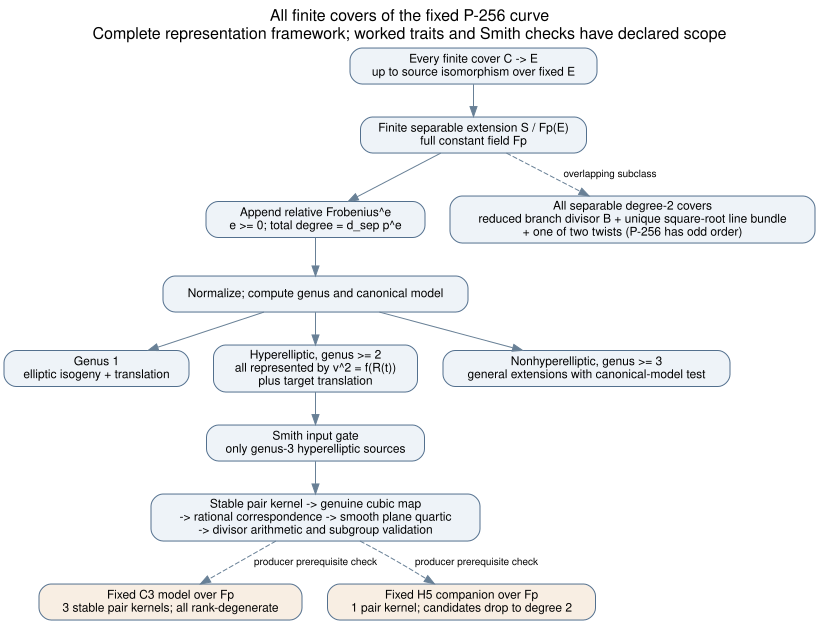

# Scope and what is exhaustive

The user selected an **all-cover classification framework**. Fix
$k=\mathbb F_p$ and the standard P-256 curve $E:Y^2=f(X)=X^3-3X+b$.
A cover means a finite nonconstant morphism $\pi:C\to E$, with $C$ smooth,
projective and geometrically connected over $k$. Equivalence means an
isomorphism of source curves commuting with the map to this fixed target.
Target translations are not divided out unless explicitly stated.

The function-field representation below includes every such cover. It is an
exhaustive representation and equivalence framework, not a finite enumeration
or a closed list of all isomorphism classes. Even fixing the source genus
does not bound the degree: compose a cover with the target's prime-to-$p$
multiplication isogenies. The worked catalogue and native checker implement
only the declared models and prerequisites. [pcc:unverified]

This document separates imported mathematical theory, written derivations,
producer correctness checks and implementation obligations. No new result has
an independently signed PCC verdict. Source and proof boundaries are recorded
below. [pcc:unverified]

# 1. Representation of every cover

Put $K=k(E)=k(X)[Y]/(Y^2-f(X))$. Every cover is specified by:

1. A finite separable extension $S/K$ whose full constant field is $k$.
   By the primitive element theorem write $S=K[T]/(P(T))$, where $P$ is monic,
   irreducible and separable. Each coefficient lies in
   $K=k(X)+k(X)Y$; no restriction to radical or solvable extensions is imposed.
2. An integer $e\ge0$, with $L=S^{1/p^e}$ inside an algebraic closure.
3. The smooth projective normalization $C$ with function field $L$, and the
   inclusion $K\hookrightarrow L$, which gives $C\to E$.

Two representations are equivalent precisely when their extensions are
$K$-isomorphic, with the same inseparable degree. Different defining
polynomials can represent the same cover: polynomial equality is not an
isomorphism test. Full constant field $k$ is essential; otherwise a connected
$k$-model may fail geometric connectedness. [pcc:unverified]

Conversely, every finite map of these smooth curves factors as

$$ C\xrightarrow{F_C^e} C^{(p^e)}\xrightarrow{\pi_s} E,$$

where the first map is relative Frobenius and the second is separable. Thus
$\deg\pi=p^e d_s$, where $d_s=\deg\pi_s$. Over the perfect field $k$, the
Frobenius step preserves genus and geometric curve type. The maximal
separable intermediate field and Frobenius factorization supply the reverse
construction. See the Stacks Project sections cited below. [pcc:unverified]

An equivalent complete description of the separable stage chooses the actual
branch locus $B\subset E$, sets $U=E\setminus B$, and chooses a continuous
finite permutation representation of $\pi_1^{\mathrm{et}}(U)$, up to conjugacy.
The geometric fundamental group must act transitively. Normalization compactifies
the corresponding cover of $U$. Wild inertia and its ramification filtration
must be retained; a tame branch-cycle list alone is not exhaustive in
characteristic $p$. Removing extra unramified points from $U$ creates duplicate
representations, so $B$ must be the actual minimal branch locus. [pcc:unverified]

# 2. Exhaustive structural cases and necessary traits

The geometry is exactly one of: genus-one elliptic source; hyperelliptic source
of genus at least two; or nonhyperelliptic source of genus at least three.
Separability, Galois structure, ramification and geometry are independent axes.

| Axis | Cases / required data |
|---|---|
| Degree | $d_s$, Frobenius exponent $e$, total $d_s p^e$ |
| Constants | Original $k$, source constant field, geometric connectedness |
| Geometry | Genus, smooth normalization, hyperellipticity, canonical model, gonality |
| Ramification | Branch divisor, inertia, different, wild lower/upper jumps |
| Symmetry | Arithmetic and geometric monodromy, deck groups over each field, known versus full automorphism group |
| Jacobian | Dimension, Frobenius polynomial, point-order factorization, $p$-rank, known factors, polarization |
| Transfer | Exact map on divisor classes, subgroup, kernel intersection, norm/dual and inverse |
| Execution | Geometry, arithmetic, pullback, norm and solver statuses separately |
| Smith | Input type, kernel, genuine trigonal map, descent square class, canonical quartic and divisor map |

For the separable stage, Riemann--Hurwitz specializes to

$$ \deg\operatorname{Diff}(\pi_s)=2g(C)-2.$$

For tame ramification this equals $\sum_P(e_P-1)\deg(P)$. Wild covers require
the full different, not just $e_P-1$. Genus zero is impossible. Genus one
forces an unramified separable map; after choosing origins and a translation,
the map is an elliptic isogeny. [pcc:unverified]

Every positive-genus cover supplies an elliptic factor up to isogeny,
$J(C)\sim E\times A$, with $\dim A=g-1$. Thus the higher-genus Jacobian is
not absolutely simple. Its Frobenius polynomial has $\chi_E$ as a factor and
its rational point order is divisible by $n=\#E(k)$. This does not determine
the complementary order or imply an isomorphism of principally polarized
varieties or finite groups. P-256 is ordinary, so the Jacobian's $p$-rank is
at least one; a full ordinary/supersingular profile is not inferred from that
lower bound. [pcc:unverified]

For subgroup transfer, the exact identity is

$$\pi_*\pi^*=[d_s p^e].$$

If the chosen prime order $n$ is coprime to the total degree, pullback is
injective and its inverse on the image is $[d^{-1}\bmod n]\pi_*$. If the
degrees share a factor, record the actual kernel intersection: coprimality is
sufficient, not necessary. A known elliptic factor or matching Frobenius
polynomial does not itself implement this divisor map. [pcc:unverified]

# 3. Complete hyperelliptic-cover representation for this target

There is a stronger description for **every hyperelliptic source** of genus
at least two covering this P-256 curve. Up to a target translation, it is the
normalization of

$$ C_R:\ v^2=f(R(t)),\qquad
   \pi_R(t,v)=(R(t),v),\qquad R\in k(t)\setminus k.$$

Include the target translation $T\in E(k)$ when classifying maps over the
fixed target. Identify rational functions under source-coordinate changes
in $\mathrm{PGL}_2(k)$. For the asserted correspondence, retain the cover
map, not merely the source curve equation. [pcc:unverified]

**Why this is exhaustive for hyperelliptic covers.** Let $\iota$ be the
hyperelliptic involution. The map $P\mapsto\pi(P)+\pi(\iota P)$ factors
through the genus-zero quotient and is therefore a constant $a\in E(k)$:
there is no nonconstant map from a genus-zero curve to $E$. Since $E(k)$ has
odd order, there is a unique $T\in E(k)$ with $2T=a$. Then
$\pi_0=\pi-T$ satisfies $\pi_0\iota=-\pi_0$. The hyperelliptic quotient is
$\mathbb P^1$ over this finite field. Its coordinate $t$ makes
$X\circ\pi_0=R(t)$ invariant and $Y\circ\pi_0$ anti-invariant, giving exactly
the displayed function field. Conversely, every nonconstant $R$ gives this
pullback cover, after normalization. Retain only the sources of genus at least
two in this stratum. [pcc:unverified]

The degree is $\deg R$; its inseparable part is the inseparable part of $R$.
To compute the source genus, cancel square factors and count the geometric
places of $k(t)$ at which $f(R)$ has odd valuation. If that number is $r$,
then $2g+2=r$. In the separable case $r\le4d_s$, so

$$ g\le2d_s-1.$$

The same bound applies after stripping Frobenius. In particular, a
hyperelliptic curve of genus at least four cannot have a separable degree-two
map to an elliptic curve. Target translations induce the identity on
$\operatorname{Pic}^0(E)$, so distinct covers can induce the same subgroup
transfer. [pcc:unverified]

# 4. Complete classification of degree-two covers of P-256

Because $p$ is odd, every separable quadratic cover is a quadratic extension
$K(\sqrt a)/K$, with $a\in K^*/K^{*2}$. A geometrically connected cover of
genus $g\ge2$ is equivalently specified by:

- a nonempty reduced effective $k$-rational divisor $B$ on $E$, of degree
  $2g-2$ (a Frobenius-stable collection of distinct geometric branch points);
- a line bundle $\mathcal L$ of degree $g-1$ with
  $\mathcal L^{\otimes2}\cong\mathcal O_E(B)$;
- one of the two constant square classes in $k^*/k^{*2}$.

Here **the rational square-root line bundle is unique**, because multiplication
by two is a bijection on $E(k)$, whose order is the odd prime $n$.
Construct the cover as
$\operatorname{Spec}_E(\mathcal O_E\oplus\mathcal L^{-1})$ with multiplication
specified by a section of $\mathcal L^2$ vanishing on $B$. Reduced branch
gives a smooth curve. Scaling the section modulo squares gives exactly two
nonisomorphic covers over this fixed target. [pcc:unverified]

There is no geometrically connected unramified quadratic cover of this target
over $k$: it would be a rational degree-two elliptic isogeny and require
nontrivial rational two-torsion on the target. The constant-field quadratic
extension is not geometrically connected and is excluded. [pcc:unverified]

| Source genus | Exhaustive quadratic-cover geometry |
|---|---|
| 2 | Always hyperelliptic; branch degree 2 |
| 3 | Hyperelliptic or nonhyperelliptic; branch degree 4; compute the canonical model |
| 4 and above | Always nonhyperelliptic; branch degree $2g-2$ |

This is a classification of all quadratic covers by branch data and twists,
not just the specific equations in the worked catalogue. [pcc:unverified]

# 5. Named families fit inside the framework

With $f(t)=t^3-3t+b$, the existing hyperelliptic models are
$z^2=f(t^2)$, $z^2=t^7+bt^4+t$, $z^2=f(t^3)$ and $z^2=f(t^4)$.
Their degrees to $E$ are 2, 2, 3 and 4 and genera 2, 3, 4 and 5.
The complete hyperelliptic representation also includes every other rational
function $R$, after the stated normalization and equivalence. [pcc:unverified]

For nonhyperelliptic examples take

$$D_h:s^4=h(t)^2f(t),\qquad \pi(t,s)=(t,s^2/h(t)).$$

For squarefree $h$ coprime to $f$, this is the degree-two extension
$s^2=Yh(X)$ of $K$, with branch degree $4+2\deg h$, hence genus
$3+\deg h$. Taking $h=1,t,t(t-1)$ gives genera 3, 4 and 5. The genus-3
case is a smooth plane quartic; the higher cases are nonhyperelliptic by
the preceding degree-two bound. Singular affine equations in the higher
cases must be normalized. Their actual-field general Jacobian arithmetic is
not implemented here. [pcc:unverified]

Useful quadratic square-class representatives on $E$ are:

| Source | $a(X,Y)$ in $K(\sqrt a)$ | Branch locus |
|---|---|---|
| $C_2$ | $X$ | Two points with $X=0$ |
| $C_3$ | $X^2-4$ | Four points with $X=\pm2$ |
| $D_3$ | $Y$ | $E[2]$, including $O$ |
| $D_4$ | $XY$ | $E[2]$ plus the two points with $X=0$ |
| $D_5$ | $X(X-1)Y$ | $E[2]$ plus the points with $X=0,1$ |

All counts here are geometric. Over $k$ some points occur as closed points
of larger degree. On P-256, $b\ne0$ and $b\ne\pm2$, so these loci are
disjoint as required. [pcc:unverified]

Other exhaustive representation strata include cyclic Kummer covers when
the required roots of unity are in the field, Artin--Schreier and
Artin--Schreier--Witt covers for cyclic $p$-power groups, mixed towers, and
arbitrary non-Galois or nonsolvable extensions. These named techniques do
not replace the general finite-extension representation. Full constant-field
and irreducibility tests are still required. [pcc:unverified]

The degree-four $C_5\to E$ illustrates why arithmetic and geometric Galois
traits differ: it is geometrically cyclic of order four, but not Galois over
this $k$, since $p\equiv3\pmod4$ and $i\notin k$. Its base-field deck group
contains only the two transformations $t\mapsto\pm t$ for this cover.
The degree-three $C_4\to E$ is cyclic over $k$, since $p\equiv1\pmod3$.
These are deck groups of the specified covers, not full automorphism groups
of the source curves. [pcc:unverified]

# 6. Smith eligibility is a chain of separate gates

The Smith construction studied here is the hyperelliptic genus-3
$(2,2,2)$-isogeny of Smith, arXiv:0806.2995, over characteristic greater
than three. It is not a genus-changing curve cover.

1. Source must be a smooth hyperelliptic curve of genus 3.
2. Choose a Frobenius-stable pair partition of its eight geometric
   Weierstrass points. There are 105 geometric pair partitions among the
   135 maximal isotropic subgroups of $J[2]$. The other 30 are outside this
   explicit pair-kernel construction.
3. Construct an actual degree-three map identifying every pair. Rank and
   square-discriminant tests do not permit common factors or base points:
   cancel them and check the degree and all pair conditions.
4. Pass the rationality test of Smith Proposition 4: the leading coefficient
   of its nonzero $s(t)$ must be a square in the base field. A failure can
   produce a quadratic twist of the desired quotient, not the same rational
   transfer. Kernel stability alone does not settle this obstruction.
5. Construct Recillas' curve $X$ and its correspondence. Compute the canonical
   system; a smooth plane quartic must actually result. Hyperelliptic or
   degenerate outcomes do not give the requested nonhyperelliptic destination.
6. Implement the isogeny on divisor classes, arithmetic, kernel and subgroup
   checks. For an odd-order P-256 image the two-primary kernel cannot kill
   that subgroup; the polarized dual satisfies $\widehat\phi\phi=[2]$.

The small-field repository implements the kernel/rationality tests and part
of Recillas' affine correspondence. Its canonical plane-quartic and general
codomain-Jacobian bridge remains unimplemented in the reviewed source. This
new checker extends prerequisite checks for two fixed models to the actual
P-256 field; it does not supply that missing bridge. [pcc:unverified]

# 7. Exact prerequisite checks for the two named genus-3 models

Native output: `results/smith-p256.json`. The 105 matchings are all enumerated,
with exact Frobenius over verified degree-three or degree-six extension fields.
All 135 two-torsion Lagrangians are compared using the pre-existing repository
implementation. Small-field controls compare factor types, stable kernels,
matrix ranks and valid map counts, and Smith's published positive example is
also exercised. These are producer checks, not signed execution verification.
[pcc:unverified]

| Model | Weierstrass cycles | Rational pair kernels | All rational Lagrangians | Standard direct Smith outcome |
|---|---|---:|---:|---|
| $C_3:z^2=t^7+bt^4+t$ | $1,1,3,3$ | 3 | 9 | All three matrices have rank 3; no genuine trigonal map for these pairings |
| $H_5:v^2=u^7-3u^3+bu$ (genus 3) | $1,1,6$ | 1 | 1 | Rank 4, but both pencil candidates drop to degree 2 |

This excludes the **standard direct pair-kernel Smith route on these fixed
models over $k$**. It does not exclude non-pair kernels, other-degree
isogenies, other isogenous source models or extension-field constructions.
For $C_3$ the six additional rational Lagrangians are specifically not tested
by the standard pair-kernel algorithm. [pcc:unverified]

## Written explanation of the degeneracies

For $C_3$, the source polynomial factors as
$t(t^3-\alpha)(t^3-\alpha^{-1})$, with both cubics irreducible over $k$.
Indeed, the exact check finds $b^2-4$ a nonzero square, and the elliptic
cubic is irreducible (consistent with the odd prime order of $E(k)$).
The only stable pair partitions pair $0$ with infinity and match the two
three-cycles. Each is an orbit partition of $t\mapsto c/t$, with
$c\in\mu_3(k)$. Its pair quadratics are $uv$ and three quadratics with
the same constant term $c$. Their Smith rows lie in a three-dimensional
space, matching the exact rank-three calculation. [pcc:unverified]

There is also a coordinate-invariant degree argument. A rational map $N/D$
of degree three identifying $0$ and infinity has
$n_3d_0-n_0d_3=0$. The numerator of
$g(t)-g(c/t)$, after multiplication by $t^3$, therefore has degree at most
five. If it vanishes at the six other branch points, it is identically zero.
Then $g$ factors through the degree-two quotient by $t\mapsto c/t$ and has
even degree, a contradiction. This argument excludes a genuine cubic map;
a missing generic rank condition must not be read as an untested success.
[pcc:unverified]

For $H_5$, the exact check finds $-b$ a nonsquare. Its six nonzero branch
points form one Frobenius orbit; the only stable partition is
$\{0,\infty\}$ and the three pairs $\{r,-r\}$. For a candidate $g$, the
numerator of $g(t)-g(-t)$ has degree at most five. Vanishing at the six
nonzero branch points forces invariance under $t\mapsto-t$, so its degree
is even. The two formal Smith-pencil candidates have a common affine factor
or a base point at infinity, explaining the observed degree drop.
[pcc:unverified]

Neither statement is a global impossibility theorem for the relevant
isogeny classes. The source's extra symmetry is essential; Smith's quoted
generic success probability must not be assigned to these structured models.
[pcc:unverified]

# 8. Traits and route status for our named covers

| Model | Genus / geometry | Cover degree | Rational infinities | Standard Smith input |
|---|---|---:|---:|---|
| $C_2$ | 2, hyperelliptic | 2 | 2 | Wrong genus; genus-2 Richelot is a different route |
| $C_3$ | 3, hyperelliptic | 2 | 1 | Eligible input type, direct pair route excluded above |
| $C_4$ | 4, hyperelliptic | 3 | 1 | Wrong genus |
| $C_5$ | 5, hyperelliptic | 4 | 2 | Wrong genus |
| $D_3$ | 3, nonhyperelliptic | 2 | 1 | Already nonhyperelliptic; no forward hyperelliptic Smith step |
| $D_4$ | 4, nonhyperelliptic | 2 | 1 | Wrong genus |
| $D_5$ | 5, nonhyperelliptic | 2 | 1 | Wrong genus |

The abstract dimension-three complement in $J(C_4)$ has not been identified
as a genus-3 Jacobian. The known genus-3 companion $H_5$ occurs in the
complement of $J(C_2)$ inside $J(C_5)$. For the usual pullback through
$C_5\to C_2\to E$, projection of the transferred subgroup to $J(H_5)$ is
zero: the two quotient pullbacks have opposite eigenvalues under
$(t,z)\mapsto(-t,z)$. Thus merely applying a genus-3 operation to that
companion would not transport the given P-256 image. [pcc:unverified]

# 9. Coverage and implementation contract

`cover-traits.schema.json` defines the general trait record, and `catalog.json`
is a worked catalogue, not the universe of covers. A schema-valid record is
not a geometric or cryptographic certificate. Unknown Frobenius polynomials,
complementary orders, full automorphism groups and $p$-ranks remain unknown.

For a general polynomial presentation the unimplemented obligations include:
constant-field and $K$-isomorphism checks; normalization; canonical-model and
hyperellipticity computation; wild ramification; general divisor maps; and a
full Smith codomain/solver. The exact function-field representation includes
these inputs even though a general executable classification engine has not
been implemented. A finite enumeration would additionally need explicit
degree, genus, branch/height and equivalence bounds. [pcc:unverified]

The current executable contribution is the model-specific prerequisite
checker, comparison controls and consistency checks for the worked catalogue.
No timing, asymptotic speedup or P-256 private-scalar recovery is measured.
Local checks do not supply independent signed proof standing. [pcc:unverified]

The elliptic companion $F_3:v^2=u^3+bu^2+u$ has rational two-torsion, so its
rational point order is even. It is therefore not isogenous to P-256 over
this base field, because P-256 has odd order and base-field elliptic isogenies
preserve rational point counts. This illustrates why an elliptic companion
factor is not automatically another P-256 transfer target. [pcc:unverified]

# Sources and proof scope

- Stacks Project, [Algebraic Curves source](https://github.com/stacks/stacks-project/blob/master/curves.tex):
  curves and function fields, Riemann--Hurwitz, purely inseparable maps and
  their genera, and smooth-curve Frobenius factorization. Exact source labels
  and downloaded-byte hashes are retained in SOURCES.md.
- Stacks Project, [Fundamental Groups of Schemes source](https://github.com/stacks/stacks-project/blob/master/pione.tex),
  `theorem-fundamental-group`, finite etale covers as finite continuous sets.
- Smith, [arXiv:0806.2995](https://arxiv.org/abs/0806.2995), sections 3--7,
  primary PDF read. The word-size implementation is used within its original
  bounds; only the named models use the new wide-field prerequisite checker.
- Existing source modules: `smith_kernel_coverage.rs`, `smith_prop24.rs`,
  `smith_trigonal.rs`, and the original P-256 native study.
- Sources checked (KB): **KB unavailable**, no MCP tools and wrapper exit 127.
  Targeted repository sources and the accessible primary sources above were used.

The all-cover equivalence and Frobenius statements are imported theory. The
hyperelliptic parameterization, quadratic P-256 specialization, named-family
traits and degeneracy arguments are written derivations. Full concrete
function-field, Picard-group, normalization and Smith-geometric Lean bridges
are not supplied. Local Lean/Lake/Mathlib execution is unavailable; any
included algebraic lemmas remain source-only. No independent signed theorem
or execution verdict is claimed. [pcc:unverified]
