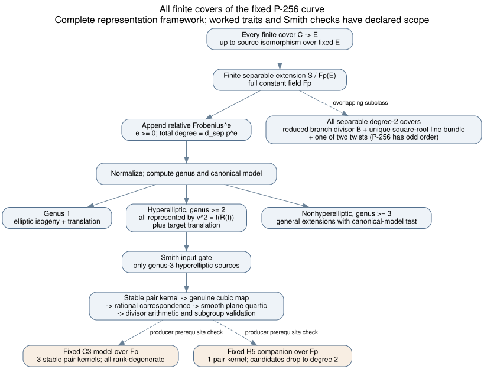

# All-cover classification framework and Smith traits

The user chose an **all-cover framework**, not a bounded finite enumeration.
Read [FRAMEWORK.md](FRAMEWORK.md) or [FRAMEWORK.pdf](FRAMEWORK.pdf).



The framework includes every finite cover of the fixed P-256 curve through
finite function-field extensions and relative Frobenius, modulo isomorphism
over the target. It also gives complete structural descriptions for
hyperelliptic-source covers and for all separable degree-two covers of this
odd-order target. This is representation-level completeness; it does not
claim an implemented general isomorphism-class enumerator. [pcc:unverified]

## Deliverables

- [General trait schema](cover-traits.schema.json): geometry, separability,
  ramification including wild data, monodromy/deck groups, Jacobian traits,
  subgroup transfer, implementation status, and Smith gates.
- [Worked catalogue](catalog.json): seven direct cover representatives,
  three companion curves, and unidentified abelian complements. It is a
  deliberately scoped set of worked records, not the full class of covers.
- [P-256-field Smith prerequisites](results/smith-p256.json) and
  [comparison controls](results/reference-controls.json).
- [Validation record](VALIDATION.md), [source audit/work log](WORKLOG.md),
  and source-only [Lean algebraic row lemma](lean/DegenerateRows.lean).

## Reproduce native correctness checks

With Rust 1.87 or newer, rustfmt and Clippy:

```sh
bash research/p256_genus_dlp_20261115/classification/check.sh
```

The active algorithms are native Rust. The `reference/` wrapper reuses the
existing repository Smith modules unchanged, within their word-size limits,
for small-field controls and two-torsion combinatorics. The wide-field code
uses the earlier study's arbitrary-precision polynomial arithmetic. No
Python research implementation is introduced.

The new checker enumerates all 105 pair partitions for each of the two fixed
models and compares the rational kernel count with enumeration of all 135
two-torsion Lagrangians. It checks actual degree and base points before
labelling a candidate a cubic map. It does not construct a Smith codomain or
implement Proposition 4 for a newly accepted wide-field cubic map.
[pcc:unverified]

PCC records (all unverified): prerequisite outputs `PCC-20261115-cc6d93`,
framework `PCC-20261115-3efc8e`, and execution `PCC-20261115-e200d2`.
No signed theorem or execution verdict is claimed. The broader classifier,
normalizer and complete Smith divisor-map bridge remain implementation
obligations.

## Render

```sh
bash research/p256_genus_dlp_20261115/classification/render.sh
```

Graphviz generates the tracked SVG and a temporary PDF diagram. Pandoc reads
the same Markdown report, with a small image-format filter for pdfLaTeX. No
managed PNG asset is needed for the GitHub view.
