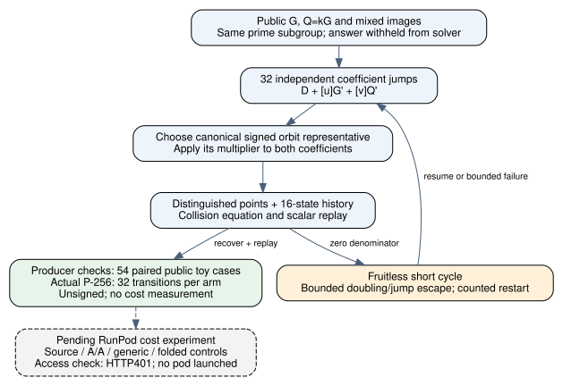

# Implemented result

An independent-increment folded solver now operates on the mixed elliptic
image in $J(C_3)$. It tracks representative multipliers on both collision
coefficients, handles distinguished points and uses bounded short-cycle
escapes. The frozen public panel completes 54 paired source/destination toy
cases, and a bounded actual-P256 trace preserves both coefficient invariants.
This is producer correctness evidence, not signed verification or a runtime
advantage. PCC-20261115-30dcbf. [pcc:unverified]

| User requirement | Current evidence or dependency |
|---|---|
| Continue searching for a transfer speedup | Implemented the missing destination walk mechanics |
| Use RunPod | Job prepared; API read returned HTTP401; access requested |
| Recover logs through the transfer | Complete public toy solves, both arms, replayed |
| Test the actual P-256 construction | 32 transitions per arm with image/coefficient replay |
| Establish net advantage | Open: optimized destination and complete matched cost experiment |
| GitHub PR | Extend the existing transfer-search PR; retain previous frozen evidence |

## Exact scope and identities

The source is NIST P-256, identity
`icv1-fp256-t89188191154553853111372247798585809583-f188c491`, with
$E:y^2=x^3-3x+b$ and its standard prime subgroup order $n$. The destination
is the mixed image inside the Jacobian of
$C_3:z^2=t^7+bt^4+t$, with degree-two cover
$\pi(t,z)=(t+t^{-1},z/t^2)$. The curve itself is not isogenous to a
different-dimensional Jacobian; the existing construction supplies an elliptic
factor and subgroup transport. [pcc:unverified]

Write $\alpha_0=\pi^*$, $\alpha_1=S\alpha_0$ and choose the nontrivial
cubic eigenvalue $\lambda$ modulo $n$. The prior round's map is
$i_\lambda(P)=\alpha_0(P)-\alpha_1([\lambda]P)$, with
$S i_\lambda(P)=[\lambda]i_\lambda(P)$. These identities and the six signed
images are prior evidence, not new proofs in this round. The preceding report
contains the exact $p,b,n,\zeta,\lambda$, map checks and identity receipts.
[pcc:unverified]

\newpage

# What the solver checks

Each state stores $(D,a,c)$ with $D=[a]G'+[c]Q'$. A jump has independently
sampled public coefficients. After addition, canonicalization chooses among
six signed rotations and applies its exact signed eigenvalue to both
coefficients. Nondegenerate equal-key collisions recover the scalar and
replay it in the group. The solver never receives the planted answer.
[pcc:unverified]

{width=80%}

| Field $p$ | Prime subgroup $r$ | Paired public cases | Scalar recovery/replay |
|---:|---:|---:|---|
| 1009 | 109 | 18 | All expected answers |
| 4093 | 823 | 18 | All expected answers |
| 16381 | 4111 | 18 | All expected answers |

Each row has six public scalars and three fixed seeds. These are exact
deterministic fixture outcomes, not a statistical runtime sample; no uncertainty
interval or performance inference is assigned. Raw records: `results/toy.json`.
[pcc:unverified]

The four release tests include invalid input, incorrect representative
multiplier, zero collision denominator and exhausted budget. The public panel
exercises a destination cycle escape. Actual P-256 uses RustCrypto 0.13.2
projective arithmetic as the external source control; its coordinates are
cross-checked against the separate affine backend. `results/trace.json` pins
the actual-field trace digest. Formatting, strict package Clippy and exact
output recomputation pass. These are producer checks. [pcc:unverified]

Short cycles are detected within a 16-state window. Longer fruitless cycles
may reach the ordinary-step cap and return explicit failure. Do not infer
universal termination, uniform mixing or a sixfold population reduction from
this finite fixture panel. The counters exclude unpriced work and are not GAE.

\newpage

# RunPod execution and remaining cost question

The user explicitly selected RunPod, superseding the investigated EKS route.
The repository's RunPod kit documents API authentication through a network
proxy. Its placeholder credential returned HTTP401 here on a read-only pod
listing; this session has no API key or connected browser. No allocation was
attempted and no cloud spend began. `results/runpod-access.json` records that
access check; `runpod/pod-run.sh` is the ready correctness-replay job.

The allocation envelope is one CPU pod, at most four vCPUs, 30GB disk,
30 minutes and USD1 including storage, with prechecked rate and an independent
deadline guard. Fetch evidence and delete the identified allocation on every
exit. Host/container metadata and binary digest are required. Provider choice
does not establish isolation. [pcc:unverified]

The ideal uniform-walk model gives a factor $\sqrt{3}$ fewer collision steps
than a negation-only source walk. Actual advantage still requires destination
addition, folding, coefficient updates, hashing and cycle costs to fit below
that allowance, followed by setup, transport, recovery and answer replay.
No such cost measurement has run. [pcc:unverified]

The next cost experiment must include matched source, source A/A, destination
generic and destination folded controls; identical subgroup/workload identities;
one warmup and at least five interleaved rounds; explicit setup/online/recovery
accounting; independent replay; and admission checks before citing wall time.
The optimized external source adapter is not a claim to be the fastest
available full solver. Full P-256 logarithm recovery is outside the bounded
trace job. No timing or speedup row is added to benchmarks. [pcc:unverified]

## Reproduction, provenance and graph review

Run `bash research/p256_genus_dlp_20261115/folded_walk/check.sh` from the
repository. `sources.sha256` pins the new code and reused research modules;
`results/local-checks.txt` retains the producer execution log. `VALIDATION.md`
details the trust and accounting boundaries. The readable canonical sibling
protocol skill could not be obtained: its GitHub blob is encrypted. No claim
is made that a new cost experiment is preregistered or admitted.

This round builds on Galbraith's primary book section 14.4 (representative
cost and fruitless cycles), the prior transfer-search source review and the
repository's RunPod kit/cloud setup guides. KB wrapper remains unavailable
(status127), with no KB connector or ecdb credentials. No novelty claim is made.

Checked graph scope: the prior cover/isogeny diagrams remain unchanged because
no new isogeny edge is established. This round adds the solver state diagram.
The scoreboards and performance-gain diagrams receive no value or ranking.
