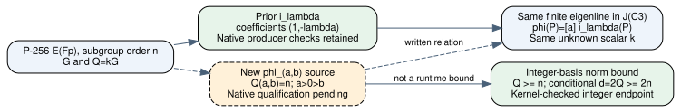

# Result at its checked scope

For the fixed P-256 order $n$ and prior cubic eigenvalue $\lambda$, the compiled
Lean instance proves that every nonzero integer pair satisfying
$b+\lambda a\equiv0\pmod n$ has the following norm bound. [pcc:unverified]

$$Q(a,b)=a^2-ab+b^2\ge n.$$

If a polarization coefficient is supplied as $d=2Q(a,b)$, the endpoint proves
$d\ge2n$. If $Q=n$ and $a>0>b$, it proves $a,-b<2^{128}$. These are integer
theorems. The geometric polarization formula is an explicit input, and
existence of the norm-minimal vector is a separate written argument.
PCC-20261115-9ff011 is unsigned. [pcc:unverified]

The new Rust source implements the coefficient reduction and map. It compiles
and passes strict Clippy; its numerical qualification has **not run**.
Smaller coefficients do not establish cheaper execution or a DLP speedup.
[pcc:unverified]

## The existing map family and the norm proof

The source is P-256, identity
`icv1-fp256-t89188191154553853111372247798585809583-f188c491`.
Use the prior genus-3 cover $C_3:z^2=t^7+b_Et^4+t$ and elliptic pullbacks
$\alpha_0,\alpha_1=S\alpha_0$. Here $b_E$ is the curve constant and $b$ is
an integer coefficient. Consider only
$\phi_{a,b}=\alpha_0[a]+\alpha_1[b]$ in their integer span.
[pcc:unverified]

The prior adjoint matrix is
$H=\left(\begin{smallmatrix}2&-1\\-1&2\end{smallmatrix}\right)$;
$S$ acts as $T(a,b)=(-b,a-b)$. Since $\det H=3$ is invertible modulo $n$,
the two pullbacks of an order-$n$ generator are independent modulo $n$.
Thus finite eigenline equivariance is equivalent to $b+\lambda a=0$; the
second coordinate follows from $\lambda^2+\lambda+1=0$ modulo $n$.
This step uses the prior geometric maps and adjoints. [pcc:unverified]

The integer calculation is

$$Q=a^2(\lambda^2+\lambda+1)
 +(b+\lambda a)\bigl(b-(\lambda+1)a\bigr).$$

Hence $n\mid Q$, while $2Q=(a-b)^2+a^2+b^2>0$. Lean inherits the bound from
`Int.le_of_dvd`. Identity records `IDC1h82e7e46ec2f57561` and
`IDC1h8068f6a8ac2949f7` point to the integer kernel proof; their supplemental
F61 replay is not qualification of the new P-256 map. [pcc:unverified]

The adjoint calculation gives $\phi^\dagger\phi=[2Q]$ and
$\deg(\phi^*\Theta)=2Q$. This is a **pulled-back polarization degree**, not
an elliptic-to-Jacobian isogeny degree or an execution cost. The scalar
endomorphism $[2Q]$ has degree $(2Q)^2$; an embedding has degree one onto its
elliptic image. The geometric bridge is written, not formalized by the integer
endpoint. [pcc:unverified]

\newpage

# Shorter coefficients, the same finite subgroup

For $\omega^2+\omega+1=0$, evaluation $\omega\mapsto\lambda^2$ gives a
surjective map $\mathbb Z[\omega]\to\mathbb F_n$. Its kernel is exactly
$b+\lambda a=0$, because multiplying $a+b\lambda^2$ by $\lambda$ gives
$\lambda a+b$. The kernel ideal has index $n$.

The Eisenstein ring is norm-Euclidean: rounding both quotient coefficients
gives a remainder of norm at most $3/4$ of the divisor norm. The kernel ideal
is therefore principal, and the norm of its generator is its index, $n$.
This standard Eisenstein/GLV argument supplies existence for the stipulated
prime order. It is a written proof; this round does not formalize that ideal
theory or claim novelty. [pcc:unverified]

A unit gives one of six signed rotations. Choose $a>0>b$. For prime $n>3$,
an axis cannot contain a norm-$n$ vector because its norm would be a square.
Then $Q=a^2+a|b|+b^2=n$, so both magnitudes are below $\sqrt n<2^{128}$.
The compiled endpoint proves the coefficient bound conditional on this norm
and sector. Rotation invariance has record `IDC1h0e308c2151b7d837`.
[pcc:unverified]

On the source order-$n$ subgroup,

$$\phi_{a,b}(P)=[a]i_\lambda(P).$$

A nonzero $a\bmod n$ gives the **same finite image subgroup**, scaling both
generator and target together. The recovered DLP scalar is unchanged. The
adjoint recovery multiplier $2a-b$ is nonzero modulo $n$ for this nonzero
eigenline and $n\ne3$. These are written consequences of the prior map, not
new native qualification results. [pcc:unverified]

{width=95%}

A hand-worked example is $n=19$, $\lambda=7$: $(1,-7)$ has $Q=57$;
$(3,-2)$ has $Q=19$ and $-2+7\cdot3=19$. This illustrates the algebra;
it is not an executed fixture or performance measurement. [pcc:unverified]

The bound concerns only this integer two-map family. It does not classify the
full $\operatorname{Hom}(E,J)$, endomorphism-coefficient saturation, other
correspondences, polarizations, genera or extensions. No global cheap
order-three endomorphism of P-256 is constructed. [pcc:unverified]

\newpage

# Implementation, evidence and pending execution

The Rust candidate uses exact Eisenstein Euclid on $(n,\omega-\lambda^2)$,
rejects nondecreasing remainders or a wrong final norm, selects the declared
sector and checks eigenline/scaling/recovery congruences. Its map uses two
signed source scalar multiplications and the existing pullback/rotation/addition
routines. Prime subgroup order is a caller contract. [pcc:unverified]

| Item | Observed status |
|---|---|
| Shared canonical Lean gate | 115 audited, zero failing/trusted native exceptions |
| Study canonical Lean gate | Six audited: four endpoints, two generated constant equations |
| Axioms | Standard foundations only; explicit print-axioms output retained |
| Native candidate | Release build and strict Clippy pass; not executed |
| Planned candidate panel | Orders109,823,4111 and P-256; zero cases executed |
| Supplemental proof artifacts | Three identities serialized/replayed with the unchanged checker |
| RunPod access | HTTP401; no allocation |
| Resume checkpoint | Upload gate failed; missing token/profile/ambient identity |

PCC-20261115-1bf4c0, aa17eb and 9ff011 preserve compile/proof evidence with
unsigned standing. The separate identity serializer imports no new gcd/map
candidate code. It verifies proof artifacts after the kernel proof, not
candidate qualification. `lean4checker` is unavailable. [pcc:unverified]

`AGENTS.md` requires a successful `scripts/checkpoint.sh gate` before experiment
launch and says not to launch if it fails. The saved `RESUME.md`, gate receipt
and immutable `qualification-001/qualifier.sh` retain the pending work. The
qualifier refuses the wrong pod/binary, a reused pre-call record or a failed
checkpoint. RunPod additionally needs authenticated access, an actual rate
check and allocation-specific deadline/deletion guards. No local timing
substitutes for the requested provider.

## What would establish an improvement

First qualify the new coefficient/map code on the unchanged public panel and
replay every answer. Then test whether smaller coefficients reduce actual
transport cost against the strongest applicable implementation. Finally run
the matched source/A-A/generic/folded comparison, charging the full cold
one-target interval: setup, maps, destination arithmetic, canonicalization,
cycles, recovery and source verification. This round establishes neither a
transport speedup nor faster full-size logarithm recovery. [pcc:unverified]

## Sources and graph review

Primary references: Smith arXiv1310.5250 sections1--5; the retrieved
Wang--Ouyang--Li--Hu eprint2021/090 section3 Cornacchia excerpt; the prior
transfer report and adjoint derivation. `SOURCES.md` records versions and
retrieval limits. Shared Lean source f74b0e8, Lean4.35.0 and Mathlibcfc55fc5
are pinned in the manifest. No numerical scaling plot or benchmark row is
added. Existing cover/isogeny and performance graphs retain their values;
the new diagram explains the coefficient family and its restricted bound.
