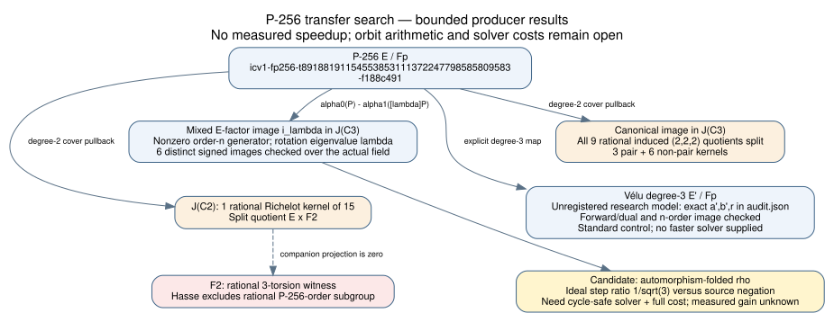

# P-256 transfer search

The previous framework PR #4209 is merged. This follow-on implements a mixed
elliptic-factor image in J(C3) with an order-three action, and tests the
remaining rational two-kernels, Richelot route, companion and a standard
elliptic degree-three control. Read [REPORT.md](REPORT.md) or [REPORT.pdf](REPORT.pdf).



The mixed image is an executable subgroup-preserving candidate. Its signed
orbits have size six, giving a conditional square-root-of-three reduction in
ideal rho steps over negation-only source rho. A net runtime improvement has
not been demonstrated. The cycle-safe solver and complete-cost experiment
remain open; all new claims are unsigned. [pcc:unverified]

Run the native checks from the repository root with Rust >=1.87:

```sh
bash research/p256_genus_dlp_20261115/transfer_search/check.sh
```

The code reuses earlier arithmetic and the existing Smith kernel enumerator;
it modifies neither. Outputs are [audit.json](results/audit.json) and
[identity receipts](results/identities.json). The initial failed elliptic scan
is retained as [invalid initial output](results/initial-scan-invalid-elliptic.json);
its root factor was a Bezout coefficient and must not be used as a result.

See [protocol](PROTOCOL.md), [proof map](PROOF_MAP.md), [validation](VALIDATION.md)
and [work log](WORKLOG.md). No canonical catalogue or benchmark row is promoted.
