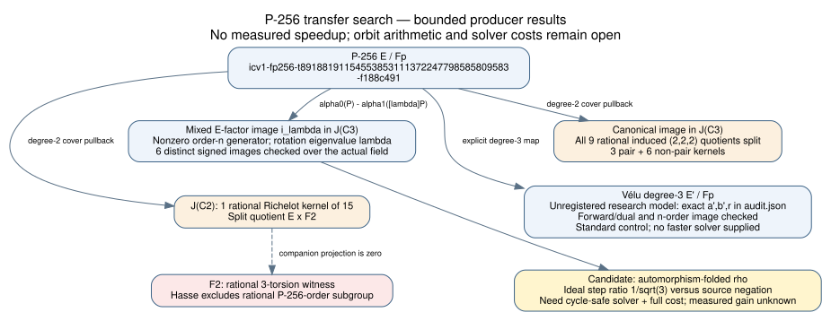

# Result and requested outcome

This round implements a mixed elliptic-factor transfer into the existing
genus-3 Jacobian. Its order-$n$ image is stable under an order-three
automorphism and has six distinct signed orbit points. The actual P-256-field
checks support the map, subgroup order, additivity and eigenvalue relation.
There is **no demonstrated runtime speedup**: the cycle-safe quotient solver
and matched complete-cost comparison are missing. The user's speedup objective
remains open. [pcc:unverified]

Other results close the six non-pair two-torsion kernels left open by the
framework's Smith audit, identify the sole rational Richelot kernel of $C_2$,
exclude the elliptic companion $F_2$ as a rational order-$n$ destination, and
implement a standard degree-three elliptic Vélu transfer as a control.
These are bounded producer results, not independently signed verdicts.
[pcc:unverified]

Fix the standard P-256 $E:Y^2=X^3-3X+b$ over $k=\mathbb F_p$, with prime
order $n$ and standard generator $G$. Its registered identity is
`icv1-fp256-t89188191154553853111372247798585809583-f188c491`.
Exact field, coefficients, points and new target models are in the native
output [audit](results/audit.json), bound to the earlier study's parameters.
New targets are research models; no uncomputed catalogue UID is invented.

# 1. Mixed image with an order-three action

On $C_3:z^2=t^7+bt^4+t$, choose a nontrivial cube root $\zeta\in k$ and put

$$\rho(t,z)=(\zeta t,\zeta^2z),\qquad S=\rho^*.$$

Let $\alpha_0=\pi_0^*:E\to J(C_3)$ for
$\pi_0(t,z)=(t+t^{-1},z/t^2)$, and $\alpha_1=S\alpha_0$,
$\alpha_2=S^2\alpha_0$. The elliptic maps are
$\pi_i(t,z)=(\zeta^it+\zeta^{-i}/t,z/t^2)$. Their adjoint matrix is

$$ \alpha_i^\dagger\alpha_j=
\begin{cases}[2]&i=j,\\ \left[-1\right]&i\ne j.\end{cases}
\qquad \alpha_0+\alpha_1+\alpha_2=0. $$

For the off-diagonal identity, the two points in a $\pi_j$ fiber map under
$\pi_i$ to the other two intersections of the horizontal line $Y=Y(P)$
with $E$. Their sum is $-P$. The infinity fiber maps to the origin.
The diagonal identity is norm after pullback. The sum relation follows from
this matrix and positivity of the induced elliptic polarization; the native
checks also test it on the actual-field generator. [pcc:unverified]

The ordinary image $\alpha_0(E(k))$ is not $S$-stable. If
$S\alpha_0(G)=[c]\alpha_0(G)$, the two norms give $2c=-1$ and $-c=2$,
forcing $3=0\bmod n$. The code rejects the proposed scalar $c=-1/2$ by
comparing actual divisors. [pcc:unverified]

Since $n\equiv1\pmod3$, choose $\lambda\ne1$ with
$\lambda^2+\lambda+1=0\bmod n$. The different transfer is

$$ i_\lambda(P)=\alpha_0(P)-\alpha_1([\lambda]P),\qquad P\in E(k). $$

Then $S i_\lambda(P)=[\lambda]i_\lambda(P)$ on this finite subgroup, and
$\pi_{0*}i_\lambda(P)=[2+\lambda]P$. The multiplier is nonzero modulo $n$:
if $\lambda=-2$, its defining polynomial would give $3=0$. Thus the transfer
is injective. Both inputs $G,Q$ can be mapped without the unknown logarithm.
A destination answer is the same scalar modulo $n$ and is checked on $E$.
The new code does not implement a general norm on arbitrary divisors; scalar
recovery does not require that pointwise inverse. [pcc:unverified]

For a Mumford divisor $(U,V)$ of degree $d$, $S$ replaces
$U(t)$ by $\zeta^{2d}U(\zeta t)$ and $V(t)$ by $\zeta V(\zeta t)$.
The native test checks the curve, image order $n$, rotation eigenvalue,
additivity, public scalars $0,1,2,37$, and six distinct signed orbit points.
The universal rotation identity has receipt `IDC1hd993e7fd3ec553aa`.
[pcc:unverified]

This is a finite-subgroup eigenline construction, not a new elliptic
endomorphism of order three. The integer $\lambda$ satisfies its equation
modulo $n$, not over $\mathbb Z$. The same algebra exists in $E\times E$,
with matrix $(P,Q)\mapsto(-Q,P-Q)$ and eigenvector $(P,-[\lambda]P)$.
No curve-specific trapdoor or novelty is claimed. [pcc:unverified]

# 2. The exact speedup gate

Under an ideal uniform quotient-walk heuristic, signed orbits have size six
instead of the source's negation orbits of size two. Expected collision steps
would decrease by $\sqrt3$, a constant factor. This is a model, not an
execution result or a changed exponent. Short cycles, canonicalization and
coefficient tracking must be handled by an actual solver. [pcc:unverified]

There is a concrete degenerate walk to avoid: $D+SD=-S^2D$ and
$D+S^2D=-SD$. After signed-orbit canonicalization these steps do not leave
the current orbit. Both equalities are checked on the actual image. A future
solver needs independent increments and explicit cycle handling, not only
endomorphism-addition steps. [pcc:unverified]

Let $W$ be the matched source walk's expected step count, $c_E$ its total
step cost and $c_J$ the destination addition, folding, hashing and cycle cost.
The conditional comparison is

$$T_E=T_{E,\mathrm{setup}}+Wc_E+T_{E,\mathrm{verify}},$$
$$T_J=T_{J,\mathrm{setup}}+T_{\mathrm{transport}}
       +\frac{W}{\sqrt3}c_J+T_{\mathrm{recover}}+T_{J,\mathrm{verify}}.$$

Ignoring only setup for a preliminary screen requires
$c_J<\sqrt3\,c_E$. A complete claim must use the full expressions.
The componentwise $E\times E$ control uses two elliptic additions per product
addition. Even if folding were free, its count model costs $2/\sqrt3$ source
addition units per matched unit of search, rather than beating one. This is
an addition-count comparison, not a wall-time lower bound for optimized
Jacobian code or a proof that every implementation loses. [pcc:unverified]

No destination solver, isolated timing or paired complete solve is supplied.
The present arbitrary-precision Cantor code is a correctness backend, not an
optimized alternative to a specialized P-256 implementation. Missing cost
data remain null. Direct AWS access is absent; the documented GitHub EKS
route must be checked for a concrete benchmark before declaring infrastructure
unavailable. No spend or benchmark was launched. [pcc:unverified]

# 3. All nine canonical two-isogeny quotients of the fixed C3 split

The earlier audit found three rational pair kernels and six rational non-pair
Lagrangians. This round enumerates all 135 geometric Lagrangians, retains the
nine Frobenius-stable ones, and tests the elliptic planes
$W_i=\alpha_i(E[2])$. Every retained kernel contains exactly one $W_i$.
The table and bitmasks are retained in the audit output. [pcc:unverified]

The plane comes directly from branch fibers: pair $\{0,\infty\}$ with each
of the other three pairs for $\pi_i$, producing the three nonzero even
four-subsets modulo complement. It is isotropic because the elliptic
polarization degree is two. The native implementation checks closure,
isotropy, stability, containment and invariance under relabeling. A generic
uncovered geometric kernel is retained as a negative control, so containment
is not asserted for all 135. [pcc:unverified]

**Polarization argument.** Write $A=J(C_3)/K$ with its induced principal
polarization, and $\phi^*\lambda_A=2\lambda_J$. Pullback $\alpha_i$ is an
elliptic embedding: a nontrivial kernel would give an etale intermediate
degree-two cover of $E$, contradicting the branched genus-3 cover.
If $W_i\subset K$, then
$\ker(\phi\alpha_i)=E[2]$, so $\phi\alpha_i=\beta[2]$ for an elliptic
embedding $\beta:E\to A$. Pulling back polarizations gives

$$[2]^*\beta^*\lambda_A
 =\alpha_i^*\phi^*\lambda_A=4\lambda_E,
 \quad\text{hence}\quad\beta^*\lambda_A=\lambda_E.$$

Thus $\beta^\dagger\beta=1$. The idempotent
$\beta\beta^\dagger$ splits $A$ as the principally polarized product
$E\times B_2$. It cannot be the canonical Jacobian polarization of a smooth
genus-3 curve. In particular, the six non-pair kernels do not rescue the
one-step canonical $(2,2,2)$ route. This does not exclude repolarizations,
other-degree isogenies, extensions or other source curves. [pcc:unverified]

Moreover $\phi^\dagger\beta=\alpha_i$, so the principal elliptic projection
of $\phi\alpha_0(P)$ is $[2]P$ if $i=0$, and $-P$ otherwise. The P-256
subgroup survives in that elliptic factor. Smith Proposition 5's
absolute-simplicity hypothesis cannot be dropped here. [pcc:unverified]

# 4. Genus-two companion and elliptic escape

For $C_2:z^2=t^6-3t^2+b$, the actual sextic is irreducible. Of all 15
geometric Richelot kernels, only the antipodal pairing is rational. Its
quadratics $t^2-r_i^2$ have zero middle column, giving the split quotient
$E\times F_2$, rather than a new genus-2 Jacobian. [pcc:unverified]

The companion $F_2:v^2=u^3-3u^2+b^2$ becomes
$y^2=x^3-3x+(b^2-2)$ after $u=x+1$. The output includes a rational point
of exact order three, with $[3]T=O$ checked natively. Since $3\nmid n$ and
the Hasse upper bound is below $3n$, $F_2(k)$ cannot have order divisible by
$n$. Its trace is $2\bmod3$, while P-256's is $1\bmod3$. This excludes
both a rational order-$n$ subgroup and a nonzero same-field elliptic
homomorphism, without computing the full companion order. [pcc:unverified]

As a separate executable control, take the rational kernel abscissa $r$ of
$\psi_3=3x^4+6ax^2+12bx-a^2$, where $a=-3$. Put

$$v=2(3r^2+a),\quad w=4(r^3+ar+b),\quad
a'=a-5v,\quad b'=b-7(w+rv).$$

The normalized Vélu map is

$$x'=x+\frac v{x-r}+\frac w{(x-r)^2},\qquad
y'=y\left(1-\frac v{(x-r)^2}-\frac{2w}{(x-r)^3}\right).$$

The dual applies the same formula on $E'$ at $-3r$, then divides coordinates
by $9,27$. The code checks both curve identities, composition $[3]$, a
nonzero order-$n$ generator image, additivity and scalar recovery. Its
universal cleared identity has receipt `IDC1hc0e497b17f3308e4`; the exact
actual-field coefficient identity is checked separately. The target has
order $n$ by the image-order witness and Hasse. Its coefficient cannot be
scaled to $-3$ over this field: the required fourth power is a nonsquare.
This supplies a valid standard transfer, not a faster destination solver.
The repository already recorded this degree-three edge's existence.
[pcc:unverified]

# Validation, source and proof boundaries

Four release tests, formatting, strict new-package Clippy and two saved-output
comparisons passed. Small-field controls over $7,13,19,31$ exhaust all point
addition pairs on the selected nonsingular curves, including the origin,
kernel and invalid-input controls. Initial elliptic output used the wrong
extended-gcd tuple element; the map constructor rejected it. The failed
scan is explicitly retained and excluded from the results. [pcc:unverified]

The Rust inputs, lockfile, raw checks, exact outputs, identity receipts and
source hashes make this bounded round reproducible. Lean lemmas for the
finite incidence table and the universal Vélu polynomial are source-only:
Lean/Lake/Mathlib are unavailable. They do not formalize Jacobians,
polarization splitting or the full transfer. See the proof map. No signed
geometric or execution proof is claimed. [pcc:unverified]

Sources checked: Smith [arXiv:0806.2995](https://arxiv.org/abs/0806.2995),
sections 3--8; the existing repository Smith and P-256 walk/Vélu modules;
and Galbraith's primary [ECC 2012 slides](https://www.math.auckland.ac.nz/~sgal018/ECC2012.pdf),
pages 15--17, for orbit walks and short-cycle cautions.
Galbraith's primary [book](https://www.math.auckland.ac.nz/~sgal018/crypto-book/main.pdf),
Theorem 14.4.3 and section 14.4.2, was also read for its explicit
group-operation plus representative-cost model and cycle handling.
The IACR copy of
Galbraith--Ruprai's PKC 2010 paper returned 403; its abstract is not used
as a full-group runtime bound. No novelty claim follows from this targeted
review. KB unavailable (no MCP/catalog, wrapper exit 127); ecdb is unavailable
without its token/AWS identity. Sources and proof scope are in PROTOCOL.md.

The next discriminating task is a cycle-safe folded solver and a matched
component/full-route experiment against the strongest source implementation.
Until then, the surviving eigenline is an implemented candidate with an
unpriced cost gate. The broader search remains open. [pcc:unverified]
