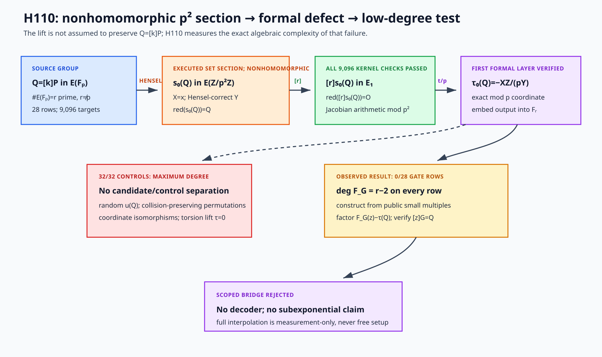

# H110 — canonical \(p^2\)-lift defect cocycle

Date frozen: 2026-11-01



Editable vector source: [`h110-p2-lift-defect-flow.svg`](figures/h110-p2-lift-defect-flow.svg).

## Requirement-to-evidence contract

- **Mechanism-new relative to H88--H109:** measure the formal-group defect of
  a deterministic Hensel section into `E(Z/p^2 Z)`; do not add another
  character, theta word, cover, extension-field phase, or division-polynomial
  feature family.
- **Transfer audit:** the Hensel section is a set-theoretic section, not a group
  homomorphism.  The experiment must separately check lift existence,
  specialization, subgroup order, kernel membership, and the formal parameter.
- **Measurement:** use all seven retained prime-order curves, generator
  relabelings `1,2,3,5`, and every nonzero target.  Charge lift construction,
  projective group operations, interpolation, root search, verification,
  memory, and advice.
- **Controls:** randomized Hensel sections, collision-preserving output
  permutations, coordinate-isomorphic models, and the unique torsion-lift
  correction, plus generic square-root references.
- **Proof:** Lean must prove the abstract section-defect transport identity,
  certificate-to-candidate implication, EC-verified recovery, and the
  conditional total-cost composition actually used by any claim.
- **PR:** the canonical and paired reference PRs must be open in draft before
  the frozen cohort is executed.

## Typed correspondence

Let

```text
E/F_p : y^2 = x^3 + a*x + b,
#E(F_p) = r,    r odd prime,    r != p.
```

The source is the prime-order group `E(F_p)=<P>`.  The destination is not a
replacement group: it is the first formal-neighborhood layer in
`E(Z/p^2 Z)`.  Reduction gives the exact-sequence fragment

```text
E_1(Z/p^2 Z) --> E(Z/p^2 Z) --red--> E(F_p).
```

For a finite point `Q=(x,y)`, use least nonnegative integer representatives and
define the canonical coordinate section `s_0` by fixing `X=x`.  Write

```text
c_Q = (x^3 + a*x + b - y^2) / p  (mod p),
v_0 = c_Q / (2*y)                 (mod p),
s_0(Q) = (x, y + p*v_0)           (mod p^2).
```

More generally, a section parameter `u in F_p` uses

```text
X = x + p*u,
v_u = (c_Q + (3*x^2+a)*u) / (2*y)  (mod p),
Y = y + p*v_u.
```

This is a Hensel lift of `Q`, not a homomorphic lift.  Since `[r]Q=O`, the
point `[r]s_u(Q)` lies in the reduction kernel.  In Jacobian coordinates
`(X_r:Y_r:Z_r)` define

```text
t([r]s_u(Q)) = -X_r*Z_r/Y_r       (mod p^2),
tau_u(Q) = t([r]s_u(Q))/p          (mod p).
```

The formal logarithm is `t + O(t^2)`, and `t^2=0 mod p^2` on this first layer.
Thus `tau_u` is the exact first-layer formal logarithm coordinate.

The correspondence is therefore

```text
Q in E(F_p) --set section s_u--> E(Z/p^2 Z)
  --[r]--> E_1(Z/p^2 Z) --t/p--> F_p.
```

Only reduction and multiplication are group maps.  The section and the
composite `tau_u` are not assumed additive.

## Frozen algorithmic hypothesis

For a generator `G`, form the exact word

```text
w_G(k) = integer representative of tau_0([k]G),  1 <= k < r,
```

and embed its values into `F_r`.  Let `F_G(z)` be the unique polynomial of
degree `< r-1` over `F_r` satisfying `F_G(k)=w_G(k)`.

The H110 prediction is that the canonical section defect has degree

```text
deg(F_G) <= D(r) = ceil(log2(r))^2
```

on every frozen row, while matched controls do not.  If so, the first
`D(r)+1` public small multiples construct `F_G`; given a target `Q`, compute
`tau_0(Q)`, factor `F_G(z)-tau_0(Q)` over `F_r`, and retain the unique root
whose scalar multiple equals `Q`.  At most `D(r)` EC validations are charged.

For the bounded experiment, enumerate all roots in `F_r`; this is a toy
verification route, not the claimed asymptotic recovery routine.  A positive
algorithmic result additionally requires a proved polynomial-factorization
bound and a uniform theorem establishing the degree bound.

## Frozen cohort and controls

1. Run curves E101, E127, E149, E211, E283, E503, and E907, generator
   multipliers `1,2,3,5`, and every `1 <= k < r`.
2. Check the lifted curve equation modulo `p^2`, reduction to `[k]G`, the
   projective curve equation for `[r]s_u(Q)`, reduction to identity, divisibility
   of the formal parameter by `p`, and agreement with a separately composed
   affine/formal calculation wherever affine denominators are units.
3. Compute the complete interpolation degree, the frozen prefix certificate,
   collision multiplicities, root counts, operation counts, and all ties.
4. On each of primary E101 and E127, run eight deterministic random-section
   controls `u_seed(Q)` and eight collision-preserving random permutations of
   the canonical output word.  These 32 controls receive the identical degree
   calculation and gate.
5. On the primary generators, repeat the canonical word after the coordinate
   isomorphism

   ```text
   (x,y,a,b) -> (lambda^2*x, lambda^3*y, lambda^4*a, lambda^6*b)
   ```

   with the least `lambda>1` in `F_p`; report whether the exact degree is
   invariant.
6. For every target, use `u=0` and `u=1` to solve the first-layer linear
   correction that makes `tau_u(Q)=0`, then directly check the resulting
   torsion lift.  This is a structural control: the homomorphic torsion section
   kills the proposed observable and does not itself solve ECDLP.
7. Execute the root/EC decoder only for rows meeting `deg(F_G)<=D(r)`.

Stopping is exhaustive over the frozen matrix.  Any lift, reduction, kernel,
formal-parameter, section-linearity, interpolation, root, or EC mismatch
invalidates the run.

## Cost and promotion gates

Report

```text
C_total = C_lift + C_[r] + C_interpolation
        + C_factor_or_root + C_EC_verify + C_checks.
```

Units are modular additions/multiplications/inversions modulo `p^2` and `p`,
Jacobian additions/doublings, interpolation field operations over `F_r`, roots,
EC validations, stored field elements, and advice coefficients.  No
fixed-generator table may be omitted from cost.

H110 qualifies as a generic subexponential algorithm only if:

1. every generic row has an exact degree at most `D(r)` under a public rule;
2. the canonical section and defect are computable in `poly(log p,log r)`;
3. polynomial construction and factorization, recovery, verification, setup,
   memory, and advice satisfy a proved subexponential total bound;
4. the degree theorem is uniform, not learned from the full scalar word;
5. Lean proves the interfaces and cost composition used by the claim.

The frozen full interpolation is a measurement instrument.  Its linear or
quadratic work cannot be counted as the proposed algorithm.

## Prior-art boundary

The bounded screen located:

- Smart, [“The Discrete Logarithm Problem on Elliptic Curves of Trace
  One”](https://doi.org/10.1007/S001459900052), for the anomalous `r=p` case;
- Huang, Kueh, and Tan, [“Lifting Elliptic Curves and Solving the Elliptic
  Curve Discrete Logarithm Problem”](https://doi.org/10.1007/10722028_22);
- Silverman, [“Lifting and Elliptic Curve Discrete
  Logarithms”](https://doi.org/10.1007/978-3-642-04159-4_6), especially the
  failure of arbitrary local nontorsion lifts to preserve `Q=[k]P` and the
  unique prime-to-`p` torsion lift;
- Yasuda, [“The Elliptic Curve Discrete Logarithm Problems over the p-adic
  Field and Formal Groups”](https://doi.org/10.1007/978-3-642-12827-1_9).

Those sources make lifting itself established prior art and identify the
relation-preservation obstruction.  The bounded screen did not locate this
specific complete test of the canonical section's first-layer defect as a
uniform low-degree scalar polynomial.  Status at freeze: mechanism-distinct
within this repository; external novelty not established.

## Preregistered interpretation

- A degree above `D(r)` rejects only the frozen canonical-section polynomial
  bridge.
- A low degree on toy rows is not a generic theorem or speedup.
- Random-section-like behavior indicates coordinate-section structure rather
  than an EC-specific scalar oracle.
- The torsion-lift zero control cannot be promoted into a formal-log attack:
  its formal observable is identically zero.

## Executed experiment

The paired draft gates were opened as
[isogeny-labs/crypto#3111](https://github.com/isogeny-labs/crypto/pull/3111)
and
[isogeny-labs/cryptanalysis#1346](https://github.com/isogeny-labs/cryptanalysis/pull/1346)
before implementation.  The frozen coefficient section, cohort, controls, and
stopping rule were not changed.

Every one of the 9,096 canonical target records passed:

- the Hensel-lift curve equation modulo `p^2` and reduction back to `Q`;
- two independently split computations of `[r]s_0(Q)`;
- the projective curve equation, reduction-kernel check, unit-`Y` check, and
  divisibility of the formal parameter by `p`;
- nonzero first-layer section slope from `u=0` and `u=1`;
- direct reevaluation of the solved torsion correction, with `tau_u(Q)=0`.

The evaluator executed 36,384 lift constructions, mixed kernel additions, and
formal extractions.  The canonical rows used 72,768 scalar multiplications,
296,560 affine additions, 521,064 affine doublings, 6,456,536 counted modular
additions, 7,820,632 modular multiplications, and 890,392 inversions.  The
recorded canonical evaluation and interpolation portions took 2.4371 s and
0.3836 s, respectively; these are diagnostic container timings, not isolated
benchmarks or scaling evidence.

The algorithmic prediction failed on every row.  For `r-1` sampled scalar
positions the largest possible interpolation degree is `r-2`, and every one
of the 28 candidate rows attained it:

```text
curve  r    observed degree (all four generators)  frozen gate
E101   83   81                                      49
E127   109  107                                     49
E149   139  137                                     64
E211   223  221                                     64
E283   281  279                                     81
E503   499  497                                     81
E907   947  945                                     100
```

The candidate values had maximum collision buckets of four or five, so the
failure is not merely a constant word.  The gate-limited Newton prefixes
matched only 50--103 targets per row, close to their available coefficient
counts and far from exactness.

All eight random-section and all eight collision-preserving permutation
controls on each of E101 and E127 also had maximum degree: 81 and 107,
respectively.  Coordinate-isomorphic canonical words were byte-distinct from
the originals but retained those same maximum degrees.  Thus no control
separated from the candidate and zero root/EC decoders opened.

A second complete run reproduced scientific-content SHA-256
`3397823fe3f55fe008797bb87b31324b7ae33efb5699fe479e8e58f5832db4de`.
An independently composed standard-library verifier recomputed all Hensel and
group arithmetic, all 28 degrees, all 32 matched controls, and the two
coordinate-isomorphic controls.  The committed result SHA-256 is
`7d6c390d0156a4ed101bddd0969132a85505fa884282ef505dc4621b7852124e`.
Lean 4.19 proves the abstract section-defect transport, torsion-correction,
verified-candidate, uniqueness, and total-cost interfaces.  It does not prove
the rejected low-degree hypothesis.

Result: the first formal layer is executable and structurally well checked,
but the coordinate-fixed section defect is maximally complex under the frozen
scalar-polynomial representation.  This closes H110's proposed bridge.  It
does not rule out other lift-derived invariants or establish a generic ECDLP
lower bound.

