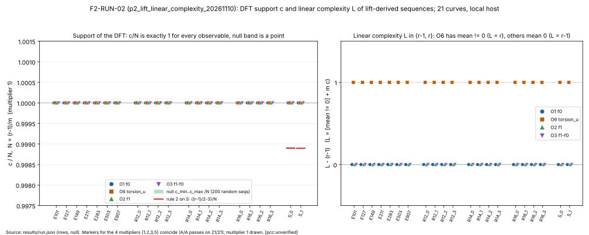
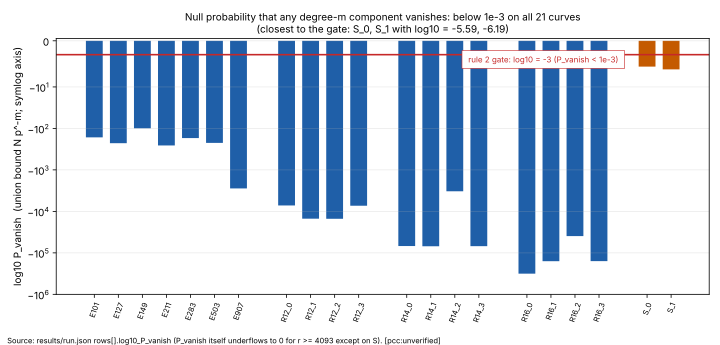

# F2: linear complexity and DFT support of sequences derived from the p²-lift of a prime-field curve

**Status:** closed by decision rule 3 (run F2-RUN-02 complete; no replication is prescribed by rule 3). Evidence standing: **local evidence; §9a confirmatory EKS run open.** Every number in this file is `[pcc:unverified]` (no pcc claim id exists for this run). No improvement over rho, or over anything, is claimed.

**Class:** boundary diagnostic; exact integer computation, no S pipeline row, no rho row, no leaderboard change.

## Question

Follow-up to `research/p2_lift_defect_20261101/` (H110), which closed only the frozen coordinate-section scalar-polynomial bridge. Is `c(f₀)` (and `c(torsion_u)`) below the null on any curve, where `c` is the number of nonzero degree-`m` components of the DFT of `a_k = f([k]G)` over `F_(p^m)` (`m = ord_r(p)`, `L = [mean ≠ 0] + m·c`, `N = (r−1)/m`) and the null is a uniformly random `r`-periodic sequence over `F_p`? Mechanism and the identity `τ₀ = r·f` are in `PROTOCOL.md` §0 (Blahut's theorem, standard, not formalized). Full design, predictions P1–P5 and rules: `PROTOCOL.md` (sha256 `a9e727d2…185ebb`, frozen 2026-11-10 before any sequence was computed).

## What was run

- **Card** `cards/F2-RUN-02.json` (`CARD-p2-lift-linear-complexity-20261110-F2-RUN-02`), sha256 `8dbad5d02c190f8196c17684e8ed59bbd5c8fd009f61c1b863afc1d4ae05bd1a`; receipt `cards/receipts/F2-RUN-02.receipt.json`: status completed, 13 commands, each one attempt, exit 0. Pinned head `9465664dbe6ba5757b9cb011192215a00605e8d8`. Command: `p2_lift_linear_complexity --protocol PROTOCOL.md --null 200 --out results/run.json` (all sets, multipliers {1,2,3,5}, 200 null sequences per curve).
- **Host and route:** local in the container (4 CPUs, x86_64, Linux 6.18.44-fc-v378, rustc 1.97.0), run by the main session through a nohup supervisor; started 2026-11-11T19:39Z, finished 2026-11-12T01:25:38Z (20,761.7 s). **Tier deviation (recorded):** the card names `executor-mechanical`, which was rate-limited, so the main session ran the frozen card itself. The §9a isolab-eks confirmatory run (PROTOCOL §9: submit the same binary and diff byte for byte) is open; until it lands the standing is local evidence.
- **Loss record:** F2-RUN-01 (started 2026-11-10T18:05:27Z, pid 4981) was lost to a container restart with no exit record; `benchmarks/losses/20261111-card-p2-lift-linear-complexity-20261110-f2-run-01-11-run-full.json`; relaunched as F2-RUN-02. `results/run.stdout.txt` and `results/run.stderr.txt` (empty) belong to RUN-01 and are not evidence.
- **Rows:** 21 curves (H: 7 curves `E101…E907`; R12, R14, R16: 4 each; S: 2 supersingular, `m = 2`) × 4 multipliers × 4 observables (O1 `f₀`, O6 `torsion_u`, O2 `f₁`, O3 `f₁−f₀`) = 336 rows; plus the empirical null (200 sequences per curve), the O5 plant on S and the A/A checks. `fatal` is empty.

## Results `[pcc:unverified]`

Source of every number: `results/run.json` (sha256 `21591ebbafaea0477b4aeb7cd2fdb9caae00c6c7f77902373e90e5332340bf1e`; rows, null, plant, aa_checks, summary). Cells `L/c` are for multiplier 1; the other multipliers give identical `(L, c)` (A/A). `c/N` is 1.0 for all four observables. `log10 P_vanish` is the recorded union bound `N·p^(−m)` (the linear value underflows to 0 for most curves; the `log10` field is used).

**Self-checks (every one of 336 rows):** `c` integer, two `τ₀` splits agree, `τ(torsion_u) = 0`, and on O1 `L7 = L − [mean ≠ 0]` (84 rows); all true.

**P1, P2, P3 (hold):** on all 21 curves every observable O1, O6, O2, O3 has `c = N = (r−1)/m` exactly and `L ∈ {r−1, r}` (O1, O2, O3: mean 0, `L = r−1`; O6: mean ≠ 0, `L = r`). On S (`m = 2`): `c = (r−1)/2 = 2724` (S_0) and `2715` (S_1) for all four observables.
**P4 (holds):** plant O5 gives `L = 2`, `c = 1` on S_0 and S_1; O7 (`L7 = L − [mean≠0]`) true on every O1 row.
**P5 (holds):** A/A identical `(L, c)` across multipliers {1,2,3,5} on 21 of 21 curves.
**Empirical null:** 0 of 4,200 random sequences has `c < N` on any curve; `c_min = c_max = N` on every curve (e.g. S_0: all 200 at `c = 2724`; R14_2: all 200 at `c = 21`).

### H (7 curves of H110)

| curve | p | r | m | N=(r-1)/m | O1 L/c | O6 L/c | O2 L/c | O3 L/c | c/N (all 4) | A/A | null c range (200) | log10 P_vanish |
|---|---|---|---|---|---|---|---|---|---|---|---|---|
| E101 | 101 | 83 | 82 | 1 | 82/1 | 83/1 | 82/1 | 82/1 | 1.0 | pass | 1..1 | -164.35 |
| E127 | 127 | 109 | 108 | 1 | 108/1 | 109/1 | 108/1 | 108/1 | 1.0 | pass | 1..1 | -227.21 |
| E149 | 149 | 139 | 46 | 3 | 138/3 | 139/3 | 138/3 | 138/3 | 1.0 | pass | 3..3 | -99.49 |
| E211 | 211 | 223 | 111 | 2 | 222/2 | 223/2 | 222/2 | 222/2 | 1.0 | pass | 2..2 | -257.69 |
| E283 | 283 | 281 | 70 | 4 | 280/4 | 281/4 | 280/4 | 280/4 | 1.0 | pass | 4..4 | -171.02 |
| E503 | 503 | 499 | 83 | 6 | 498/6 | 499/6 | 498/6 | 498/6 | 1.0 | pass | 6..6 | -223.45 |
| E907 | 907 | 947 | 946 | 1 | 946/1 | 947/1 | 946/1 | 946/1 | 1.0 | pass | 1..1 | -2797.90 |

### R12

| curve | p | r | m | N=(r-1)/m | O1 L/c | O6 L/c | O2 L/c | O3 L/c | c/N (all 4) | A/A | null c range (200) | log10 P_vanish |
|---|---|---|---|---|---|---|---|---|---|---|---|---|
| R12_0 | 4093 | 3989 | 1994 | 2 | 3988/2 | 3989/2 | 3988/2 | 3988/2 | 1.0 | pass | 2..2 | -7202.11 |
| R12_1 | 4093 | 4153 | 4152 | 1 | 4152/1 | 4153/1 | 4152/1 | 4152/1 | 1.0 | pass | 1..1 | -14997.20 |
| R12_2 | 4093 | 4177 | 4176 | 1 | 4176/1 | 4177/1 | 4176/1 | 4176/1 | 1.0 | pass | 1..1 | -15083.89 |
| R12_3 | 4093 | 4049 | 2024 | 2 | 4048/2 | 4049/2 | 4048/2 | 4048/2 | 1.0 | pass | 2..2 | -7310.47 |

### R14

| curve | p | r | m | N=(r-1)/m | O1 L/c | O6 L/c | O2 L/c | O3 L/c | c/N (all 4) | A/A | null c range (200) | log10 P_vanish |
|---|---|---|---|---|---|---|---|---|---|---|---|---|
| R14_0 | 16381 | 16253 | 16252 | 1 | 16252/1 | 16253/1 | 16252/1 | 16252/1 | 1.0 | pass | 1..1 | -68491.46 |
| R14_1 | 16381 | 16453 | 16452 | 1 | 16452/1 | 16453/1 | 16452/1 | 16452/1 | 1.0 | pass | 1..1 | -69334.33 |
| R14_2 | 16381 | 16339 | 778 | 21 | 16338/21 | 16339/21 | 16338/21 | 16338/21 | 1.0 | pass | 21..21 | -3277.43 |
| R14_3 | 16381 | 16363 | 16362 | 1 | 16362/1 | 16363/1 | 16362/1 | 16362/1 | 1.0 | pass | 1..1 | -68955.04 |

### R16

| curve | p | r | m | N=(r-1)/m | O1 L/c | O6 L/c | O2 L/c | O3 L/c | c/N (all 4) | A/A | null c range (200) | log10 P_vanish |
|---|---|---|---|---|---|---|---|---|---|---|---|---|
| R16_0 | 65521 | 65843 | 65842 | 1 | 65842/1 | 65843/1 | 65842/1 | 65842/1 | 1.0 | pass | 1..1 | -317120.13 |
| R16_1 | 65521 | 65957 | 32978 | 2 | 65956/2 | 65957/2 | 65956/2 | 65956/2 | 1.0 | pass | 2..2 | -158834.30 |
| R16_2 | 65521 | 65497 | 8187 | 8 | 65496/8 | 65497/8 | 65496/8 | 65496/8 | 1.0 | pass | 8..8 | -39430.80 |
| R16_3 | 65521 | 65701 | 32850 | 2 | 65700/2 | 65701/2 | 65700/2 | 65700/2 | 1.0 | pass | 2..2 | -158217.80 |

### S (supersingular, `m = 2`, `p ≡ 2 mod 3`, `#E = p+1`)

| curve | p | r | m | N=(r-1)/m | O1 L/c | O6 L/c | O2 L/c | O3 L/c | c/N (all 4) | A/A | null c range (200) | log10 P_vanish |
|---|---|---|---|---|---|---|---|---|---|---|---|---|
| S_0 | 32693 | 5449 | 2 | 2724 | 5448/2724 | 5449/2724 | 5448/2724 | 5448/2724 | 1.0 | pass | 2724..2724 | -5.59 |
| S_1 | 65171 | 5431 | 2 | 2715 | 5430/2715 | 5431/2715 | 5430/2715 | 5430/2715 | 1.0 | pass | 2715..2715 | -6.19 |

S_0: `p = 32693`, `r = 5449`, `#E = p+1 = 32694`, cofactor 6; S_1: `p = 65171`, `r = 5431`, `#E = 65172`, cofactor 12. Rule-2 threshold on S: `(r−1)/2 − 3 = 2721` (S_0), `2712` (S_1); measured `c = 2724`, `2715`, i.e. 3 above the threshold and equal to `(r−1)/2`. `log10 P_vanish`: −5.59 (S_0, 2.55e-6), −6.19 (S_1, 6.39e-7).

### Summary block (generated by `figures/plot.py` from `results/run.json`; numbers, not verdicts)

```
summary (numbers, not verdicts):
  rows: 336 (21 curves x 4 multipliers x 4 observables); fatal: []
  self-checks all true on every row: True
  c == N on all 84 rows of O1: True; rows with c != N: 0
  c == N on all 84 rows of O6: True; rows with c != N: 0
  c == N on all 84 rows of O2: True; rows with c != N: 0
  c == N on all 84 rows of O3: True; rows with c != N: 0
  L in {r-1, r} on all rows: True; mean_nonzero: O1,O2,O3 False on all 252 rows, O6 True on all 84 rows: True
  A/A pass: 21/21 curves
  plant O5 (set S): S_0: L=2, c=1, pass=True; S_1: L=2, c=1, pass=True
  empirical null: sequences with c < N, all curves: 0 of 4200; curves with c_min != N or c_max != N: 0
  S_0: r=5449, c(O1)=2724, (r-1)/2=2724, rule-2 threshold (r-1)/2-3=2721, c(O1)-threshold=3
  S_1: r=5431, c(O1)=2715, (r-1)/2=2715, rule-2 threshold (r-1)/2-3=2712, c(O1)-threshold=3
  log10 P_vanish: min -317120.13, max -5.59 (S_0 -5.59, S_1 -6.19); curves with P_vanish < 1e-3: 21 of 21
  cost counts (generation counted once per (curve,multiplier), 84 pairs; BM counted per row):
    hensel_lifts: generation 5726624; naive sum over 336 rows 22906496 (= 4.0 x generation)
    inversions_mod_p2: generation 236445680; naive sum over 336 rows 945782720 (= 4.0 x generation)
    inversions_mod_p: generation 8589852; naive sum over 336 rows 34359408 (= 4.0 x generation)
    affine_mod_p_adds: generation 1431572; naive sum over 336 rows 5726288 (= 4.0 x generation)
    lifted_adds: generation 71525800; naive sum over 336 rows 286103200 (= 4.0 x generation)
    lifted_doublings: generation 159193256; naive sum over 336 rows 636773024 (= 4.0 x generation)
    kernel_mixed_adds: generation 5726624; naive sum over 336 rows 22906496 (= 4.0 x generation)
    formal_extractions: generation 5726624; naive sum over 336 rows 22906496 (= 4.0 x generation)
    bm_multiplications: sum over 336 rows 739548609053 (generation part 0)
    bm_inversions: sum over 336 rows 14315528
    plant O5 bm_multiplications: 43522
```



Figure 1 (`figures/support_L.svg`, `.png`): left, `c/N` per curve for the four observables (all exactly 1; markers overlap), the empirical-null band `c_min..c_max /N` (a point at 1) and, on S, the rule-2 threshold `((r−1)/2−3)/N`; right, `L − (r−1)`: 0 for O1, O2, O3 and 1 for O6.



Figure 2 (`figures/pvanish.svg`, `.png`): `log10 P_vanish` per curve against the rule-2 gate `10⁻³` (`log10 = −3`; symlog axis). All 21 curves are below the gate, so the first clause of rule 2 applies on every curve; the closest are S_0 and S_1.

## Cost counts (PROTOCOL §8; counts, not timings; `[pcc:unverified]`)

`counts_generation_shared_by_curve_multiplier` is one record per (curve, multiplier), repeated in the four observable rows of that pair, so the generation counts are summed over the 84 (curve, multiplier) pairs, not over the 336 rows (summing rows gives exactly 4.0× that). Generation, once: `hensel_lifts` 5,726,624; `inversions_mod_p2` 236,445,680; `inversions_mod_p` 8,589,852; `affine_mod_p_adds` 1,431,572; `lifted_adds` 71,525,800; `lifted_doublings` 159,193,256; `kernel_mixed_adds` 5,726,624; `formal_extractions` 5,726,624. Berlekamp–Massey, per row, summed over the 336 rows: `bm_multiplications` 739,548,609,053; `bm_inversions` 14,315,528. Plant O5 (S only): 43,522 BM multiplications. The null sequences' BM work is not recorded in `run.json`. The naive row sums (22,906,496 lifts, 945,782,720 mod-p² inversions) overstate generation 4× and should not be quoted. Wall time (20,761.7 s) is a shared-host figure, not a result.

## Decision (PROTOCOL §7, first applicable line)

Rule 1 (instrument failure: P4 or P5 fails, or any H110 self-check fails): no. Rule 2 (lead alive): no. First clause: no curve has a gated observable with `c < (r−1)/m` (c − N = 0 on all curves; 0 of 4,200 null sequences below N). Second clause: on S the gated observables have `c = 2724` and `2715`, not `≤ (r−1)/2 − 3`. **Rule 3 applies**, quoted verbatim from `PROTOCOL.md` §7:

> 3. **Closed:** otherwise. Reading: the first formal layer's defect has a full
>    DFT support on every curve measured; a sparse-exponential-polynomial
>    transfer through the `p²`-lift is closed for the fixed-`x` section, the
>    `u = 1` section and the canonical torsion lift's `x`-digit, at these sizes.

and the caveat paragraph that follows it:

> Rule 3 does not establish a generic lower bound, says nothing about higher
> formal layers (`p³`, H112) or about sections that fix other coordinates,
> and is a measurement at toy sizes (`r ≤ 2^16`).

The protocol's proposer prior that a gated observable breaks P1 or P2 was ≤ 0.02; none did. The result is the null result the generic-sequence reading predicts: the DFT of the first-layer defect along `⟨G⟩` is full-support, indistinguishable (in `(L, c)`) from a random sequence, on every curve measured. `[pcc:unverified]`

## Caveats and limitations

- Rule 3's own caveats (above): no generic lower bound, nothing about higher formal layers, other sections, or sizes beyond `r ≤ 2^16`.
- **Resolving power varies by curve.** For most curves `N` is 1 to 8 (E101, E127, E907, R12_1, R12_2, R14_0/1/3, R16_0 have `N = 1`), so `c = N` means only that the few degree-`m` DFT components are nonzero, which a random sequence has with probability `1 − P_vanish` (here `P_vanish` is astronomically small, so a vanished component would itself be strong evidence, but there is little room for partial sparsity). The curves with large `N` are R14_2 (`N = 21`) and the S curves (`N = 2724`, `2715`); on S the null probability of a vanishing component is 2.6e-6 and 6.4e-7 (not astronomically small), and a single vanished component would have been seen.
- Only one multiplier-1 sequence per observable is independent; the four multipliers are an A/A check (a permutation of DFT components), not four samples.
- The null is 200 sequences per curve; with `c_min = c_max = N` throughout, it adds little beyond the exact `P_vanish`.
- Local shared host; the §9a isolab-eks confirmatory run (same binary, byte diff of `results/run.json`) is open; no aws CLI route was used from this session. Tier deviation (main session executed the card) recorded above.
- Disclosure (PROTOCOL §11): before the freeze the implementing agent ran `--quick`, R12 and S with few nulls; all consistent with P1, P2, P4; not scored. Two specification amendments (S-set selection rule, O5 modulus) preceded the freeze; no prediction or rule changed.
- `FREEZE.sha256` lists four entries (PROTOCOL.md, tool/src/main.rs, Cargo.toml, Cargo.lock), all OK in `F2-RUN-02.verify-freeze.stdout`; the card also binds FREEZE.sha256 itself (sha256 `62747ae66cdb94051a59a3015a5722b8a0942674b0761f9c64f1f1ca86941401`, matches the file).
- Tests (`F2-RUN-02.test.stdout`): 7 passed, 0 failed, 0 ignored.
- No improvement is claimed `[pcc:unverified]`; no matched-rho comparison (§5a) or leaderboard row applies to a boundary diagnostic.

## Evidence pointers

- Protocol sha256 `a9e727d29fca88dded3f9f5a2939e32dd23b8e1b10c6b0d93f35a27b6e185ebb`; tool source `tool/src/main.rs` sha256 `72dadcb9416a7facb4e6cdb6eb9aa0794ebe646179481d370c4f8d5eaf1d1fe6`; `Cargo.toml` `5b16e1f3400b2160c73d45f0944508717cd9f5bd8d1def45e57f4787c743e755`; `Cargo.lock` `288c3b68cbbbafdb8615627c9c398b36bd518177a5cb104e8e31cb080b4fd416` (`run.json` header repeats the protocol and tool hashes).
- Binary `tool/target/release/p2_lift_linear_complexity` sha256 `172f1f4dc2db4e0a0d263ad0de4f4439d6d750fa2dce08e0dfe82ebad2ea19d2` (bound by the card).
- `results/run.json` sha256 `21591ebbafaea0477b4aeb7cd2fdb9caae00c6c7f77902373e90e5332340bf1e` (523,764 bytes; `F2-RUN-02.result-sha256.stdout`); table in `results/run-02.stdout.txt`.
- Report build: typst Python wheel in a scratch venv; figures by matplotlib.

## Sources checked

- `PROTOCOL.md` of this experiment (§0–§11), the F2-RUN-02 card and receipts, `results/run.json`, `results/run-02.stdout.txt`.
- H110 reference: `research/p2_lift_defect_20261101/` (README, `run.py` `hensel_lift`, `mixed_kernel_sum`, `CURVES`, `first_point`), the 28-row precursor whose closure covers only the coordinate-section scalar-polynomial bridge; and the PROTOCOL §0 pointers (H110 "typed correspondence"; H112 for `p³`).
- Standard facts used by the protocol and not re-derived here: Blahut's theorem (linear complexity = DFT support), Silverman's torsion lift; both `[recalled]`, not formalized.
- research-kb was not queried for this write-up; no novelty or "not tried" claim is made.

## Files

- `README.md` (this file); `REPORT.typ`, `REPORT.pdf`.
- `figures/support_L.svg`, `.png`; `figures/pvanish.svg`, `.png`; `figures/plot.py` (draws only from `results/run.json`; also writes `figures/table_H|R12|R14|R16|S.md|.typ` and `figures/summary.txt`).
- `results/`, `cards/`, `tool/`, `PROTOCOL.md`, `FREEZE.sha256` (inputs, unchanged).
