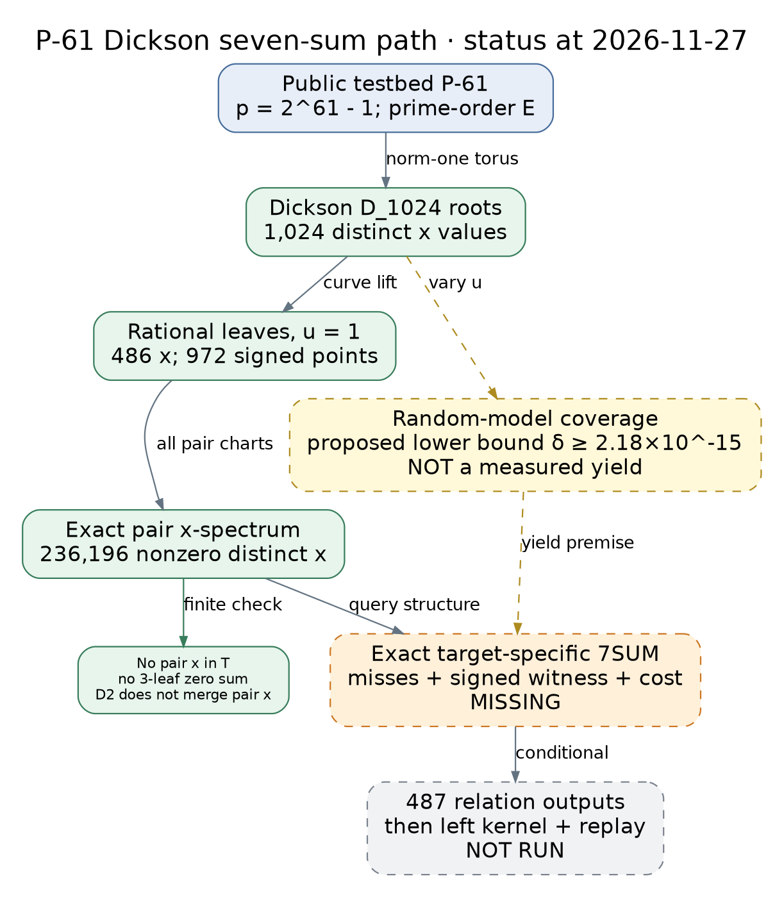

# P-61 Dickson seven-sum audit and end-to-end cost gate

27 November 2026 · research audit for [draft PR #5289](https://github.com/isogeny-labs/crypto/pull/5289) · canonical curve `icv1-fp61-tm813574577-a3b71255` (label P-61, also called M61-1 here)

**Standing.** The selector and pair spectrum have a deterministic native producer replay in this PR; they have no signed independent PCC verdict. The arbitrary-selector coverage lemma below is a **proposed, unrefereed proof sketch**. The cube-root attack is conditional on an exact seven-sum oracle whose cost includes failed queries. There is no complete P-61 target solve or measured end-to-end speed in this audit. No `PCC-*` result is claimed. [pcc:unverified]



The visual's editable [diagram source](pipeline.dot) and [SVG](pipeline.svg) are beside this report. [pcc:unverified]

## Question and scope

Can the norm-one-torus roots of $D_{1024}(x)$ support an index-calculus solution of ECDLP in $O(p^{1/3})$ operations on curves like P-61? This audit records a concrete factor-base census and a precise **conditional** cost reduction. It does not identify a competitive complete decomposition algorithm or infer a finite speedup from an asymptotic exponent. [pcc:unverified]

The public curve is

$$p=2^{61}-1=2305843009213693951,\qquad
E/\mathbb F_p:y^2=x^3-3x+\mathtt{0x54aa66b458b77ec},$$

with prime order $r=2305843010027268529$ and cofactor one. These parameters come from the repository's [canonical testbed record](https://github.com/isogeny-labs/crypto/blob/main/docs/curves/testbed/testbed.json). The public point checked in the finite audit is $G=(\mathtt{0x112c917afe3d4fd3},\mathtt{0x0ef721929b08bfaa})$, for which $[r]G=O$; Hasse plus primality of $r$ identifies the full group order. This is a published synthetic test curve, not a production target. [pcc:unverified]

## Sources and prior work checked

| Source | Consequence for this audit |
| --- | --- |
| [Kaarelson v2, §§3, 5–6](https://github.com/kaarelkaarelson/fast-ecdlp/blob/main/v2/paper.pdf) | Defines *generic* chord-only decompositions and claims $p^{2/m+o(1)}$ for a short-interval $x$ predicate. Its oracle bound is not a bound for Dickson-root membership. The interval-to-arbitrary-selector coverage adaptation below is proposed separately. |
| [P-61 testbed record](https://github.com/isogeny-labs/crypto/blob/main/docs/curves/testbed/testbed.json) | Fixes $p$, coefficients, prime order, cofactor, and curve identity. |
| [Kaarelson coverage reproduction](https://github.com/isogeny-labs/crypto/blob/main/research/kaarelson_coverage_20261118/RESULT.md) | Reproduces the paper's engine-free coverage mechanism at small primes for interval bases; it does not validate this P-61 selector adaptation. |
| [Equal-size torus comparison](https://github.com/isogeny-labs/crypto/blob/main/research/norm_one_torus_base_compare_20261126/REPORT.md) | In a Prime31 streamed $2+3$ collector, the torus and ordinary bases incurred equal full-scan work. Structure alone did not accelerate the query. |
| [Exact $m=7$ torus PR #5254](https://github.com/isogeny-labs/crypto/pull/5254) and [cold Dickson/Semaev PR #5259](https://github.com/isogeny-labs/crypto/pull/5259) | Adjacent native relation work on Prime31; neither establishes a P-61 seven-sum speed. |
| [Target-specialized norm-gcd PR #5275](https://github.com/isogeny-labs/crypto/pull/5275) and [four-leaf follow-on PR #5287](https://github.com/isogeny-labs/crypto/pull/5287) | An exact **subquadratic pair-query primitive exists** through depth six, but #5275 reports it 245–298 times slower than a batched direct scan at depth six and stops before $m=7$. This supersedes any blanket claim that no subquadratic pair query exists. |
| [Xylouris, Theorem 1.1](https://www.impan.pl/en/publishing-house/journals-and-series/acta-arithmetica/all/150/1/83078/on-the-least-prime-in-an-arithmetic-progression-and-estimates-for-the-zeros-of-dirichlet-l-functions) | Linnik exponent $5.18<7$ supplies the proposed growing-field torus-selector family below. |

The shared research-KB MCP was absent in this runtime. The repository wrapper was present but its `research-kb` executable was unavailable. This review used those primary sources and repository records. It is not a claim that all prior art has been exhausted.

The cited repository outcomes retain their source's unverified standing; the present PR introduces no PCC claim. [pcc:unverified]

## Exact fixed-model finite results

Let $T=\{x\in\mathbb F_p:D_{1024}(x)=0\}$. Its 1,024 elements are distinct and nonzero. Let $A$ be the signed rational curve points with $x\in T$. The deterministic census finds 486 lifting $x$-coordinates, hence $|A|=972$ signed points. The complete unoriented pair-chart set has $486^2=236196$ members, all nonzero with distinct $x$-coordinates. Its $x$-image is disjoint from $T$, so no three signed leaves sum to zero. The map $x\mapsto x^2-2$ is injective on these pair abscissae, so one direct Dickson fold does not compress this pair spectrum. [pcc:unverified]

The exact pair census implies $|2A|=2(236196)+1=472393$. Cauchy–Davenport in the prime-order group then gives $|7A|\ge 1418148$, or a uniform-target hit fraction of at least $6.1502366\times10^{-13}$. This counts **unrestricted** seven-sums. It does not certify a generic chord-only decomposition or give a practical yield estimate. [pcc:unverified]

There are at most $\binom{972+7-1}{7}=\binom{978}{7}$ signed seven-leaf multisets. For a uniformly random nonidentity target, the expected number of represented multisets is at most $0.0720718453$. This upper bound is independent of a decomposition implementation; it does not measure the true success probability. [pcc:unverified]

The native Rust replay source and exact output are [p61_audit.rs](p61_audit.rs) and [pair_spectrum.json](pair_spectrum.json). The sorted 64-bit big-endian pair-$x$ list hashes to `319d587d42bc0846929749fa065005baea993fbc49f8fc16a9585c4075efac2f`, so a second implementation can check the entire set rather than only the counts. These are correctness counts, not a timing experiment. [pcc:unverified]

## Proposed random-scaling coverage argument

For a nonsingular curve $y^2=x^3+Ax+B$ with $AB\ne0$, let $T\subset\mathbb F_p^*$ contain $h$ distinct coordinates with $12m\le h\le\sqrt p$. Keep $T$ fixed while choosing $u\in\mathbb F_p^*$ uniformly and replacing the model by $E_u:y^2=x^3+u^4Ax+u^6B$. Write $F_u$ for its signed rational points over $T$ and $f(u)=|F_u|$. The proposed adaptation of Kaarelson v2 §5 uses

$$\Theta_m=(2m-1)!!4^m,\quad D'=(2m-1)2^{2m-2},$$
$$\mu=\Theta_mh^m+\frac{2\cdot4^mD'h^{2m}}{p-1},\quad
V=h+\frac{h(h-1)(11\lceil\sqrt p\rceil+5)}{p-1}.$$

Its proposed conclusion is that at least $1-1/\kappa-4V/h^2$ of the scalings have $f(u)\ge h/2$ and $m$-fold additive energy at most $\kappa\mu$. For each such scaling, it proposes a generic-target coverage fraction of at least [pcc:unverified]

$$\delta=\frac{h^{2m}}{2^{2m+2}\kappa\mu\,\#E(\mathbb F_p)}.$$

Here *generic* is exactly Kaarelson v2 Definition 3.1: for $S_1=P_1$ and $S_k=S_{k-1}+P_k$, every prior partial sum $S_{k-1}$ is affine and $x(S_{k-1})\ne x(P_k)$. Each step is a chord addition; doubling, cancellation, infinity partial sums, and final $R=O$ are excluded. [pcc:unverified]

The proof sketch uses character-sum variance for the factor-base size, a nonzero Semaev dilation polynomial for nontrivial tuples, an additive-energy estimate, and Cauchy–Schwarz. The $AB\ne0$ condition is proposed to remove the exceptional coordinate-dilation ratios that obstruct a direct extension to arbitrary $T$. The written argument is in [PROOF_NOTE.md](PROOF_NOTE.md) and remains to be externally reviewed or formalized. In particular, the short-interval oracle of Kaarelson v2 is **not** transferred by this coverage calculation. [pcc:unverified]

For $h=1024$, $m=7$, and $\kappa=4$, the proposed formula evaluates to $\Theta_7=2214051840$, $D'=53248$, $\mu\approx1.05729919\times10^{33}$, and $V\approx1024.00758846$. Conditional on the proof sketch, at least $0.746093721$ of scalings are good and each covers at least 5,029 generic targets, a fraction $\delta\ge2.18088033\times10^{-15}$. The exact rational evaluation is in [coverage_bound.json](coverage_bound.json), generated by native [p61_bounds.cpp](p61_bounds.cpp). These are deliberately weak **proof-bound values**, not a measurement of yield at $u=1$. [pcc:unverified]

For a proposed explicit growing family, let $p_k$ be the least prime $-1\pmod{2^{k+2}}$ and $q_k=2^{\lfloor(\log_2p_k)/7\rfloor}$. Xylouris's exponent gives $p_k\ll2^{5.18k}$, so eventually $4q_k\mid p_k+1$ and $q_k=\Theta(p_k^{1/7})$. The norm-one torus supplies $q_k$ rational roots of $D_{q_k}$; $y^2=x^3-3x+1$ has both coefficients nonzero. This is a proposed selector/coverage family, not a prime-order family or an algorithm without the oracle below. [pcc:unverified]

## Conditional end-to-end speed and finite P-61 ledger

Let $C_7(q)$ be the cost of a **complete exact seven-sum query**, charged for successes, misses, signs, exceptional charts, witness recovery, and replay. Let $N$ count all attempted uniform targets. The cold one-target cost is

$$C_{\rm E2E}=C_{\rm count/factor}+C_{\rm setup}+N(C_7+C_{\rm replay})+C_{\rm relation}+C_{\rm matrix}+C_{\rm recovery}.$$

The proposed coverage lemma gives $N=O(q)$ across capped random-model rounds. **If** an oracle has $C_7(q)=O(q^{4/3})$ field operations per call, setup and sparse matrix work fit $O(q^2\operatorname{polylog}p)$, and point-count/factor work fits the cube-root budget, then $C_{\rm E2E}=O(q^{7/3})=O(p^{1/3})$ field operations for $q=\Theta(p^{1/7})$. The relation argument uses uniform mixed targets and a left kernel after at most $q+1$ rows; no full factor-base rank assumption is needed. These are conditional reductions, not a proof that the oracle exists or runs at that rate. Bit operations carry additional polylogarithmic factors. [pcc:unverified]

| P-61 quantity | Value | Scope |
| --- | ---: | --- |
| $p^{1/3}$ reference count | 1,321,123 | Mathematical scale, not measured time |
| $q^{4/3}$ for $q=1024$ | 10,321 | Hypothetical per-query scaling reference |
| Canonical $x$ columns at $u=1$ | 486 | Exact finite count |
| Rows needed by the simple left-kernel route | 487 | Counting requirement |
| Expected uniform nonidentity target queries | at least 6,757.15 | Lower bound even if all witnesses are returned |
| Full pair entries inspected over those calls | at least $1.596\times10^9$ | Only if every call scans all 236,196 entries; remaining five-sum work excluded |
| Proposed random-good-model capped round | up to $9.40\times10^{17}$ calls | Very loose sufficient proof cap, **not** observed cost |
| Ideal negation-quotient rho | about $1.346\times10^9$ group steps | Random-walk model; not a matched benchmark |

At the absolute lower query count, beating that ideal rho count would require the **entire** attack to average below about 199,157 rho-step equivalents per query, including setup and matrix work. Pair-entry inspections, field operations, and elliptic group steps are distinct units; this threshold is an accounting target, not a measured comparison. This audit has not solved a target $Q$. [pcc:unverified]

## Reproduction and remaining checks

The PR's native sources regenerate the fixed-model census and rational-bound arithmetic. The published JSON values are data, not timing records. The producer replay used source commit `c2b6b21c53` and these commands from the study directory: [pcc:unverified]

```sh
rustc --edition=2021 -D warnings -O p61_audit.rs -o /tmp/p61_audit
/tmp/p61_audit | jq . > /tmp/pair_spectrum.replay.json
/tmp/p61_audit --pair-x-u64be | sha256sum
g++ -std=c++20 -O2 -Wall -Wextra -Werror p61_bounds.cpp \
  -lgmpxx -lgmp -o /tmp/p61_bounds
/tmp/p61_bounds 486 236196 > /tmp/coverage_bound.replay.json
cmp /tmp/pair_spectrum.replay.json pair_spectrum.json
cmp /tmp/coverage_bound.replay.json coverage_bound.json
```

The pair-list digest above and both JSON comparisons passed in the source-pinned rerun. The arithmetic is self-checked; the proposed general coverage proof still needs independent review and formalization. [pcc:unverified]

The next discriminating result is a complete, failed-query-inclusive $m=7$ Dickson decomposition algorithm with a charged cost for one unseen public target. It must collect relations, solve the matrix, recover and verify the scalar, then run against a matched cold rho baseline. The currently published subquadratic pair primitive in #5275 is useful prior art, but its reported depth-six cost and missing seven-sum composition leave this gate open. [pcc:unverified]

No canonical performance graph is updated: this PR adds no measured P-61 timing or verified speedup. The canonical P-61 record remains the parameter source. A Lean formalization and independent proof review of the arbitrary-selector coverage lemma remain open. [pcc:unverified]
