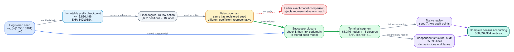

# p61 registered-root terminal closure run

**Run:** `run-20261023T200212Z`
**Curve:** `p61-i0025`, `p = 2^61 - 1`, registered model `y^2 = x^3 + 1055x + 16361`
**Source:** `3b66e5cae94ab709f2ba2169e181eb0d3ac1c9e2`
**Outcome:** terminal census segment generated, replayed, admitted, and independently audited

## Result

The registered-root closure correction passed the frozen protocol. The final
row range `[19,890,496, 19,894,128)` contributes `65,376` vertices across 18
lanes and emits one closure certificate per lane. Together with the immutable
prefix, this accounts for the certified class size of `358,094,304` vertices.

The result has four mutually reinforcing evidence layers:

1. The successor producer generated the exact terminal segment and all 18
   degree-13 closure certificates.
2. `verify-segment` independently reconstructed the terminal range with audit
   seed 7 and two audit points.
3. The immutable admission manifest bound the predecessor checkpoint, source
   commit, binary, segment, terminal checkpoint, and both native receipts.
4. A separate Python 3.13 auditor streamed all 65,396 JSONL records, recomputed
   dense coordinates and indices, checked every parent and closure lane, and
   connected the terminal receipt to the last ordinary-prefix audit receipt.

This resolves the registered-model implementation obstruction. It does not by
itself establish global j-invariant uniqueness, full selected-degree adjacency,
dense endpoint resolution, reciprocal multiplicities, attack-label coverage,
or M7 confirmation performance.

## Frozen identity and resource envelope

| Item | Value |
| --- | --- |
| Field | `2305843009213693951` |
| Fundamental discriminant | `-8726545188371316595` |
| Certified class number | `358094304` |
| Row order | `19894128` |
| Lanes | `9 × 2 = 18` |
| Predecessor checkpoint | `142b06f99f69d7124f2ef22259fc8c36ea80656f51349c363b87f134e0bcec25` |
| Successor binary | `353afbd71fdc09dc44501d62deb72eb695ed2868b8256070615b01299aeadf23` |
| Source bundle | `52da2845915eb572e10aa94499512a2edea92a5ebf33fed73a93c7687f9d6b33` |
| Python 3.13 runtime | `20c9c2144a9f5202177620417e67643fb551aa31586e5d3c1361627b920cadb0` |
| Control-plane v31 spec | `bc86139a03933a5d9f5b734d35099edb49c637b8df1040f13c47b5ad2e0dfec0` |
| Control-plane v31 launcher | `96ce4d73edf1e466cc726423b45ca6078d2b9385363120b0c3049082aa768a3c` |
| Dispatch load | `10.6665` one-minute load, limit `12.0` |
| Dispatch free space | `6,753,151,533,056` bytes, reserve `1,500,000,000,000` |
| Runtime | hash-pinned Python 3.13 plus clean Darwin ARM64 release binary |

## Terminal artifact accounting

| Artifact | Size | SHA-256 |
| --- | ---: | --- |
| Segment | 8,306,946 B | `1b576b189b7354bb9c025f17a14409cb1a4118c8c84c7bfbfb7229f5505fee32` |
| Terminal checkpoint | 7,311 B | `ef9c6857a84a497bc99a4de534f2cf548bcea393896dbf6085d7b5bfe3e9ea74` |
| Generation receipt | 9,783 B | `eec5774ebd9ea7b0da959324bf3a6a5288cd7b0980678142c62d5359d0cb813d` |
| Replay receipt | 1,220 B | `94ec6052a4e6461f518bcee6637561c893154347d2925ae02effedba012f633f` |
| Admission manifest | 1,943 B | `f3c03ef4965a4980e403d2e187ed4b45cf96400d4b82790c2c36d0bb91e52129` |
| Structural audit | 2,521 B | `a165b95e5c26c9cad590a427fbc8b556e096f7dca7eea78e7cd24d75ba86d5f1` |
| Terminal-follower state | 3,427 B at seal | `6621705747d5638db2dd70181de324705d47f4e6e482cfd483703945a936ad14` |

The compressed segment expands to `36,207,183` bytes. Its record accounting is
exactly one header, 65,376 nodes, 18 closures, and one summary. The recomputed
record-chain digest is
`c8a0499eea65009e87beba9b24d348b44f7d90f8e26a8d3522b7a4d676eaf247`.

## Timing

| Stage | Elapsed |
| --- | ---: |
| Generation | 35.134 s |
| Native replay | 31.059 s |
| Separate structural audit and follower admission | 5.986 s |

The native timings are correctness-run receipts, not a throughput benchmark.
The run used eight configured Rayon threads, but the row action is principally
sequential within each lane and should not be extrapolated as an eight-core
scaling result.

## Root cause and correction

The row action returned to the seed j-invariant as expected. The earlier code
then compared the generic canonical coefficient pair with the separately
registered root pair. Those pairs differ while representing the same
`F_p`-isomorphism class.

The successor now performs three explicit steps at terminal closure:

1. select the terminal degree-13 target j-invariant;
2. require that j-invariant to equal the stored lane seed j-invariant; and
3. link the computed Velu codomain directly to the model actually stored at
   `x=0`, retaining the kernel and isomorphism certificate.

Checkpoint continuation was also made source-transition aware: a predecessor
source identity may differ from the successor only when the complete configured
predecessor checkpoint digest matches exactly.

## Independent-audit compatibility finding

The existing follower failed closed on the terminal segment for two deliberate
reasons: its v1 scope required distinct producer/verifier binary digests and
required ordinary segments to contain zero closure records. It was therefore
not valid evidence for this terminal format.

The terminal-specific v2 follower preserves that rejection, binds the last
ordinary audit receipt (`6eb336a1…`) and its checkpoint (`142b06f9…`), and then
accepts only the terminal structural-audit schema with 18 closure lanes and the
complete class total. Control-plane v31 reports both the generation gate and
the terminal audit follower as `complete`. The v31 launch path is pinned to the
Python 3.13 executable, supervisor specification, launcher, follower, and
terminal producer identities rather than relying on an ambient interpreter or
mutable command path.

## Validation history

- Focused release tests: six passed, zero failed.
- The first sparse-worktree test invocation lacked embedded fixture files; no
  test executed to a scientific verdict. Materializing the required fixtures
  and rerunning produced the six-test pass.
- Clean detached release build: pass; binary SHA-256 `353afbd7…`.
- Terminal generation: pass, 65,376 nodes and 18 closures.
- Native terminal replay: pass with seed 7 and two audit points.
- Full-record structural audit: pass, 65,396 lines and 65,376 unique dense
  coordinates.
- Ordinary-prefix-to-terminal follower continuity: pass.
- Source-head serialized release-library suite: 4,081 passed, zero failed, 114
  ignored in 554.47 seconds. A parallel run exposed an existing SMT temporary
  filename collision; the affected Z3 Boolean test passed immediately in
  isolation, and serialization removes that shared-file race.
- Rebased current-`main` code head `fb5e3a4479536aa5436bece7e1ea177ac306734b`
  (base `d7daaa6b42e7b5209e78c2407b2eaf35da25fbe4`) focused suite: six
  passed, zero failed.
- Rebased current-`main` serialized release-library suite: 4,479 passed, zero
  failed, 119 ignored in 592.14 seconds.

## Remaining campaign gates

The census obstruction is resolved, but the complete graph and learning corpus
remain active work. At `2026-10-23T20:44:38Z`, the downstream terminal pipeline
reported a gap-free `19,894,128 / 19,894,128` row prefix and all
`358,094,304` census vertices admitted. In that same snapshot, adjacency had
admitted `37,199,232 / 2,506,660,128` directed edges and a
`4,134,528`-vertex contiguous prefix. The remaining obligations are:

1. global external uniqueness over all 358,094,304 vertices;
2. complete selected-degree adjacency and endpoint resolution;
3. exact per-degree, reciprocity, and multiplicity proofs;
4. frozen attack-context labels and explicit censored-observation masks;
5. class-held-out and field-held-out partitions; and
6. destructive geometric null controls followed by leakage-controlled M7
   confirmation training.

Those gates must continue to report partial, waiting, capped, skipped,
exhausted, unverified, and incomplete-walk states explicitly.
