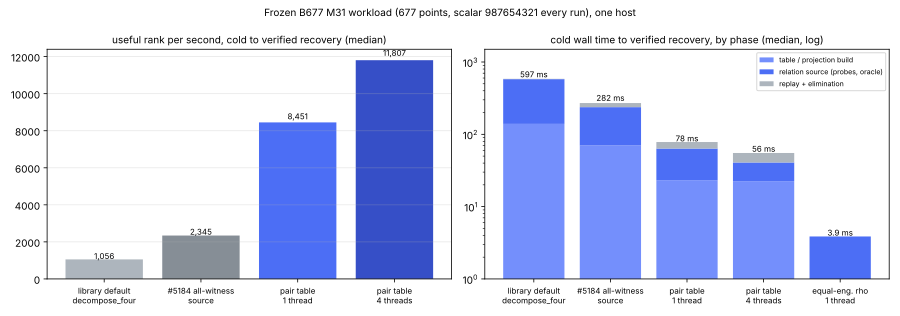

# Signed pair-table relation source: faster useful rank per second on B677 M31

2026-11-25, Claude Code. Development measurements on one shared 4-vCPU cloud VM
(Intel Xeon @ 2.10 GHz). Unsigned. [pcc:unverified]

## Question

The library's default Semaev oracle (`PairProjection::build` + `decompose_four`) delivers
about 1,000 useful rank per second on the frozen B677 M31 workload. The all-witness
pair-table source from crypto #5184 delivers about 2,300 (crypto #5188). How much faster can
a library relation source go on the same workload, cold and fully charged to a verified
target logarithm?

## What was built

A new library module, [`src/cryptanalysis/pair_table_relations.rs`](../../src/cryptanalysis/pair_table_relations.rs),
with no new dependencies, exposing `PairTable<F: FieldMul>` with `Mersenne31` and
`GenericPrime` fields.

- **Table:** for each unordered base pair it stores S = P_i + P_j and D = P_i − P_j. Both
  come from one shared inverse of x_j − x_i, with Montgomery batch inversion in 256-pair
  blocks. Table construction can use several threads; the result is identical.
- **Index on x only:** a point C with x(C) = x(E) is ±E, decided by its ordinate, so ±S and
  ±D share one key. Each slot holds a 32-bit fingerprint and a 32-bit head with open
  addressing, and the full x is checked on a match.
- **Bit filter:** an L2-sized filter of 2^23 bits rejects about 95% of misses without
  touching the 8 MB index.
- **Shuffled pair order:** a fixed shuffle makes a contiguous probe window a uniform subset.
  Without it, the six split pairs of a relation sit together in the window and each
  relation was found about 2.2 times (3.7M probes instead of 1.8M).
- **Probes:** for each stored L, R + L and R − L share one inverse. Only x and the slope are
  computed up front, with prefetch into the filter; the ordinate is computed only for
  candidates that pass the filter.
- **Output:** every signed four-term relation in the window is reported, with its signs
  known from construction, so no sign lift is needed.

Instrument: [`examples/pair_table_rank_rate.rs`](../../examples/pair_table_rank_rate.rs).

- **Arms:** `pairtable` (window fraction 8/256, salt, threads) and `default` (library
  `PairProjection` + `decompose_four`, with an exact 16-pattern sign lift).
- **Consumer, shared by both arms:** dedup, exact group-law replay, then
  large-prime-then-factor-base elimination over Z/N with Barrett reduction and sparse pivots.
  The run stops at a target logarithm verified by d·G = Q.
- **Comparators:** the panel also runs crypto #5184's `cost-v2 sample:13` and its
  equal-engineering rho, interleaved on the same host.

## Results: panel 02 (10 interleaved reps per arm; every run recovered and verified 987654321)

Medians. Ratios are geometric means of paired ratios, with 95% bootstrap intervals; ratios
against rho are unpaired, over 10 rho seeds.

| Arm | build | relation source | replay + elimination | cold to recovery | useful rank/s |
| --- | ---: | ---: | ---: | ---: | ---: |
| library default `decompose_four` | 139 ms | 440 ms | 6 ms | 597 ms | 1,056 |
| #5184 all-witness source | 70 ms | 167 ms | 33 ms | 282 ms | 2,345 |
| **pair table, 1 thread** | 23 ms | 40 ms | 15 ms | **77.6 ms** | **8,451** |
| **pair table, 4 threads** | 23 ms | 18 ms | 14 ms | **55.8 ms** | **11,807** |
| equal-engineering rho, 1 thread | – | – | – | 3.9 ms | – |

| Comparison (cold to recovery) | Ratio |
| --- | --- |
| #5184 source / pair table (1 thread) | **3.51× [3.32, 3.69]** |
| library default / pair table (1 thread) | **7.58× [7.18, 8.04]** |
| pair table 1 thread / 4 threads | 1.36× [1.26, 1.47] |
| pair table (1 thread) / equal-engineering rho | **18.5× [16.2, 20.8]** (was 64.7× for #5184 in this panel) |
| pair table (4 threads) / rho (1 thread) | 13.6× [11.8, 15.6] (rho is not parallelised here) |



- **Correctness:** for each salt, the 1-thread and 4-thread runs give the same relation
  stream digest. Each relation is replayed by the group law before elimination, and d·G = Q
  is checked. The window fraction changes which relations are found, not the recovered log.
- **Panel 01** ran the same arms before the ordinate deferral (pair table 1 thread 83.3 ms,
  4 threads 61.0 ms). Its summary is kept in `evidence/panel-01`.

## Why this is close to the floor for a generic source

- **Probes:** 1.77M probes for about 690 relations. That is the table's hit rate: 915k signed
  points out of an order-2^31 group, with every relation found about once.
- **Base size:** at about 50 ns per table entry and 22 ns per probe, the cost-optimal base
  for a pair table, with probes proportional to 1/B and build proportional to B², is about
  667 points. The frozen 677-point base is already at that balance.
- **What is left:** per-operation constants and the elimination (about 15 ms; online
  elimination with fill-in).
- **Tried and rejected** (development runs, not in the panel):
  - slot-ordered insertion (counting sort): 18–20 ms insert against 11 ms;
  - a batch Markowitz-style elimination: solved on its first attempt, but in 31–41 ms against
    14–19 ms online;
  - a 4-thread producer–consumer pipeline: identical stream, no gain, because workers ran
    30–60 queries ahead.

## Tests

`cargo test --lib pair_table_relations` passes **4/4**
([`evidence/libtest.txt`](evidence/libtest.txt)):

- `full_window_equals_brute_force_four_sums`: p = 1019, 18 points. A full probe returns
  exactly the brute-force set of all signed four-sums with distinct indices, for two targets.
- `threaded_build_is_identical`: the 1-thread and 4-thread builds are equal field by field.
- `mersenne_and_generic_fields_agree`: identical table, relations and counters for
  `Mersenne31` and `GenericPrime(2^31 − 1)`.
- `windows_partition_the_full_probe`: wrapped windows that cover all pairs find exactly the
  full probe's relations.

## Scope and limits

- **Not shown:** an exponent change or rho parity. This is a constant-factor improvement of a
  generic source on one fixed workload.
- **Host:** a shared development VM, so wall-time intervals reflect this host only. The EKS
  route is blocked.
- **Comparator caveats:** the rho arm is the conservative #5184 equal-engineering rho (no
  negation map, 1 thread), so a tuned rho would widen the gap. The 4-thread figure is a wall
  figure; parallel rho would gain similarly.
- **Choice of window fraction:** f = 8/256 came from a development sweep (2, 4, 8, 13 over
  256, three salts each, all within noise of each other between 4 and 13).

## Replay

```
cargo build --release --example pair_table_rank_rate
X=target/release/examples/pair_table_rank_rate
$X pairtable 8 1 1       # window 8/256, salt 1, 1 thread
$X pairtable 8 1 4       # same stream on 4 threads
$X default               # library PairProjection + decompose_four
REF=<#5184 cost-v2> RHO=<#5184 rho-batched> PANEL=panel-02 research/pair_table_rank_rate_20261125/tools/panel.sh
python3 research/pair_table_rank_rate_20261125/tools/summarize.py research/pair_table_rank_rate_20261125/evidence/panel-02
```
