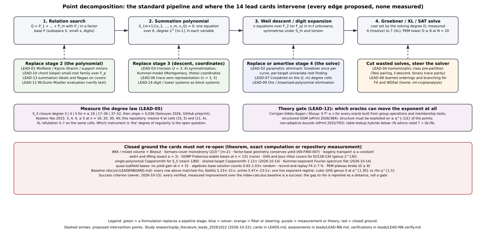

# Point decomposition beyond summation polynomials: literature review and 14 leads

**Date.** 2026-10-22 (dossiers completed 2026-10-23). **Type.** Literature
search round with lead dossiers (research-visuals skill, "Deliverables for each
search round"); no experiment was run. **Status of every statement.**
*Proposed* unless a sentence says *derived* (desk algebra in a dossier, labelled
unverified), *read at source* (a cited text was fetched and read), or *measured*
(a number quoted from a frozen repository artefact, with its path). Nothing
here changes a leaderboard, benchmark or scoreboard row, and no claim about a
deployed curve is made or withdrawn. **Conductor.** Not installed in this
container (the hooks warn and let edits through); the study touches only this
directory.

**Question.** Which reformulations of the point decomposition problem (PDP)
could replace or relax Semaev's summation polynomials in the relation search
of elliptic-curve index calculus and lower the Gröbner-basis cost or the degree
of regularity, measured against the current index-calculus baseline
([`docs/ic/LEADERBOARD.md`](../../docs/ic/LEADERBOARD.md): every row above
matched rho, Koblitz 5.23×–21×, prime 5.47×–13.5×)?

**Answer in one paragraph.** The literature since 2020 is dormant on the
summation-polynomial side (no new decomposition method; one 2026 preprint on
the degree of regularity of descended `S₃`; learned Gröbner solvers and
Crossbred theory on the solver side; two new generic-group lower bounds). Of
the 14 leads drafted here, the director-tier dossiers close most of them: the
MinRank, chord-lattice, trace-zero and prime-field block-structure
reformulations are the same ideals or the same oracles the repository already
has (LEAD-01, 06, 10, 14, each *closed-by-theorem* at the desk); the class
filter and learned orderings are constant-factor levers that move no exponent
and at most 1.1–2× at stage level (LEAD-04, 08); the McGuire–Mueller text and
the elliptic-curve theorem of ePrint 2026/384 could not be read from this
container (LEAD-11, 12, *unverifiable-from-here*); and the 2026 degree law is
plausible for two-point `S₃` but does not transfer to the chain routes (LEAD-05).
The gate dossier (LEAD-12) finds no lead that the generic bounds exclude
outright and three that could move the exponent in principle, which means "not
excluded", not "indicated". The remaining five dossiers (02, 03, 07, 09, 13) are
listed below with their status. The cheapest next measurement that decides
several cards at once is LEAD-05's `S₃` boundary replication (about 1
person-day, 10–15 CPU-hours), which LEAD-12 routes first.

Figures: [`figures/pdp_landscape.svg`](figures/pdp_landscape.svg) (source
[`figures/diagram.py`](figures/diagram.py)) and
[`figures/dreg_records.svg`](figures/dreg_records.svg) (source
[`figures/plot_dreg.py`](figures/plot_dreg.py), data
[`figures/dreg_records.csv`](figures/dreg_records.csv)). PDF:
[`report.pdf`](report.pdf) (source [`report.typ`](report.typ)). Literature map:
[`papers.csv`](papers.csv). Cards: [`LEADS.md`](LEADS.md). Dossiers and
verification cards: [`leads/`](leads/).

## 1. Scope and method

1. **Repository sweep** (2026-10-22, one read-only agent over `crypto`,
   `cryptanalysis`, `crypto-autoresearcher`, `ml-cryptanalysis`,
   `cryptanalysis-rl`): existing literature notes, code modules, ledger
   records, open problems, negative results and the baseline. The programme
   already holds a 25-file known-results map and about 60 literature notes on
   this topic in the autoresearcher's `knowledge/`, the master boundary
   ledger, two syntheses
   ([`reports/Index calculus leads next steps.md`](../../reports/Index%20calculus%20leads%20next%20steps.md),
   [`research/ic_leads_review_20261018/`](../ic_leads_review_20261018/README.md))
   and native oracles for Semaev, Nagao, SAT/WDSat, root finding and
   Crossbred. The cards were written against that map so that closed ground
   is not re-opened (list in `LEADS.md`, "Standing constraints").
2. **External literature** (about 30 web searches and 12 page fetches,
   2026-10-22): the summation-polynomial line from Semaev 2004 to
   Galbraith–Granger–Merz–Petit 2020, the degree-of-regularity line from
   Petit–Quisquater 2012 to Kousidis–Wiemers 2019 and the 2026 Solovyev
   preprint, the Gröbner-free and alternative-formulation line (Nagao,
   Faugère–Wallet summation ideals, McGuire–Mueller, Di Tullio–Pal,
   Gorla–Massierer trace zero), the solver line (WDSat, Crossbred, learned
   Gröbner bases) and the bound line (structured generic-group model,
   non-adaptive time–space bounds). `papers.csv` lists 44 sources with the
   access status each one had from this container: IACR ePrint PDFs are
   Cloudflare-blocked here, so most ePrint items are abstract-only.
3. **Lead cards** (`LEADS.md`): 14 cards, each with mechanism, why it could
   lower the Gröbner cost or the degree of regularity, prior art, the closed
   ground nearby, a discriminating test with a kill criterion, and repository
   hooks.
4. **Dispatch** (owner's model tiers, 2026-10-17): one director-tier Sonnet
   5.5 agent per card wrote `leads/LEAD-NN.md` under `BRIEF_SONNET.md`
   (literature first, every citation marked read-at-source / abstract-only /
   recalled, no experiment, no research-state change); one mechanical-tier
   Haiku 5.5 agent per dossier wrote `leads/LEAD-NN.verify.md` under
   `BRIEF_HAIKU.md` (every citation re-fetched, every path tested with
   `test -e`, every quoted number grepped; computes nothing). The container
   restarted once during the round; the five dossiers that were lost (02, 03,
   07, 09, 13) were re-dispatched on 2026-10-23 with a time budget.

## 2. What the literature says (summary of `papers.csv`)

- **The formulation is unchanged since 2004.** Every index calculus on
  elliptic curves over extension fields decomposes `Q = P₁ + … + P_m` by the
  zero set of Semaev's `S_{m+1}` (degree `2^{m−1}` in each variable), Weil
  descent to `n` equations in `m·ℓ` unknowns, symmetrisation under `S_m`
  (Faugère–Perret–Petit–Renault 2012) and under rational 2-torsion
  (Faugère–Huot–Joux–Renault–Vitse 2014), and a Gröbner or XL solve. The
  two published alternatives to `S_{m+1}` are Nagao's Riemann–Roch system
  (`(n²−n)g` quadrics; 2007/2010) and Faugère–Wallet's summation ideals on
  hyperelliptic Jacobians (2018), both for Jacobians on covers; the
  repository measured Nagao at prime `n` as "`S′₄` with the linear part
  hidden" (`RESEARCH_PDP_SAT_SMT_NAGAO_SURVEY.md` §5). McGuire–Mueller
  (ePrint 2017/1262) claim a Gröbner-free evaluation algorithm and a second
  one without summation polynomials; the text could not be read here
  (LEAD-11). Di Tullio–Pal (arXiv 1909.08901, read at source) write the
  prime-field DLP as quadratic conditions on functions `y·g(x) + h(x)` with a
  prescribed divisor, which is the Riemann–Roch form again.
- **The degree of regularity is the open quantity, and the literature is
  split on what to call it.** Petit–Quisquater's first fall `m²+1`,
  Kousidis–Wiemers' `m²−m+1`, Semaev's "≤ 4 under the first-fall-degree
  assumption", Huang–Kosters–Yeo's evidence against that assumption, and
  Kosters–Yeo's first fall 2 for descended `S₃` all coexist. The only recent
  data point is Solovyev's 2026 preprint (GitHub release, no venue,
  single author): exact degree-capped closures giving `S₃` degree 3, 4, 5 at
  `n ≤ 16`, `17–36`, `37–52`, then linear growth, with closed-form closure
  dimensions and `S₄` solving degree = first fall = 7 up to `N = 24`.
  Figure 2 plots the recorded values side by side with the repository's own
  msolve (4) and XL (5–7) readings on the same cells.
- **Solvers moved, formulations did not.** WDSat (Trimoska–Ionica–Dequen
  2019–2021) is measured here as an enumerator (`2^{3ℓ}/3!` nodes to within
  0.2 %); Crossbred theory (Vidal–Ionica–Delaplace, ePrint 2024/992;
  preprocessing ePrint 2026/360) was never tried on the descent cells;
  learned Gröbner bases (Kera et al., NeurIPS 2024; HATSolver, arXiv
  2512.14722) predict bases for 0-dimensional radical ideals and do not learn
  orderings (the LEAD-08 dossier corrects the card on this point).
- **Two 2025–2026 lower bounds fence the oracle space.** The structured
  generic-group model (Corrigan-Gibbs–Henzinger–Wu, ePrint 2026/384) and the
  non-adaptive time–space bounds (Dinur–Keller–Marmor, ePrint 2025/783)
  make every table-lookup or enumeration oracle a constant-factor lever;
  LEAD-12 maps each card onto them and records which statement is the
  paper's theorem and which is this repository's interpretation (the
  elliptic-curve theorem of 2026/384 was not readable from here).

## 3. The 14 leads: verdicts

Verdicts are the dossiers' own (`leads/LEAD-NN.md`); "verification" is the
mechanical card's totals (`leads/LEAD-NN.verify.md`: citations verified /
mismatch / unreachable; paths exist / missing). Every mismatch and missing
row was read by hand and is classified in §5; none is a wrong citation.

| Lead | Card (class) | Dossier verdict |
|---|---|---|
| 01 | MinRank / Kipnis–Shamir / support-minors modelling of the summation chain (formulation) | **closed-by-theorem**: the Minors, KS and SM modellings are the repository's `S₄`-direct system, the chain, and the chain's ideal; none can read a lower degree than the chain. One residual probe (carry seeds) keeps about a 10 % prior of one degree |
| 02 | Parametric eliminant: generic-fibre Gröbner basis in the target's coordinates (solver, amortisation) | *pending (re-dispatched 2026-10-23)* |
| 03 | ℓ-torsion (3, 4) symmetrisation and Kummer-model coordinates (formulation) | *pending (re-dispatched 2026-10-23)* |
| 04 | Homomorphic class pre-partition: Tate pairing, ℓ-descent, trace parity (filter) | **constant-factor candidate**, cofactor curves only: `Z/r` has no proper quotient, so every prime-order row (all eight Table B prime rows) gets exactly 1.000×; pigeonhole caps the `m = 3` probe saving at 2× for any class group, so the card's "`\|A\|` in every oracle" is wrong |
| 05 | Degree-of-regularity growth law for descended `S₃`/`S₄` (measurement) | **unverifiable-from-here**: the `S₃` thresholds 3 → 4 → 5 at square `N = 16, 36` agree with Kosters–Yeo, Kousidis–Wiemers and the repository's own `lfd.sage` boundary, with one conflicting cell (Magma reads 4 at `n = 35` where the preprint reads 5); the law is for the quadratic two-point `S₃`, not the cubic-plus-quadratic chain, and the preprint's own `S₄` data are flat at 7 |
| 06 | Trace-zero variety representation for `E(F_{q^n})`, `n = 3, 5` (representation) | **closed-by-theorem**: `T_n` exists only for a curve defined over `F_q`, so it is not a coordinate system for the baseline's random prime-order `E/F_{p^k}`; at `n = 3` it ties rho at `q¹`; at `n = 5` the `T₅` system is 9 equations of degree 32 in 8 unknowns against the `k = 4` ladder's 4 equations of degree ≤ 8 |
| 07 | Crossbred on the Weil-descent degree cells (solver) | *pending (re-dispatched 2026-10-23)* |
| 08 | Learned orderings and branching for F4 and WDSat (solver, ML) | **constant-factor candidate**, stage level only: a variable order cannot change F4's solving degree on refuted or unique-solution targets (Caminata–Gorla Thm 3.1, Cor 3.3, read at source) and cannot lower WDSat's node count (thesis tables within +0.8 % of `2^{3ℓ}/3!`); only the F4 word-XOR cost is in play, where hand rules already give 2–4.91× at stage level with `S` unchanged |
| 09 | Ore / linearized-polynomial quotient-algebra elimination (solver) | *pending (re-dispatched 2026-10-23)* |
| 10 | Chord-parametrised small-root family over `F_p` (formulation) | **closed-by-theorem** for the small-unknown family: the chord system at `m = 2` is Semaev's `S₃` in the symmetric `(e₁, e₂)` encoding after a free linear elimination of the slope (symbolic and numeric desk check); every encoding has the same limit reach `2/(m(m+1)d)` = 1/6, 1/24, 1/80 and ceiling `1/(md)` = 1/4, 1/12, 1/32, so the `m = 4` kill fires (1/80 < 1/32 < 1/5) |
| 11 | McGuire–Mueller Gröbner-free algorithms, ePrint 2017/1262 (literature verification) | **unverifiable-from-here**: the PDF is Cloudflare-blocked (`cf-mitigated: challenge`), the Caen server times out, no mirror found; provisional classification from second-hand evidence: Algorithm 2 (sum `m−1` base points, test membership) coincides with the repository's `rf-pairs`/`rf-mitm` oracles, Algorithm 1 is the same oracle with an algebraic evaluation step; both on the CGK line |
| 12 | Theory gate: structured GGM and non-adaptive bounds (theory) | **unverifiable-from-here** for the one statement it most wants (the elliptic-curve theorem of ePrint 2026/384 could not be read); the 14-row classification is delivered: 3 leads can move the exponent in principle (01, 06, 10 conditional), 9 constant only, 0 excluded outright, 2 are not oracles; none of CGK, Shoup, DKM or SGGM constrains an oracle that reads coordinates, so "in principle" means "not excluded" |
| 13 | Summation ideals (Faugère–Wallet) and Nagao on Joux–Vitse covers (formulation on the cover) | *pending (re-dispatched 2026-10-23)* |
| 14 | Prime-field digit and Kummer-tower systems as multi-homogeneous blocks (formulation) | **closed-by-theorem**: the bilinear and unmixed multilinear bounds do not apply (two structural hypotheses fail: the tower quadrics have block degree 2 and the system is over-determined); their formal values 7, 9, 11, 13 at `m = 3`, `N = 9–18` exceed the measured 6, 6, 7, 7 with a slope 3–7× too steep; any valid block bound has slope `(m−1)/m` in `N`, which the PKM note's §3.6 turns into at least `√r` per target |

Table B. Ranking inputs and verification totals per lead.

| Lead | Confidence | Expected gain if it works | Test cost | Verification (citations v/m/u; paths e/m) |
|---|---|---|---|---|
| 01 | medium | at most one degree (4 → 3): `m = 4` at `n = 131` moves +7.62 → +5.34 bits over rho (`w = 1`), still above | 1–1.5 person-days, < 4 CPU-h, ≤ 1.5 GB (msolve) | 12 / 2 / 0; 25 / 1 |
| 02 |  |  |  |  |
| 03 |  |  |  |  |
| 04 | medium (bounds); low (effect on `S`) | about 1.1–1.2× on `S` for the cofactor-2/6 random-binary rows (desk estimate); exponent unchanged | 1 person-day, < 1 CPU-h | 2 / 0 / 0; 30 / 0 |
| 05 | medium (`S₃` import); low (transfer) | none as an improvement; if the slope transferred, the `m = 3, 4` rows at `n = 131` would move *up*, to 2^114.7–2^129.1 and 2^132.1–2^155.6 column touches | 1 person-day, 10–15 CPU-h, ≤ 12 GB | 8 / 0 / 0; 24 / 1 |
| 06 | high (no improvement); medium (`n = 5` asymptotics) | none against any baseline row; a `T_n` row would be a new baseline, not an improvement | 2–3 person-days (new `T₃` harness), ≤ 2 CPU-h | 1 / 4 / 4; 16 / 0 |
| 07 |  |  |  |  |
| 08 | medium | 0 degree levels; WDSat ≤ 1.04×; F4 XORs 1.0–2× beyond the hand rules (guess); `S` 1.00× | 2 person-days core, 10 CPU-h mechanical, ≤ 16 GB | 7 / 0 / 5; 21 / 3 |
| 09 |  |  |  |  |
| 10 | medium | none in the exponent; 5–11 % higher `δ` at equal multiplicity (2–3× smaller lattices) on oracles that cannot beat rho | zero-compute test done in the dossier; 0.5 person-day to confirm in the `05` MILP harness | 6 / 0 / 1; 12 / 0 |
| 11 | low (text); medium (classification) | none; the relayed `O(p)` cost is a worse exponent than Table B's `m = 2` row (`r^{2/3}`) | 0.5 person-day once a host can download the CC BY PDF | 9 / 2 / 3; 13 / 0 |
| 12 | medium (generic rows); low (algebraic rows) | none (a gate); routes the first test to LEAD-05 | 0.5 person-day to close the reading gap | 8 / 1 / 3; 10 / 0 |
| 13 |  |  |  |  |
| 14 | medium | none on the exponent, and the sign is wrong; constant unknown, likely ≤ 1.5× | 0.5 person-day, < 1 CPU-minute | 10 / 0 / 0; 12 / 1 |

### 3.1 What the completed dossiers add beyond their verdicts

- **LEAD-01.** The Sylvester determinant of the `S₃ ∘ S₃` chain is `S₄`
  (desk check); Bardet–Bertin Prop. 1 (read at source) gives KS = SM ideals
  with Minors ⊂ KS, so the three modellings are generating sets of ideals the
  repository already solves. The bilinear bound does not apply because the
  chain has the cubic term `x₁x₂y`; read naively it gives 16 at `(15, 5)`
  against a measured F4 degree of 4. The free-kernel KS system is 14.7–16.4×
  wider at degree 4. The one thing left is whether the closed-form carry
  seeds (bit components of `x₁f₁, x₂f₁, yf₁`) lie in the degree-4 Macaulay
  span and let F4 finish at 3; the dossier replaces the card's test with that
  probe (R1).
- **LEAD-04.** Why KN-FIND-14706d does not cover this: that finding tests
  the product character `χ₁χ₂χ₃`, which is trivial on `E(F_p)` by the curve
  equation; the 2-descent class `(χ₁, χ₂)` lives in its kernel and takes all
  four values. But on a prime-order row there are no classes at all, and on
  cofactor rows hash lookups and membership tests are already exact and
  uncharged, so only table-build additions fall. The dossier flags an
  adjacent lever outside the card: the random-binary ladder builds its base
  from raw points with no projection into the subgroup; a class-0 or
  cofactor-projected base is estimated at 1.4–1.6× at fixed base size on
  `f2m21` (desk estimate, no record of it being tried).
- **LEAD-05.** Solovyev's "degree of regularity" is the degree-capped closure
  with iterated falls (Huang–Kosters–Yeo Def. 1), which matches the
  repository's MutantXL closure and msolve's F4 step degree draw for draw and
  sits below XL refutation. The M4GB fix is PR #14 of `cr-marcstevens/m4gb`,
  opened by the preprint's author on 18 Sep 2026 and merged 25 Sep 2026. The
  preprint's "5 for 37 ≤ n ≤ 52" hides a parity split (odd `n = 51` predicted
  6). The decisive cells beyond the cheap test (`S₄` at `N = 27`, `S₃` at
  `N ≈ 52`, chain `m = 4`, `ℓ = 6`) need 37–128 GB hosts.
- **LEAD-06.** The prime-order subgroup lies in `T_n` iff
  `gcd(ℓ, #E(F_q)) = 1`, automatic for `ℓ > q + 1 + 2√q` but capped at
  `ℓ ≤ #T_n ≈ q^{n−1}`. The one positive is a cheaper per-residual solve
  (2 unknowns, 6 solutions, yield 1/2 against 3 unknowns, 64 solutions, yield
  1/6 for `S₄`), which comes from the smaller group and does not transfer to
  generic curves. The card's pointer "ePrint 2014/158" is the point-compression
  paper; the optimal-representation paper is arXiv 1405.2733 / ePrint 2014/333.
- **LEAD-08.** HATSolver predicts the lex Gröbner basis directly rather than
  learning an ordering; the relevant learned-order paper is Bunch et al.,
  arXiv 2602.02972. The instance-level degree is a cell-level constant,
  identical across targets in the committed data, so there is nothing
  per-instance to learn; the test is replaced by a held-out-cell split with a
  permutation null, runnable from ml-cryptanalysis.
- **LEAD-10.** Two side findings: `RESEARCH_PRIME_FIELD_BREAKTHROUGH_PROGRAM.md`
  §4.6 puts the `(e₁, e₂)` reach at 1/9, which W10's own e-encoding rows
  already exceed (the family value is 1/6); W10's `m = 3` e-encoding rows were
  run in a box that binds, so 0.018176 and 0.024903 are lower bounds (a
  non-binding desk LP gives 0.0201 and 0.0269, unconfirmed in W10's Rust
  engine). The symmetric encoding also enlarges the root set: about `4p^{1/2}`
  slopes with small `s₁` per genuine decomposition at `B = p^{1/2}`.
- **LEAD-11.** Corrections for `KN-LIT-6966ea` are listed in the dossier's
  §8; the "McGuire–Mueller trinomial bound" cited in
  `research/ic_next10_20261014/08-quasi-subfield/README.md:53` is their 2019
  arXiv paper (1905.11755, read at source), not 2017/1262.
- **LEAD-12.** The `S·T² ≳ N/|Aut|` form used across the repository is in
  none of the four bound papers; unique factorisation fails for
  elliptic-curve sums, so every elliptic-curve use of `δ` is the repository's
  derivation. The most uncertain classification is LEAD-03, with 01, 07 and 14
  riding on it: a constant-factor drop in the slope of `D(n)` would move the
  exponent (desk check: cost exponent per bit of `n` 0.81 at slope 1/20 and
  0.48 at 1/40, against rho's 0.5), which is why LEAD-05's fit of `D(n)` is the
  first test.
- **LEAD-14.** The card's premise is wrong at source: Petit–Kosters–Messeng
  use a composition tower, not binary digits, and their experiments are
  `m = 2` only. Their Tables 4–5 (Magma, `m = 2`) independently reproduce the
  repository's `D = 4, 5, 6` rises, which `RESEARCH_PKM_TOWER_ORACLE.md`
  §10.10 had recorded as unchecked. Kudo et al. is located as CANS 2018, LNCS
  11124.

## 4. Ranking and what to do next

*(Provisional until the five re-dispatched dossiers land; the ranking below
uses the nine completed ones and LEAD-12's gate.)*

1. **Run LEAD-05's cheap test first** (about 1 person-day, 10–15 CPU-hours,
   ≤ 12 GB): replicate the `S₃` closure boundaries at `N = 16/17` and `36/37`
   with the repository's closure driver and msolve, with `n = 35` as the
   decisive cell against Kousidis–Wiemers' Magma reading, and check three
   closure-dimension formula points. It decides whether the 2026 law can be
   imported at all, and LEAD-12 makes it the gate for 01, 03, 07 and 14.
2. **LEAD-01's residual probe R1** (1–1.5 person-days, < 4 CPU-hours): export
   the closed-form carry seeds and test whether msolve finishes at degree 3 on
   the `(15, 5)` and `(11, 4)` cells. About a 10 % prior; the prize is one
   degree, worth 7–65× in Macaulay width.
3. **LEAD-04's arm C** (1 person-day): the cofactor-projected base on the
   random-binary ladder, 1.4–1.6× estimated at fixed base size, with the
   prime-order negative control that must read 1.000×. A measured
   improvement over a leaderboard row would count under the success criterion
   even at that size.
4. **Do not spend on** LEAD-06, 10, 14 (closed at the desk, with the
   reasoning in the dossiers) or LEAD-08 beyond a cheap null test (the
   theorem leaves only matrix cost, where hand rules already exist).
5. **Reading debt** (0.5 person-day each, needs a host outside the Cloudflare
   block): ePrint 2017/1262 (LEAD-11) and the elliptic-curve section of ePrint
   2026/384 (LEAD-12). Until then both verdicts stay *unverifiable-from-here*.

The gap to matched rho is unchanged by this round: no row moves, and the
distance remains what `docs/ic/LEADERBOARD.md` records.

## 5. Verification (mechanical tier)

Each `leads/LEAD-NN.verify.md` re-fetched every citation, tested every path and
grepped every quoted number, recording outcomes verbatim. The non-clean rows,
read by hand:

- **Citation mismatches.** All are year-of-version or wording differences:
  arXiv submission year against journal year (LEAD-06 ×3, LEAD-12 ×1 where a
  search ranked a different paper first and the right one second), title
  capitalisation or an abbreviated title in the dossier (LEAD-01 ×2, LEAD-11
  ×2), and a thesis whose host (`edoc-vmtest.ub.unibas.ch`) did not resolve
  (LEAD-06). No row shows a different paper or different authors.
- **Unreachable citations.** ePrint PDFs and some abstract pages (403 or a
  Cloudflare challenge), one Springer chapter behind a login, the Caen 2018
  server (504), Semantic Scholar's rate limit. The dossiers mark these
  abstract-only or recalled.
- **Missing paths.** Files the discriminating tests propose to create
  (`examples/lead01_carry_seeds.rs`, `examples/lead14_block_bounds.rs`,
  `examples/pdp_perm_f4.rs`, `csd/order_probe.py`), one external repository
  file (`cr-marcstevens/m4gb` `src/m4gb.hpp`), and one brace-expansion
  artefact (`README` for `README.md`). No cited existing path is missing.
- **Numbers not found by literal grep.** Formatting differences ("0 of 345"
  for "0/345", "8 of 8", "N = 40 and 42"; confirmed by hand in the named
  files), and in LEAD-14 three numbers that live in
  `research/pkm_m3_n21_msolve_20261018/RESULTS.md` while the dossier names
  the sibling `README.md` (an attribution slip, not a wrong number). One
  LEAD-05 number ("37 of 38" in `fall_degree_bounds_20261008/RESULTS.md`) was
  not located by hand either and stays unconfirmed.

## 6. Corrections to repository records surfaced by this round

Recorded here for the owners of those files; this PR changes none of them.

- `knowledge/literature/KN-LIT-6966ea.md` (autoresearcher) is abstract-only
  and should carry the corrections in `leads/LEAD-11.md` §8.
- `research/ic_next10_20261014/08-quasi-subfield/README.md:53` cites a
  "McGuire–Mueller trinomial bound" to ePrint 2017/1262; the source is arXiv
  1905.11755.
- `RESEARCH_PRIME_FIELD_BREAKTHROUGH_PROGRAM.md` §4.6's `(e₁, e₂)` reach of
  1/9 is a basic-strategy figure; the family value is 1/6 (LEAD-10).
- `RESEARCH_PKM_TOWER_ORACLE.md` §10.10's "unchecked" against
  Petit–Kosters–Messeng: their Tables 4–5 reproduce the `D = 4, 5, 6` rises
  (LEAD-14).
- `LEADS.md` card errors found by the dossiers and left in place for the
  record: the Solovyev preprint is 2026, not 2025 (corrected in the card
  heading and figures); "ePrint 2014/158" is the point-compression paper
  (LEAD-06); HATSolver does not learn orderings (LEAD-08); PKM use a
  composition tower, not binary digits (LEAD-14); "`|A|` in every oracle"
  overstates the pair-table saving (LEAD-04).

## 7. Unresolved checks and access failures

- IACR ePrint PDFs are blocked from this container by a Cloudflare challenge;
  WebFetch on the same URLs returns 403. The texts that matter most and were
  not read: ePrint 2017/1262 (LEAD-11), the elliptic-curve section of ePrint
  2026/384 (LEAD-12), ePrint 2015/573 (LEAD-05), ePrint 2019/313 (LEAD-08;
  covered by Trimoska's thesis, read at source).
- The Caen 2018 talk and paper by Mueller (nitaj.users.lmno.cnrs.fr) returned
  504; Mueller's UCD thesis was not found online.
- The five re-dispatched dossiers (02, 03, 07, 09, 13) are listed as pending
  in §3 until their agents report; this README and the PDF are regenerated
  when they do.

## 8. Graphs checked and left unchanged

No measured result was produced, so no canonical graph changes:
`docs/index-calculus-scoreboard.html`, `docs/ic/progress-timeline.json`,
`docs/ic-leaderboard.html` / `docs/ic/LEADERBOARD.md` / `docs/ic/leaderboard.json`,
`docs/performance-gains/`, and `benchmarks/README.md` are untouched. Nothing
here is a performance result, so no `benchmarks/` entry is owed.

## 9. Files

| File | What it is |
|---|---|
| `LEADS.md` | The 14 lead cards and the standing constraints |
| `BRIEF_SONNET.md`, `BRIEF_HAIKU.md` | The director-tier and mechanical-tier briefs |
| `leads/LEAD-NN.md` | Director-tier dossiers (Sonnet 5.5), one per card |
| `leads/LEAD-NN.verify.md` | Mechanical-tier verification cards (Haiku 5.5), one per dossier |
| `papers.csv` | Literature map, 44 sources, access status per source |
| `figures/pdp_landscape.svg`, `.png`, `diagram.py` | Figure 1 and its source |
| `figures/dreg_records.svg`, `.png`, `.csv`, `plot_dreg.py` | Figure 2, its data and its source |
| `report.typ`, `report.pdf` | This report rendered (pandoc → Typst) |
