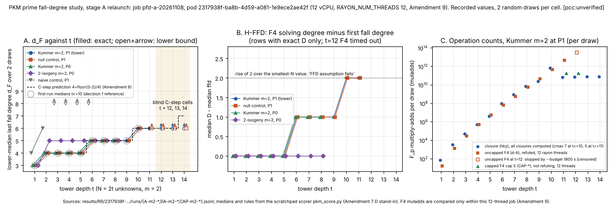

# RESULTS: PKM prime fall-degree study, stage A relaunch (job `pfd-a-20261108`)

**Verdict (derived by the preregistration's stage A rules, applied as written):** `[pcc:unverified]`

- **Reproduction: AGREE.** The owner decision 1 repeat check (median level, `t <= 10`) agrees at all ten `t`. The Amendment 2 stop rule does not fire, and the study continues.
- **C-step (Amendment 6): UNDECIDED at the three blind cells, `t = 12, 13, 14`.** The median `d_F` is `>= 6` at each of them. That bound includes the predicted values (6, 6 and 7), so the prediction is neither confirmed nor refuted. It **holds at `t = 11`**, but `t = 11` is not a blind test (Amendment 7 E). This job did not contain the cells that decide C-step: the Amendment 7 B cap-6 runs at `t = 12, 13`, and cap 6 then cap 7 at `t = 14`. Those are the `pfd-x-*` jobs.
- **Kummer `m = 2` at `P1`:**
  - H-LFD reads **"`d_F` grows"**: the median goes from 3 at `N = 2` to 6 at `N = 22`.
  - H-FFD reads **"FFD assumption fails"**: median `D - ffd` goes from 0 to 2.
  - H-gap: **0 of 22** draws have `d_F < D`, and the median `D - d_F` is 0.
- **H-null: UNRESOLVED.** The rule text does not say how to treat censored medians. On completed `N` the reading is "shape-driven".

Gates:

| gate | result |
|:--|:--|
| G1 | pass, 6 hand cases |
| G2 | 72 draws checked, 0 violations |
| G3 | 144 capped runs, 0 disagreements |
| G4 | not part of this job |

No hypothesis or rule was changed. No outcome here is an `S`, a price or a leaderboard row (§8).

Evidence classes:

- **measured**: read from the job's rows under `results/R9/2317938f-ba8b-4d59-a081-1e9ece2ae42f/`;
- **derived**: computed from those rows by the scratchpad scorer `pkm_score.py`, or by the committed tools named below;
- **cited**: a repository document says so.

Every number is `[pcc:unverified]`. `R9/<pod>` below abbreviates `results/R9/2317938f-ba8b-4d59-a081-1e9ece2ae42f`.

## 0. Execution record (measured, unless marked)

- **Job**
  - Job `pfd-a-20261108`, job uid `64ee9a59-...`, pod `pfd-a-20261108-p6nzd`, uid `2317938f-ba8b-4d59-a081-1e9ece2ae42f`.
  - Launched 17:12:54Z (bench record `commands[0]`). The pod ran 17:14:36Z to 20:47:48Z, 12,792 s (derived). Exit code 0, reason `Completed`.
  - The exit was read from the EKS audit log, because the Pod object was deleted together with its node: `receipts/R9/collect-v01/status-with-audit-pod.json`, and card `cards/CARD-...-pfd-a-R9-V01` (receipt: every step succeeded).
  - The request `requests_r2c/pfd-a.json` carries `protocol_sha256 7bfc1dec...`, the hash of the preregistration file today (Amendments 1-9).
- **Amendment 9 context**
  - Resources: cpu 12, memory 56Gi, `seconds` 172800, `instance_type r6i.4xlarge` (pinned, because 172,800 > 90,000).
  - `host.txt`: `nproc 12`, `rayon: 12`, Intel Xeon Platinum 8375C @ 2.90GHz, MemTotal 129,804,648 kB, kernel 6.18.54-121.166.amzn2023.
  - `host.txt` does not name the instance type. The r6i class is inferred from the pin, the CPU model and the memory size.
- **Wall budgets unchanged (Amendment 9)**
  - Every row's `budget_seconds` is 1800: closures, `d-A` F4 and the CAP rows. `gate3` ran with `--budget 900` (`image/entry.sh`).
  - No limit is larger than registered. The job used 7.4% of its 172,800 s deadline (derived).
- **Image and binaries**
  - Image `isolab/tasks@sha256:0d6b2ecd...`, built from source `f13a690df0`.
  - `binary.sha256` matches the image build: `pkm_tower_pilot f78f3959...`, `prime_fall_degree_tools 7e8a6703...`, `hky_fp_tower_check c36d324e...`, `pfd_grid_zeros 96283361...`.
  - The 32 result files match `receipts/R9/local-sha256-01.txt` (`sha256sum -c`: 32 OK, re-run in this analysis).
- **Stages (`progress.txt`)**
  - The command was `g1 hky-A g3 d-A cap-A`. Every stage line ends `exit 0`.

  | stage | time (UTC) | duration (derived) |
  |:--|:--|--:|
  | `g1` | 17:14:37 | under 1 s |
  | `hky-A` | 17:14:37 to 18:18:23 | 63.8 min |
  | `g3` | 18:18:23 to 18:23:27 | 5.1 min |
  | `d-A` | 18:23:27 to 20:46:36 | 143.2 min |
  | `cap-A` | 20:46:36 to 20:47:45 | 69 s |

  - Order: G3 passed before any capped F4 run, as §3 and Amendment 8 require.
- **Rows** (measured):

  | files | rows |
  |:--|:--|
  | `A-m2-tower` | 20 |
  | `A-m2-tower-big` | 8 |
  | `A-m2-tower-p0` | 32 (Kummer and isogeny) |
  | `A-m2-null` | 20 |
  | `A-m2-null-big` | 8 |
  | `A-m2-naive` | 12 |
  | `DA-m2-tower`, `DA-m2-null` | 24 each |
  | `DA-m2-tower-p0` | 32 |
  | `CAP-m2-t11-k{0,1}-c5`, `CAP-m2-t12-k{0,1}-c5` | 1 each |

  - Every cell of §5 A and Amendment 1 is present: Kummer and null `t = 1..14` at `P1`; naive `t = 1..6`; Kummer and isogeny `t = 1..8` at `P0`.
  - System identity: `x_r`, `curve` and `tower` agree between the closure, F4, CAP and grid-zero rows of every system, 128 checks with 0 mismatches (derived).
- **F4 at `t >= 12`**
  - Uncapped F4 (`d-A`) at `t = 12` stopped at its 1800 s budget on both draws and on both arms (`timed_out: true`, about 1802 s, at degree 6).
  - The pilot then stopped the ladder (`DA-m2-tower.log`: "every run at t = 12 timed out; stopping"), so there are no `D` rows at `t = 13, 14`.
  - `cap-A` (`run.sh`) took `D` from `DA-m2-tower.jsonl` without checking `timed_out`. At `t = 12` it ran cap `D - 1 = 5`, with the timed-out row's `D = 6`. At `t = 13, 14` it found no `D` and ran nothing.
- **Not in this job:** G4, stages B and C, the Amendment 7 `cap:`/`X-*` bracket jobs (`pfd-x-*`), and the Amendment 8 `m = 4` cells.

## 1. Gates

| gate | registered text (§4) | this job | result |
|:--|:--|:--|:--|
| G1 | `cargo test --lib hky_fp_tower` passes (hand cases) | `hky_fp_tower_check` prints six `ok` lines and `G1: 6 cases pass` (`gates/g1.log`) | **pass**. The registered command runs 0 tests, because the module has no `#[test]` functions. The cases are in the example (`RESTART.md` step 2, written before any data). |
| G2 | `d_F <= D` on every Kummer/isogeny `m = 2` cell `t <= 10` | 72 draws with exact `d_F` and refuting `D`, 52 of them in the registered cells: Kummer `P1` `t <= 10`, Kummer and isogeny `P0` `t <= 8` (derived) | **0 violations**. `d_F = D` on every draw. The committed scorer gives the same: "72 draws checked, 0 violations". |
| G3 | closure contains `1` at `c` iff capped F4 refutes at `c`, for each `c` from 2 to `d_F` | `gate3` over 72 closure systems with `N <= 20` (Kummer and null at `P1`, Kummer and isogeny at `P0`), caps `d - 1` (must not refute) and `d` (must refute): `G3: 144 capped runs, 0 disagreements` (`gates/g3.log`, `g3.jsonl`) | **pass as implemented**: 0 seed mismatches and 0 timeouts (derived). The tool tests 2 caps per system, not every `c` from 2 to `d_F`, which would be 252 runs (derived). The 70-run G3 of Amendment 3 used the same tool. See UNRESOLVED (U3). |
| G4 | planted closures never contain `1` | not run: `g4` is in `pfd-c` | Amendment 3 records a first-run pass, but those records are lost (cited). See U4. |

## 2. Repeat check (owner decision 1: median level, `t <= 10`)

Kummer `m = 2`, `P1`, lower median of the closure `d_F` over the 2 draws (measured: `R9/<pod>/runs/A-m2-tower.jsonl`).

| t | 1 | 2 | 3 | 4 | 5 | 6 | 7 | 8 | 9 | 10 |
|:--|--:|--:|--:|--:|--:|--:|--:|--:|--:|--:|
| this run, draws k0/k1 | 3/3 | 4/4 | 4/4 | 4/4 | 4/4 | 5/5 | 5/5 | 5/5 | 5/5 | 6/6 |
| this run, median | 3 | 4 | 4 | 4 | 4 | 5 | 5 | 5 | 5 | 6 |
| first run, median (decision 1 reference) | 3 | 4 | 4 | 4 | 4 | 5 | 5 | 5 | 5 | 6 |
| agree | yes | yes | yes | yes | yes | yes | yes | yes | yes | yes |

**The repeats agree at every `t <= 10`.** Every value is exact, and both draws equal the median, so the lower-median convention plays no role.

- This is a median-level check, as decision 1 fixes. The first run's rows are lost, so no row-level check (`x_r`, `falls`, `ffd`) against them is possible.
- One draw ties to an earlier run (cited): `t = 6`, target 0, `x_r 464833983`. The same value is in the round-2 commit and the 2026-11-07 dev check (README, Development check). So the pilot's rng consumption is unchanged for that draw.

## 3. Per-`t` tables

### Table 1. Kummer `m = 2` at `P1` (tower). Values are per draw, k0 / k1.

Sources: `R9/<pod>/runs/A-m2-tower.jsonl` (t <= 10), `A-m2-tower-big.jsonl` (t >= 11), `DA-m2-tower.jsonl`, `CAP-m2-t1{1,2}-k{0,1}-c5.jsonl`, and `analysis/pfdA_grid_zeros.jsonl`. Scored values are derived.

`c*` is the C-step prediction `4 + ⌊(t − 2)/4⌋` (Amendment 6). It applies from `t = 2`; this table shows it from `t = 11`, the first row past the reference medians of §2.

| t | N | λ | closure `d_F` (cmax) | `ffd` | `D` (uncapped F4) | capped F4 | grid_zeros | scored `d_F` [source] | **median `d_F`** | censoring | `c*` |
|--:|--:|--:|:--|:--|:--|:--|:--|:--|:--|:--|--:|
| 1 | 2 | 2.0e-9 | 3 / 3 (7) | 3 / 3 | 3 / 3 | — | 0 / 0 | 3 / 3 [closure] | **3** | none | — |
| 2 | 4 | 8.0e-9 | 4 / 4 (7) | 4 / 4 | 4 / 4 | — | 0 / 0 | 4 / 4 [closure] | **4** | none | — |
| 3 | 6 | 3.2e-8 | 4 / 4 (7) | 4 / 4 | 4 / 4 | — | 0 / 0 | 4 / 4 [closure] | **4** | none | — |
| 4 | 8 | 1.3e-7 | 4 / 4 (7) | 4 / 4 | 4 / 4 | — | 0 / 0 | 4 / 4 [closure] | **4** | none | — |
| 5 | 10 | 5.1e-7 | 4 / 4 (7) | 4 / 4 | 4 / 4 | — | 0 / 0 | 4 / 4 [closure] | **4** | none | — |
| 6 | 12 | 2.0e-6 | 5 / 5 (7) | 4 / 4 | 5 / 5 | — | 0 / 0 | 5 / 5 [closure] | **5** | none | — |
| 7 | 14 | 8.1e-6 | 5 / 5 (7) | 4 / 4 | 5 / 5 | — | 0 / 0 | 5 / 5 [closure] | **5** | none | — |
| 8 | 16 | 3.3e-5 | 5 / 5 (7) | 4 / 4 | 5 / 5 | — | 0 / 0 | 5 / 5 [closure] | **5** | none | — |
| 9 | 18 | 1.3e-4 | 5 / 5 (7) | 4 / 4 | 5 / 5 | — | 0 / 0 | 5 / 5 [closure] | **5** | none | — |
| 10 | 20 | 5.2e-4 | 6 / 6 (7) | 4 / 4 | 6 / 6 | — | 0 / 0 | 6 / 6 [closure] | **6** | none | — |
| 11 | 22 | 2.1e-3 | > 5 / > 5 (5) | 4 / 4 | 6 / 6 (refuted) | cap 5: not refuting / not refuting | 0 / 0 | 6 / 6 [`=D (F4)`] | **6** | closure censored, resolved by F4 | 6 |
| 12 | 24 | 8.3e-3 | > 5 / > 5 (5) | 4 / 4 | ≥ 6 (timed out at 1800 s) / same | cap 5: not refuting / not refuting | 0 / 0 | ≥ 6 / ≥ 6 [bracket started: cap 5 does not refute, cap 6 not run] | **≥ 6** | censored | 6 |
| 13 | 26 | 3.3e-2 | > 5 / > 5 (5) | 4 / 4 | not run | not run | 0 / 0 | ≥ 6 / ≥ 6 [closure one-sided] | **≥ 6** | censored | 6 |
| 14 | 28 | 1.3e-1 | > 5 / > 5 (5) | 4 / 4 | not run | not run | 0 / 0 | ≥ 6 / ≥ 6 [closure one-sided] | **≥ 6** | censored | 7 |

- Closure `cmax` is 7 at `t <= 10` and 5 at `t >= 11` (Amendment 5).
- "> 5" means that the closure reached `c = 5` without `1` and was stopped by no limit (`censored_at null`). So `d_F >= 6`.
- No closure row in stage A hit `--budget`, `max_cols` or `max_entries`.
- The committed scorer prints these rows as `>6`; that is its "value `cmax + 1`, flag `>`" convention for the same bound.

### Table 2. Controls and the `P0` arms: lower medians per `t` (measured rows; derived medians)

Every cell has 2 draws, and the two draws are equal in every cell.

| arm | p | t | median `d_F` | median `ffd` | median `D` | `D − ffd` |
|:--|--:|:--|:--|:--|:--|:--|
| null | `P1` | 1-14 | 3 4 4 4 4 5 5 5 5 6 ≥6 ≥6 ≥6 ≥6 | 3, then 4 at `t = 2..14` | 3 4 4 4 4 5 5 5 5 6 6, then timed out at `t = 12` and not run at `t = 13, 14` | 0 0 0 0 0 1 1 1 1 2 2 |
| naive | `P1` | 1-6 | 4 6 ≥8 ≥8 ≥8 ≥8 (closure to `cmax 7` without `1` at `t >= 3`) | 4 6 — — — — | not run (`d-A` has no naive arm) | — |
| Kummer | `P0` | 1-8 | 3 4 4 4 4 5 5 5 | 3 4 4 4 4 4 4 4 | 3 4 4 4 4 5 5 5 | 0 0 0 0 0 1 1 1 |
| 2-isogeny | `P0` | 1-8 | 3 5 5 5 5 5 5 5 | 3 5 5 5 5 5 5 5 | 3 5 5 5 5 5 5 5 | 0 0 0 0 0 0 0 0 |

Sources: `A-m2-null{,-big}.jsonl`, `DA-m2-null.jsonl`, `A-m2-naive.jsonl`, `A-m2-tower-p0.jsonl` and `DA-m2-tower-p0.jsonl`, all in `R9/<pod>/runs/`. The full per-draw table is `analysis/pfdA_summary.json` (`cells`, `draws`).

## 4. Decomposability (Amendment 7 C)

`grid_zeros` was computed for every Kummer `m = 2` tower draw, at `P1` (`t = 1..14`) and at `P0` (`t = 1..8`): 44 draws.

- **Tool:** the committed `pfd_grid_zeros` (dev-host build; the source is identical to `f13a690df0`). Output: `analysis/pfdA_grid_zeros.jsonl`.
- **Cross-check 1:** the committed `prime_fall_degree_tools ns-degree --t-max 12` on a copy of the rows. It gives the same `grid_zeros` and `x_r` on its 36 rows (`t = 2..12`).
- **Cross-check 2:** a numpy recount (scratchpad `pkm_gridcheck.py`) agrees on all 44 rows, including `t = 13, 14`.

**Result: `grid_zeros = 0` on all 44 draws. No draw is decomposable, and none is excluded.** The censored `t >= 11` rows are therefore certified inconsistent (D1), so they read as censored, not as possibly consistent.

**Positive control, cited, not re-run here.** This job contains no planted draw. The `t = 14` study reports that `pfd_grid_zeros` gives exactly 2 on a planted draw, and that it agrees with `ns-degree` at `p = 786433`, `t = 10`, with counts 0, 0, 2, 2, 2, 2, 4, 2 (`research/prime_fall_degree_t14_20261101/README.md`).

**By-product (derived).** `ns-degree` gives an NS degree of `2t + 2` on every draw at `t = 2..12` (DERIVED D4), with `supp f ⊆ {0,1,2}²`.

## 5. C-step (Amendment 6), scored per Amendment 7 D.5

| t | `c*` | median `d_F` | source | reading | blind? |
|--:|--:|:--|:--|:--|:--|
| 11 | 6 | 6 | `=D (F4)`: uncapped F4 refuted at `D = 6`, and capped F4 at `D − 1 = 5` did not refute (Amendment 3) | **holds at t = 11** | no (Amendment 7 E: round-2 rows already gave `D = 6`) |
| 12 | 6 | ≥ 6 | bracket of Amendment 7 B, started: cap `c* − 1 = 5` does not refute; cap 6 not run | **undecided at t = 12** (the bound includes `c*`) | yes |
| 13 | 6 | ≥ 6 | closure one-sided (no F4 or capped row) | **undecided at t = 13** | yes |
| 14 | 7 | ≥ 6 | closure one-sided | **undecided at t = 14** (the decisive cell) | yes |

- **`ffd = 4` at `t = 11..14` on every draw.** Amendment 6 predicts `ffd` unchanged (D3), and that part of the prediction holds wherever the closure ran (measured).
- **What would decide C-step.** The Amendment 7 B steps, run as separate jobs under Amendment 7 A's limits (`--budget 86400`, `--max-dense`):
  - at `t = 12`: cap 6 on both draws (cap 5 is already "not refuting" here);
  - at `t = 13`: cap 5, then cap 6;
  - at `t = 14`: cap 6, then cap 7.

  The requests exist: `requests_r2c/pfd-x-*`.
- **Earlier off-route rows.** `research/prime_fall_degree_t14_20261101/` reports cap 5 not refuting at `t = 14` on both draws, off-route, on 2026-11-01. Those rows are not used here, because Amendment 7 E keeps them out of every Amendment-7 median. They agree with the `≥ 6` above.
- **Amendment 8.** The lane readings need C-step at `t = 12-14` and the `m = 4` reading. Neither exists, so no Amendment 8 action is reached.

## 6. Section 6 hypotheses (as written; Kummer and isogeny ladders, plus the controls)

| ladder | H-LFD | H-FFD | H-gap: `d_F < D` / `=` / `>` (median `D − d_F`) |
|:--|:--|:--|:--|
| Kummer `m = 2`, `P1`, `t = 1-14` | **`d_F` grows**: smallest completed `N = 2` reads 3, largest completed `N = 22` (`t = 11`) reads 6 | **FFD assumption fails**: `D − ffd` 0 at `t = 1-5`, 1 at `t = 6-9`, 2 at `t = 10, 11`; `t >= 12` has no `D` and does not enter | 0 / 22 / 0 (0). Counting closure-exact `d_F` only (`t <= 10`): 0 / 20 / 0 (0). |
| Kummer `m = 2`, `P0`, `t = 1-8` | **`d_F` grows** (3 to 5) | **consistent** (0, then 1 from `t = 6`) | 0 / 16 / 0 (0) |
| 2-isogeny `m = 2`, `P0`, `t = 1-8` | **`d_F` grows** (3 to 5) | **consistent** (0 throughout) | 0 / 16 / 0 (0) |
| null, `P1`, `t = 1-14` | `d_F` grows (3 to 6) | FFD assumption fails | 0 / 20 / 0 (0) |
| naive, `P1`, `t = 1-6` | `d_F` grows (4 to 6 on completed `t = 1, 2`) | no `D` | none |

- **Robustness of H-LFD (derived).** Kummer `P1` reads "grows" on `t <= 10` alone (3 to 6). It does not depend on the `t = 11` value or on the scorer of Amendment 7 D.
- **The 2-isogeny ladder.** Its "grows" comes only from `t = 1`: it reads 5 at every `t = 2..8`. That is stated as a description, not as a reading.
- **H-null (Semaev-specific versus shape-driven): UNRESOLVED (U1).**
  - The null arm equals the Kummer arm draw for draw in `d_F`, `ffd` and `D` at every `t <= 10`, and in `D` at `t = 11` (measured).
  - The two largest common `N` with rows are `t = 13, 14` (N = 26, 28). Both arms are censored at `≥ 6` there, so neither "exceeds" nor "equal" can be read.
  - On the two largest common **completed** `N`, `t = 9, 10`, both arms read 5, 6, which gives **"shape-driven"**. Combining the null's closure bound (`> 5`) with its refuting `D = 6` at `t = 11` gives 6 = 6, also "shape-driven". That combination is not the Amendment 7 D.2 order, which needs a capped row, and the null has none.
- **H-m (ladder C)** is not in this job.
- **Proof obligations (derived checks).**
  - **P1, naive:** DERIVED D5 proves `d_F >= 2^t`. The naive rows are 4 >= 2 and 6 >= 4, and at `t = 3..6` the closure to `cmax 7` never contains `1`, consistent with `d_F >= 8`. No contradiction.
  - **P2/D3:** `ffd = 4` holds on every Kummer draw with `t >= 2`, at both primes, up to `t = 14`.

## 7. Operation counts (`F_p` multiply-adds; measured; deterministic counts, not timings)

- **Closure, Kummer `P1`, per draw (both draws within 0.01%).**

  | t | 6 | 8 | 10 | 11 | 14 |
  |:--|:--|:--|:--|:--|:--|
  | muladds | 9.98e7 | 7.24e9 | 6.60e11 | 6.85e10 | 8.01e10 |

  - At `t <= 10` the closure ran to `cmax 7`; at `t >= 11` only to `c = 5`.
  - The largest closure has 122,438 columns (`t = 14`, `c = 5`).
  - The closure's batches do not depend on the thread count (Amendment 9).
- **F4, all rows at 12 rayon threads: the only thread count in this job, so they are compared only with each other (Amendment 9).**
  - Uncapped `D` rows:

    | t | 6 | 8 | 10 | 11 | 12 |
    |:--|:--|:--|:--|:--|:--|
    | muladds | 6.48e7 | 5.78e9 | 4.82e11 | 4.88e12 | 3.26e13 |

    The `t = 12` value is the count at the budget stop, so it is censored.
  - The capped cap-5 rows at `t = 11` and `t = 12` all report `muladds 179052499158`, `max_cols 16572` and `basis_len 2922`: identical counters across `t` and across draws.
  - Heuristic reading, not tested: at cap 5, F4 does not reach the top of the towers at these depths.
  - No F4 count is compared with the 2-thread dev check or with any other thread count.

## 8. Amendment 7 D scorer: what was used, and whether the result depends on it

The scorer patch of Amendment 7 D is **not done**: it is not committed and not reviewed (README (g); R2_READY open threads). This analysis therefore used a **scratchpad scorer written for this report** (`pkm_score.py`, inside the archive of §11). It implements the rule text:

- D.1: read `CAP-*`/`X-*` rows and key them like the closure rows;
- D.2: priority `=D (F4)`, then the B bracket, then the closure's one-sided value;
- D.3: the C exclusion;
- D.4: the repeat check at median level (decision 1);
- D.5: the C-step line;
- the §6 rules, with lower medians as defined in the committed scorer.

Cross-check: the committed `prime_fall_degree_tools score` (dev build of unchanged source) was run on a copy of the rows (`committed_score.stdout` in the archive). It reproduces:

- every cell's median `d_F`, `ffd` and `D` except `t = 11`;
- G2 at 72 checked and 0 violations;
- the H-LFD and H-FFD readings of every ladder.

**Dependence:**

- Only the Kummer `P1`, `t = 11` value depends on the stand-in scorer. It reads 6 by `=D (F4)`; the committed scorer, which does not read CAP rows, reads `≥ 6`.
- With the committed scorer, C-step at `t = 11` would read "undecided" instead of "holds". `t = 11` is not a blind cell.
- No blind C-step reading, gate, repeat check or §6 reading changes.
- The `t = 11` value 6 also follows without the CAP rows and without G3's direction: the closure gives `d_F > 5`, and the refuting uncapped `D = 6` gives `d_F <= 6` (Amendment 3, derived).

## 9. UNRESOLVED (rules that cannot be applied as written to this job's data; no choice made after the data)

- **U1. H-null and censored medians.**
  - "At the two largest common `N`" does not say whether censored `N` count.
  - With rows: `t = 13, 14`, both censored, so no reading.
  - Completed only: "shape-driven".
  - Reported both ways; neither is chosen.
- **U2. Amendment 7 C and the null control.**
  - Clause C certifies Kummer `m = 2` draws by the grid zeros of the reduced `S₃`. The null arm (`kind: kummer`, `control: null`, random coefficients on the `S₃` support) has no such certificate, and no tool computes one.
  - If the "other kinds and `m`" clause applies to it, the null draws at `t = 13` (λ = 0.033) and `t = 14` (λ = 0.133) are "possibly decomposable", not `d_F > 5`. If it does not apply, they read `≥ 6`.
  - No reading changes: the null at `t >= 11` enters no completed comparison.
- **U3. G3 coverage.**
  - §4 asks for agreement "for each `c` from 2 to the closure's `d_F`". The `gate3` tool tests only `c = d − 1` and `c = d`: 144 of the 252 runs the literal text implies.
  - It passes as implemented, as it did in Amendment 3. Whether the subset satisfies G3 is not settled by the text.
  - The only stage A value that uses the G3-validated direction ("cap `c` does not refute ⇒ `d_F > c`") is the `t = 12` bracket step. There the closure gives the same bound, so nothing here rests on that direction alone.
- **U4. G4 and stage A.**
  - §4 says any gate failure "stops the study". The relaunch reruns G4 in `pfd-c`, not in `pfd-a`.
  - Stage A is reported here conditional on G4, whose first-run pass (Amendment 3) has no surviving records.
- **U5. Resources of the `t = 12` CAP rows.**
  - Amendment 7 A asks that each `t >= 12` F4 system run as its own job with `--budget 86400` and `--max-dense`.
  - The `t = 12` CAP rows came from `run.sh cap-A` inside `pfd-a`, with `--budget 1800 --max-nnz 2e9`. Their cap was derived from a timed-out `D`, a `run.sh` behaviour.
  - Amendment 7 D.1 names `CAP-*` rows as scorer inputs. The rows finished uncensored in 17 s, so the limits did not bind. The value would be the same without them (closure `> 5`).
  - Whether they count as the bracket's first step, or the cap-5 step must be repeated under Amendment 7 A before cap 6, is for the director to decide. It changes no reading here.

## 10. Caveats

- 2 random draws per cell, as registered. The two draws gave equal degrees in every cell, so the medians carry no spread.
- Toy primes (`P1 = 2013265921`, `P0 = 786433`), `t <= 14`, `m = 2` only (§8). A growing or flat `d_F` here is evidence on an open question, not a complexity statement.
- Wall seconds depend on the host and are given for budget context only. No timing claim is made, and no L2, replay or A/A admission applies to command Jobs (README).
- The instance type is inferred, not recorded (§0). Amendment 7 A's "records the instance type" is met only through the request pin and the CPU and memory lines.
- The cross-check binaries (`pfd_grid_zeros`, `prime_fall_degree_tools`) are dev-host glibc builds, not the image's musl builds. The current sources of the four example and engine files are byte-identical to `f13a690df0` (`git diff f13a690df0 --` is empty). The binaries themselves were built on 2026-11-07 from that day's shared working tree, and their build source was not re-verified. They were used only for cross-checks and for the grid-zero certificate; that certificate was confirmed independently by the numpy recount. The job itself used the image binaries.
- The R2-A and R2-B drafts (proposed Amendments 10 and 11) are not frozen and were not applied. They do not concern stage A.

## 11. Figure, report and provenance of this analysis

- **Figure 1:** `results/R9/analysis/pfdA_fig1.svg` (PNG beside it).
  - A: lower-median `d_F` against `t` per arm, with the C-step step function and the decision-1 reference medians.
  - B: the H-FFD series `D − ffd`.
  - C: `F_p` multiply-adds per draw for the closure, uncapped F4 and capped F4, Kummer `P1`, 12 threads.
- **Short report:** `results/R9/analysis/pfdA_report.pdf`, 2 pages, matplotlib PDF backend. No typst or LaTeX is installed.
- **Summary:** `results/R9/analysis/pfdA_summary.json`.
- **Grid zeros:** `results/R9/analysis/pfdA_grid_zeros.jsonl` (the committed tool's output).
- **Scripts.** AGENTS.md forbids committed Python that generates results, so the scripts live in the scratchpad and are archived:
  - `scripts.tar.gz`, sha256 `8b746a89d3159a36e597bef2f2b125fcd20355c5fa55aa528c031bb322b5ea5d`. Its location is in `results/R9/analysis/scripts-archive.json` and the raw entry of `benchmarks/records/20261108T0513Z-pkm-fd-pfd-a.json`.
  - Contents and sha256:

    | file | sha256 |
    |:--|:--|
    | `pkm_score.py` | `fa6f18d9...` |
    | `pkm_gridcheck.py` | `5fbe414d...` |
    | `pkm_tables.py` | `b96984a4...` |
    | `pkm_fig.py` | `7ac959f0...` |
    | `pkm_report.py` | `ae3fc595...` |
    | `explore.py` | `440fdb80...` |

  - The archive also holds `RUN.txt` (the exact commands) and the committed tools' stdout.
- **Outputs (sha256):**

  | file | sha256 |
  |:--|:--|
  | `pfdA_summary.json` | `e7fbe8a4...` |
  | `pfdA_grid_zeros.jsonl` | `f63d9a3c...` |
  | `pfdA_fig1.svg` | `67c8cab1...` |
  | `pfdA_fig1.png` | `dd5ed41e...` |
  | `pfdA_report.pdf` | `674351cd...` |

- **Raw:** `results/R9/2317938f-ba8b-4d59-a081-1e9ece2ae42f/`. The 32 files are hashed in `receipts/R9/local-sha256-01.txt` and stored in S3 by SHA-256 (bench record `raw`).

experiment.export/v1: not assembled. No machine-readable experiment.protocol/v1 exists for this study, and the command-job output does not fit `from-ecbench`/`from-taskq`.

Sources checked: research-kb and Conductor are not installed in this environment (ROUND2_RULES.md), so none was queried. Read directly:

- `PREREGISTRATION.md` (sha256 `7bfc1dec...`, verified), `DERIVED.md` (D3-D5), `RESTART.md` and `run.sh`;
- this directory's `README.md`, `R2_READY.md`, `AMENDMENT_R2_C_cpu12.md`, `image/entry.sh`, `requests_r2c/pfd-a.json`, `cards/CARD-...-R9-V01.*` and `receipts/R9/*`;
- `research/open_leads_execution_20261108/DECISIONS.md` (item 1);
- `examples/{prime_fall_degree_tools,pfd_grid_zeros,pkm_tower_pilot}.rs` (scorer, gate3, ns-degree, controls);
- `research/prime_fall_degree_t14_20261101/README.md`.
