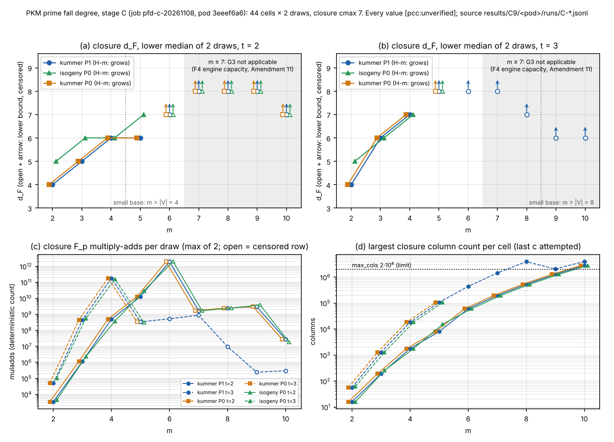

# RESULTS: PKM prime fall-degree study, stage C and gate G4 (job `pfd-c-20261108`)

**Verdict (derived by the preregistration's stage C rules, applied as written; protocol sha256 `ef5e18ea...`, Amendments 1-11):** `[pcc:unverified]`

- **H-m (fixed `t`, ladder C): "grows in m" on all six ladders.** P1 Kummer `t = 2` and `t = 3`, P0 Kummer `t = 2` and `t = 3`, P0 2-isogeny `t = 2` and `t = 3`. The median `d_F` rises by 2 or 3 between `m = 2` and the largest `m` with an exact median, and every censored median beyond it is a lower bound at or above that value.
  - The reading does not depend on any `m >= 7` row. It also holds with `m <= 6` only.
  - It depends on a small-base cell in one ladder: without P0 isogeny `t = 2`, `m = 5` (`|V| = 4 < m`) that ladder would read "mixed" (5, 6, 6). §6 says small-base cells "enter the rule", so the registered reading is "grows".
  - **G3 for stage C passed on the `m <= 6` cells** (job `pfd-g3c-20261109`: 98 capped runs, 0 disagreements, exactly the Amendment 11 within-capacity set; §2a). The `m >= 7` cells are "G3 not applicable (F4 engine capacity)". H-m uses closure values only, which G3 does not gate (Amendment 11). **Under Amendment 11's stop rule (0 disagreements), the study continues in the `R2_READY.md` order.**
- **H-LFD:** no new reading from stage C.
  - The `m = 2` stage C systems are identical to stage A's `t = 2, 3` systems, and all 12 draws agree field for field, so the stage A ladders are unchanged.
  - `m = 3..6`: the ladders belong to stage B (`pfd-b`; no stage B row was available to this analysis). The stage C cells are their `t = 2, 3` points: **pending `pfd-b`**.
  - `m >= 7`: no completed `N` on any ladder, so no reading.
- **H-FFD, H-gap and G2: not applicable to this job.** No `D` row exists for any stage C cell. `run.sh` has no `d-C` stage, and the `DC-*` rows Amendment 3 names were never run. "Rows without `D` do not enter this rule" (§6).
- **H-null:** stage C has no null arm. **Amendments 6, 7 B and 8:** no stage C cell enters their readings.
- **Amendment 10 (high λ):** no stage C cell is high-lambda. The largest λ is 5.6e-3 (P0, `t = 3`, `m = 5`). **Amendment 7 C:** no cell is "possibly decomposable" (every λ < 0.01). Every Kummer `m = 2` draw has `grid_zeros = 0`, from the stage A certificate on the same systems.

Gates:

| gate | result |
|:--|:--|
| G1 | **pass**, 6 hand cases |
| G2 | not checkable: no `D` rows in this job |
| G3 | **not run (tool defect)** in `pfd-c` (Amendment 11). Stage C: **pass on `m <= 6`** in job `pfd-g3c-20261109` (98 capped runs over 56 draws in 28 cells, 0 disagreements); `m >= 7`: G3 not applicable (F4 engine capacity) |
| G4 | **pass**: 32 planted draws in 16 cells. `1` never enters a closure, and every planted point solves its generators |

**G4 and stage A.** Stage A's RESULTS lists U4, "stage A is reported conditional on G4". G4 has now run as registered (`run.sh g4`, Amendment 1's `cmax 5`), on the same image and binaries as `pfd-a`, and it passed. **The U4 condition is met.** Stage A's readings stand without that condition. G4 checks the closure on planted systems at `m = 2, 3` only (Kummer `t <= 6` at `m = 2`, `t <= 3` at `m = 3`, `c <= 5`). It does not reach stage A's `t >= 7` or `c = 6, 7`. That is its registered scope, not a shortfall of this run.

No hypothesis or rule was changed. No outcome here is an `S`, a price or a leaderboard row (§8).

Evidence classes:

- **measured**: read from the job's files under `results/C9/3eeef6a6-9565-415c-918c-b3f92801aafc/`;
- **derived**: computed from those files by the scratchpad scorer `pkm_c_score.py` (§9), or by the committed tool named there;
- **cited**: a repository document says so.

Every number is `[pcc:unverified]`. `C9/<pod>` below abbreviates `results/C9/3eeef6a6-9565-415c-918c-b3f92801aafc`.

## 0. Execution record (measured, unless marked)

- **Job**
  - Job `pfd-c-20261108`, job uid `cf7eb7d1-...`, pod `pfd-c-20261108-hp5bb`, uid `3eeef6a6-9565-415c-918c-b3f92801aafc`.
  - The request is `requests_r2c/pfd-c.json`: command `entry.sh g1 g4 hky-C g3`, cpu 12, memory 56Gi, `seconds` 86400, no instance pin, `protocol_sha256 7bfc1dec...` (Amendments 1-9 at submission).
  - The pod ran from 2026-11-08T22:50:08Z to 2026-11-09T02:38:38Z, 13,710 s (derived), and used 15.9% of the deadline. **Exit code 1, reason `Error`. The job FAILED.**
  - The exit was read from the EKS audit log, because the Pod object was gone: `receipts/C9/collect-f01/status-with-audit-pod.json`.
- **Salvage**
  - Card `cards/CARD-pkm-falldegree-unblock-20261107-pfd-c-C9-F01` (receipt: 10 of 10 steps succeeded) downloaded the 76 result objects and verified them against `receipts/C9/local-sha256-01.txt`.
  - `sha256sum -c` was re-run in this analysis: 76 OK.
- **Amendment 9 context**
  - `host.txt` records `nproc 12`, `rayon: 12`, seed 1347112276, an Intel Xeon Platinum 8488C, MemTotal 64,776,600 kB and kernel 6.18.54-121.166.amzn2023. The instance type is not recorded.
  - Budgets are unchanged: every row's `budget_seconds` is 1800.
- **Image and binaries**
  - Image `isolab/tasks@sha256:0d6b2ecd...`, the same digest as `pfd-a`, built from source `f13a690df0`.
  - `binary.sha256` is identical to `pfd-a`'s (derived: `diff` of the hash columns): `pkm_tower_pilot f78f3959...`, `prime_fall_degree_tools 7e8a6703...`, `hky_fp_tower_check c36d324e...`, `pfd_grid_zeros 96283361...`.
- **Stages (`progress.txt`)**

  | stage | time (UTC) | duration (derived) | exit |
  |:--|:--|--:|:--|
  | `g1` | 22:50:09 | under 1 s | 0 |
  | `g4` (4 runs) | 22:50:09 to 22:50:20 | 11 s | 0, 0, 0, 0 |
  | `hky-C` (31 runs) | 22:50:20 to 02:38:36 | 3 h 48 min | 0 on all 31 |
  | `g3` | 02:38:36 | 0 s | **101** |

  - The two longest closure runs are `C-t2-m6-p0`, 7,966 s, and `C-t2-m6`, 3,663 s. Each closure stopped at its 1800 s budget (or, for the P0 isogeny draws, at `max_entries`) at `c = 7`.
- **The failure, and Amendment 11**
  - `gates/g3.log` holds five panic lines. Two pilot subprocesses failed at `f4_fp_tower.rs:736:17` ("index out of bounds: the len is 4 but the index is 4"), and `gate3` then panicked at `prime_fall_degree_tools.rs:523` and `:552`. `gates/g3.jsonl` is 0 bytes.
  - Amendment 11 (frozen 2026-11-09, before any stage C row was read) traces this to `gate3` launching capped F4 at `t = 2`, `m >= 7`, where the F4 engine's `MAX_FREE = 4` is exceeded (`n_free = m − 2`).
  - It records `pfd-c`'s `g3` stage as **"not run (tool defect)", not as a §4 gate failure**. That is the main session's reading, and the owner may overrule it.
  - It keeps the `hky-C` rows, labels `m >= 7` cells "G3 not applicable (F4 engine capacity)", and moves stage C's G3 to the separate job `pfd-g3c-20261109` over the 19 within-capacity files. **That job has run and passed: "G3: 98 capped runs, 0 disagreements", exit 0 (§2a).**
- **Blindness.** This analysis is the first reading of the stage C rows. Amendment 11 was frozen before it, and nothing here changes a rule.

## 1. Instrument check (derived from `progress.txt`, `run.sh` and the row files)

- **Files.** `run.sh hky-C` registers 31 run files: P1 Kummer `C-t{2,3}-m{2..10}`, and P0 Kummer + isogeny `C-t2-m{2..10}-p0` and `C-t3-m{2..5}-p0`. The P0 arm is limited to `t <= tmax0(m)`, which is 2 for `m >= 6` (Amendment 1).
  - 31 of 31 are present. None is missing or extra.
- **Arguments.** Every `start` line in `progress.txt` carries argv identical to what `run.sh` generates for that file, for all 31 C files and the 4 `g4` files. That includes `--planted 0 --random 2`, `--hky-cmax 7`, `--budget 1800`, `--hky-max-cols 2000000`, `--hky-max-entries 300000000` and `--t-min t --max-t t`.
- **Cells and draws.** 44 registered `(p, kind, m, t)` cells, each with exactly 2 draws (`target_index` 0 and 1): 88 draws.
  - No duplicate draw.
  - Every row has the file's `p`, `m` and `t`, `control tower`, `target random`, `engine hky_fp_tower`, `hky_cmax 7`, and `0 <= x_r < p`.
  - Every summary line reads `seed 1347112276` (`0x504B4D54`), `random_per_cell 2`, `planted_per_cell 0`, `planted_violations 0` and `budget_seconds 1800`, and its row count matches.
  - All 88 `x_r` values are distinct within each prime.
- **Closure-internal consistency.** On every row, the reported `last_fall_degree` equals the first `c` whose closure contains `1`, and that closure is the last one. A row without `1` either reached `c = 7` uncensored (`censored_at null`) or stopped at the `c` named by `censored_at`.
- **rng identity (seeds and `x_r` as registered)**
  - The 12 Kummer and isogeny `m = 2` draws at `t = 2, 3` (P1 and P0) repeat stage A's systems: `R9/<pod>/runs/A-m2-tower.jsonl` and `A-m2-tower-p0.jsonl`, the same seed and command shape.
  - All 12 agree on `x_r`, `curve`, `tower`, `last_fall_degree`, `first_fall_degree`, `falls` and closure `muladds`: 0 mismatches. This is the Amendment 2/4 "repeats must agree" check, on the rows that exist. The first run's stage C rows are lost, so Amendment 4's comparison against them cannot be made.
  - The development check rows `devcheck/dev-M4-t2-k0.jsonl` and `devcheck_r2/dev-m4-tower.jsonl` (Kummer `m = 4`, `t = 2`, draw 0, closure to `cmax 5`) have the same `x_r 1102336260` and curve as `C-t2-m4` draw 0. Their "no `1` up to `c = 5`" agrees with `d_F = 6` here.
- **Cross-check with the committed scorer.** `prime_fall_degree_tools score` was run on a copy of the 31 C files. It was a dev glibc build; its source is byte-identical to `f13a690df0`.
  - Its 44 cells match this analysis on median `d_F` (value and censoring flag), median `ffd`, λ and the small-base flag: 0 mismatches.
  - Its H-m readings match on all six ladders: "grows".
  - It reports G2 "0 draws checked" (no `D` rows), 0 repeats and 0 planted violations.
  - It prints `>8` for "`1` absent up to `cmax 7`" (its "value `cmax + 1`, flag `>`" convention). This file writes `> 7`, the same bound.
- **Nothing is missing or duplicated.** Every registered stage C cell has its two draws.

## 2. Gates

| gate | registered text (§4) | this job | result |
|:--|:--|:--|:--|
| G1 | `cargo test --lib hky_fp_tower` passes (hand cases) | `hky_fp_tower_check` prints six `ok` lines and `G1: 6 cases pass` (`C9/<pod>/gates/g1.log`), exit 0 | **pass**. As in stage A, the registered command runs 0 tests. The cases live in the example (`RESTART.md` step 2). |
| G2 | `d_F <= D` on Kummer/isogeny `m = 2` `t <= 10`, `m = 3` `t <= 4`, `m = 4` `t <= 3` | stage C contains `m = 3, 4` cells at `t = 2, 3`, inside G2's registered set, but no `D` row | **not checkable here**. Pending any `D` rows for these systems: stage B's `d-B` covers the same systems, if B repeats them as stage A's `m = 2` rows were repeated (derived from the shared seed; not verified). |
| G3 | closure contains `1` at `c` iff capped F4 refutes at `c` | `g3` exit 101 before any comparison; `g3.jsonl` empty | **not run (tool defect)** (Amendment 11). Stage C: **pass on the `m <= 6` cells** in job `pfd-g3c-20261109` (§2a); `m >= 7`: not applicable. |
| G4 | on planted systems the closure never contains `1`, and every generator vanishes at the planted point | `run.sh g4`: `g4-kummer-m2` (P1, `t = 1..6`), `g4-kummer-m3` (P1, `t = 2, 3`), `g4-isogeny-m2` (P0, `t = 1..6`), `g4-isogeny-m3` (P0, `t = 2, 3`); `--planted 2 --random 0 --hky-cmax 5` | **pass**: 32 rows, 16 cells × 2 draws. `1` is in 0 closures at any `c`, `planted_ok` is `true` on 32 of 32 rows, and the summary lines sum to 0 planted violations. 0 censored; every row reached `c = 5`. All four runs exit 0. |

- **G4 detail.**
  - The pilot forces `t >= 2` at `m >= 3` (Amendment 4), so `--t-min 1` gives `t = 2, 3` at `m = 3`.
  - The closures start at `hky_cmin`, the reduced generators' degree. So they test `c = 2..5` for Kummer `m = 2` and for both kinds at `t = 1`, `c = 3..5` for Kummer `m = 3`, and `c = 4, 5` for isogeny at `t >= 2`.
  - Source: `C9/<pod>/runs/g4-*.jsonl`.
- **What G4 means for stage A (U4).** U4 said: "Stage A is reported here conditional on G4, whose first-run pass (Amendment 3) has no surviving records." G4 has now passed on the frozen image, so the condition holds and stage A's readings are no longer conditional on it.
  - That assumes G4 counts once for the study. Amendment 3 recorded one G4 pass; whether gates are per stage or per study is UNRESOLVED in Amendment 11 for G3, and G4 raises the same question. G4 has no per-job outcome that would differ here.
  - G4 guards against a closure that wrongly derives `1`, which would make `d_F` read low. It cannot detect a closure that misses `1`.

## 2a. Stage C G3 job (`pfd-g3c-20261109`; measured, and derived where marked)

- **Execution.** Job `pfd-g3c-20261109`, the Amendment 11 §4.4 command on the frozen image. The pod ran 2026-11-09T20:21:19Z to 20:21:59Z and exited 0; job state `succeeded` (`receipts/G1/collect-v02/status-with-audit-pod.json`). `host.txt`: `nproc 12`, `rayon: 12`, Intel Xeon 6975P-C (no instance pin, as Amendment 11 sets). `binary.sha256`: `pkm_tower_pilot f78f3959...` and `prime_fall_degree_tools 7e8a6703...`, the frozen binaries.
- **Collection.** Card `cards/CARD-pkm-falldegree-unblock-20261107-pfd-g3c-G1-V02` collected it (receipt: 10 of 10 steps succeeded). Two earlier collect cards stopped without collecting and changed no data: `G1-V01` (the pod record still existed, so the audit helper refused, exit 60) and `G1-C01` (the pod record had gone, verify exit 50). Their receipts are kept under `receipts/G1/`.
- **Inputs.** `gates/g3-inputs.sha256` lists 19 files. They are exactly Amendment 11's within-capacity set (`C-t2-m{2..6}`, `C-t2-m{2..6}-p0`, `C-t3-m{2..6}`, `C-t3-m{2..5}-p0`), and all 19 hashes match `C9/<pod>/runs/` (re-checked here: 19 OK). The job read exactly `pfd-c`'s rows.
- **Result.** `gates/g3.log`: "G3: 98 capped runs, 0 disagreements". `gates/g3.exit`: "g3 exit 0". **Pass** by the Amendment 11 test (exit 0 and ", 0 disagreements").
- **Re-derived from `gates/g3.jsonl` (derived, `pkm_c_g3check.py`).**
  - 98 lines, no duplicate `(system, cap)`. `agree` true on 98 of 98; `seed_match` true on 98; `f4_timed_out` false on 98. 42 runs refute.
  - Coverage: 56 systems (all draws of the 28 within-capacity `(p, kind, m, t)` cells, 2 each), largest `m` 6, largest `N` 18. No `m >= 7` cell is present.
  - The expected work, built from `pfd-c`'s closure rows with `gate3`'s cap rule restricted to Amendment 11's scope (`m <= 6`, `N <= 20`), is 98 runs: caps `d − 1` (must not refute) and `d` (must refute) on the 42 exact draws, and cap `d − 1` (must not refute) on the 14 censored draws. That is cap 6 at `t = 2`, `m = 6` (3 arms, `d_F >= 7`) and cap 7 at `t = 3`, `m = 5` (3 arms) and `m = 6` (P1) (`d_F > 7`). **The job's 98 runs equal that set exactly: 0 missing, 0 extra.** On every run, F4's refutation equals the expected one, and the row's `closure_contains_one` equals the closure.
  - Caps per cell: Kummer `m = 2`: 3, 4; Kummer `m = 3`: 4, 5 (`t = 2`) and 5, 6 (`t = 3`); `m = 4`: 5, 6 and 6, 7; Kummer `m = 5`, `t = 2`: 5, 6; isogeny `m = 2`: 4, 5; isogeny `m = 3`: 5, 6; isogeny `m = 4`: 5, 6 and 6, 7; isogeny `m = 5`, `t = 2`: 6, 7; `t = 2`, `m = 6`: 6 (all arms); `t = 3`, `m = 5, 6`: 7. The same for P0 and P1 Kummer. Full list: `pfdC_summary.json` key `G3_job`.
- **Reading (Amendment 11).** **Stage C's G3 passed on the `m <= 6` cells. The `m >= 7` cells are "G3 not applicable (F4 engine capacity)".** Under Amendment 11's stop rule ("If it reports 0 disagreements, the study continues in the `R2_READY.md` order"), **the study continues**: `pfd-b`, then the `pfd-x` capped runs.
- **What the pass covers.** Capped F4 agrees with the closure at the two caps tested per system, at `n_free <= 4`. It also confirms, by an independent engine, the "> 7" closure outcome at `t = 3`, `m = 5, 6` and the "≥ 7" lower bound at `t = 2`, `m = 6` (cap 6 does not refute). It says nothing about `m >= 7`, where the closure stays unchecked (§4).

## 3. Per-`(t, m)` tables (stage C, `m = 2..6`)

Values are the closure `d_F` per draw, k0 / k1, with `ffd` and the censoring per §2:

- "none": exact `d_F`.
- "cmax 7, no 1": the closure reached `cmax 7` without `1`, so `d_F > 7`.
- "budget @c7", "max_entries @c7": the closure was stopped by that limit at `c = 7`, so `d_F >= 7`.

The median is the lower median of the 2 draws, written `>=` when censored. λ uses `|V| = 2^t` (Amendment 10). Small base means `m > |V|` (§5, Amendment 4).

Sources: `C9/<pod>/runs/C-t{2,3}-m{2..6}.jsonl` (P1 Kummer) and `C-t{2,3}-m*-p0.jsonl` (P0 Kummer and isogeny). All values are measured, and the medians are derived.

### Table 1. `t = 2` (`|V| = 4`)

| m | N | small base | λ (P1 / P0) | P1 Kummer `d_F` k0 / k1 | P0 Kummer `d_F` k0 / k1 | P0 2-isogeny `d_F` k0 / k1 | median `d_F` (P1K / P0K / P0iso) |
|--:|--:|:--|:--|:--|:--|:--|:--|
| 2 | 4 | no | 7.9e-09 / 2.0e-05 | 4 / 4 (ffd 4 / 4; none) | 4 / 4 (ffd 4 / 4; none) | 5 / 5 (ffd 5 / 5; none) | **4 / 4 / 5** |
| 3 | 6 | no | 2.1e-08 / 5.4e-05 | 5 / 5 (ffd 4 / 4; none) | 5 / 5 (ffd 4 / 4; none) | 6 / 6 (ffd 5 / 5; none) | **5 / 5 / 6** |
| 4 | 8 | no | 4.2e-08 / 1.1e-04 | 6 / 6 (ffd 4 / 4; none) | 6 / 6 (ffd 4 / 4; none) | 6 / 6 (ffd 5 / 5; none) | **6 / 6 / 6** |
| 5 | 10 | yes | 6.8e-08 / 1.7e-04 | 6 / 6 (ffd 4 / 4; none) | 6 / 6 (ffd 4 / 4; none) | 7 / 7 (ffd 5 / 5; none) | **6 / 6 / 7** |
| 6 | 12 | yes | 9.0e-08 / 2.3e-04 | ≥7 / ≥7 (ffd 4 / 4; budget @c7) | ≥7 / ≥7 (ffd 4 / 4; budget @c7) | ≥7 / ≥7 (ffd 5 / 5; max_entries @c7) | **≥7 / ≥7 / ≥7** |

### Table 2. `t = 3` (`|V| = 8`)

| m | N | small base | λ (P1 / P0) | P1 Kummer `d_F` k0 / k1 | P0 Kummer `d_F` k0 / k1 | P0 2-isogeny `d_F` k0 / k1 | median `d_F` (P1K / P0K / P0iso) |
|--:|--:|:--|:--|:--|:--|:--|:--|
| 2 | 6 | no | 3.2e-08 / 8.1e-05 | 4 / 4 (ffd 4 / 4; none) | 4 / 4 (ffd 4 / 4; none) | 5 / 5 (ffd 5 / 5; none) | **4 / 4 / 5** |
| 3 | 9 | no | 1.7e-07 / 4.3e-04 | 6 / 6 (ffd 4 / 4; none) | 6 / 6 (ffd 4 / 4; none) | 6 / 6 (ffd 5 / 5; none) | **6 / 6 / 6** |
| 4 | 12 | no | 6.8e-07 / 1.7e-03 | 7 / 7 (ffd 4 / 4; none) | 7 / 7 (ffd 4 / 4; none) | 7 / 7 (ffd 5 / 5; none) | **7 / 7 / 7** |
| 5 | 15 | no | 2.2e-06 / 5.6e-03 | >7 / >7 (ffd 4 / 4; cmax 7, no 1) | >7 / >7 (ffd 4 / 4; cmax 7, no 1) | >7 / >7 (ffd 5 / 5; cmax 7, no 1) | **≥8 / ≥8 / ≥8** |
| 6 | 18 | no | 5.8e-06 / — | >7 / >7 (ffd 4 / 4; cmax 7, no 1) | not registered (`t > tmax0(6) = 2`) | not registered | **≥8 / — / —** |

- **The two draws are equal in every cell** (`d_F`, `ffd` and censoring), so the lower-median convention plays no role.
- **P1 and P0 Kummer agree in every cell**, on `d_F`, `ffd`, column counts and censoring (measured). Their closure `muladds` agree to within 0.001% (largest relative difference 3.5e-6, derived). So for stage C, the Kummer–isogeny comparison at P0 is not confounded by the prime (Amendment 1's concern), as far as these cells show.
- **`ffd` is constant**: 4 on every Kummer draw and 5 on every isogeny draw, at every `m` and `t`, including the censored rows. This is a description. No stage C rule uses `ffd` without `D`.
- Censored rows at `m <= 6`: `t = 2`, `m = 6` (all three arms, limit-stopped at `c = 7`), and `t = 3`, `m = 5` (three arms) and `m = 6` (P1), which reached `cmax 7` without `1`. These are the within-capacity rows where `pfd-g3c` tested capped F4 at cap `d − 1` (none refuted, as required; §2a): cap 7 for "> 7" rows and cap 6 for "≥ 7" rows (`gate3`, `prime_fall_degree_tools.rs:461-475`, derived from source).

## 4. The `m >= 7` block: "G3 not applicable (F4 engine capacity)" (Amendment 11)

**Disclosure required by Amendment 11.** At `m >= 7` the closure runs with 5-8 free variables (`n_free = m − 2`). **No gate checks the closure at that width.** The G1 hand cases use `n_free ∈ {0, 1, 3}`, G3 reaches at most 4, and G4 runs at `m = 2, 3`. These rows rest on the closure alone. Their closure values enter H-m and H-LFD as registered. No capped-F4 value or `D` exists for them, or may be made by any engine, so they enter neither H-FFD nor H-gap.

Sources: `C9/<pod>/runs/C-t2-m{7..10}.jsonl`, `C-t2-m{7..10}-p0.jsonl` and `C-t3-m{7..10}.jsonl` (measured).

### Table 3. `t = 2`, `m = 7..10` (all small base, `|V| = 4 < m`)

| m | N | λ (P1 / P0) | P1 Kummer `d_F` k0 / k1 | P0 Kummer `d_F` k0 / k1 | P0 2-isogeny `d_F` k0 / k1 | median `d_F` (P1K / P0K / P0iso) | label |
|--:|--:|:--|:--|:--|:--|:--|:--|
| 7 | 14 | 1.0e-07 / 2.6e-04 | >7 / >7 (ffd 4 / 4; cmax 7, no 1) | >7 / >7 (ffd 4 / 4; cmax 7, no 1) | >7 / >7 (ffd 5 / 5; cmax 7, no 1) | **≥8 / ≥8 / ≥8** | G3 not applicable (F4 engine capacity) |
| 8 | 16 | 1.0e-07 / 2.6e-04 | >7 / >7 (ffd 4 / 4; cmax 7, no 1) | >7 / >7 (ffd 4 / 4; cmax 7, no 1) | >7 / >7 (ffd 5 / 5; cmax 7, no 1) | **≥8 / ≥8 / ≥8** | G3 not applicable (F4 engine capacity) |
| 9 | 18 | 9.2e-08 / 2.4e-04 | >7 / >7 (ffd 4 / 4; cmax 7, no 1) | >7 / >7 (ffd 4 / 4; cmax 7, no 1) | >7 / >7 (ffd 5 / 5; cmax 7, no 1) | **≥8 / ≥8 / ≥8** | G3 not applicable (F4 engine capacity) |
| 10 | 20 | 7.3e-08 / 1.9e-04 | ≥7 / ≥7 (ffd 4 / 4; max_cols @c7) | ≥7 / ≥7 (ffd 4 / 4; max_cols @c7) | ≥7 / ≥7 (ffd 5 / 5; max_cols @c7) | **≥7 / ≥7 / ≥7** | G3 not applicable (F4 engine capacity) |

### Table 4. `t = 3`, `m = 7..10` (P1 Kummer only; P0 has `tmax0 = 2`)

| m | N | small base | λ (P1) | P1 Kummer `d_F` k0 / k1 | median `d_F` | label |
|--:|--:|:--|:--|:--|:--|:--|
| 7 | 21 | no | 1.3e-05 | >7 / >7 (ffd 4 / 4; cmax 7, no 1) | **≥8** | G3 not applicable (F4 engine capacity) |
| 8 | 24 | no | 2.6e-05 | ≥7 / ≥7 (ffd 4 / 4; max_cols @c7) | **≥7** | G3 not applicable (F4 engine capacity) |
| 9 | 27 | yes | 4.7e-05 | ≥6 / ≥6 (ffd 4 / 4; max_cols @c6) | **≥6** | G3 not applicable (F4 engine capacity) |
| 10 | 30 | yes | 7.5e-05 | ≥6 / ≥6 (ffd 4 / 4; max_cols @c6) | **≥6** | G3 not applicable (F4 engine capacity) |

- **Every `m >= 7` value is censored.** There are 14 cells and 28 draws:
  - 18 draws reach `cmax 7` without `1` (`d_F > 7`);
  - 10 are stopped by `max_cols 2·10⁶`, at `c = 7` (`t = 2`, `m = 10`, three arms; `t = 3`, `m = 8`) or at `c = 6` (`t = 3`, `m = 9, 10`).
- No `m >= 7` draw has an exact `d_F`, so none of them sets the "largest completed `m`" of an H-m ladder. Each is a lower bound at or above the largest completed median, and none contradicts "grows".
- None is "possibly decomposable" (λ < 0.01 throughout), and none is high-lambda.

## 5. Censoring (§2)

Of 88 draws (derived from the rows):

| status | draws | reads |
|:--|--:|:--|
| exact (`1` enters at `c = d_F <= 7`) | 42 | `d_F` |
| `cmax 7` reached without `1`, no limit hit | 28 | `d_F > 7` (censored) |
| stopped by `--budget 1800` at `c = 7` | 4 | `d_F >= 7` (censored) |
| stopped by `max_entries 3·10⁸` at `c = 7` | 2 | `d_F >= 7` (censored) |
| stopped by `max_cols 2·10⁶` at `c = 7` or `c = 6` | 12 | `d_F >= c` (censored) |

- No censored row was dropped or redrawn.
- The pilot sets `timed_out: true` on any limit stop, `max_cols` included. The limit that fired is in the last closure's `censored` field.
- **Budget stops and the thread count (Amendment 9).** Four rows (Kummer `t = 2`, `m = 6`, both primes) stopped on the wall budget after about 1820-1940 s, partway through `c = 7` (141,813 rows reduced on each P1 draw). Amendment 9 warns that at 12 rather than 14 threads a system close to its budget may be censored. Such a row reads as a one-sided bound, as here. The closure's batches do not depend on the thread count, so the operation counts are comparable.
- The `max_cols`-censored rows report the column count that tripped the limit. That count, not a finished closure, is what Figure 1 (d) shows.

## 6. Section 6 hypotheses for stage C (as written)

### H-m (fixed `t`, ladder C)

The rule is "flat in m", "grows in m" (rise ≥ 2) or "mixed", on medians, with small-base cells reported and entering the rule. It is applied as the committed scorer applies the level rule: to completed (exact) medians in `m` order, reading "grows" if the last completed median is at least the first plus 2. Censored medians are listed.

| ladder | `m` | median `d_F` | completed `m` (values) | rise | **H-m** | `m <= 6` only | without small-base cells | with lower bounds at largest `m` |
|:--|:--|:--|:--|--:|:--|:--|:--|:--|
| P1 Kummer, `t = 2` | 2-10 | 4 5 6 6 ≥7 ≥8 ≥8 ≥8 ≥7 | 2-5 (4 5 6 6) | 2 | **grows** | grows | grows (4 5 6) | grows (≥7 vs 4) |
| P1 Kummer, `t = 3` | 2-10 | 4 6 7 ≥8 ≥8 ≥8 ≥7 ≥6 ≥6 | 2-4 (4 6 7) | 3 | **grows** | grows | grows | grows (≥6 vs 4) |
| P0 Kummer, `t = 2` | 2-10 | 4 5 6 6 ≥7 ≥8 ≥8 ≥8 ≥7 | 2-5 (4 5 6 6) | 2 | **grows** | grows | grows (4 5 6) | grows |
| P0 Kummer, `t = 3` | 2-5 | 4 6 7 ≥8 | 2-4 (4 6 7) | 3 | **grows** | grows | grows | grows |
| P0 2-isogeny, `t = 2` | 2-10 | 5 6 6 7 ≥7 ≥8 ≥8 ≥8 ≥7 | 2-5 (5 6 6 7) | 2 | **grows** | grows | **mixed** (5 6 6) | grows |
| P0 2-isogeny, `t = 3` | 2-5 | 5 6 7 ≥8 | 2-4 (5 6 7) | 2 | **grows** | grows | grows | grows |

- **Robustness (derived).** The reading is the same under every convention tried: completed medians only; the largest `m`'s lower bound against the smallest `m`; `m <= 6` only; and with Amendment 11's `m >= 7` rows. The one exception is dropping small-base cells, which turns P0 isogeny `t = 2` to "mixed". §6 rules that out ("Small-base cells are reported but enter the rule").
- **The rise is set at small `m`.** On every ladder the completed medians stop at `m = 4` or 5, about `N <= 12`. Beyond that every value is a censored lower bound. "Grows" says the median rose by at least 2 between `m = 2` and `m = 4`-5. Whether `d_F` keeps rising at `m >= 6` is not measured. The `m = 6`, `t = 2` closures stopped at `c = 7` by limit, and the `m = 7..9`, `t = 2` closures found no `1` up to 7.
- **Quantity.** The H-m sentence does not name `d_F`. It is applied to `d_F` here, as the committed scorer does, and as Amendment 11 implies ("closure values ... enter ... H-m"). On `ffd` every ladder would read "flat" (4 Kummer, 5 isogeny). That is listed as UNRESOLVED U-C3, not chosen.
- **Small-base cells** (flag of §5 and Amendment 4): `t = 2`, `m = 5..10`, and `t = 3`, `m = 9, 10`. The E8 effect the flag anticipates ("may make it read low") is not visible. The small-base medians are equal to or above their neighbours (`t = 2`: 6, 6, 7 at `m = 5`; censored lower bounds beyond).

### H-LFD (on `(kind, m)` N-ladders)

- `m = 2`: the stage C systems are stage A's `t = 2, 3` systems, with identical rows (§1). Stage A's readings are unchanged (RESULTS.md §6).
- `m = 3..6`: the registered ladders are stage B's (§5 B, `t = 1 ...` until censored). Stage C supplies their `t = 2, 3` points, listed below. The reading is **pending `pfd-b`**.

  | ladder | `t = 2` | `t = 3` |
  |:--|:--|:--|
  | P1 Kummer `m = 3` | 5 | 6 |
  | P1 Kummer `m = 4` | 6 | 7 |
  | P1 Kummer `m = 5` | 6 | ≥8 |
  | P1 Kummer `m = 6` | ≥7 | ≥8 |
  | P0 Kummer `m = 3` | 5 | 6 |
  | P0 Kummer `m = 4` | 6 | 7 |
  | P0 Kummer `m = 5` | 6 | ≥8 |
  | P0 isogeny `m = 3` | 6 | 6 |
  | P0 isogeny `m = 4` | 6 | 7 |
  | P0 isogeny `m = 5` | 7 | ≥8 |

  The committed scorer prints two-point readings for these fragments ("flat" or "mixed"). They are not the registered ladders and are not reported as readings.
- `m >= 7` (Amendment 11 says these closure values enter H-LFD):
  - P1 Kummer `m = 7..10` has 2 points each (`t = 2, 3`), all censored: no completed `N`, **no reading**.
  - P0 `m = 7..10` has one point each: **no reading**.

### H-FFD and H-gap

- **Not applicable: no `D`.** §6 says "Rows without `D` ... do not enter this rule". Amendment 3 names `DC-*` rows (uncapped F4 on the C cells, `m <= 6`), but no stage of `run.sh` produces them, and no request in `requests_r2c/` or `requests_r2e/` runs them (Amendment 11 §4.2: "`run.sh` has no `d-C` stage").
- At `m >= 7` no `D` can exist (F4 capacity).
- This is listed as U-C1.

### H-null

No null control in stage C (§5 C registers Kummer and isogeny only).

### Amendment-specific rules

| amendment | rule | stage C outcome |
|:--|:--|:--|
| 1 | isogeny and Kummer-at-P0 only where λ < 0.1 (`tmax0`) | applied by `run.sh`. Largest P0 λ is 5.6e-3 (`t = 3`, `m = 5`) (derived) |
| 3 | Cell D procedure (`=D (F4)` where the closure does not decide, `m <= 6`) | **not applied: no `DC-*` rows** (stage C's G3 has passed, §2a). Affects the censored within-capacity cells `t = 2`, `m = 6` and `t = 3`, `m = 5, 6`. UNRESOLVED U-C1 |
| 4 | small-base flag, `m > |V|` allowed at random targets | `t = 2`, `m >= 5`; `t = 3`, `m >= 9`. Reported, and entering H-m |
| 7 C | Kummer `m = 2` decomposability certificate; "possibly decomposable" if no `1` and λ ≥ 0.01 | `grid_zeros = 0` on all 8 Kummer `m = 2` draws (stage A's `pfdA_grid_zeros.jsonl`, same `x_r`); every censored draw has λ < 0.01, so none is "possibly decomposable" |
| 10 | high-lambda (λ ≥ 0.1, `m >= 3`) cells excluded from every rule | none in stage C; nothing excluded (Amendment 10 itself predicted this) |
| 11 | `m >= 7` label, own block, disclosure; `g3` not run (tool defect); stage C G3 in a separate job (passed) | §4, §0 and §2a |

## 7. Operation counts (closure `F_p` multiply-adds per draw; measured; deterministic counts, not timings)

| arm | `t` | `m = 2` | 3 | 4 | 5 | 6 | 7 | 8 | 9 | 10 |
|:--|--:|:--|:--|:--|:--|:--|:--|:--|:--|:--|
| P1 Kummer | 2 | 3.48e3 | 1.15e6 | 4.94e8 | 1.28e10 | 1.92e12 (budget) | 1.71e9 | 2.41e9 | 2.99e9 | 2.74e7 (max_cols) |
| P1 Kummer | 3 | 5.02e4 | 4.45e8 | 1.78e11 | 3.39e8 | 5.21e8 | 8.84e8 | 9.41e6 (max_cols) | 2.43e5 (max_cols) | 2.98e5 (max_cols) |
| P0 2-isogeny | 2 | 4.58e3 | 2.28e6 | 3.77e8 | 2.89e10 | 2.00e12 (max_entries) | 1.67e9 | 2.41e9 | 3.88e9 | 1.79e7 (max_cols) |
| P0 2-isogeny | 3 | 1.05e5 | 5.51e8 | 1.56e11 | 3.08e8 | — | — | — | — | — |

- P0 Kummer equals P1 Kummer to 3 significant figures in every cell. The full per-draw table, with column counts and wall seconds, is in `results/C9/analysis/pfdC_summary.json` (`cells`, `draws`).
- **Observation, heuristic, not tested.** The closures that reach `cmax 7` without `1` cost 2-4 orders of magnitude less than the last exact closures. For example, `t = 2`, `m = 7` costs 1.7e9 with 195,604 columns, against 1.9e12 for the budget-stopped `m = 6` with 61,183 columns; `t = 3`, `m = 5` costs 3.4e8 against 1.8e11 at `m = 4`. A low-rank closure (no `1`, so far from full rank) is cheap to reduce: `dims` at `c = 7` for `t = 2`, `m = 7` reach 63,478 of 195,604 columns. That is consistent with these rows being genuine "no `1` up to 7" outcomes, not short-circuits. No gate tests it at `m >= 7`. At `m = 5, 6` (`t = 3`), the G3 job tested the same "> 7" outcome against capped F4 at cap 7, and F4 agreed on all 14 such draws: cap 7 does not refute (§2a).
- Cost per row is reported so that a degree is not mistaken for a cost (§8). No rule uses these counts.

## 8. UNRESOLVED (rules that cannot be applied with the rows that exist; no choice made after the data)

- **U-C1. `D` for stage C.** Amendment 3 registers `DC-*` rows and the Cell D procedure for C cells with `m <= 6`. No run exists or is requested.
  - H-FFD, H-gap and G2 cannot be applied to stage C.
  - The censored within-capacity cells (`t = 2`, `m = 6`; `t = 3`, `m = 5, 6`) stay one-sided, `≥ 7` or `> 7`.
  - Stage C's G3 has now passed (§2a), so capped F4 is validated on these systems. What remains is a director decision on `DC-*` (uncapped F4) requests and Amendment 3 capped steps. The G3 job's cap-`d − 1` rows themselves are gate rows, not `D` rows, and are not used as `d_F` values here.
- **U-C2. G3 for stage C: resolved, passed on `m <= 6`.** Job `pfd-g3c-20261109` reported 0 disagreements, so nothing in this file changes and the study continues (Amendment 11 stop rule).
  - Still the owner's to overrule: `pfd-c`'s own `g3` stage is recorded as "not run (tool defect)" rather than a §4 failure (the main session's reading, Amendment 11).
  - Still not decided by the registered text: whether G3 is one gate per stage or per study, and G3's literal "each `c` from 2 to `d_F`" versus the tool's two caps (stage A's U3 applies here too: 98 runs where the literal text implies more).
- **U-C3. H-m's quantity.** The H-m sentence does not name `d_F`. On `d_F` (applied here) every ladder reads "grows". On `ffd` every ladder would read "flat". Both are reported, and neither is chosen as a second reading.
- **U-C4. Censored medians in H-m.** §6 H-m, unlike H-LFD, does not say "completed". The completed-median convention (committed scorer) and the bound convention give the same reading on every ladder, so this does not change an outcome.
- **U4 (from stage A): met.** G4 passed in this job on the same binaries, so U4 is closed. Whether G4 (and G3) are per-study or per-stage gates is still not decided by the registered text (Amendment 11 §3). It does not change anything here, because G4 passed.

## 9. Caveats

- 2 random draws per cell, as registered. Both draws agree in every cell, so the medians carry no spread.
- Toy primes (`P1 = 2013265921`, `P0 = 786433`), `t = 2, 3`, `m <= 10` (§8). "Grows in m" here is evidence on an open question, not a complexity statement. It rests on `m <= 5`, `N <= 12`.
- `m >= 7` rows rest on the closure alone, at 5-8 free variables that no gate covers (§4).
- Wall seconds depend on the host and are given for budget context only. No L2, replay or A/A admission applies to command Jobs.
- The instance type is not recorded in `host.txt` (Amendment 7 A). The CPU model and memory are.
- The committed-scorer cross-check used a dev glibc build of unchanged source, not the image's musl binary. The job itself used the image binaries.
- The stage A grid-zero certificate (`results/R9/analysis/pfdA_grid_zeros.jsonl`) was reused for the 8 Kummer `m = 2` draws through `x_r` identity. It was not recomputed.
- `results/R9/analysis/` has no `pfdA_fig1.png`, although RESULTS.md §11 lists one beside the SVG (measured, `ls`). Stage A's figure is otherwise intact. Noted, not fixed here.

## 10. Figure, report and provenance of this analysis

- **Figure 1:** `results/C9/analysis/pfdC_fig1.svg` (PNG beside it, 150 dpi, from the same source).
  - (a, b) lower-median closure `d_F` against `m` at `t = 2, 3` per arm. Censored medians are open markers with arrows. `m >= 7` is shaded "G3 not applicable", and the small-base boundary is dotted.
  - (c) closure `F_p` multiply-adds per draw.
  - (d) largest closure column count, with the `max_cols` limit.
- **Short report:** `results/C9/analysis/pfdC_report.pdf`, 2 pages, matplotlib PDF backend (no Typst or LaTeX installed), inspected after rendering.
- **Summary:** `results/C9/analysis/pfdC_summary.json`. It holds the instrument check, rng identity, gates, censoring, 44 cells, H-m ladders with robustness, the committed-scorer cross-check, the G3 job's re-derivation (`G3_job`), stage durations and all 88 draws.
- **Scripts.** AGENTS.md forbids committed Python that generates results, so the scripts live in the scratchpad and are archived:
  - `scripts.tar.gz`, sha256 `4d681da5c5b5657cf797180abc6fba6ad4ea6cf43fa34fbedc20e349248621b8`, 22,391 bytes. Its location is in `results/C9/analysis/scripts-archive.json` and in the raw entry of `benchmarks/records/20261108T2223Z-pkm-fd-pfd-c.json`.

    | file | sha256 |
    |:--|:--|
    | `pkm_c_score.py` | `8971f57e...` |
    | `pkm_c_g3check.py` | `432ac255...` |
    | `pkm_c_fig.py` | `288c3ab3...` |
    | `pkm_c_report.py` | `4d1f8887...` |
    | `pkm_c_tables.py` | `879fc403...` |

  - The archive also holds `RUN.txt` (the exact commands), the committed scorer's stdout, `score.json` and `TABLE.md`, the scorer's stdout and the generated tables.
- **Outputs (sha256):**

  | file | sha256 |
  |:--|:--|
  | `pfdC_summary.json` | `3f601ae9...` |
  | `pfdC_fig1.svg` | `f1671a6e...` |
  | `pfdC_fig1.png` | `27873298...` |
  | `pfdC_report.pdf` | `73573fbd...` |

- **Raw:** `results/C9/3eeef6a6-9565-415c-918c-b3f92801aafc/`. The 76 files are hashed in `receipts/C9/local-sha256-01.txt` and stored in S3 by SHA-256 (bench record `raw`).

experiment.export/v1: not assembled, for the same reason as stage A (no machine-readable experiment.protocol/v1 for this study).

Sources checked: research-kb and Conductor are not installed in this environment (ROUND2_RULES.md), so none was queried. Read directly:

- `research/prime_fall_degree_20261027/PREREGISTRATION.md` (sha256 `ef5e18ea...`, verified), `run.sh` and `RESTART.md`;
- this directory's `AMENDMENT_R2_D_g3_scope.md` (Amendment 11), `AMENDMENT_R2_A_stageB_m6t6.md` (Amendment 10), `RESULTS.md` (stage A), `image/entry.sh`, `requests_r2c/pfd-c.json`, `cards/CARD-...-pfd-c-C9-F01.*` and `receipts/C9/*`;
- `examples/prime_fall_degree_tools.rs` (`d_f`, `lower_median`, `reading`, `score`, `gate3`);
- the stage C G3 job: `results/G1/7c2b54f1-afcd-474f-a9b8-c7b58ee44c04/` (`gates/g3.log`, `g3.jsonl`, `g3.exit`, `g3-inputs.sha256`, `host.txt`, `binary.sha256`), `cards/CARD-...-pfd-g3c-G1-V02.*` and `receipts/G1/*`.
