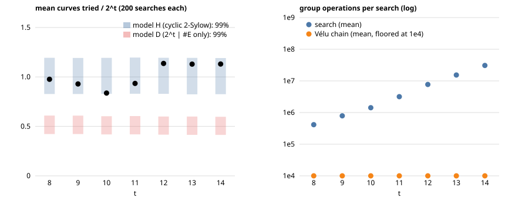

# Auxiliary-curve search at P1: replication and 200-seed sweep (2026-11-15)

Protocol frozen before data in `PROTOCOL.md` (commit `9bb74e1926`). Run locally on the 4-vCPU session machine.
Every number is `[pcc:unverified]`.

**Question (owner):** the isogeny factor base needs an auxiliary curve E′ whose group has a point of order 2^t. Did we
measure finding it, and do the results replicate?

**Answer:** before today, no. Each iso-a / iso-14 tower recorded one search per t, and its cost was neither counted nor
repeated. Now:

1. **Replication: 14/14.** `pkm_tower_pilot --aux-search` reran the cell seeds of the 14 recorded searches (t = 1..14).
   It reproduced (aux_a, aux_b, #E′, curves tried) for all 14 (`replicate.jsonl`). The t = 10..14 orders had already
   been recounted independently in C (`results/ISO/iso-a/recount-t10-13.json`, `iso-14/.../recount.json`).
2. **The search's rate is predicted exactly.** The search needs a cyclic 2-Sylow of order ≥ 2^t, not just 2^t | #E′.
   Under the Haar model (Frobenius uniform in SL₂(ℤ/2^t), p ≡ 1 mod 2^27), the acceptance probability is **exactly
   2^-t** (`predict.py`; brute force agrees for t ≤ 4). So the expected number of curves tried is **2^t**. The
   divisibility-only model D predicts about 2^(t−1).
3. **The 200-seed sweep agrees with H at every t and rejects D at every t.**

| t | mean tries | median | sd | mean / 2^t | H 99% | D 99% | KS p (vs Exp) | quantile of the recorded search |
|--:|--:|--:|--:|--:|:--|:--|--:|--:|
| 8 | 250 | 197 | 204 | 0.976 | [0.83, 1.19] | [0.42, 0.61] | 0.62 | 0.03 |
| 9 | 476 | 298 | 470 | 0.929 | [0.83, 1.19] | [0.42, 0.61] | 0.25 | 0.96 |
| 10 | 857 | 594 | 818 | 0.837 | [0.83, 1.19] | [0.42, 0.60] | 0.28 | 0.52 |
| 11 | 1,914 | 1,241 | 1,869 | 0.934 | [0.83, 1.20] | [0.42, 0.60] | 0.59 | 0.43 |
| 12 | 4,654 | 3,031 | 4,630 | 1.136 | [0.83, 1.19] | [0.42, 0.60] | 0.22 | 0.76 |
| 13 | 9,252 | 7,047 | 9,243 | 1.129 | [0.82, 1.19] | [0.41, 0.60] | 0.13 | 0.40 |
| 14 | 18,522 | 11,728 | 19,470 | 1.130 | [0.83, 1.19] | [0.41, 0.60] | 0.44 | 0.67 |

Readings, per the protocol: H holds at t = 8..14; D is rejected at t = 8..14. The sd ≈ mean (geometric). The recorded
single searches were ordinary draws: t = 8 (12 tries) and t = 9 (1,402) sit at the 3% and 96% quantiles. At t = 12..14
the means sit about 13% high, all three inside H's interval. The protocol allows a finite-p deviation there: only about
44, 22 and 11 traces lie in the progression. The data do not resolve whether that is real.

## Cost

| t | group ops per search (mean) | per curve tried | Vélu chain ops | ms per search |
|--:|--:|--:|--:|--:|
| 8 | 4.1 × 10^5 | 1,655 | 28 | 55 |
| 10 | 1.4 × 10^6 | 1,658 | 45 | 209 |
| 12 | 7.7 × 10^6 | 1,656 | 66 | 966 |
| 14 | 3.1 × 10^7 | 1,658 | 91 | 3,793 |

- Group operations are additions plus doublings (`GroupOps`). Almost all of them are Mestre/BSGS point counting:
  constant per curve (about 1,656, of order p^(1/4)).
- The search therefore costs about **1,656 · 2^t group operations**, and the chain is negligible.
- **Scope (owner, 2026-11-15): finding the auxiliary curve and the isogenies is not part of the success criteria.**
  This cost is a description of the setup, made once per prime. It is not compared with rho and enters no criterion or
  tier reading. `docs/ic/SUCCESS_CRITERIA.md` ("One target, cold"; the transfer-map rule) still says to charge
  target-independent setup in full. Whether to amend that document is the owner's decision; it is not changed here.
- Point counting by SEA instead of BSGS would lower the per-curve constant (not measured).

## Amendment A1: exact finite-p prediction and a confirmatory run (2026-11-15/16)

Frozen before data (`AMENDMENT_A1.md`, commit `1eb46c2a0f`).

**Exact prediction.** The number of accepted (a, b) is (p − 1)/2 · Σ_s [H(4p − s²) − H((4p − s²)/4)], summed over
traces s ≡ p + 1 (mod 2^t), with H the Hurwitz class number computed by counting reduced forms (`exact/hurwitz.c`).
- **Check.** At p = 257, 263 and 769 the formula equals a full enumeration of every curve at every t.
- **At P1.** The expected tries are 0.992–1.025 × 2^t for t ≤ 14, then 1.048 at t = 15 and 0.923 at t = 16. Finite p
  therefore does not explain an excess of 13%.

**Run.** Fresh seeds: 600 per t at t = 12, 13, 14 and 200 per t at t = 15, 16. That is 2,200 searches with the same
binary, stderr empty, and each output an exact in-order prefix of its shard. The session machine restarted once
mid-run and the processes resumed; no row was lost or repeated.

| t | n | mean tries / 2^t | exact E / 2^t | 99% interval | z |
|--:|--:|--:|--:|:--|--:|
| 12 | 600 | 1.028 | 1.010 | [0.91, 1.12] | +0.43 |
| 13 | 600 | 1.003 | 1.025 | [0.92, 1.14] | −0.52 |
| 14 | 600 | 0.910 | 0.997 | [0.89, 1.10] | −2.13 |
| 15 | 200 | 0.982 | 1.048 | [0.87, 1.26] | −0.89 |
| 16 | 200 | 1.023 | 0.923 | [0.76, 1.10] | +1.53 |

**Readings, as frozen.**
- The exact model holds at t = 12..16.
- The pooled z over t = 12..14 is −1.28: no miss.
- The first sweep's +13% at t = 12..14 did not recur. The A1 means are 1.03, 1.00 and 0.91. It reads as chance.
- Pooling both runs (800 per t) gives 1.055, 1.034 and 0.965, all inside their intervals.
- The cost per curve tried stays about 1,660 group operations up to t = 16.

The pilot's search therefore behaves exactly as uniform sampling of (a, b) with the cyclic-2-Sylow acceptance rule
predicts. The single searches in the iso-a/iso-14 towers were ordinary draws from it. Files: `AMENDMENT_A1.md`,
`exact/` (`hurwitz.c`, `traces.*`, `predict_exact.py`, `predict_exact.json`), `a1.*`, `analyze_a1.py`,
`a1_summary.json`.

## Files

- `PROTOCOL.md`, `predict.py` (frozen before data).
- `replicate.in` / `replicate.jsonl`.
- `sweep.in` (sha256 `2c7856d2…`), `sweep.out.0..3` (1,400 rows, stderr empty).
- `analyze.py` → `summary.json`, `fig1.svg`.
- `REPORT.pdf`.
- Binary: `pkm_tower_pilot` built at `9bb74e1926` plus the `--aux-search` edit in the same commit as this report;
  local sha256 `50c61dbf…`.

## Not claimed

No fall-degree reading changes. Isogeny factor bases show no solving-degree advantage (iso-a / iso-14 readings). This
study describes their setup (~2^t · p^(1/4) group operations per prime), outside the criteria.
