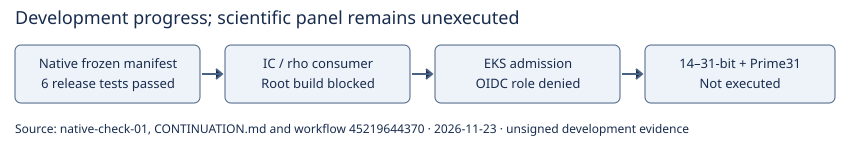

# PKM continuation: native frozen workloads

2026-11-23 · #5088 · producer-authored, unsigned [pcc:unverified]

The native workload generator and validator pass six release unit tests and
CLI validation/overwrite-refusal checks. Exact pre/post source hashes match.
The new `ic bench --prime-workload` adapter selects the same immutable target
list for IC and rho; its full integration tests have not run because the
root library emits inherited compilation errors. No new scale measurement or
source-pinned replay of the original panel has run.



The shared Rust module reuses original `factor-base` arithmetic. It freezes
p,a,b,r,h,P, scalar and canonical Q=[k]P; rejects duplicate/out-of-range scalars,
altered points, unknown fields and oversized inputs; and reports exact byte
SHA-256. A domain-separated SHA256 counter stream uses rejection sampling
without replacement. The F17/eight-target CLI fixture is a correctness fixture,
not a larger-curve experiment. See [native usage](native/README.md) and
[complete development receipts](native-check-01/result.json).

The consumer cross-checks targets with the actual solver backend, prevents
competing curve/repeat flags, and requires rho runs to cover either zero or
all frozen targets. It retains the inherited group-order validation status:
large group orders may still be caller-asserted and require independent
certification before admission. Legacy target selection retains its formula.
Two additional consumer integration tests were authored but remain unexecuted;
the six passing tests cover the shared module, not the full consumer.

The local full-consumer attempt first found a missing tracked sparse package.
After restoring it, compilation reached the original library and emitted ten
E0425 errors in `src/cryptanalysis/prime_root_trace.rs` (powers, gcds, previous,
r and g). This source was not modified; the owner lane must resolve its
verifier implementation. Raw build output is retained in continuation-evidence.

The existing [budget workflow log](https://github.com/isogeny-labs/crypto/actions/runs/45219644370)
now gives the exact access failure: `sts:AssumeRoleWithWebIdentity` was denied.
The displayed credential-step success masked its underlying failure through
continue-on-error. Budget reads were skipped. No new workflow or EKS job was
launched; live daily/monthly spent-plus-reserved balances remain unknown.

Upstream #5067 also advanced to `5f3a956f`: its reported fresh 13-bit instance
replication completed 31/32 candidate targets in each repeat and failed its
frozen gate. This is separate upstream evidence, not a new run by this session;
it must remain in the larger-panel failure/accounting record.

The proposed 14–31-bit panel and separate exact-Prime31 comparison remain open.
Resume needs the root consumer build/integration checks, certified untouched
curve manifests, incumbent/control and independent-rank/cold-cost admission,
plus existing EKS access and current budget/capacity/checkpoint receipts.
No performance scoreboard or graph changed: there is no new performance datum.

The attempted full-consumer command was:

```sh
cargo test --release --locked --bin ic bench::tests \
  --no-default-features
```
 It is a development check with Redis TLS
and jemalloc defaults disabled, not an original-protocol source replay.
No full-library pass or consumer qualification is asserted.

Development claim `PCC-20261123-32bcfc` has **unverified** standing. Documentation
whitespace and Rust formatting checks passed. The global benchmark-record gate
still reports 5,566 historical artifact/progress issues across 402 records;
those records were not modified. The append-only PCC chain passes against
the current #5067 parent. These publication checks do not admit a benchmark.
The full-consumer attempt has now exited 101; the
[build receipt](continuation-evidence/consumer-build.json) preserves the exact
command, both failures and the immutable base/source identities.
