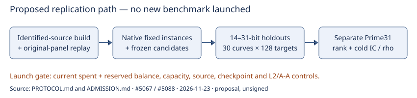

# Larger-scale PKM test: admission checkpoint

2026-11-23 · Draft #5088 · Producer-authored, unsigned [pcc:unverified]

The requested larger-scale test has **not run**. The source audit and proposed
panel are saved; source reproduction, native workload execution and budget
admission remain unresolved. No new performance data or scaling conclusion is
reported.

The proposed population is five untouched curves at each of 14, 16, 20, 24,
28 and 31 subgroup bits, 128 targets per curve, plus a separate population at
exactly p=2^31−1. Compare the original degree-16 policy and an explicitly
size-dependent tower policy separately, with exact-size interval controls.
Complete cold costs and independent relation rank feed the incumbent IC and
optimized single-target rho comparison. See [protocol](PROTOCOL.md) for controls,
multiple-comparison treatment, caps and unresolved implementation requirements.

The last available [budget telemetry run](https://github.com/isogeny-labs/crypto/actions/runs/45219644370)
failed and skipped its budget-read step. Artifact retrieval returned 403. This
runtime has no configured AWS identity; the GitHub route is documented but does
not waive the requirement to know current daily/monthly spent and reserved
amounts. No paid build or job was launched. See [audit](ADMISSION.md).

The old runner is Python and changes generic curve identity when seed or
repeat count changes. Extending it would not implement this independent-curve
protocol. A native manifest consumer and identified-source build/replay must
precede timing. Historical source-build errors are retained in
[the original study](../pkm_adaptive_sweep_20261123/REPORT.md); no claim is made
that those errors persist on current main.

Flow: planned panel = proposal above; attempted/completed new benchmark calls =
0/0; excluded new benchmark records = 0. No experiment export exists because
there was no experiment. Canonical leaderboard and progress-timeline graphs
remain unchanged: this audit adds no measured result or curve registration.

Publication checks: `git diff --check` passed. The bench-record gate initially
reported stale progress with zero visible records in the sparse checkout;
that is a tooling/input limitation, not a benchmark outcome. Full Rust checks
were not run: no Rust toolchain is installed and no Rust source was changed.

Next action: restore existing budget readback, then complete native source and
workload admission. This document preserves the request; it does not discharge
it.

After materializing historical benchmark records the global gate still failed
with unhydrated artifact/report inputs and stale progress (402 records, 5,566
reported issues). No benchmark records or progress outputs were modified.
Proposal claim PCC-20261123-8aec3f remains unverified. Existing obstruction:
[PKM complete cost](../../problems/symmetric-pkm-complete-cost.md).
