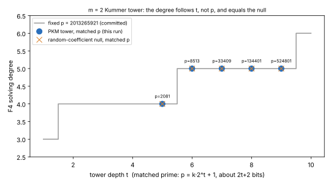

# PKM Kummer tower on primes matched to the tower depth (2026-11-06)

**Question.** Over F_p there is no Weil descent. The atlas lead `LEAD-ICE-prime-field-semaev-solving-degree` (crypto-autoresearcher) is closed. It reopens only if a prime-field factor base with bounded-degree membership shows a solving degree that stays flat as the field grows.

Every Petit–Kosters–Messeng (PKM) tower measurement so far used one prime, p = 2013265921 (`research/ic_next10_20261014/03-pkm-degree/results.csv`). There, the solving degree climbs with the tower depth t as 3, 4, 4, 4, 4, 5, 5, 5, 5, 6. Here the field grows with the depth: for each t, p is the smallest prime k·2^t + 1 of about 2t + 2 bits whose 2-adic valuation is exactly t.

**Answer: the line stays closed** [pcc:unverified]. The degree follows t, not p, and the curve's system has the same degree as the random-coefficient null.

| t | p | bits | D, tower (3 systems) | D, null (3 systems) | D, fixed p (committed) |
|---|---|---|---|---|---|
| 5 | 2,081 | 12 | 4, 4, 4 | 4, 4, 4 | 4 |
| 6 | 8,513 | 14 | 5, 5, 5 | 5, 5, 5 | 5 |
| 7 | 33,409 | 16 | 5, 5, 5 | 5, 5, 5 | 5 |
| 8 | 134,401 | 18 | 5, 5, 5 | 5, 5, 5 | 5 |
| 9 | 524,801 | 20 | 5, 5, 5 | 5, 5, 5 | 5 |

- **Slope.** Over t = 5–9 the least-squares slope of D against t is +0.2 per step. With the committed t = 10 value of 6 at fixed p, the staircase is the one already recorded. The reopen rule asks for a slope of at most 0, with D below the null; neither holds.
- **Each system is checked.** Three planted (tower) and three random (null) systems ran per depth. Each passed the pilot's own construction checks before it was measured.

## Method

- **Probe:** `examples/pkm_tower_pilot.rs` (unchanged), F4 engine `f4_fp`.
- **Flags:** `--m 2 --kinds kummer --controls tower,null --t-min t --max-t t --ladder-t t --budget 1800`, one process per prime.
- **Provenance:** binary sha256 in `raw/binary.sha256`, commit in `raw/commit.txt`.
- **Raw output:** `raw/t*.log` and `raw/t*.jsonl`.
- **Figure:** `plot.py` reads the logs.
- **Host:** a local 4-core container. The values are counts (solving degree, matrix columns) and do not depend on the host. Times are in the logs but not compared.

## Not claimed

- No cost, no comparison against rho, no leaderboard or benchmark row.
- m = 2 only. The atlas's deciding cell is m ≥ 4 at N ≈ 20, which needs a large host. This run fills only the matched-prime gap at m = 2.
