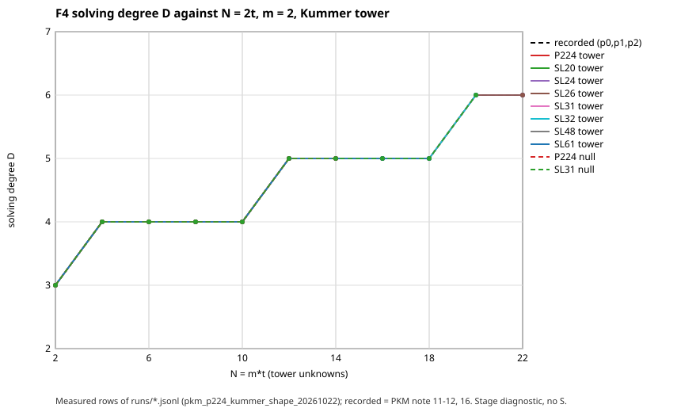
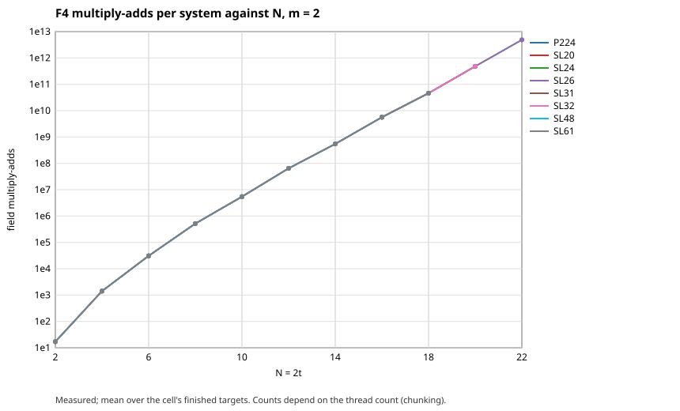
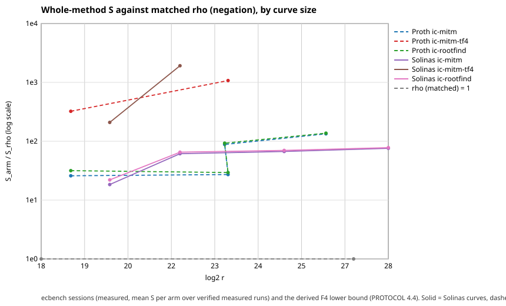

# The PKM Kummer tower at P-224's 2-adic shape, priced against matched rho

2026-10-22. Branch `claude/p224-pkm-kummer-10gpep`. Protocol:
[`PROTOCOL.md`](PROTOCOL.md), frozen in commit `375893d02` before any measured run;
two dated amendments (arms, before any ecbench session; R18 and R18b, before
R18b) are in the same file. Lead: claim 2d of
[`research/p224_hypothesis_ranking_20261008/`](../p224_hypothesis_ranking_20261008/README.md).
Background:
[`RESEARCH_PKM_TOWER_ORACLE.md`](../notes/index-calculus/RESEARCH_PKM_TOWER_ORACLE.md) §§10-17.

Every number is labelled **measured** (this directory's runs), **recorded** (an
earlier committed row), **derived** (a calculation shown) or **predicted**
(stated in the protocol before the runs).

## Verdict

**Inconclusive on the solver axis; clean negative on price; no improvement over
the index-calculus baseline. Not an advance, not engineering, not relabelling.**
One accounting artefact is named in §3.4 so it is not mistaken for a gain.

- **Measured, solver axis (stage diagnostic, no `S`).** At eight P-224-shaped Solinas
  primes `p = 2^n - 2^k + 1` (20 to 61 bits) and at the NIST P-224 prime itself,
  the F4 solving degree `D` of the Kummer tower equals the recorded `D` in all 89
  valued tower cells (`m = 2, 3, 4`), the width and step count of every system
  equal the recorded ones, and the shape-matched null gives the same `D` in all
  65 paired cells. `k/n` ran from 0.42 to 0.70 and the odd part of `p - 1` from 6 to
  128 bits; the prior pilot primes had `k/n` 0.87-0.94 and a 2-4 bit odd part. So
  the P-224 *proportions* of 2-adic structure change nothing F4 can see. H_same
  holds (predicted).
- **Measured, the one cell past the recorded frontier did not finish.** `m = 2,
  N = 24` (`t = 12`) was killed by the kernel's out-of-memory killer at 6.0 GB (R18,
  below), so it has no `D`. A capped re-run (R18b) gives only `D >= 6`. The
  `m = 2` line over `N = 2...22` reads **inconclusive** under rule A1 (plateau
  length 2, upper-half slope 0.114). Question Q2 stays open; it needs a host
  with more than this one's memory (its `B'` block passes 7.9e8 entries at
  step 26 of an unknown number).
- **Measured, price (ecbench, full cost, matched rho).** On four Solinas curves
  of 20 to 28 bits (and four Proth controls) the Kummer-base index calculus costs
  **18 to 78 times** rho with the negation map (`S` ratio, `w = 0`), **19.9 to 134 at
  `w = 1`**; rho is below every index-calculus arm on every curve at every weight
  of the band. Every one of the 1,152 runs (warm-ups included) verified and 864 replays reproduced.
- **Derived, the F4 method priced end to end at the one cell that matches a
  curve** (20 bits, `m = 2, N = 20`): at least **2.4 x 10^9** in `S`, about
  **1.9 x 10^9 times** matched rho at `w = 0` and **1.0 x 10^9** at `w = 1` (generous
  bound: 6 x 10^10 `S` with one field inversion costed as one multiplication). Only one F4 row
  exists, so there is no scaling fit for it.
- **Distance to rho (success criterion).** Best baseline-family arm: 18.4 times
  rho (20-bit Solinas, `ic-mitm`) and 75.9 times at 28 bits. At equal `t` the Solinas
  curves cost 2% to 32% more in absolute GAE than the prior ladder's Proth curves
  (§3.4), so no row moved toward rho.



## 1. What ran

| run | what | status (measured) |
|:--|:--|:--|
| R0 | positive control: isogeny kind, `p0`, `m = 2`, `N = 4-10` | **passed**: `D = 5` on both targets at every `N` |
| R1-R3 | Kummer `m = 2`, `N = 2-20`, tower and null, SL26, SL31, SL32 | complete, 41 rows each |
| R4 | SL20, `m = 2`, `N = 16-20` (the 20-bit priced curve's prime) | complete |
| R5-R8 | `m = 3` (`N = 6, 9, 12`) and `m = 4` (`N = 8, 12`), tower and chain null | complete |
| R9-R12 | SL48 (`Fp64`) and SL61 (`Fp64`), `m = 2` to `N = 18`, `m = 3` to `N = 12`, `m = 4` `N = 8` | complete |
| R13-R15 | P-224 (`Fp224`): `m = 2` to `N = 16` and `N = 18`, `m = 3` to `N = 12`, `m = 4` `N = 8`; wide builder `--verify` | complete, 23/23 verified in `BigUint` |
| R16 | SL24, `m = 2`, `N = 20` and `22`, one target each; null at `N = 22` (R16n) | complete |
| R17 | SL31, `m = 3`, `N = 15`, one target | complete, `D = 7` |
| R19 | SL26, `m = 2`, `N = 22`, one target | complete |
| **R18** | SL24, `m = 2`, **`N = 24`**, 2 threads, cap 1.8e9 entries | **killed (OOM), no row, no `D`** (§4) |
| R18b | the same system, `--max-nnz 6e8 --trace` (Amendment 2) | stopped at step 26, `D >= 6` |
| s20-s28 | ecbench sessions, Solinas and Proth curve per size | 4 sessions, all audits OK |

Where `N = 22` was measured (SL24 and SL26, one target each), `D = 6`, the
recorded value. The recorded `m = 2` frontier was `N = 22`; this round did not
pass it.

## 2. Solver axis (measured; stage diagnostic)

The tower is the Kummer tower `V = mu_{2^t}` (`g = 1`), `f4_tower_generic` at
`Fp32`, `Fp64` and `Fp224`, two random targets per cell unless noted, seed
1347112276. Cell value: `D` when every target finished with the same `D`.

| m | N | recorded D | SL20 | SL24 | SL26 | SL31 | SL32 | SL48 | SL61 | P224 | null D (same cell) |
|--:|--:|--:|--:|--:|--:|--:|--:|--:|--:|--:|:--|
| 2 | 2 | 3 | · | · | 3 | 3 | 3 | 3 | 3 | 3 | 3 at every prime run |
| 2 | 4 | 4 | · | · | 4 | 4 | 4 | 4 | 4 | 4 | 4 |
| 2 | 6 | 4 | · | · | 4 | 4 | 4 | 4 | 4 | 4 | 4 |
| 2 | 8 | 4 | · | · | 4 | 4 | 4 | 4 | 4 | 4 | 4 |
| 2 | 10 | 4 | · | · | 4 | 4 | 4 | 4 | 4 | 4 | 4 |
| 2 | 12 | 5 | · | · | 5 | 5 | 5 | 5 | 5 | 5 | 5 |
| 2 | 14 | 5 | · | · | 5 | 5 | 5 | 5 | 5 | 5 | 5 |
| 2 | 16 | 5 | 5 | · | 5 | 5 | 5 | 5 | 5 | 5 | 5 |
| 2 | 18 | 5 | 5 | · | 5 | 5 | 5 | 5 | 5 | 5 | 5 |
| 2 | 20 | 6 | 6 | 6 | 6 | 6 | 6 | · | · | · | 6 (SL26, SL31, SL32) |
| 2 | 22 | 6 | · | 6 | 6 | · | · | · | · | · | 6 (SL24) |
| 2 | **24** | no value | · | **stopped, D ≥ 6** | · | · | · | · | · | · | · |
| 3 | 6 | 5 | · | · | 5 | 5 | 5 | 5 | 5 | 5 | 5 |
| 3 | 9 | 6 | · | · | 6 | 6 | 6 | 6 | 6 | 6 | 6 |
| 3 | 12 | 6 | · | · | 6 | 6 | 6 | 6 | 6 | 6 | 6 |
| 3 | 15 | 7 | · | · | · | 7 | · | · | · | · | not run |
| 4 | 8 | 6 | · | · | 6 | 6 | · | 6 | 6 | 6 | 6 |
| 4 | 12 | 7 | · | · | 7 | 7 | · | · | · | · | 7 |

`·` = not run. Full per-cell table (targets, width, steps, multiply-adds,
time): [`tables/f4_cells.md`](tables/f4_cells.md) and
[`tables/f4_cells.tsv`](tables/f4_cells.tsv); decision lines:
[`tables/f4_summary.txt`](tables/f4_summary.txt).

- **Q1, H_same: held.** 89 of 89 valued tower cells equal the recorded `D`; 0
  differ. **Q3:** tower `D` equals null `D` in 65 of 65 paired cells (H1b does
  not hold: the tower is not below the null). **Q4:** at every `(m, N)` run at
  two or more primes (16 cells) the width and step count are equal, and the
  multiply-add count of target 0 agrees to within 3 x 10^-6 across the
  primes (`m = 2, N = 18`: 45,950,099,888 to 45,950,147,498 at seven primes
  from 20 to 224 bits; one thread, so the chunking is the same).
- **Positive control (R0): passed**, so the instrument can see a
  tower-family difference (isogeny `D = 5` against Kummer 4 at the same `N`).
- **Independent check.** `pkm_tower_check verify` recounted every finished
  `u64`-builder tower row by exhaustive search over `V^m`: 104 + 52 rows (R0 included), all
  agree ([`verify_u64.txt`](verify_u64.txt),
  [`verify_u64_wide48_61.txt`](verify_u64_wide48_61.txt)). The P-224 rows
  (above `2^64`) were checked by the pilot's own `--verify` in `BigUint`
  arithmetic: 23 of 23 tower rows ok (the independent checker's integer type
  does not hold `p`, so it does not read those rows).
- **Q2 (frontier).** Pooling the `m = 2` tower rows over primes (a derived
  input file, [`analysis/pooled_m2_kummer_tower.jsonl`](analysis/pooled_m2_kummer_tower.jsonl),
  `p` relabelled to 1, `target_index` offset per prime, nothing else changed) and
  running `pkm_tower_check analyze` gives for `N = 2...22`: *A1 inconclusive
  (upper-half slope 0.114 over N = 12...22, final plateau L = 2)*
  ([`analysis/pooled_m2_analyze.txt`](analysis/pooled_m2_analyze.txt)). R18b's
  trace, [`runs/R18b-SL24-m2-N24-sizing.log`](runs/R18b-SL24-m2-N24-sizing.log):
  25 steps ran, step 23 was at degree 6 and added 2,042 elements, so **`D >= 6`**.
  Step 26 (degree 6) stopped at `B'` = 7.86e8 entries, above the 6e8 cap. The
  recorded `N = 22` system had 28 steps in all. Nothing here reads 7.



*Scope.* `t <= 12` at `N <= 24`. P-224's `p - 1` has `v2 = 96`, so a tower could
in principle be `t = 96`. PKM needs `|V|^m` of the order of `r`, that is `N = m t`
near `log2 r = 224` at any `m`. The measured `N <= 24` is about 11% of that, and
every deeper cell is extrapolation (not made here).

## 3. Price (measured arms; derived F4 arm)

### 3.1 Boundary, reference, unit

`S = total GAE / sqrt(r)`; the floor is `sqrt(pi/4) = 0.886`; the reference is
`rho.negation` in the same session and binary, matched to each IC arm's workload
and round. All 8 workloads per curve are one-target; 3 measured rounds; every
IC arm charges every group operation.

### 3.2 Curves

Curves are named here by their field and parameters, not by an ICV1 slug (see the
note below the table). `y^2 = x^3 + ax + b`, `#E = h r`, `r` prime.

| bits | Solinas curve `(p, a, b)` | `k` | `h` | `log2 r` | `t` | Proth control `(p, a, b)` (prior ladder) | `log2 r` |
|--:|:--|--:|--:|--:|--:|:--|--:|
| 20 | (1032193 = 2^20-2^14+1, 115752, 453155) | 14 | 1 | 19.98 | 8 | (946177, 304973, 530845) | 18.85 |
| 24 | (16760833 = 2^24-2^14+1, 10096653, 5158538) | 14 | 4 | 22.00 | 9 | (10940417, 10128206, 867458) | 23.38 |
| 26 | (67104769 = 2^26-2^12+1, 36772902, 59108565) | 12 | 2 | 25.00 | 10 | (40857601, 8702713, 9617118) | 23.28 |
| 28 | (268369921 = 2^28-2^16+1, 147431093, 254493867) | 16 | 1 | 28.00 | 11 | (231657473, 95419558, 159693275) | 26.20 |

**Not registered.** AGENTS.md §11 asks for registration before a curve's slug is cited.
The four Solinas curves are not in `docs/curves/registry.json`: a registry change moves
the registry digest that the cover, trait and transfer certificates bind, so it needs
those regenerated (`curve_cover_check`, `curve_traits`, `jacobian_transfers`, the
alias map), which is a separate, large change. So no slug is written in Markdown
here (the slugs are in the sealed sessions' `plan.json`, `spec.json` and records, and
`ecbench plan` says `registered=false` for them). Registering them is a follow-up. The
four Proth controls are registered (the prior ladder).

### 3.3 Table: `S` per arm, ratio to matched rho, with the §5a band

`S` at `w = 0 / 0.1 / 1` GAE per unpriced native operation (the harness's
`ecbench band`, reproduced by [`tables/ecbench_arms.md`](tables/ecbench_arms.md)); ratio
= `S_arm / S_rho` at the same `w`. The F4 arm is **derived**, one row, a lower
bound (§3.5). `D` is the F4 solving degree of the cell the arm's size corresponds
to (stage diagnostic).

| curve | arm | `D` (stage) | `S` w=0 / 0.1 / 1 | ratio to rho w=0 / 0.1 / 1 | unpriced counters (mean) |
|:--|:--|:--|:--|:--|:--|
| 20-bit Solinas | rho-neg | | 1.250 / 1.358 / 2.337 | 1.0 | canonicalisations 1,104 |
| 20-bit Solinas | ic-mitm | | 22.94 / 25.30 / 46.53 | 18.4 / 18.6 / 19.9 | lookups 6,092; row ops 17,357; 3 more |
| 20-bit Solinas | ic-rootfind | | 27.54 / 29.96 / 51.69 | 22.0 / 22.1 / 22.1 | lookups 6,167; row ops 17,845; 3 more |
| 20-bit Solinas | **F4 arm (derived), m=2, N=20** | 6 | 2.40e9 / 2.40e9 / 2.40e9 | 1.9e9 / 1.8e9 / 1.0e9 | F4 pairs, reducers, rows (§3.5) |
| 24-bit Solinas | rho-neg | | 1.057 / 1.155 / 2.030 | 1.0 | |
| 24-bit Solinas | ic-mitm | | 64.9 / 73.8 / 153.7 | 61.4 / 63.9 / 75.7 | |
| 24-bit Solinas | ic-rootfind | | 68.9 / 77.7 / 157.7 | 65.1 / 67.3 / 77.7 | |
| 24-bit Solinas | F4 arm | not priced: `N = 24` has no `D` | | | |
| 26-bit Solinas | rho-neg | | 0.913 / 0.998 / 1.762 | 1.0 | |
| 26-bit Solinas | ic-mitm | | 61.2 / 74.6 / 194.8 | 67.1 / 74.7 / 110.6 | |
| 26-bit Solinas | ic-rootfind | | 63.8 / 77.1 / 196.4 | 69.9 / 77.3 / 111.4 | |
| 28-bit Solinas | rho-neg | | 0.923 / 1.013 / 1.824 | 1.0 | |
| 28-bit Solinas | ic-mitm | | 70.1 / 87.5 / 244.0 | 75.9 / 86.3 / 133.8 | |
| 28-bit Solinas | ic-rootfind | | 71.8 / 89.0 / 243.3 | 77.8 / 87.8 / 133.4 | |
| 20-28-bit Proth controls | rho-neg, ic-mitm, ic-rootfind | | see [`tables/ecbench_arms.md`](tables/ecbench_arms.md) | 25.9-133.7 (`w=0`) | |

Paired `ecbench compare` intervals (95% cluster bootstrap over 8 workloads, per
curve, `w = 0`), ic-mitm / rho-neg: 18.4 [14.7, 23.9] (20-bit Solinas),
61.4 [49.9, 78.0] (24), 67.0 [53.1, 86.4] (26), 75.9 [60.5, 97.4] (28);
ic-rootfind / rho-neg: 22.0 [17.6, 28.9], 65.1 [52.9, 82.7], 69.9 [55.4, 90.1],
77.8 [62.0, 99.8]. The Proth controls: 25.9, 27.2, 88.2, 133.7 (mitm). A/A
(`rho-neg-aa / rho-neg`) = 1.0000 on all four sessions. Files:
[`tables/s*.compare.*.txt`](tables/).

**Order across the band.** `rho-neg < ic-mitm` and `rho-neg < ic-rootfind` hold at
every `w` in {0, 0.1, 1} on all eight curves; the only unresolved pairs are
`rho-neg` against its own A/A copy and `ic-mitm` against `ic-rootfind` on the
28-bit Solinas curve ([`tables/s*.band.txt`](tables/)). The F4 arm's order against
rho holds at every `w` (its `S` is `w`-independent to 4 digits: `U` = 213,652
unpriced operations per system is 1.1e8 GAE at `w = 1` over 522 relations, against
2.4e12 GAE priced).



### 3.4 Solinas against Proth at the same tower height

Predicted (P6): `S_IC/S_rho` on a Solinas curve within 20% of the Proth control at
each size. **Failed as stated**: the ratios differ by -29%, +126%, -24% and -43%
at 20, 24, 26, 28 bits (18.4 vs 25.9, 61.4 vs 27.2, 67.0 vs 88.2, 75.9 vs 133.7).
The differences are not the prime's shape:

- `t` is chosen by bit size, so a Solinas and a Proth curve of the same size have
  the same factor-base height, while `r` differs (cofactors 1-4: `log2 r`
  19.98 vs 18.85, 22.00 vs 23.38, 25.00 vs 23.28, 28.00 vs 26.20). `S` divides by
  `sqrt r`.
- **Absolute cost at equal `t`** (derived from the sealed records, 95% bootstrap
  over workloads, [`tables/gae_solinas_vs_proth.md`](tables/gae_solinas_vs_proth.md)):
  Solinas / Proth GAE for `ic-mitm` is 1.053 [1.034, 1.071], 1.324 [1.297, 1.357],
  1.206 [1.196, 1.216], 1.017 [1.014, 1.020] at 20, 24, 26, 28 bits, and for
  `ic-rootfind` 1.034, 1.300, 1.197, 1.016 (same intervals' order). **The
  Solinas curves cost more in absolute GAE at every size**, 2% to 32%, not less, in both IC arms. Rho
  moves with `sqrt r` (Solinas/Proth rho GAE 1.48, 0.59, 1.59, 1.79).
- So where the Solinas `S` ratio is lower, rho got more expensive, the index
  calculus did not get cheaper. By AGENTS.md §3 that is **accounting** (the numbers
  changed, the algorithm did not) and it is not claimed as an improvement. No row
  met the protocol's improvement condition (§5 of the protocol) once `r` is
  accounted for.
- Growth with size (`d log2(S_ic/S_rho) / d log2 r`, 4 sizes, least squares, 95%):
  Solinas `ic-mitm` 0.217 ± 0.225, `ic-rootfind` 0.192 ± 0.202; Proth `ic-mitm`
  0.304 ± 0.350, `ic-rootfind` 0.268 ± 0.347; prediction 0.17, no fit excludes it or
  zero ([`tables/growth_fits.txt`](tables/growth_fits.txt)). With `t` tied to `bits`
  and `r` varying by cofactor, this fit is poorly conditioned; it is reported, not
  relied on.

### 3.5 The F4 arm (derived; PROTOCOL §4.4, formula frozen before the runs)

`GAE_F4 = R * (madds / M + w * U)`, `R = columns + 10`, `S = GAE_F4 / sqrt r`.

| input | value | label |
|:--|:--|:--|
| curve | 20-bit Solinas, `r = 1,030,723`, `t = 10` (`N = 20`) | |
| `columns` | 512, the on-curve abscissae of `ic-mitm-tf4` (`prime-kummer:t=10`) | measured (factor-base record) |
| `madds` | 4.819e11 per system, mean of 2 random targets (R4) | measured |
| `ns / madd` | 1.05, `ms / madds` of R4 under load | measured |
| `ns / GAE` | 101-139 across five invocations of the report tool; the table uses the stored one, 108.0 (microbenchmark of the harness's counted `PrimeCurve` addition, median of 5 runs of 10^6 additions; [`analysis/ns_per_gae_1032193.txt`](analysis/ns_per_gae_1032193.txt)) | measured |
| `M = ns/GAE / ns/madd` | 97-133 madds per GAE (the table uses the stored one: 103.2) | derived |
| `U` | 213,652: F4 pairs + reducer rows + max rows per system | measured, priced at `w` |
| `S_F4` | 2.40e9 at every `w`; ratio to rho 1.9e9 / 1.8e9 / 1.0e9 | derived, **lower bound** |
| generous bound | `M = 4` (inversion costed as one multiplication): `S_F4 = 6.2e10` | derived |

Lower bound because it counts one F4 solve per relation, 522 relations (`R`); it omits
the failed targets, the factor-base build and the linear algebra. A second
priced row needs `N = 24` (R18 failed), so there is **no scaling fit** for the F4
arm. Per the protocol the 26- and 28-bit curves, which need `N = 26, 28`, get no F4
row and none is extrapolated. [`tables/f4_priced.md`](tables/f4_priced.md).

*Prediction P7* (F4 arm at least 10^5 times rho at `N = 20`): **held** (1.9 x 10^9).

## 4. Failures and deviations (all preserved)

1. **R18 was OOM-killed (measured, kernel log).** SL24, `m = 2`, `N = 24`, one target,
   2 threads, `--max-nnz 1.8e9`, `ulimit -v` 9 GB. Started 04:19 UTC; killed about
   06:45 UTC by the memory-cgroup OOM killer, `anon-rss 6,007,580 kB`, the killer
   having been invoked by another agent's process in the shared container cgroup.
   The pilot writes a system's row when the system ends, so the run left no row
   and no step trace: no `D` and no lower bound. Per protocol §2.2 it is
   recorded as out of budget (memory) and is **not re-run**. The empty files
   [`runs/R18-SL24-m2-N24.jsonl`](runs/R18-SL24-m2-N24.jsonl) and `.log` are kept.
2. **R18b (Amendment 2, committed before it ran)** re-ran the same system with a
   600M-entry cap and a trace. It stopped by design at step 26 and gave
   `D >= 6` only (§2).
3. **`progress.txt` exit statuses are void for `run_f4.sh`.** The `echo` printed the
   `$?` of its own `date` substitution, so every `end ... exit 0` line from that script
   carries no information (R18 shows `exit 0` though the kernel killed it).
   Completion is read from each run's summary line in `runs/*.log` (the only runs
   without one: R18). The script is fixed in this tree; the version that ran had the
   bug.
4. **Parallel runs.** The main script was stopped by hand after R16 started (the
   child kept running), and R16n, R17 and R19 were started in parallel with the
   same flags through [`run_parallel.sh`](run_parallel.sh) to use idle cores;
   `progress.txt` has a NOTE (the script was tidied of a redundant `case` after the runs,
   same flags). The cells and flags are the protocol's; only the
   order and concurrency changed.
5. **Load.** The host's load average was 4-10 throughout, shared with other agents,
   so wall times (`ms`) are descriptive only; operation counts do not depend on it.
6. **ecbench ran at L0**, `--cpus none --allow-busy`, so no wall time is admitted;
   operation counts, audits and replays are unaffected. The spec says
   `isolation_required: L2`; the harness ran and graded every run L0.
7. **Scratch smoke runs.** Before the first run of each tool the author ran short
   smoke tests of the pilot at SL26 and P-224 (`N <= 6`, 14 rows) in a scratch
   directory; they are not results and are not in this directory.
8. **A transcription slip in the report tool**: the recorded `D` at `N = 10`
   was first coded as 5; the protocol says 4, and three cells were reported as
   `H_diff` in a trial print before the fix. The committed output is from the fixed
   tool; no run changed.
9. **Curves not registered** (Amendment 3 in the protocol; §3.2 says why).

## 5. Predictions against outcomes

| | prediction | outcome |
|:--|:--|:--|
| P1 | R0 gives `D = 5`, `N = 4-10` | **held** |
| P2 | H_same on every valued cell; `D` rises to 6 at `N = 20` at every prime | **held** (89 of 89) |
| P3 | `D(N = 24)` is 6 or 7 | **no value** (R18 killed; R18b `D >= 6`) |
| P4 | tower and null agree at every cell | **held** (65 of 65) |
| P5 | multiply-adds equal across backends at one thread | **held** (to 3 x 10^-6) |
| P6 | Solinas `S` ratio within 20% of Proth | **failed as stated**, explained by `r` (§3.4) |
| P7 | F4 arm at least 10^5 x rho | **held** |

## 6. What this shows, what it does not, and the next step

**Shows (measured).** The F4 solving degree and the whole F4 computation do not
see a P-224-like ratio of 2-adic to odd part: equal `D`, width, steps and
multiply-adds at eight Solinas primes and at P-224's. The tower family still reads
inconclusive at `N <= 22`. Priced end to end the PKM F4 method costs 10^9 times
rho at the one size that matches a curve, and the table oracles on the same
base cost 18-134 times rho and the gap grows slowly with size.

**Does not show.** Anything at `N` near P-224's size, `m >= 4` at `N` above 12,
whether `D` rises past 6 at `m = 2`, or a priced F4 row at a second size.
Nothing here attacks P-224; a bounded null is not nonexistence (AGENTS.md).

**Next improvement to try** (each is a different experiment, not done here):
1. `m = 2, N = 24` and `m = 3, N = 21` on a host with 64 GB or more
   (`B'` is 4 bytes per entry; R18b's step 26 alone is 3.1 GB, and the run died
   at 6.0 GB resident), which would answer Q2 and give the F4 arm a second
   priced size.
2. An `ic.pipeline` oracle that calls `f4_tower_generic`, so the F4 arm is
   measured in the harness (`ecbench-extend`) instead of derived.
3. Curves matched on `r`, not on bits, for any Solinas-against-Proth `S`
   comparison, since §3.4 shows the bit-matched one is confounded.

## 7. Environment and reproduce

Claude Code cloud container, 4 vCPU Xeon @ 2.10 GHz, 15 GiB RAM shared with
other agents, rustc 1.97.0, binary
`pkm_tower_pilot` sha256 `aab76a30ab352de3…` ([`runs/BINARY.sha256`](runs/BINARY.sha256)),
built from commit `dd0486c6d` (the pilot source is unchanged from `main`).
Conductor `check` reported the scope clear.

```bash
export CARGO_TARGET_DIR=/path/to/target
cargo build --release --example pkm_tower_pilot --example pkm_tower_check \
  --example prime_tower_curves --example pkm_p224_shape_report --bin ecbench
research/pkm_p224_kummer_shape_20261022/make_specs.sh          # specs from curves.jsonl
BIN=$CARGO_TARGET_DIR/release/examples/pkm_tower_pilot research/pkm_p224_kummer_shape_20261022/run_f4.sh main
BIN=... research/pkm_p224_kummer_shape_20261022/run_f4.sh frontier   # R18 (needs ~10 GB)
BIN=... research/pkm_p224_kummer_shape_20261022/run_r18b.sh
ECBENCH=$CARGO_TARGET_DIR/release/ecbench research/pkm_p224_kummer_shape_20261022/run_sessions.sh
pkm_p224_shape_report f4 runs .  &&  pkm_p224_shape_report price runs . curves.jsonl sessions/s20 sessions/s24 sessions/s26 sessions/s28
research/pkm_p224_kummer_shape_20261022/render.sh              # PNGs and report.pdf
```

Curves: `prime_tower_curves --solinas 20:14,24:14,26:12,28:16 --seed 20261022
--max-cofactor 4` ([`curves.jsonl`](curves.jsonl), [`curves.log`](curves.log)).
Specs: [`specs/`](specs/). Sealed sessions: [`sessions/`](sessions/); audits
([`audits/`](audits/)): s20 and s24 320 records, 240 replays; s26 and s28 256 records, 192
replays; every record verified, every replay reproduced, 0 problems. Run rows and logs: [`runs/`](runs/). Report PDF:
[`report.pdf`](report.pdf).
