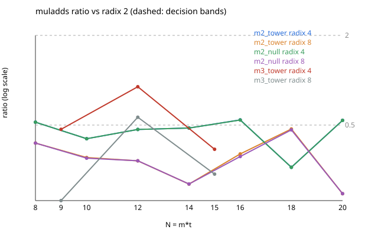
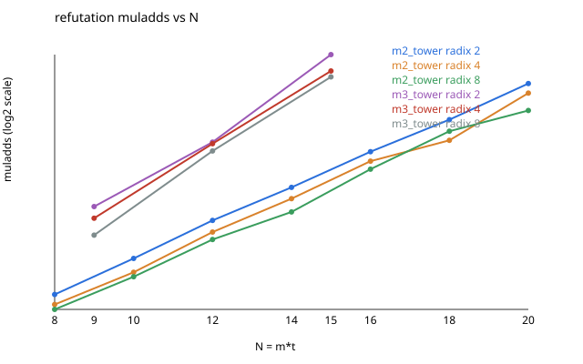

# Radix gradings of the Kummer tower: a constant-factor gain, no change of growth

**EXP-PKM-RADIX-001 — report.** 2026-11-05. Protocol: [`PROTOCOL.md`](PROTOCOL.md) / [`protocol.json`](protocol.json)
(frozen before data; Amendments 1 and 2 disclosed there). Analysis: `analyze.py` (SHA-256 `194a4232…`, as
frozen), output [`results.json`](results.json). Every number below is a counted metric from `runs/*.jsonl`
[pcc:unverified].

## 1. Verdicts (frozen rule, §5)

| `(m, radix)` | verdict | `r_k(t_max)` | `t_max` |
|:--|:--|--:|--:|
| m = 2, radix 4 | `no_material_effect` | 0.538 | 10 |
| m = 2, radix 8 | `gain_constant` | 0.173 | 10 |
| m = 3, radix 4 | `gain_constant` | 0.344 | 5 |
| m = 3, radix 8 | `gain_constant` | 0.234 | 5 |

- **Validity.** C1, C2 and the A/A check all pass.
  - G0 at 4 threads reproduces the committed `R-t9-t10` rows exactly. This is the Amendment 2 setting.
  - Every graded row decides every system as the unit row does.
  - Every planted row is solved [pcc:unverified].
  - A1 is bit-identical to `L2-t8-r4`.
- **Attribution: `shape` for both radices.** The shape-matched null control gives the same verdicts as the
  tower, with ratios equal to three digits. The gain belongs to the system's shape (`S₃`'s support on this
  tower), not to the elliptic curve.
- **Replication: `replicated`.** `p = 786433` gives the same bands at `t = 10`: 0.538 and 0.173.
- **The pre-registered prediction is falsified.** The author predicted `no_material_effect` for every
  `(m, k)`, and three of the four cells are `gain_constant`. No cell is `gain_growing`.

## 2. What was measured

Refutation multiply-adds, one value per cell. The two random draws agree in every cell up to a few parts in
10⁷.

| cell | radix 2 | radix 4 | radix 8 | `D` (2/4/8, each in its own grading) | widest matrix (2/4/8) |
|:--|--:|--:|--:|:--|:--|
| m=2, t=5 (N=10) | 5.43·10⁶ | 2.20·10⁶ | 1.64·10⁶ | 4 / 6 / 10 | 337 / 252 / 260 |
| m=2, t=10 (N=20) | 4.82·10¹¹ | 2.59·10¹¹ | 8.35·10¹⁰ | 6 / 8 / 13 | 33,446 / 28,225 / 17,101 |
| m=3, t=4 (N=12) | 1.06·10¹⁰ | 9.59·10⁹ | 5.98·10⁹ | 6 / 9 / 12 | 5,019 / 6,509 / 4,063 |
| m=3, t=5 (N=15) | 3.19·10¹² | 1.10·10¹² | 7.47·10¹¹ | 7 / 9 / 12 | 31,397 / 28,055 / 20,284 |

Ratios to radix 2 over the full ladder are in `results.json` and [`ratio_vs_t.svg`](ratio_vs_t.svg).

- At m = 2, radix 4 sits between 0.26 and 0.54 and radix 8 between 0.17 and 0.47.
- At m = 3 (`t = 3, 4, 5`): radix 4 is 0.47, 0.91, 0.34; radix 8 is 0.16, 0.56, 0.23.
- Neither ratio moves monotonically with `N`.

**Growth (descriptive only, §5 item 5).** Least-squares slope of `log₂ muladds` against `N` over the ladder:

| arm | m = 2, tower | m = 2, null | m = 2, `p = 786433` | m = 3, tower |
|:--|--:|--:|--:|--:|
| radix 2 | 1.64 | 1.64 | 1.61 | 2.38 |
| radix 4 | 1.63 | 1.63 | 1.63 | 2.31 |
| radix 8 | 1.61 | 1.61 | 1.52 | 2.48 |

The slopes agree to within the spread of a ≤ 7-point deterministic ladder. No interval is attached and none
is claimed.

## 3. Reading

- **A radix-8 grading of the same Kummer tower does about 2–6× less F4 work at these sizes** (m = 2,
  `N ≤ 20`; m = 3, `N ≤ 15`). It is the same ideal, the same factor base and the same systems; only the
  degree order changes. Radix 4 helps less and less reliably. The widest matrix and the largest dense block
  shrink with the multiply-adds, as far as `t = 10`. The solving degree, measured in each arm's own
  grading, rises (6 → 8 → 13 at m = 2, `t = 10`). It is not comparable across arms and is not a cost.
- **This is an engineering lever, not an exponent.** The factor does not grow with `N` on these ladders, and
  the descriptive slopes are flat across arms. That fits the barrier note's reading
  (`research/notes/ecdlp-general/RESEARCH_PRIME_FIELD_BARRIER_MAP_20261104.md` §3): cost follows information,
  not variable count, so regrading can buy a constant and no more. The note's §6.1 prediction of "no
  material effect" was wrong about the constant.
- **The null control explains why.** `S₃`'s monomial support with random coefficients gains exactly as
  much. The weights reorder F4's monomial selection in a way that suits the shape of the tower quotient. The
  gain does not come from elliptic structure.

## 4. What this does not establish

- Anything at `N > 20` (m = 2) or `N > 15` (m = 3), or at cryptographic sizes. Anything about Pollard rho or
  about the IC leaderboard. This is a solver-axis stage diagnostic with no end-to-end `S`, so no leaderboard
  or `benchmarks/` row is made.
- **That the gain is constant asymptotically.** The ratio is non-monotone over three to seven points.
- Clock comparisons. `ms` is recorded but the host is unisolated (2 vCPU, opt-level 1, 4 Rayon threads on 2
  cores), and the protocol reads no clock.
- Isogeny towers (their `y_j·y_next` terms forbid these weights), Dickson towers (allowed by the code, not
  run), and radix 16.

## 5. Deviations and process notes

- **Amendment 1 (pre-data).** The binary is built from a pruned module list, because `crypto_lib` release
  builds are OOM-killed on this host.
- **Amendment 2 (after G0, before graded rows).** `muladds` depends on `RAYON_NUM_THREADS`. At `t = 9` the
  counts are 45,950,147,498 / 45,952,850,022 / 45,957,046,778 at 1 / 2 / 4 threads, with `D` and widths
  unchanged. All cells were run at 4 threads. The 2-thread G0 rows are kept as `runs/G0th2-*` and are not
  admissible.
- **That thread dependence is an instrument property worth knowing beyond this study.** Any comparison of
  `muladds` across runs of `f4_fp_tower` must fix the thread count. Its size here, at most 0.015%, is far
  below any band used in this study.
- **Execution.** Local container (2 vCPU, 7.8 GiB), not Iso Lab: this session has no route to it (protocol
  §7). No `bench.record/v1` or `.resume/` checkpoint was made. There are no clock claims, and the counted rows
  are in Git.
- **Smoke rows** (`smoke/`) predate the study and are not study data.

## 6. Next

- **Ask whether the gain holds or grows at larger `N`.** That means the m = 2 ladder to `t = 12–14`, or
  m = 4, on a host with ≥ 64 GiB, through `run_cells.sh` with a new protocol version. A factor of 5–6 at
  `t = 14` would cut the memory the decisive fall-degree cell needs
  (`research/prime_fall_degree_t14_20261101/`), if that cell's question survives the change of grading.
- **Check the fall-degree reading under grading before using radix 8 there.** Degrees in a weighted grading
  are not the unit-graded `d_F` that the C-step prediction is stated in.
