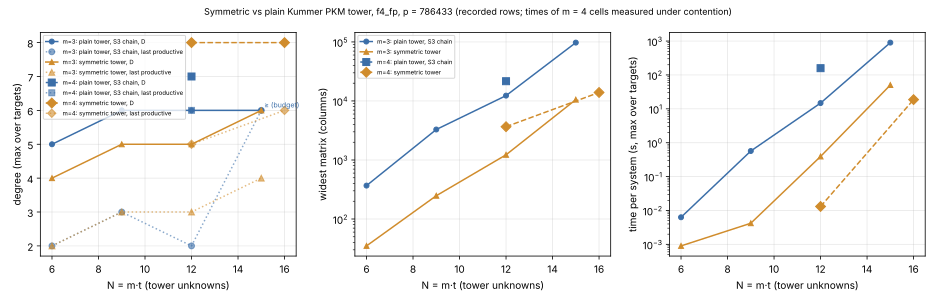

# Lead 1 (bounded D?) on the symmetric PKM tower, and the first m = 4 cells

2026-10-26 · follow-up to [`../pkm_symmetric_tower_20261026/`](../pkm_symmetric_tower_20261026/README.md)
(PR #2632) · instrument [`examples/pkm_symmetric_tower.rs`](../../examples/pkm_symmetric_tower.rs) ·
records `rows.jsonl` (m = 3, sweep t ≤ 7), `rows_n18.jsonl` (m = 3, N = 18 rerun), `rows_m4.jsonl`
(m = 4, contended), `rows_m4_uncontended.jsonl` (m = 4, timed alone), `run.log` · graph [`d_vs_n.svg`](d_vs_n.svg) (`plot.py`, recorded values only) · PDF `report.pdf`

**Class: stage diagnostic of the solver axis (AGENTS.md §2). No pipeline is priced, no `S`, no
leaderboard row.** Same prime `p = 786433`, curve, `g`, `ζ`, engine (`f4_fp`, grevlex) and
construction as PR #2632.

## Verdict

**m = 3:** the symmetric tower's D is **6 at N = 18**, the same as at N = 15. The
sequence over N = 6, 9, 12, 15, 18 is **4, 5, 5, 6, 6**. That is still exactly a staircase
that steps up every second cell, so the next step would come at N = 21. The N = 18 cell
cannot tell the two readings apart: "D bounded at 6" and "D rises by one every 6 in N"
both predict 6 there. **Lead 1 stays open.** The discriminating cell is N = 21, where the
two readings predict 6 and 7. It needs more than this container's 13 GB.

**m = 4 (new):** S₅ written in the e_k is now in the instrument and passes its planted
check. At N = 12 the symmetric system runs in 8–9 ms where the plain chain takes 66–70 s (both timed
alone on the host), with
5.9× narrower matrices and a last productive degree one lower (5 against 6). Its D is 8 at
N = 12 and 16. That is just the degree of S₅(e), its input, so D cannot rank the two arms
at m = 4.

Cost still grows with N in both families. From N = 15 to 18 (m = 3) the widest matrix
grows 3.1× and the time 39×. Nothing here prices a pipeline.

## m = 3: does D stay at 6?

| N | symmetric D | last productive | widest matrix | time per system |
|--:|--:|--:|--:|--:|
| 6 | 4 | 2 | 35 | < 1 ms |
| 9 | 5 | 3 | 248 | 4 ms |
| 12 | 5 | 3 | 1,224 | 0.4 s |
| 15 | 6 | 4 | 10,532 | 50 s |
| **18** | **6** | 3 | 33,153 | 1,941 s (one target; alone except one plot render of a few seconds) |

Rows N = 6–15 reproduce PR #2632 exactly: same D, widths and field-operation counts.

## m = 4: S₅ in the elementary symmetric functions

`S₅(x₁,…,x₄, x_R) = Res_u(S₄(x₁,x₂,x₃,u), S₃(u,x₄,x_R))`, where `S₄ = Res_v(S₃(x₁,x₂,v), S₃(v,x₃,u))`.
It has degree ≤ 8 in each variable. With `x_R` fixed, the instrument evaluates it on a
9⁴ grid (6×6 Sylvester determinants mod p) and recovers it exactly by tensor Lagrange
interpolation. It then rewrites it in `e₁..e₄` with the leading-term algorithm.
**Check:** every cell first evaluates every equation at a planted decomposition. The planted
decomposition uses four distinct summands from `V` and `x_R` computed by chained point
additions. The check passes at N = 12 and N = 16.

| N | arm | D | last productive | widest matrix | field ops | time per system, alone (contended) |
|--:|--|--:|--:|--:|--:|--:|
| 12 | plain chain | 7 | 6 | 21,619 | 1.10·10¹¹ | 66.4 / 70.2 s (157–159 s) |
| 12 | **symmetric** | 8 | **5** | **3,663** | **4.01·10⁵** | **8.7 / 7.9 ms** (13 ms) |
| 16 | **symmetric** | 8 | **6** | **13,926** | 1.08·10¹⁰ | 11.8 / 11.7 s (18 s) |
| 20 | symmetric | — | — | — | — | aborted under its 6 GB cap |

Times are per target (target 0 / target 1). The timed-alone rows are the 20:01Z rerun
(`rows_m4_uncontended.jsonl`), run with nothing else on the host. The contended times in
parentheses come from the first run, alongside the m = 3 N = 18 cell, and are kept for the record
only (AGENTS.md: wall time is evidence only from uncontended runs).

Both random targets give identical D and widths in every cell, and their field-operation counts
agree to within 4·10⁻⁷. Both runs give the same D, widths and field-operation counts.

- **D is not the right comparison at m = 4.** The symmetric system's input `S₅(e)` already
  has degree 8, so `D ≥ 8` holds trivially. The plain chain's inputs have degree 4, and its
  D = 7 matches the recorded tower-engine value at N = 12 (encyclopedia §0.1:
  6, 7, 7, ≥ 8 at N = 8, 12, 16, 20).
- **The cost is the comparison.** At N = 12 the symmetric system is 5.9× narrower and about
  7,600–8,900× faster per system, timed alone (66–70 s against 8–9 ms; the paired per-target
  ratios are 7,632× and 8,891×). It uses about 2.7·10⁵× fewer field operations (1.1·10¹¹ against
  4.0·10⁵), and that count does not depend on load. Its last productive
  degree is one lower (5 against 6).
- From N = 12 to 16 the symmetric arm's last productive degree rises from 5 to 6, and its cost
  grows by about 2.7·10⁴×.

## What did not run, and why

- **m = 3, N = 18, first attempt.** The kernel's OOM killer stopped it (exit 137) after
  92 CPU-minutes, at about 8.5 GB or more. The operator had started the m = 4 cells
  alongside it, and together they exceeded the container's 15 GB. It was rerun alone
  (`rows_n18.jsonl`) with a 13 GB cap and one random target. Because it starts at
  `--t-min 6`, that target differs from the one a full sweep would draw.
- **m = 3, N = 21** was not attempted after that. It would need more than 13 GB.
- **m = 4, N = 8** cannot be planted. `V` has 4 points, and 200,000 draws found no ordered
  4-subset whose chained sum gives an `x_R`. The instrument skips such a cell instead of
  measuring it without its check.
- **m = 4, N = 16, plain chain** was not run. At N = 12 it already takes 66–70 s alone, with 21,619
  columns.
- **m = 4, N = 20, symmetric:** allocation failure under the 6 GB cap (exit 134).
- The first m = 4 times were measured while the m = 3 N = 18 cell held all four cores. They are
  superseded by the rerun timed alone and are not pooled with it. The contended plain chain was
  2.3× slower than alone, and the contended symmetric arm 1.5×. So the contended ratio (12,000×)
  overstated the uncontended one.
- The resume checkpoint could not be pushed: the container has no S3 token.

## Reading

Constant-factor gains in the decomposition oracle's F4 stage are now measured at both m = 3
and m = 4: about 10× narrower matrices at m = 3 and 5.9× at m = 4. The per-system time gain
is 20–50× at m = 3 for N = 12–15 (PR #2632), and 7,600–8,900× at m = 4, N = 12 (timed alone). For m = 4 this is
the larger effect. The plain chain needs m − 2 = 2 extra partial-sum unknowns and an S₃
chain, while the symmetric system has none, and it sees each unordered summand set once
instead of m! = 24 times.

None of this is an index-calculus improvement until it is priced end to end: relations per
second against a matched rho, with the §5a band. The next measurements are:

1. **m = 3, N = 21 symmetric.** It decides lead 1's next step (6 against 7). It needs a host
   with about 32 GB or more.
2. **m = 4, N = 20 symmetric** against the recorded plain D ≥ 8.
3. **Price the m = 4 symmetric oracle** inside the PKM decomposition pipeline at N = 12–16.
   Whether a per-system gain of about 8,000× moves the pipeline depends on the share of time the F4
   stage takes there. That share has not been measured.
