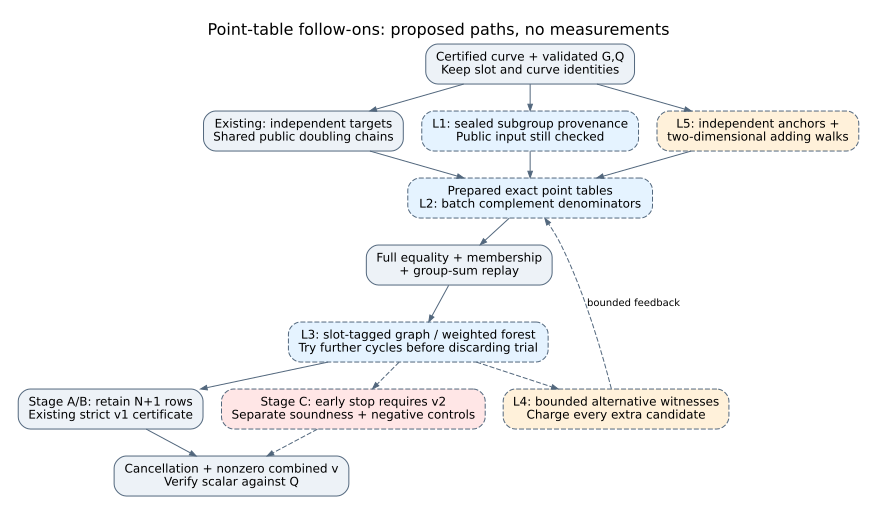

# Point hashing: five implementation leads

Date: 2026-11-16 UTC. Status: proposed research designs, not measured results.

The strongest next steps are to remove repeated subgroup certification from
internally generated queries, batch affine subtraction, and exploit the special
graph structure of two-slot relations. A second tier is to select useful cycles
and generate targets with short, independently anchored adding walks. These are
integration hypotheses using established primitives; this report makes no
novelty, runtime, significance, or challenge-recovery claim. [pcc:unverified]

This is a planning-only change. It does not modify the native solver, pending
point-table PRs, the ECBench branch, frozen pilot evidence, registrations,
canonical claim history, or experiment budget. No scientific job was launched.

## 1. Scope and source audit

The immediate domain is the existing short-Weierstrass prime-field native
solver, a certified prime-order subgroup of order r, and two independently
configured factor-base slots. Every vertex, witness and cancellation retains its
slot identity. No implementation or performance conclusion is transferred to
the unfinished binary challenge pipeline or a Certicom challenge.

Source pins for this search:

- Crypto native feature snapshot: `28b33d4a8c8a09b6c08e27a17e30ddacb3586cc0`,
  `crates/hashed-ecdl-tensor/src/` [S1]. This is a feature snapshot, not a claim
  that the pending feature has landed on main.
- Cryptanalysis mirror snapshot: `fdfc85c73307e113fcc5f4829e02f9914a575c12`,
  `bindings/rust/hashed-ecdl-tensor/src/` [S2]. Mirror integration is outside
  this search; port eligibility must be checked again before implementation.
- Initial planning base: `b478a9770ea35f84bddf4e9b9ffbf7efeab30f06` [S3].
- Lead-atlas snapshot: `96f010d853a088d6ff5093ebedc4270b013484dd` [S4].

Producer source observations, with exact paths and digests in
`source-inputs.sha256`: [pcc:unverified]

- `prepared.rs:152`: each prepared query calls `in_subgroup`, then scans one
  selector-ordered base, computes a complement, performs a full-point lookup,
  and replays arithmetic membership and the group sum.
- `curve.rs:265`: subgroup checking multiplies the point by r. `add:273`
  uses checked affine arithmetic, with an inversion in ordinary addition.
- `reduction.rs:799`: the collector allocates a dense matrix for N+1 rows,
  with N the sum of the slot cardinalities. Every attempt draws fresh u,v.
  At `847`, only the first dependency is tried; zero combined v discards
  the trial. The verifier at `945` demands exactly N+1 rows.
- `partial.rs:1`: the existing partial-relation path uses sparse elimination
  over the odd subgroup field. Its own comment distinguishes this from binary
  graph-cycle cancellation. It is an important control, not a missing feature
  to relabel as new. `joint.rs` already shares public coefficient doubling
  chains; simultaneous multiplication itself is not a new lead here.

The research-KB MCP tools were absent. The repository wrapper's status and
search commands failed because no executable was available. The lead-atlas
wrapper also failed on an unavailable orchestration import. Direct pinned Git
reads supplied the fallback; an empty sparse directory or failed wrapper was
not interpreted as absence of prior work. Conductor was attempted and absent.

Atlas dispositions materially changed the shortlist [S4]:

- `LEAD-RHO-batched-inversion-shared-pm`: closed-known. L2 below investigates
  its placement inside prepared decomposition, not discovery of batch inversion.
- `LEAD-RHO-r-adding-walk-mixing`: closed-known. L5 investigates useful
  relation dependencies under correlated targets, not a new rho walk constant.
- `LEAD-ICE-relation-graph-rank-large-prime`: open-next-step. L3/L4 are a
  narrower integration question; rank-aware collection and cycle enrichment
  are already in the programme.
- `LEAD-ICP-generic-table-decomposition`: closed-obstructed. These generic
  table optimizations do not establish a new asymptotic ECDLP algorithm.
- `LEAD-ICB-frobenius-orbit-factor-base`: closed-obstructed. Ordinary orbit
  folding is excluded from the new shortlist; no second gain is established.

Primary reading: Bos, Kaihara and Montgomery, SHARCS 2009, sections 3.4-3.5
and 4.3 [P1], and Godsil and Guo, section 2 and the bipartite discussion in
section 3 [P2]. The Teske paper [P3] was located but direct full-text retrieval
returned HTTP 403; [P1] is the actually read source for the adding-walk
construction. Atlas numerical summaries were not independently replayed here.

## 2. Ranked leads and dependency map

Priority is an engineering judgment, not a measured ranking. L1 and L2 can
preserve the current target stream and first-witness contract. L3 starts with
the existing certificate format. L4 and L5 deliberately change search policy
and need separate controls.

1. L1: carry sealed subgroup provenance through internal target construction.
2. L2: batch the affine denominators used by complement queries.
3. L3: a weighted forest and cycle backend for exactly two slots.
4. L4: prefer useful cycle opportunities with bounded extra witness work.
5. L5: two-dimensional adding walks between independent target anchors.

Figure 1. Dashed boxes are proposed paths. Solid boxes are existing replay
obligations, not independently signed execution evidence. There are no
measured quantities in the figure. All routes must finish with relation
cancellation and scalar replay; a hash lookup alone is insufficient.

## 3. L1: retain subgroup provenance

Hypothesis: repeated order-r multiplication can be avoided when a query is
constructed exclusively from already validated subgroup points. Hashing is
an index, never a proof of point validity.

Design an internal opaque `SubgroupPoint` tied to a specific validated curve
context. Only validated input or checked operations on that same context may
create it. Keep the public untrusted-point API's subgroup check. Do not add
an unchecked public constructor, serialized trusted token, or caller-controlled
boolean. A Rust lifetime alone does not identify a curve; context binding
must distinguish two curve objects that happen to share a lifetime.

The collector validates Q and already knows certified G. Prepared and joint
target operations could preserve the internal capability. Only that internal
query path may elide the repeated subgroup multiplication. Membership checks,
full point equality, relation sum replay and final scalar verification stay.

Controls: same seeded target/witness stream against the checked API; wrong
curve context; noncanonical coordinates; outside-subgroup points on cofactor
fixtures; identity and exceptional additions; attempted token forgery through
every exposed constructor. Document which checks occur at each boundary.

Accounting: count subgroup multiplications, context construction, copies,
normalizations and all retained replays separately. Eventually compare full
cold setup, query and verification cost, not just the trusted call.

Reject or redesign if an untrusted point can enter the path, errors change
into misses, or context overhead removes the full-pipeline benefit. This is
the first implementation candidate because its search semantics can stay fixed.

## 4. L2: batch complement subtraction

Hypothesis: scan a chunk of prepared P values and share inversion across the
ordinary affine additions computing R-P. Montgomery simultaneous inversion
is established prior art [P1, section 3.5]; its benefit in this early-exit
query is unmeasured.

Proposed chunk sizes are 1 (control), 8, 32 and 128. Preserve selector order
and choose the same first full witness. Partition exceptional cases before
batch inversion: identity inputs, equal x coordinates, R=P, R=-P, doubling
and zero denominators. Use the current checked arithmetic for those cases.
Only nonzero denominators enter the batch. Both signed point coordinates
must be materialized before the existing full-point lookup and replay.

The source's arithmetic model replaces k independent inversions by one
inversion and 3(k-1) multiplications for the inversion stage. This is a cited
operation-count model, not measured runtime or total addition cost. Slope
arithmetic, zero handling, coordinates, allocation, hashing and unused tail
work after an early hit must all be charged.

Controls: exhaustive small fixture queries; identical first witness and
misses with uncapped resources; forced table hash collisions; exceptional
points; chunk boundaries; limits that interrupt allocation or arithmetic.
Budget exhaustion stays unknown/error, never a certified negative. Test
failure semantics explicitly because batching changes work ordering.

Stratify early-hit, late-hit and no-hit queries. Reject a universal chunk-size
claim if early-hit overhead dominates; a deterministic threshold policy may
be useful, but must be chosen on training fixtures and frozen for held-out
ones. Compare with the best available same-computation native batch primitive,
not just an intentionally unbatched implementation.

## 5. L3: use the two-slot relation graph

Hypothesis: replace dense row/provenance elimination in the two-slot special
case with a spanning forest and coefficient potentials. The graph incidence
and cycle-space connection is established [P2]. Its finite-field, parallel-edge
and certificate integration here is a proof and implementation obligation.

Create a vertex for each `(slot, canonical point)`. An accepted two-point
relation is an edge carrying u,v and a reference to its original witness.
Keep distinct slot vertices even for equal physical points. Orient edges
from slot zero to slot one; account for the slot sign convention explicitly.
Use modular potentials in a weighted union-find structure to screen closing
edges. Keep a separate immutable spanning forest for reconstructing signed
relation provenance. Avoid reconstructing every long path for a null cycle.
This is not XOR cancellation over an odd-order field and does not directly
handle three or more slots.

Stage A preserves N+1 successful relations and the strict v1 verifier.
Compare the first dependency, normalization and certificate bytes where
possible against the dense backend on identical ordered relation streams.
If exact matching fails for a legitimate choice of dependency, document and
test that change rather than asserting byte equality.

Stage B tries additional fundamental-cycle dependencies when the first has
zero combined v, before rebuilding bases. This isolates a current discard
policy from any early-stopping proposal. Replay all accepted combinations.
The proposed completeness obligation is that the retained cycle basis spans
all dependencies, so a useful dependency is not missed merely by choosing
the first cycle. It is not yet certified by this planning round.

Stage C is a separate certificate v2 for short, useful cycles and early
stopping. Do not relax v1's exact N+1 rule. Specify bounded row counts,
slot identities, membership, group equations, modular cancellation, nonzero
combined v and final scalar replay. Whether v2 can avoid full base
enumeration is a separate soundness question, not an assumed saving.

Controls: dense elimination and existing odd-order sparse elimination;
parallel edges; disconnected components; isolated columns; same point in
both slots; first cycle unusable but a later one useful; all cycles unusable;
malformed signs/provenance; resource limits; outside-two-slot rejection.
Measure full storage including witnesses, BigUint labels, forest, cycle
reconstruction and verification. Sparse graph bookkeeping alone is not an
end-to-end cost verdict.

## 6. L4: useful-cycle-aware witness choice

Hypothesis: after L3, a bounded number of alternative decompositions per
target could produce useful closing cycles sooner than always taking the
first witness. It may also lose because extra subtractions cost more than
the saved target attempts. This overlaps the atlas's rank-feedback lead;
the new task is a precise bounded policy in the prepared two-slot API.

Compare extra-candidate caps 0 (current first hit), 4 and 16. A graph oracle
may expose component IDs and edge structure to the selector, but never the
planted scalar or target coefficients u,v. Evaluate combined v in the
collector after a witness is chosen; a closed cycle is not automatically
informative. Version the changed witness policy and record deterministic
tie-breaking and every rejected or alternate candidate.

Use the identical target stream, factor bases and limits for all policies.
Run a shuffled/rewired graph control preserving candidate counts and degree
information where appropriate; it is a null model, not substitute solver
data. Record useful cycles, zero-v cycles, repeated targets, extra lookups,
replays and cold scalar recoveries. All generated candidate work belongs in
the denominator. Stop if no held-out total-cost benefit survives the cap.

This lead depends on L3's correctness and cannot be justified solely by an
increase in raw relation yield or graph cycle count.

## 7. L5: two-dimensional target walks

Hypothesis: use an established adding-walk construction [P1, section 3.4]
to reduce repeated target scalar multiplication between independent anchors.
Define prepared increments Delta_i = a_i G + b_i Q; a step updates R by
Delta_i and updates the public labels by a_i,b_i modulo r. Choose the step
from a domain-separated hash of a canonical point. The relation oracle
receives points, not coefficients or the planted secret.

Draft controls: independent uniform targets with the existing joint path;
adding tables of 16 and 32 increments; independently anchored blocks of
16, 64 and 256 steps. Freeze exact tables, anchors, seed derivation, curve
files and restart rules before any run. These values are proposed design
choices, not measured optimal settings or a frozen protocol.

Critical negative control: repeatedly adding G keeps v constant. The
proposed degeneracy lemma to establish is that slot cancellation then also
cancels combined v, preventing extraction through that dependency. More
generally, test a single fixed nonidentity increment as a deliberately
one-dimensional label policy. Do not confuse this with a genuine labelled
point collision: an identity increment with a useful coefficient difference
may already encode a solution and must be replayed, not silently excluded.

Use a two-dimensional increment-label design, but do not impose a universal
rank-three rule on accepted relations: a useful pair collision can solve
with only two rows. Label-span diagnostics are not a validity criterion.
The fixed-v lemma, finite-field graph reduction and provenance closure are
explicit proof obligations. No new algebraic identity certificate was issued
here; they remain unverified rationale, not certified theorems.

Record target autocorrelation, repeated states, trapping/restarts, coefficient
degeneracy, useful cycles, relation yield and total work. Do not transfer
an iid success theorem to correlated targets. Charge increment construction,
anchor multiplications, canonical hashing, reseeding, replay and verification.
Reject if cheap steps only generate redundant or unusable relations, or if
independent anchors erase the full-pipeline benefit.

## 8. Experiment design and decision gates

These are designs, not an execution-ready preregistration. Exact fixture
files, subgroup parameters, seeds, commands, limits and source hashes are
still pending. Before implementation, recheck current source and relevant
prior results, specify the proof obligations above, and keep each changed
search policy separate from semantics-preserving arithmetic work.

Recommended sequence:

1. Implement L1 and L2 independently in Rust, preserving the checked API and
   selector order. Port the same interface and controls to the mirror.
2. Qualify exact combined source with native correctness, negative controls,
   lint and supported toolchains. Distinguish operation counts from runtime.
3. Implement L3 A/B on recorded identical edge streams. Version v2 separately
   only after its soundness contract and malformed-certificate controls exist.
4. Freeze L4 and L5 independently; combine only after each has a held-out win.
5. For a proposed runtime study, freeze a matched panel and compare the full
   cold pipeline with the current solver and strongest applicable generic
   reference. Include setup, failed attempts, memory, verification and I/O.

Use the frozen standard panel's prime rungs P24a, P32a, P36a and P40a
(`docs/ic/STANDARD_PANEL.md`, `standard_panel.json`); pin each ICV1 model
and subgroup before a run. Start with the smallest admitted rung, with larger
rungs gated by cost and memory. Tiny exhaustive and cofactor fixtures are
off-panel correctness controls, not performance evidence. The independent
unit is a public curve/target seed; use disjoint training/held-out seeds,
preserve failures/timeouts, and report completion probability, paired cold
cost and peak memory. Never select only successful relations or seeds.

A suggested practical success threshold to freeze before execution is a
paired held-out cold-cost reduction of at least 10%, with the uncertainty
interval excluding a zero reduction, unchanged scalar correctness, and an
explicit memory ceiling. This is a proposed decision rule, not a significance
result. If the admitted budget cannot resolve it, report inconclusive rather
than extending the sample adaptively until a win appears. A predeclared memory
reduction at equal throughput can be a separate useful outcome.

Launch gates remain fresh current-source S3 checkpoint upload/readback and
authenticated exact native execution/image/L2 admission. This search did not
retest cloud access and did not use chat credentials. The existing first-pilot
budget authorization is retained; it does not supply missing execution identity.
Neither PR integration nor a rendered PDF satisfies these run gates.

## 9. Deliverables, graph status and open work

This report, editable DOT, SVG, rendering source and PDF are the search
deliverable. `source-inputs.sha256` pins read native inputs, and
`retrieval.md` records unavailable retrieval paths. Mathematical proof,
implementation, experiments, independent replay and signed claim standing
remain pending. No performance record or canonical producer row is added.

Canonical graph inventory reviewed by tracked path: `docs/index-calculus-scoreboard.html`,
`docs/ic/progress-timeline.json`, `docs/curves/`, `docs/performance-gains/`,
`figures/`, and the prepared/joint study reports. All stay unchanged: the
search proposes routes and adds no new measured point, evidence-backed edge or
correction to an existing graph. No benchmark or leaderboard row is appropriate.

The pending point-table integration tracker remains separate. The original
pilot, frozen matched A/B panel, profiling, binary pipeline, challenge scalars
and independent full audit are not closed by this plan.

## References

- [S1] Crypto feature source: https://github.com/isogeny-labs/crypto/tree/28b33d4a8c8a09b6c08e27a17e30ddacb3586cc0/crates/hashed-ecdl-tensor/src
- [S2] Cryptanalysis mirror: https://github.com/isogeny-labs/cryptanalysis/tree/fdfc85c73307e113fcc5f4829e02f9914a575c12/bindings/rust/hashed-ecdl-tensor/src
- [S3] Planning base: https://github.com/isogeny-labs/crypto/commit/b478a9770ea35f84bddf4e9b9ffbf7efeab30f06
- [S4] Programme atlas: https://github.com/isogeny-labs/crypto-autoresearcher/tree/96f010d853a088d6ff5093ebedc4270b013484dd/knowledge/leads/ecdlp
- [P1] J. W. Bos, M. E. Kaihara, P. L. Montgomery, "Pollard Rho on the
  PlayStation 3", SHARCS '09 record, pp. 35-50, especially sections 3.4,
  3.5, 4.3. Read construction and arithmetic model, not transferred timings.
  https://www.hyperelliptic.org/tanja/SHARCS/record2.pdf
- [P2] C. Godsil, K. Guo, "Cycle Spaces of Digraphs", arXiv:1609.09118v1,
  section 2 (incidence/flow space), section 3 (bipartite sign change).
  The paper's stated real/complex-space results do not replace a native
  finite-field multigraph correctness argument for this solver.
  https://arxiv.org/html/1609.09118
- [P3] E. Teske, "On random walks for Pollard's rho method", Mathematics
  of Computation 70 (2001), 809-825, DOI 10.1090/S0025-5718-00-01213-8.
  Located, full text blocked by HTTP 403; construction read through [P1].
  https://doi.org/10.1090/S0025-5718-00-01213-8
