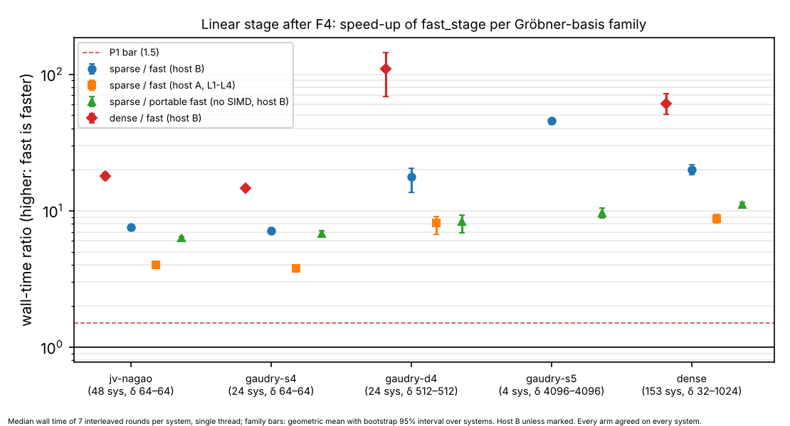
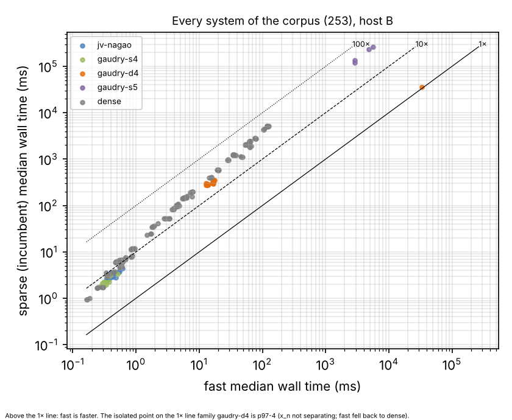
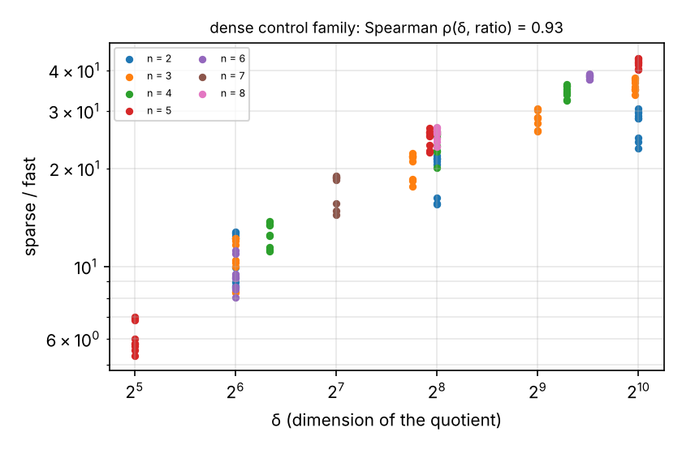
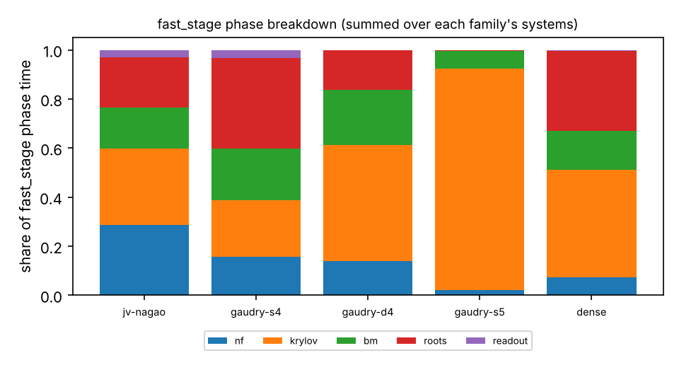
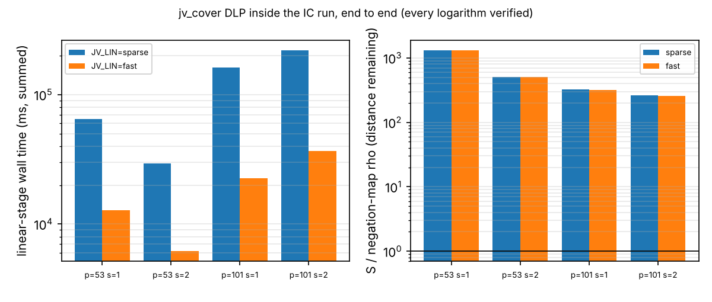

# The linear stage after F4, end to end, on a corpus of Gröbner bases

Measured 2026-10-27 under [`PROTOCOL.md`](PROTOCOL.md), frozen in `544eb84f95`
before any measured session, with amendments
[1](PROTOCOL_AMENDMENT_1.md) (`4d55b7306e`), [2](PROTOCOL_AMENDMENT_2.md)
(`42bb4d54fb`) and [3](PROTOCOL_AMENDMENT_3.md) (`b8b4a97983`). PDF:
[`REPORT.pdf`](REPORT.pdf). Numbers come from
[`analysis/summary.json`](analysis/summary.json), written by the Rust example
[`examples/postgb_la_summary.rs`](../../examples/postgb_la_summary.rs) from the
run records in `runs/`: wall time from the R2 cards, counted multiplications and
S from the R3 cards. Validation lives in [`validation/`](validation/): an
independent replay, recompute and scalar check, all in Rust, described in
[`VALIDATION_NOTES.md`](validation/VALIDATION_NOTES.md). **Validated** under the
2026-10-19 gate: [`validation/VALIDATION.json`](validation/VALIDATION.json) holds
the replay certificate (with every solved logarithm checked independently), the
validator report (151 headline numbers recomputed at 1e-9), and the matched
negation-map rho reference with its §5a band.

The owner asked (2026-10-26) for the linear-algebra stage to be sped up until
it takes the leaderboard's linear-algebra section. The measurement is end to
end for the linear stage alone, not for the whole index calculus, on a variety
of systems whose Gröbner bases come out of F4.

## What is measured

**The linear stage** takes a monic grevlex Gröbner basis (`f4_fp`) of a
zero-dimensional ideal over `F_p` to every `F_p`-rational point, each checked
against the input. The clock covers everything between the basis and the
checked points: the staircase, normal forms, multiplication matrix, minimal
polynomial, roots, coordinates and the check.

| arm | code |
|:--|:--|
| `dense` | `jv_cover::linear_stage_from_basis`, `LinMode::Dense`: all multiplication matrices, Hessenberg characteristic polynomial, one null space per root |
| `sparse` | **the incumbent**: `LinMode::Sparse`, the leader of the IC leaderboard section "Linear stage after F4 (sparse FGLM)". It runs Wiedemann/Berlekamp–Massey on `M_{x_n}`, then shift-chain eliminations per root |
| `fast` | **new**: `zero_dim_la::fast_stage` (`src/cryptanalysis/zero_dim_la.rs`). See below. It falls back to `dense` inside its own clock when it gives up |

How `fast_stage` works:
- **Matrix:** the same `M_{x_n}`, stored as hybrid dense/sparse columns.
- **Krylov:** one transposed Krylov pass `(Mᵀ)ʲu`, `j < 2δ`, gives the sequence of every coordinate at once.
- **Minimal polynomial:** Berlekamp–Massey with a cached inverse.
- **Roots:** `gcd(f, x^p − x)`, with `x^p mod f` computed by allocation-free Karatsuba/Barrett powering.
- **Coordinates:** the rational univariate representation, `x_i = Ψ_{a(x_i)}(ξ) / Ψ_{a(1)}(ξ)`.
- **Arithmetic:** lazy `u32`/`u64` with explicit AVX-512/AVX2 kernels chosen at run time.

**Corpus:** 253 systems in five families, generated by frozen generators and
seeds in [`examples/postgb_la_bench.rs`](../../examples/postgb_la_bench.rs):

| family | system | n | δ | systems |
|:--|:--|--:|--:|--:|
| `jv-nagao` | Weil-restricted Nagao decompositions of `jv_cover` (random and planted residuals), p = 53, 101, 251, 1009 | 6 | 64 | 48 |
| `gaudry-s4` | symmetrised S₄ over `F_{p³}`, Weil-restricted, p = 271, 1039, 8191 | 3 | 64 | 24 |
| `gaudry-d4` | D₄-invariant S₅ over `F_{p⁴}`, p = 97, 1033, 4093 | 5 | 512 | 24 |
| `gaudry-s5` | full symmetrised S₅ over `F_{p⁴}`, p = 13, 101 | 4 | 4096 | 4 |
| `dense` | n random dense polynomials of degree d through a planted point, 17 shapes × p ∈ {65521, 2³¹−1, 4294967291} × 3 | 2–8 | 32–1024 | 153 |

**Rounds:** 7 interleaved rounds per system, with the arm order rotated, single
thread, after a quiet-CPU wait. The `dense` arm is capped at δ ≤ 1024 (fixed in
the protocol).

## Result

**Correctness gate: passed.**
- Every arm returned the same solution set on all 253 systems.
- Every planted point was found.
- No system was skipped.
- Every DLP solve was correct: 4 runs per `JV_LIN` arm, and every rho run.

| prediction | outcome |
|:--|:--|
| **P1** every family `sparse/fast` ≥ 1.5, interval above 1 | **held**: 7.1–45.5× |
| **P2** in `dense`, `sparse/fast` grows with δ | **held**: Spearman ρ = 0.93 over 153 systems |
| **P3** `fast` gives up on ≤ 5% | **held**: 1 of 253 (0.4%), `gaudry-d4 p97-4` |
| **P4** DLP logs correct, counted multiplications within ±25% on every system, S within ±10%, lower linear-stage wall time on every run | **failed** on the counted clause: fast's count falls outside ±25% of sparse's (R3) on 97 systems (85 `dense`, 8 `gaudry-s4`, 2 `gaudry-d4`, 2 `gaudry-s5`); counted sparse ÷ fast ranges 0.77–2.14. The other three clauses held |
| **P5** portable `fast` (no vector kernels) still ≥ 1.2 | **held**: 6.3–11.1× |

### 1. The linear stage is 7–46× faster than the incumbent in every family

The table gives the wall-time ratio of median times on host B (Xeon 2.8 GHz,
4 MiB L2, 33 MiB L3): the geometric mean over the family's systems, with its
bootstrap 95% interval (4,000 resamples) and its range.

| family | systems | δ | sparse ms (median) | fast ms (median) | **sparse ÷ fast** | range | dense ÷ fast | counted sparse ÷ fast |
|:--|--:|--:|--:|--:|:--|:--|:--|:--|
| jv-nagao | 48 | 64 | 3.05 | 0.40 | **7.60 [7.43, 7.78]** | 5.80–8.95 | 17.9 [16.9, 19.0] | 0.98–1.32 |
| gaudry-s4 | 24 | 64 | 2.21 | 0.32 | **7.13 [6.80, 7.49]** | 5.87–8.97 | 14.6 [14.1, 15.0] | 1.12–1.54 |
| gaudry-d4 | 24 | 512 | 313 | 16.5 | **17.8 [13.7, 20.5]** | 1.06–23.8 | 109 [69, 144] | 0.90–1.56 |
| gaudry-s5 | 4 | 4096 | 229,741 | 4,849 | **45.5 [42.8, 47.2]** | 41.5–47.4 | (dense not run) | 0.77–0.89 |
| dense | 153 | 32–1024 | 104 | 4.64 | **20.0 [18.3, 21.7]** | 5.33–43.6 | 60.6 [51.2, 71.8] | 0.99–2.14 |




**The gain grows with δ** (P2, ρ = 0.93). It is about 7× at δ = 64, 18–20× at
δ = 512–1024, and 46× at δ = 4096. On `gaudry-s5` the incumbent needs about
230 s per system and `fast` about 5 s.



**Most of the gain is in the cost per multiplication.** With amendment 3's fixed
counter, both arms count the products they execute. The incumbent counts those
with non-zero operands, and `fast` one per nonzero coefficient times the row it
scales.
- **Counted multiplications:** `fast` does fewer on four families: geometric
  means of 1.13 (`jv-nagao`), 1.26 (`gaudry-s4`), 1.05 (`gaudry-d4`) and 1.42
  (`dense`). On `gaudry-s5` it does more (0.83).
- **Wall time:** 7–46× lower, which is far more than the counts explain.
- **P4:** the counted range, 0.77–2.14, is outside P4's preregistered ±25%, so
  P4 fails.

Wall time is the headline unit, as in the leaderboard's existing
"Linear-algebra engine" section. The counted numbers are reported beside it and
not ranked. The ratios above them in the table, dense ÷ fast, have no
fixed-counter count, because R3-C ran only `sparse` and `fast`.

**Where `fast` spends its time:**
- the Krylov pass is the largest phase: 23–90% of the time, 90% at δ = 4096;
- the root step takes 16–37%, and is largest at the 31- and 32-bit primes;
- the normal forms take 29% at `jv-nagao` and less elsewhere.



### 2. The algorithm, not only the instruction set (P5)

With `ZERO_DIM_LA_SIMD=portable` (no explicit vector kernels), cards R2-A1 and
R2-A2 measured `sparse` against `fast` with 3 rounds. The table gives `sparse ÷
portable fast`.

| family | jv-nagao | gaudry-s4 | gaudry-d4 | gaudry-s5 | dense |
|:--|--:|--:|--:|--:|--:|
| sparse ÷ portable fast | 6.31 | 6.75 | 8.35 | 9.63 | 11.10 |
| portable ÷ vector fast | 1.15 | 1.04 | 2.16 | 4.01 | 1.83 |

The vector kernels are worth 1.0–4.0×. The rest, 6–11×, is the algorithm and
the arithmetic layout.

### 3. Inside the index calculus: `jv_cover` DLP, end to end

Cards R2-D1 (`JV_LIN=sparse`) and R2-D2 (`JV_LIN=fast`) ran the same command
(`--exp dlp --sizes 53,101 --seeds 2 --rho-runs 4 --check-every 64`) with the
same seeds and relations, and the same-process rho. They give the wall time.

R3-D1 and R3-D2 re-ran the same command with amendment 3's fixed counter. They
give the counted S. They also ran the negation-map rho (`rho_e_neg`) in the
same process, which is the §5a matched reference. Relations, logarithms and the
plain rho runs are identical to R2's.

| p | seed | relations | linear-stage s, sparse → fast | **lin ÷** | whole run s | S sparse → fast | S/rho | **S/rho (negation map), distance to rho** |
|--:|--:|--:|:--|--:|:--|:--|:--|:--|
| 53 | 1 | 31 | 64.8 → 12.8 | **5.07×** | 248 → 247 | 731.6 → 727.1 | 664 → 660 | 1319 → **1310** |
| 53 | 2 | 33 | 29.5 → 6.2 | **4.79×** | 136 → 136 | 328.8 → 326.5 | 286 → 284 | 510 → **506** |
| 101 | 1 | 53 | 162.0 → 22.6 | **7.16×** | 121 → 76 | 224.4 → 220.4 | 151 → 149 | 326 → **320** |
| 101 | 2 | 50 | 220.7 → 36.5 | **6.05×** | 164 → 119 | 365.5 → 359.0 | 293 → 287 | 262 → **257** |



**Linear stage.** `lin_ms` here is the stage's time summed across `jv_cover`'s
4-thread relation pool, unlike the single-threaded corpus bench. Its wall time inside the IC run falls 4.8–7.2×, and the whole
run is 27–37% shorter at p = 101. At p = 53 the whole run is unchanged, because
the rho reference runs in the same process and dominates there.

**Counted S falls.** S, in counted group operations, falls 0.6–1.8%. The fast
arm does 3–8% fewer linear-stage multiplications here. Under R2's formula
counter, S had appeared to rise about 3%. P4's ±10% bound on S held.

**Tables A–C.** No row moves: the linear stage is a minor term of S here.

**Distance to rho.** Against the negation-map rho, S/rho with `fast` is
257–1310. The negation map's mean S over 4 runs is 0.55–1.40, against 1.10–1.48
for the plain rho.

**§5a band.** The IC side emits no unpriced native work, so its S is the same at
0, 0.1 and 1 GAE per operation, and at w > 0 it is a lower bound. The
negation-map rho leaves its canonicalisations, partition hashes and table
operations unpriced. The validator bounded that work from rho's own counts.
Pooled over the four instances, with rho at the upper bound:

| GAE per unpriced op | 0 | 0.1 | 1 |
|:--|--:|--:|--:|
| IC (fast) S | 408 | 408 (lower bound) | 408 (lower bound) |
| negation-map rho S | 0.82 | 1.37 | 6.35 |
| IC ÷ rho | 497 | 297 | 64 |

Rho is cheaper on every instance at every weight, so the order holds across the band.

### 4. Host dependence

The worker restarted between card L4 and the R2 cards, and came back on another
host (amendment 2). Host A was a Xeon 2.1 GHz with 8 MiB L2 and 260 MiB L3; host
B, which ran every R2 card, a Xeon 2.8 GHz with 4 MiB L2 and 33 MiB L3. Hosts
are never pooled.

The first runs (L1–L4) on host A covered 238 systems. They read lower
speed-ups:

| family | jv-nagao | gaudry-s4 | gaudry-d4 | dense |
|:--|--:|--:|--:|--:|
| host A, sparse ÷ fast | 4.01 | 3.79 | 8.14 | 8.75 (142 systems) |

Most of the difference is the incumbent. Its sparse elimination over the shift
chains runs about 3× slower on B's smaller caches, while `fast` slows about 1.3×.
On both hosts every family clears P1's 1.5× bar by a wide margin.

### 5. The one give-up: `gaudry-d4 p97-4`

On this system `x_n` does not separate the solutions. The minimal polynomial of
`M_{x_n}` has degree below δ on all four tries, so `fast` falls
back to `dense` (33.2 s; `sparse` also fell back, 35.3 s; `dense` 32.4 s).

A random linear form `ℓ = x_n + Σ c_i x_i` as the separating element would avoid
this. It needs `M_ℓ` built from the normal forms already memoised. That is a
follow-up, not part of this frozen protocol.

## Decision (PROTOCOL.md, "Decision rule")

P1 and the correctness gate hold, so `fast` becomes the default linear stage:
- **The change:** `JV_LIN` now defaults to `fast` (`src/cryptanalysis/jv_cover.rs`,
  `lin_mode`), and the generic entry point `solve_zero_dim` uses it.
- **The incumbent stays available:** `JV_LIN=sparse` selects it.
- **Earlier studies are unaffected:** studies that ran with `JV_LIN` unset (for
  example `research/jv_cover_p_scaling_20261024`) used `sparse`. Their records
  pin their commits and binaries.

It enters the leaderboard as the leader of a new component section, "Linear
stage after F4 across Gröbner-basis corpora". The `jv_cover` end-to-end row
stands beside it.

**Class:** engineering, a component speed-up. No row of tables A–C moves.

## Deviations, all recorded before the affected runs

1. **Card L1's first attempt was refused** before its run. The disk had
   588 MB free, below the card's 1 GB check. Space was cleared, keeping the
   pinned binaries, and the attempt is kept under `cards/refused-disk/`.
2. **A harness bug skipped 11 systems in L3 and L4** (amendment 1). `F4Options::with_budget`
   was built with the corpus and expired. The budget is now built per system,
   and all ten cards were re-run as R2 on the fixed binary. No arm's code changed.
3. **The host changed after L4** (amendment 2). Hosts are reported separately,
   the R2 run timeouts were raised to 7000 s, and the main session ran the long
   cards with `tools/task_card.py` from its own shell. Their launcher logs are
   in `cards/`.
4. **Conductor** was unreachable all session (connection refused at
   localhost:8080), so its hooks let edits through.
5. **No `CHECKPOINT_UPLOAD_TOKEN`** was set, so the S3 resume checkpoint could not be
   pushed.
6. **The fast arm's counter and the rho reference** (amendment 3). A PR review
   found that the fast arm charged its root powering by a formula. The counter
   was fixed, and every counted figure was re-measured: the corpus counts in
   R3-C, and S in R3-D1 and R3-D2. Wall time is R2's. The R2 counts stay in the
   records but are superseded.

   R3-D1 and R3-D2 also run the negation-map rho, the strongest rho on this
   curve, as the matched reference. The analysis moved from Python to Rust
   (AGENTS.md, "no Python"), so the bootstrap intervals moved in their last
   digit.

   The first launches of R3-C and R3-D1 were stopped during their quiet-CPU
   wait, before any run. They are kept as `cards/*aborted-preflight*`.

The independent validator also found these (none changes a recorded number):
- **F4 budget.** The bench gives the `dense` family's F4 600 s, not the 900 s
  that PROTOCOL.md states. This has been so since the freeze, and no system timed out.
- **Planted points.** The bench checks planted points only in the `dense` family. On the
  constructed `jv-nagao` systems it checks only that a solution exists.
- **Activity during R2-A2.** A commit landed during R2-A2's measured run, which can affect
  its timings but not its counts.

## Reproduce

```sh
cargo build --release --example postgb_la_bench --example jv_cover --example postgb_la_summary
python3 tools/task_card.py run research/postgb_linear_stage_20261026/cards/CARD-postgb-la-20261026-R2-L1.yaml   # … each R2 and R3 card
./target/release/examples/postgb_la_summary
python3 research/postgb_linear_stage_20261026/scripts/plots.py   # lays out summary.json; needs matplotlib
```
