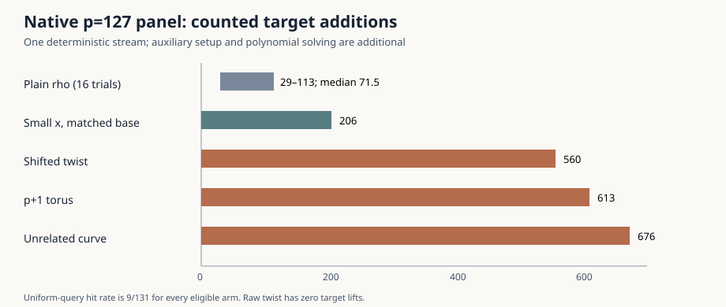

# Smooth auxiliary fibers for prime-field relations

**Status, 2026-11-27 audit of the 2026-11-25 panel:** the three usable
auxiliary fibers produce checked relations on the original curve. On the one
frozen query stream, each costs more counted target-curve additions than the
matched small-x panel and all 16 same-target rho trials. The exact uniform-query
hit probability is nevertheless **the same for all four eligible bases**.
The observed stopping times are single-stream outcomes, not estimates of a
general yield advantage or disadvantage. Setup, realistic polynomial solving,
recombination and sparse linear algebra remain outside the cost comparison.

## Construction and proof boundary

For the prime-order target $E(\mathbb F_p)=\langle P\rangle$, let
$Q=[k]P$. For each auxiliary construction, enumerate field elements $x$,
retain only those for which $x^3+Ax+B$ is a square on **E**, and choose
target points $F_i=(x_i,y_i)$ and $-F_i$. Every recorded row comes from a
checked equality $aP+bQ=\sum_j\epsilon_j F_{i_j}$ on E. In logs, it is
$bk-\sum_j\epsilon_j\log_P F_{i_j}=-a\pmod r$. Since E has prime order,
each nonidentity $F_i$ lies in its target subgroup and has nonzero scalar
modulo r. No auxiliary-point map is treated as a group homomorphism. The
only map needed is field x selection followed by target-curve lifting.

The torus arm uses the norm-one subgroup of $\mathbb F_{p^2}^{*}$, of order
$p+1=128$ here, and $x=z+z^{-1}$. A fixed order-8 coset has eight distinct
images; the checked Dickson recurrence $D_8(x)=c$ characterizes its fiber.
The unrelated elliptic arm uses an order-8 coset on $y^2=x^3+x$, then its x
coordinates. The twist arm uses an order-5 coset on the target quadratic
twist; normalization to the twist's $d y^2=f(x)$ model yields zero target
lifts, as quadratic characters require. The shifted twist arm applies the
first field shift giving two lifts. That shift has no homomorphism property;
its rows are valid only through the target-curve check. Both signs and all
duplicate pair representations are retained as rows, while matrix rank counts
independent information.

## Native panel and falsifiers

The frozen protocol is in [PROTOCOL.md](PROTOCOL.md) with the native stream
amendment in [AMENDMENT_NATIVE.md](AMENDMENT_NATIVE.md). Public fixture:
$p=127$, $E:y^2=x^3+x+26$, $r=131$, $P=(0,36)$, $Q=(12,49)$,
and withheld verification scalar 37. Each eligible arm uses two x columns,
both signs, pair arity 2, the same 1024-query stream, and stops at rank 3.
The independent Rust replay checked every point identity, coefficient/sign,
rank and recovered scalar. Raw stream, bases, rows, summary and rho trials are
in [native_run_v1](native_run_v1/). These are **measured local diagnostic**
counts. Group additions count the native runner's scalar arithmetic and row
point verification, but omit x-lift tests and finite-field setup. Wall times
are excluded from comparisons because this was not an EKS-controlled run.

| Arm | Raw fiber | Target x lifts | Queries to rank 3 | Raw rows | Target additions | Auxiliary additions | Verdict |
|:--|--:|--:|--:|--:|--:|--:|:--|
| small x, matched base | 2 | 2 | 10 | 6 | 206 | 0 | control |
| p+1 torus | 8 | 5 | 32 | 3 | 613 | 0* | above control on this stream |
| unrelated curve | 8 | 3 | 35 | 5 | 676 | 84 | above control on this stream |
| raw twist | 5 | 0 | 0 | 0 | 0 | 34 | lift gate fails |
| shifted twist | 5 | 4 | 29 | 4 | 560 | 34 | above control on this stream |

*Torus finite-field work is uncounted in the addition column. Twist shift
search, x lifts, pair-table creation outside target additions, and linear
algebra are also not fully priced. Thus the auxiliary total costs are strictly
higher than the displayed lower bounds. The rho control has 16 verified runs,
29–113 counted group additions (median 71.5), using a plain three-way walk.
The matched small-x arm is an exhaustive arity-2 relation control, with the
same two factor-base columns. The plot [counted target work](figures/work.svg)
shows this one-stream lower-bound work and the rho range.

### Exact matched-base yield audit (2026-11-27)

Let the two target-curve columns be nonidentity points $A,B$ with distinct x
coordinates, so the signed base is $\{A,-A,B,-B\}$. Its unordered two-summand
set is contained in
$\{O,\pm 2A,\pm 2B,\pm(A+B),\pm(A-B)\}$, at most **nine** target
points. Ordered swaps and the two ways to make $O$ do not add independent
coefficient rows. The separate Rust replay now enumerates all 16 ordered
pairs from the committed `bases.csv`: **each** eligible arm has exactly nine
distinct target sums. These are exact finite checks of this fixture, not
timing measurements.

If $a,b$ are independent uniform scalars modulo 131, $aP+bQ$ is uniform on
the 131-point target group. The exact hit probability for every eligible arm
is therefore $9/131\approx0.06870$. The map $(a,b)\mapsto(aP+bQ,b)$ is a
bijection, so conditional on each hit point, $b$ remains uniform. The nine
signed-pair coefficient patterns are the same for every arm; when the nine
point sums are distinct, the coefficient-row and rank-stopping distributions
are consequently identical under independent uniform queries. The frozen
xorshift64 run is deterministic rather than independent uniform sampling:
its 10 versus 29–35 query stopping counts cannot estimate a difference in
expected yield. Auxiliary setup remains additional work; this argument does
not compare the complexity of different full-size Semaev polynomial systems.
Within this bounded pair-table model, all four arms also use the same 16
ordered pair operations and the same query arithmetic; auxiliary setup is
additional. A gain would have to come from another stage or a larger base,
both of which require a separate, fully charged comparison.

**Proof map.** [SignedPairSupport.lean](SignedPairSupport.lean) checks the nine
formal coefficient classes with Lean 4.36.0 (`lean SignedPairSupport.lean`;
`#print axioms` reports only `propext`, `Classical.choice`, `Quot.sound`).
The point-level bridge, including all four nine-element sumsets, is checked
by [native/src/verify.rs](native/src/verify.rs). The probability and rank-law
implication above has a written proof here but is not yet formalized in Lean;
the remaining formal obligation is the bijection and induced row-distribution
statement for a prime-order target group.

**Cheap falsifier per candidate.** Torus: verify exact norm-one order, eight
distinct Dickson roots, then count target lifts and independent rows per
complete work. Unrelated curve: verify smooth subgroup/coset and distinct x
fiber, then target lifts and row yield including auxiliary setup. Raw twist:
the target-lift count is zero for the normalized x values. Shifted twist:
check all shifted target lifts and charge the shift scan; its valid rows still
cost more on the frozen stream. These results apply to this fixture and
stream; the exact uniform-query yield result is separate from that observation.

## Published-method and larger-curve screen

[Petit, Kosters and Messeng, PKC 2016, §§3.1–3.5](https://people.maths.ox.ac.uk/petit/files/16PKC_primeECDLP.pdf)
already describe smooth auxiliary curves as *factor-base constructors*. Their
summation-polynomial relation must still be solved on the target curve.
[Semaev's summation-polynomial method](https://eprint.iacr.org/2004/031)
provides that target relation condition. Our arity-2 exhaustive pair table is
only a small-field oracle for the relation step, not a measured Gröbner or
resultant implementation. At fixed two-column base, the three auxiliary arms
needed 29–35 queries for rank on the frozen stream, versus 10 for the small-x
control. The exact audit above shows that their ideal uniform-query hit and
rank distributions are equal at this matched base size. The larger fiber
alone does not enlarge the matched base.

The existing [factor-base encyclopedia](../../docs/ic/factor-base-encyclopedia/README.md)
records prior Dickson and isogeny measurements, including a P-256 Dickson
tower cost model reported there as 394.5 times its rho baseline. That is
**prior evidence**, not a measurement made in this PR, and its workload and
model differ from this exact panel. A P-256 scaling claim would require a
fresh, same-target EKS run with polynomial solving, setup, recombination and
linear algebra charged. AWS credential validation returned
`InvalidClientTokenId` in this session, so the repository's EKS performance
gate could not run. No new arm established a solver-cost advantage, so no new
relation solver was built.

## Reproduce

From the repository root, run
`cargo test --manifest-path research/pplus1_aux_twist_relations_20261125/native/Cargo.toml`,
then `cargo run --release --manifest-path research/pplus1_aux_twist_relations_20261125/native/Cargo.toml --bin prime-aux-relations-panel -- /tmp/prime-aux-run`,
then `cargo run --release --manifest-path research/pplus1_aux_twist_relations_20261125/native/Cargo.toml --bin verify-relations -- /tmp/prime-aux-run`.
For the bounded formal coefficient result, change to this study directory and
run `lean SignedPairSupport.lean` with the pinned `lean-toolchain`.
The old Python files and JSON remain under [historical-python](historical-python/)
for provenance; they are excluded from the native result.
