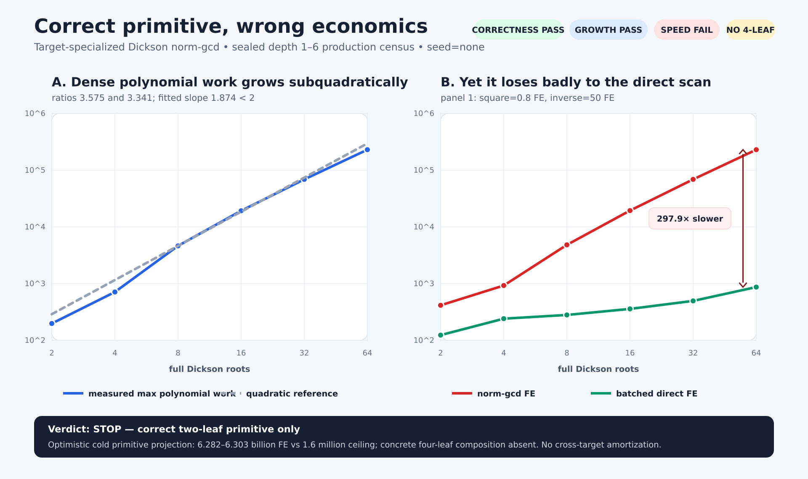

# Result

The target-specialized Dickson/Semaev norm-gcd is **correct and measurably
subquadratic through 64 selector roots, but it is not a speedup**. The
independent verifier accepted all six depths, all 66 fixed queries, all six
sealed support digests, every exceptional-chart decision, every exact miss,
and every recovered signed witness. Maximum polynomial work had adjacent
ratios 3.575 and 3.341 and a depth-3--6 fitted slope of 1.874, so the frozen
growth gate passed.

The competitive gates failed decisively. At depth six, the norm-gcd was
244.99--297.94 times slower than the one-inversion batched direct scan on the
worst paired query, depending on the frozen field-equivalent panel. Its
optimistic two-leaf-only projection over 27,370 residuals was 6.282--6.303
billion FE, roughly 3,926--3,939 times the complete 1.6-million ceiling. No
concrete four-leaf composition exists in this study, so promotion is forbidden
independently of those cost failures.

The frozen verdict is `stop-primitive-only`. This is a scoped negative result
for the dense quotient-before-norm implementation, not a lower bound against a
direct Dickson-substituted four-leaf elimination or a structured pair
resultant. [pcc:unverified]



# Question and scope

For the registered prime-field curve and signed Dickson factor bases inherited
from the preceding pair-spectrum study, the experiment asks whether a target
$R$ can be tested for

$$
R\in A_t+A_t
$$

without constructing the essentially quadratic pair support. It also asks
whether that exact two-leaf primitive beats a strong linear scan and can be
placed inside a complete four-leaf composition under the cold one-target
budget.

The scope rules out generic factor-base replacement, target changes after
labels are known, warm state from another DLP target, and cross-target
amortization. Passing a polynomial slope alone is insufficient. The maintained
baseline scans each distinct selected abscissa, batch-inverts all regular
denominators with one Montgomery inversion, tests both signs, and directly
replays the canonical witness.

# Algorithm

At depth $t$, let $F_t(X)=D_{2^t}(X,1)$. For a finite target $R=(u,v)$ and
$P=(x,y)$ on $y^2=f(x)$, define

$$
d=(u-x)^2,\qquad
C=v^2+f(x)-(u+x)d,\qquad D=2v.
$$

Away from $x=u$,

$$
x(R-P)=\frac{C+Dy}{d}.
$$

The candidate works immediately in
$Q_t=\mathbf F_p[x]/(F_t)$ and represents the cleared composition as
$A_j+yB_j$ with denominator power $\delta_j$. Starting from
$(A_0,B_0,\delta_0)=(C,D,d)$, it applies

$$
\begin{aligned}
A_{j+1}&=A_j^2+fB_j^2-2\delta_j^2,\\
B_{j+1}&=2A_jB_j,\\
\delta_{j+1}&=\delta_j^2.
\end{aligned}
$$

The quadratic norm

$$
N_R=A_t^2-fB_t^2\pmod {F_t}
$$

vanishes on candidate leaf abscissae. A balanced product/remainder tree
evaluates it on every known root and rebuilds the exact split gcd from the zero
leaves. The implementation uses Karatsuba multiplication and reversed-series
Newton division. It never invokes a generic factorizer or an unpriced root
oracle.

For a regular root with $B_t(x)\ne0$, the only compatible sign is recovered as
$y=-A_t(x)/B_t(x)$. The candidate directly handles $x=u$, $A_t=B_t=0$,
nonlifting roots, infinity, and the denominator-clearing zero caused by
$P=-R$. Every candidate complement must be an actual signed leaf and must add
back to $R$.

# Independent proof path

The candidate publishes dense coefficients of $A_t$, $B_t$, $N_R$, and the
split gcd; every norm value in the frozen root order; zero indices; chart
labels; counters; and a canonical witness or explicit miss. The independently
written Rust verifier imports none of the candidate implementation. It
reconstructs the curve, tower, leaves, full unordered pair truth, and sealed
support hashes, then evaluates the homogenized recurrence pointwise at every
root and checks every published coefficient evaluation, norm value, gcd root,
chart, classification, and witness.

The accepted production transcript contains:

- 6 verified depths and 66 verified queries;
- 12 exact hits and 54 finite exact misses;
- 3,780 independent coefficient evaluations and 1,260 checked root values;
- 6 forced denominator-zero queries; and
- 0 unresolved or ambiguous production queries.

The separately fixed unit test exercises the $A=B=0$ orientation branch that
the production targets do not reach.

This is a public deterministic proof by exhaustive replay, **not a
zero-knowledge proof**. Nothing is private: inputs, targets, coefficients,
witnesses, and misses are intentionally disclosed. The source manifest binds
the instrumented counters, but the verifier does not attest machine
instructions or the host. SHA-256 is custody, not zero knowledge or trusted
execution. [`PROOF_MODEL.md`](PROOF_MODEL.md) records the exact boundary.

There is no random seed (`seed=none`). The curve, roots, smaller-root-first
branch convention, signed ordering, and eleven queries at every depth were
fixed prospectively.

# Production custody

The active source manifest is
[`SOURCE_MANIFEST.json`](SOURCE_MANIFEST.json). It binds the protocol, proof
model, pushed-Git checkpoint, runbook, locked Rust crate, candidate, verifier,
analyzer, and sole runner to source commit `1db27050c0`. The run launched from
the clean named branch at pushed commit `6e6a5c7bdb`; source hashes passed both
before and after the release build.

The candidate, verifier, and analyzer each ran exactly once. All three stderr
files are empty. Evidence was atomically moved into
[`evidence/`](evidence/) only after the analyzer schema and every evidence hash
passed. It was committed unchanged at `2df4ff6142`. The analyzer's diagnostic
input-path strings preserve the temporary staging-directory name used before
that atomic move; the named files and their SHA-256 values are the committed
artifacts.

# Exact results

## Correctness and growth

| Depth | Full roots | Signed leaves | Pair support | Max polynomial work | Norm FE, panel 1 | Direct FE, panel 1 |
|---:|---:|---:|---:|---:|---:|---:|
| 1 | 2 | 2 | 3 | 198 | 414.4 | 123.6 |
| 2 | 4 | 4 | 9 | 712 | 925.0 | 241.2 |
| 3 | 8 | 8 | 33 | 4,626 | 4,827.2 | 280.4 |
| 4 | 16 | 16 | 129 | 19,237 | 19,404.0 | 358.8 |
| 5 | 32 | 30 | 451 | 68,774 | 68,841.2 | 496.0 |
| 6 | 64 | 68 | 2,313 | 229,756 | 229,529.8 | 868.4 |

The FE columns are the maximum finite-query cost at each depth and need not
come from the same query. The frozen speed gate instead compares norm and
direct costs within every paired query.

| Growth test | Measured | Required | Result |
|:---|---:|---:|:---:|
| Depth 4 to 5 ratio | 3.575090 | $<4$ | pass |
| Depth 5 to 6 ratio | 3.340739 | $<4$ | pass |
| Depth 3--6 log-log slope | 1.874056 | $<2$ | pass |

This is finite-range empirical growth, not an asymptotic theorem. It does show
that the Karatsuba/Newton/remainder implementation achieved the intended
structural regime instead of accidentally doing quadratic root-by-root dense
work.

## Direct-baseline failure

| Frozen FE panel | Depth-6 max norm FE | Depth-6 max direct FE | Worst paired norm slowdown | 2x win? |
|:---|---:|---:|---:|:---:|
| square 0.8, inverse 50 | 229,529.8 | 868.4 | 297.94x | no |
| square 1.0, inverse 100 | 230,087.0 | 994.0 | 273.91x | no |
| square 1.0, inverse 200 | 230,287.0 | 1,194.0 | 244.99x | no |

The first panel's worst paired query uses only 770.4 FE on the regular direct
path while the norm path uses about 229,530 FE. The stronger inverse prices
make the direct scan relatively more expensive, but nowhere near enough to
change the verdict.

At depth six, every regular finite query pays essentially the same dense norm
construction:

```text
130,658 additions
 41,489 subtractions (41,490 on the planted and denominator chart)
 55,383 multiplications
  2,225 squarings
      0 inversions
```

By contrast, the regular direct scan covers 34 selected abscissae and 68 signed
leaves with 68 additions, 306 subtractions, 268 multiplications, 98 squares,
and one batched inversion. The dense quotient successfully removed
factorization and per-leaf inversions, but it solved a substantially more
expensive algebra problem than the exact membership question requires.

## Cold projection and composition

| Frozen FE panel | Optimistic primitive-only total | Ceiling | Multiple of ceiling |
|:---|---:|---:|---:|
| square 0.8, inverse 50 | 6,282,242,829.4 | 1,600,000 | 3,926.40x |
| square 1.0, inverse 100 | 6,297,494,290.0 | 1,600,000 | 3,935.93x |
| square 1.0, inverse 200 | 6,302,968,290.0 | 1,600,000 | 3,939.36x |

These totals optimistically charge depth-six setup once and then the maximum
two-leaf query 27,370 times. They still omit a four-leaf composition, its
recovery, and its certificate traffic. The analyzer records that composition
as `absent-two-leaf-primitive-only`, so this projection cannot be presented as
an m=7 solver even hypothetically.

# Why the promising asymptotic did not help

The experiment separates two facts that are easy to conflate:

1. The dense quotient computation is subquadratic in the number of full
   selector roots over the measured ladder.
2. The maintained exact baseline is already linear in the much smaller set of
   rationally lifting abscissae and uses only one inversion.

At $n=64$, fast dense polynomial arithmetic has a large constant and emits far
more algebraic state than a membership scan needs. Replacing the dense
polynomials by pointwise Dickson recurrence would remove most of that constant,
but it would still perform a recurrence on top of the same leaf-wise work the
direct scan already uses. It therefore cannot plausibly deliver the mandatory
2x win as a standalone two-leaf query.

That observation is not a general lower bound. It is the reason to stop
optimizing this primitive and move the elimination boundary outward to four
leaves.

# Prior-art assessment

Semaev's summation-polynomial zero criterion justifies the elimination target,
but it is an algebraic-closure statement and does not replace rational signed
recovery or exceptional-chart handling.

Petit--Kosters--Messeng (PKM) provide direct prior art for low-degree selector
composition. Their prime-field cost retains the relation-system solve as the
open term $T(E,m,L)$, and the reported experiments solve two-summand systems.
The paper does not supply an executed m=7 extractor or the measured query in
this report.

Amadori--Pintore--Sala execute dynamic-factor-base experiments for
$m=3,4,5$. Their displayed m=7 crossover assumes that two solve costs are
approximately equal and explicitly notes that this is unproved. It is a lead,
not experimental evidence for m=7.

Bostan--Flajolet--Salvy--Schost give fast algorithms for special resultants and
support the quotient-algebra strategy. Their algorithms remain sensitive to
the retained output degree and do not imply a sublinear empty-inclusive zero
query.

No exhaustive novelty claim is made: the repository research-KB executable and
MCP were unavailable in this runtime. The primary papers, their recorded local
hashes, and the committed predecessor studies form the bounded literature
review in [`PROTOCOL.md`](PROTOCOL.md).

# Decision

Do not integrate this two-leaf norm-gcd into m=7 and do not amortize it across
targets. Correctness and growth pass; direct speed, cold budget, and concrete
four-leaf composition fail. Further factor-base swaps or generic Gröbner-basis
experiments would not answer the frozen question.

# Best next lead: four-leaf-first Dickson/Semaev elimination

The next goal should be a **direct four-leaf query**, not another representation
of $A_t+A_t$. For target $R=(u,v)$, start from

$$
F_t(x_i)=0\quad(i=1,\ldots,4),\qquad
S_5(x_1,x_2,x_3,x_4,u)=0,
$$

and retain the signed group-law replay as the final rational filter. Do not
form, sort, hash, or scan the pair spectrum.

The most promising enabling structure is the Dickson basis. In
$\mathbf F_p[x]/D_n(x,1)$,

$$
D_iD_j=D_{i+j}+D_{|i-j|},\qquad
D_{n+k}=-D_{n-k}.
$$

Thus multiplication matrices are Toeplitz-plus-Hankel after quotient folding.
The proposed breakthrough test is to express the symmetrized, target-dependent
$S_5$ elimination operator as a small sum of such structured contractions in
the elementary symmetric variables of the four leaves. If its displacement
rank stays polylogarithmic in $n$, a deterministic structured
resultant/minimal-polynomial query may avoid the quadratic pair spectrum while
remaining exceptional-chart safe.

This is a research hypothesis, not a claimed algorithm. The next protocol
should require these algebraic go/no-go steps **before** another production
census:

1. Prove and unit-test the Dickson-basis quotient folding and the exact
   Toeplitz-plus-Hankel multiplication action through $n=64$.
2. Derive the symmetrized $S_5$ target operator without constructing an
   $n^2$ pair table or a tensor with an $n^2$ target-specific face.
3. Show a deterministic zero certificate and signed recovery path, including
   multiplicities and all exceptional components.
4. Stop immediately if the operator's target-dependent representation or one
   exact query is quadratic in the pair spectrum.
5. Only then implement the counted Rust solver and compare its **complete**
   27,370-residual one-target total against 1.6 million FE, with no work shared
   across unrelated DLP targets.

The narrower Dickson/Laurent transform of the current two-leaf norm may still
be useful as a building block inside this four-leaf operator, but the present
measurements rule it out as the promoted endpoint.

# Verification and regeneration

Verify the sealed evidence:

```sh
(cd research/pplus_dickson_norm_gcd_20261127/evidence && \
  sha256sum --check --strict SHA256SUMS)
```

Run the standalone Rust tests:

```sh
cargo fmt --all --manifest-path \
  research/pplus_dickson_norm_gcd_20261127/native/Cargo.toml -- --check
cargo clippy --locked --all-targets --manifest-path \
  research/pplus_dickson_norm_gcd_20261127/native/Cargo.toml -- -D warnings
cargo test --locked --manifest-path \
  research/pplus_dickson_norm_gcd_20261127/native/Cargo.toml
```

Regenerate the visual:

```sh
rustc --edition=2021 -D warnings -O \
  research/pplus_dickson_norm_gcd_20261127/reporting/generate_visual.rs \
  -o /tmp/pplus-norm-gcd-generate-visual
/tmp/pplus-norm-gcd-generate-visual \
  research/pplus_dickson_norm_gcd_20261127/reporting/result-data.tsv \
  research/pplus_dickson_norm_gcd_20261127/figures/result.svg
inkscape research/pplus_dickson_norm_gcd_20261127/figures/result.svg \
  --export-type=png \
  --export-filename=research/pplus_dickson_norm_gcd_20261127/figures/result.png \
  --export-width=1920
```

The one-shot custody runner is retained in [`run_census.sh`](run_census.sh).
It now correctly refuses to overwrite the committed evidence directory.
