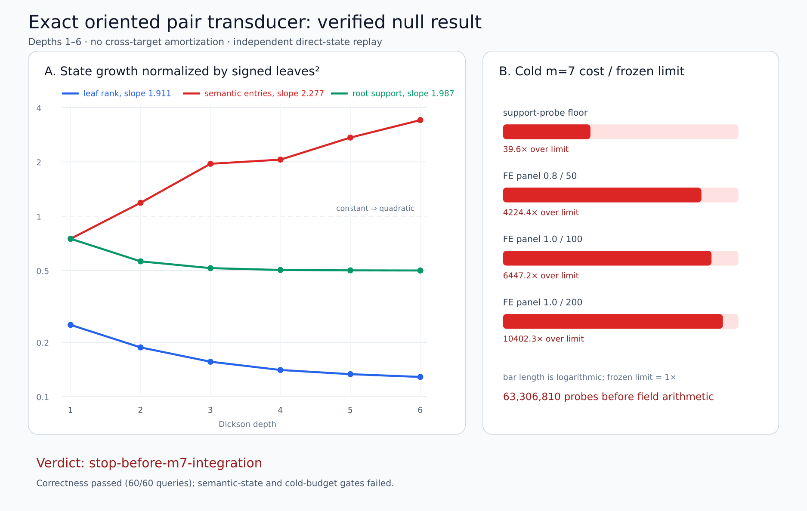

# Result

The exact oriented pair-support transducer is correct, but it **must stop before
m=7 integration**. The independent verifier accepted all six complete supports,
all 60 fixed queries, every recovered witness, and every exact miss. However,
the hash-consed semantic circuit grew superquadratically, and the complete cold
single-target projection exceeded the frozen 1.6-million budget by orders of
magnitude.

This is a scoped null result for one explicit semantic-state representation. It
is not a lower bound against implicit resultants, separator coordinates,
target-specialized gcd methods, or other pair-spectrum data structures.
[pcc:unverified]



# Frozen scope and custody

The experiment uses curve `icv1-fp31-tm3989-ae9db972` over
$p=2^{31}-1$, the full backwards Dickson tower through depths 1–6, and both
orientations of every rational curve lift. Targets at each depth are the first
finite planted four-leaf multiset, $[k]G$ for $k=1,\ldots,8$, and infinity.
There is no random seed, hidden target choice, warm cross-target state, or
cross-target amortization.

The active source boundary is
[`SOURCE_MANIFEST_4.json`](SOURCE_MANIFEST_4.json). The candidate constructs
quadratic-tree pair states by exact multiset union. The separately coded
verifier instead enumerates the leaves below every node pair directly,
recomputes every level's support and exact $\operatorname{GF}(2)$ incidence
rank, and independently checks the root queries and witnesses. The frozen Rust
analyzer applies the preregistered inequalities and integer budget limits.

The successful immutable transcript is under [`evidence/`](evidence/), with
its own `SHA256SUMS`. Failed attempt 1 is also retained: source hashes and the
release build passed, but the wrapper stopped before candidate execution
because `/usr/bin/time` was absent. Its candidate output is exactly zero bytes;
amendment 4 removed that diagnostic dependency before the single successful
retry.

# Correctness

- Six of six Dickson depths verified.
- Sixty of sixty fixed queries agreed.
- Every reported hit replayed under the independent group law.
- Depth six supplied eight exact finite misses.
- Candidate and verifier agreed on every root-support SHA-256.
- Candidate and direct-state verifier agreed on every level's row count,
  nonempty count, support columns, entries, rank, actual/unique state totals,
  semantic entries, and union-edge totals.

The evidence is public deterministic replay, not a zero-knowledge proof or a
host attestation. The distinction and claim-to-evidence map are recorded in
[`PROOF_MODEL.md`](PROOF_MODEL.md).

# State growth

| Depth | Signed leaves $L$ | Leaf rank | Semantic entries | Root support |
|---:|---:|---:|---:|---:|
| 1 | 2 | 1 | 3 | 3 |
| 2 | 4 | 3 | 19 | 9 |
| 3 | 8 | 10 | 125 | 33 |
| 4 | 16 | 36 | 527 | 129 |
| 5 | 30 | 120 | 2,455 | 451 |
| 6 | 68 | 595 | 15,769 | 2,313 |

The frozen rule requires each metric to beat the corresponding $L^2$ ratio on
both transitions 4→5 and 5→6, and to have a depth-3–6 log-log slope below 2.

| Metric | 4→5 ratio / quadratic | 5→6 ratio / quadratic | Slope | Pass |
|---|---:|---:|---:|:---:|
| Leaf rank | 3.333 / 3.516 | 4.958 / 5.138 | 1.9108 | yes |
| Semantic entries | 4.658 / 3.516 | 6.423 / 5.138 | 2.2770 | **no** |
| Root support | 3.496 / 3.516 | 5.129 / 5.138 | 1.9865 | yes |

The root support is essentially quadratic: 68 signed leaves have 2,346
unordered pairs with repetition, while 2,313 distinct oriented sums remain.
Only 33 pair collisions disappear. Hash-consing reduces depth-six actual
entries from 16,269 to 15,769 semantic entries, which is not the state collapse
needed for a breakthrough.

The decreasing leaf-rank diagnostic is real, but it is not an executable
low-rank query algorithm. The complete support and recovery state remain the
governing objects.

# Cold single-target projection

The projection charges setup once to the one public DLP target and then charges
27,370 complete depth-six finite-miss queries. Reuse across unrelated targets
is forbidden.

| Frozen reading | Measured/projected | Limit | Multiple of limit |
|---|---:|---:|---:|
| Optimistic support probes | 63,306,810 | 1,600,000 | 39.57× |
| FE panel: square 0.8, inverse 50 | 6,758,978,305.4 | 1,600,000 | 4,224.36× |
| FE panel: square 1.0, inverse 100 | 10,315,442,515.0 | 1,600,000 | 6,447.15× |
| FE panel: square 1.0, inverse 200 | 16,643,617,815.0 | 1,600,000 | 10,402.26× |

The field-equivalent totals use the frozen affine reference path and therefore
include its expensive inversions. That implementation detail cannot rescue the
candidate: the coordinate-free optimistic floor already needs 63.3 million
support probes, 39.57 times the complete budget, before charging any field
arithmetic.

This study measured structure and counted operations, not a wall-time speedup.
The recorded local elapsed times are diagnostics only and support no end-to-end
ECDLP claim.

# Prior-art assessment

Petit–Kosters–Messeng provide low-degree selector compositions, but their cost
formula leaves the relation-system solution as the open term $T(E,m,L)$; their
reported prime-field decompositions are two-summand systems. The paper is
selector prior art, not an m=7 solver bound.

Amadori–Pintore–Sala dynamically choose the factor base and seek one dependency
rather than a full relation matrix. Their executed prime-field experiments
cover $m=3,4,5$, with the $m=5$ system split as $S_3/S_4$. Their displayed
$m=7$ crossover assumes, without proof, that their solve cost is approximately
PKM's. It is neither an executed m=7 algorithm nor an m=7 measurement.

Semaev's summation-polynomial criterion and the special-resultant algorithms of
Bostan–Flajolet–Salvy–Schost justify elimination and fast polynomial
construction. They do not by themselves supply an empty-inclusive,
subquadratic oriented pair query with recovery. No exhaustive novelty claim is
made because the repository research KB and authenticated ecdb were unavailable.

# Decision

Do not integrate this transducer into m=7. Correctness passed, but one of three
mandatory growth metrics and every cold-budget panel failed. The optimistic
probe floor independently enforces the stop.

The negative result rules out the following as the next experiment:

- another explicit pair-support table or bottom-up support union;
- promotion from low ordinary $\operatorname{GF}(2)$ rank without an exact
  query and recovery algorithm;
- a generic factor-base swap; or
- any argument that divides setup across unrelated DLP targets.

# Ranked next leads

## 1. Target-specialized Dickson/Semaev norm-gcd

Let $F_t(X)=D_{2^t}(X,1)$, let the curve be $y^2=f(x)$, and let the query target
be $R=(u,v)$. For $P=(x,y)$ away from the $x=u$ chart,

$$
x(R-P)=\left(\frac{v+y}{u-x}\right)^2-u-x.
$$

Substitute this rational function into $F_t$, clear denominators, and reduce
modulo $y^2-f(x)$. The result has the form

$$
A_R(x)+yB_R(x)=0.
$$

Taking the quadratic norm gives

$$
N_R(x)=A_R(x)^2-f(x)B_R(x)^2.
$$

Then $\gcd(F_t,N_R)$ identifies candidate factor-base abscissae without
materializing $A_t+A_t$. When $B_R(x)\ne0$, orientation is recovered from
$y=-A_R(x)/B_R(x)$; the $x=u$ and $B_R=0$ charts are handled explicitly and
every recovered pair is replayed. This is the most direct
Dickson-substituted Semaev elimination route to an exact subquadratic query.

The next bounded experiment should implement this in Rust through depths 1–6,
compare the gcd roots with the sealed pair-support truth, count polynomial
operations, and require complete exceptional-chart and miss handling.

## 2. Same-target batch remainder tree

A separate gcd for each of 27,370 residuals will probably remain too costly.
The residual cohort belongs to one public DLP target, so batching *within that
target* is legal. Express $N_R$ in the Dickson quotient algebra
$\mathbf F_p[X]/F_t$ and use a subproduct/remainder tree or rectangular
evaluation to process the full residual cohort together. The goal is to share
only fixed-source and same-target work, emit an exact zero-divisor/gcd witness
per hit, and retain a complete no-root certificate per miss.

Promotion should require a measured total below 1.6 million, not merely a
quasi-linear asymptotic label. This lead is distinct from forbidden
cross-target amortization.

## 3. Balanced full seven-summand elimination

If the pair-query route still misses the budget, eliminate the explicit
retained-three/four residual interface. Compose the Dickson quadratic norms
directly with a balanced Semaev $S_7$ tree, reducing modulo each tower equation
and taking early gcds before degree growth. This is a PKM/Semaev elimination
experiment, not generic F4 and not another factor-base comparison. It must
expose intermediate degrees, exceptional components, recovery, exact misses,
and the complete one-target cost before any production integration.

# Reproduction

The sealed run was launched from the pushed branch with:

```sh
research/pplus_oriented_pair_transducer_20261127/run_census.sh
```

Verify evidence and regenerate the visual with:

```sh
(cd research/pplus_oriented_pair_transducer_20261127/evidence && sha256sum --check --strict SHA256SUMS)
rustc --edition=2021 -D warnings -O \
  research/pplus_oriented_pair_transducer_20261127/reporting/generate_visual.rs \
  -o /tmp/pplus-generate-visual
/tmp/pplus-generate-visual \
  research/pplus_oriented_pair_transducer_20261127/evidence/analysis.json \
  research/pplus_oriented_pair_transducer_20261127/figures/result.svg \
  research/pplus_oriented_pair_transducer_20261127/reporting/result-data.tsv
inkscape research/pplus_oriented_pair_transducer_20261127/figures/result.svg \
  --export-type=png \
  --export-filename=research/pplus_oriented_pair_transducer_20261127/figures/result.png \
  --export-dpi=150
```

The Rust generator reads the sealed analyzer JSON through `jq`, computes the
normalizations and budget ratios itself, and emits both the plotting TSV and
SVG. The PDF is built from this report with Pandoc/XeLaTeX.
