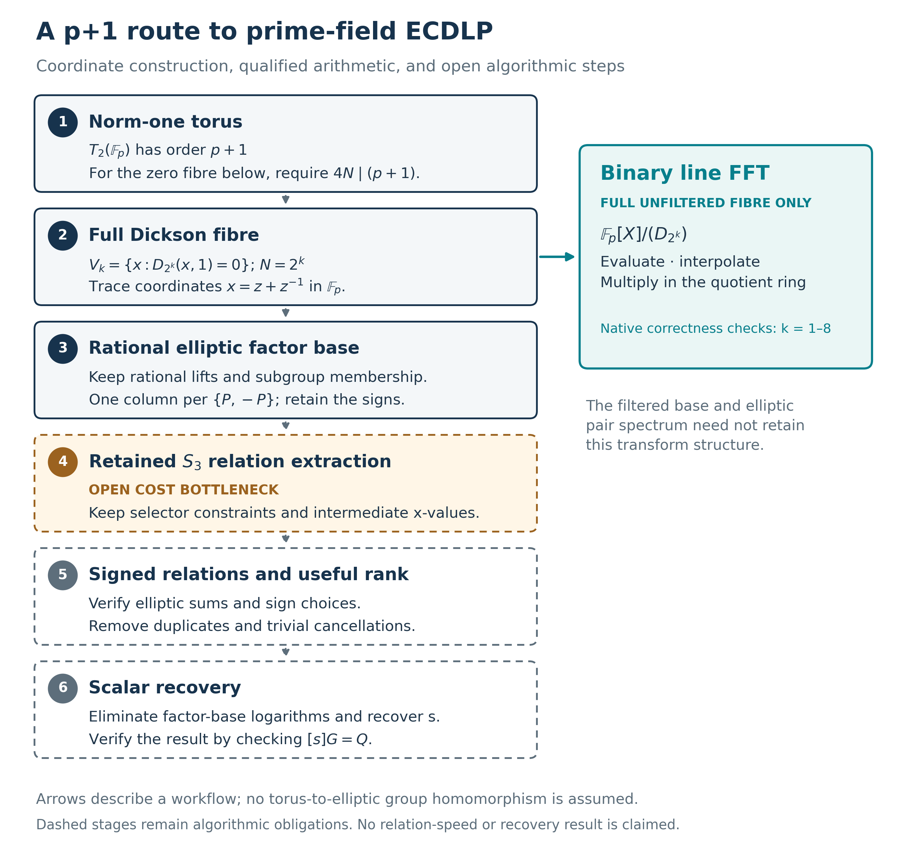
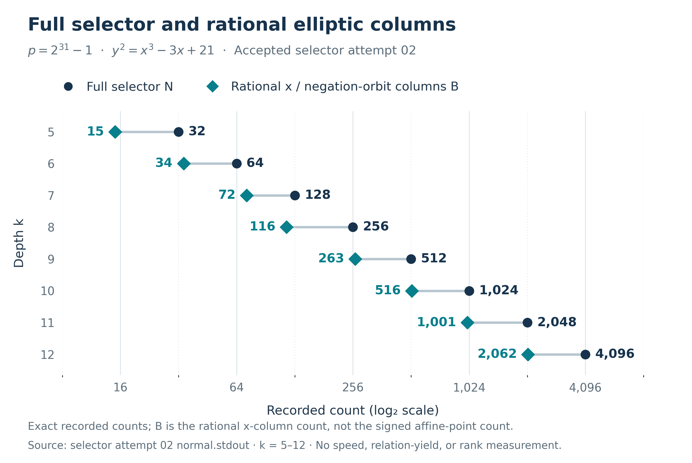

# A p+1 index-calculus route for prime-field ECDLP

Research note • 23 November 2026 • Isogeny Labs • PR #5049

**Outcome.** The applicable candidate is a norm-one-torus Dickson factor base inside the Petit–Kosters–Messeng (PKM) prime-field index-calculus framework. Its selector is already implemented in the project. This work adds a source-pinned native qualification at the principal Mersenne field and a working binary line-FFT prototype for arithmetic on the full selector domain. A dedicated elliptic relation extractor remains the next algorithmic dependency. [pcc:unverified]

**Evidence standing.** Published mathematical background, explicit derivations, historical repository reports, new local Rust correctness checks, and proposed solver work are distinguished below. The new checks and within-team source review are not signed PCC validation, Lean proofs, comparative timings, or a complete ECDLP recovery. No speedup is claimed. [pcc:unverified]

## 1. Which p+1 algorithm applies?

Throughout this note, p denotes the field characteristic and r the elliptic subgroup order. Confusing these two integers changes the problem.

| Method | What p+1 supplies | Applicability to this task |
| --- | --- | --- |
| Norm-one torus + Dickson selector + PKM/Semaev relations | A large smooth coordinate domain over Fp | Applicable to ordinary prime-field curves; fast relation extraction is unresolved |
| Granger–Vercauteren torus index calculus | Relations in a torus of order q^n+1 | Published decomposition exploits a proper extension F_(q^n)/Fq; it does not provide the missing elliptic transfer |
| MOV/Frey–Rück + finite-field index calculus | A pairing target containing r-th roots of unity when r divides p+1 | Applies to suitable subgroups; excluded for our odd-order Prime31 subgroup |
| Cheon auxiliary-input algorithm | A smooth divisor of r+1, using r for the group order | Requires powers of the unknown scalar; ordinary G,Q inputs do not supply them |
| Williams p+1 | Smooth order of a Lucas-sequence element modulo an unknown factor | Integer factorization; not an elliptic logarithm algorithm |
| Circle/line FFT | Fast evaluation and interpolation on two-power circle domains | Reusable arithmetic component; not by itself a relation-finding algorithm |

PKM's Algorithm 1 accepts a factor-base selector that is a composition of low-degree maps. Its concrete examples use smooth p−1 and auxiliary elliptic isogenies. The norm-one/Dickson construction fits that general interface, while the structured polynomial-solving cost is still a separate question. This is an instantiation of prior work, not a novelty claim. [R1]

Granger–Vercauteren gives genuine torus index calculus: symmetric coordinates turn decomposition into linear equations followed by polynomial splitting. Its smaller base and dimensional argument use an extension field. At extension degree one the required proper-subfield construction is unavailable; the paper explicitly limits its impact on prime-field systems. [R2]

Cheon's r+1 algorithm needs auxiliary points of the form [alpha^i]G, including higher powers of the unknown alpha. The related Cheon–Kim Dickson method retains that auxiliary-input model. The project has a corresponding implementation in cryptanalysis, but it cannot be substituted for an ordinary public-input solver. [R5, C8]

## 2. Exact construction over the prime field

Let p be odd and define the norm-one torus:

$$
T_2(\mathbb F_p)=\{z\in\mathbb F_{p^2}^{*}:z^{p+1}=1\}.
$$

It has order p+1. Frobenius satisfies z^p=z^(-1), so the trace coordinate X=z+z^(-1) lies in Fp. The Dickson identity is:

$$
D_n(z+z^{-1},1)=z^n+z^{-n}.
$$

In particular, doubling on the torus induces D_2(X,1)=X^2−2, and composition gives D_(ab)=D_a composed with D_b. These are standard Dickson identities. [R3, R4]

For a divisor N of p+1, let H be the order-N subgroup of the torus. A coset gH whose inverse coset is distinct gives N distinct trace coordinates. Their selector is D_N(X,1)−c, with c=g^N+g^(−N). The guard c != ±2 prevents the inversion-paired cosets from coinciding. All these roots are in Fp. A smooth factorization of N produces a low-degree composition.

For the principal field,

$$
p=2^{31}-1,\qquad p+1=2^{31}.
$$

A particularly simple regular fibre is:

$$
V_k=\{x\in\mathbb F_p:D_{2^k}(x,1)=0\},\qquad 0\leq k\leq29.
$$

It has exactly 2^k distinct roots. Here is the explicit argument. Put N=2^k. The equation z^N+z^(−N)=0 is equivalent to z^(2N)=−1. Its 2N roots have exact order 4N, which divides p+1 for k<=29. They belong to the norm-one torus. Inversion pairs them without fixed points, and each pair has one trace. This produces N distinct rational roots of a monic degree-N polynomial, exhausting its roots. The polynomial is therefore squarefree. This is a written derivation; the general statement has not been formalized in Lean in this task. [pcc:unverified]

The representation is short:

$$
x_0=x,\qquad x_{j+1}=x_j^2-2,\qquad x_k=0.
$$

A degree-256 selector is represented by eight quadratic steps. For example, V_1 consists of 65536 and p−65536, since 65536^2=2 modulo p. For N>=4 in this two-power family, D_N−2 has repeated roots and a different distinct-root count; the zero fibre avoids that degeneracy. The small cases N=1 and N=2 are exceptions to this repeated-root statement.

The mathematical depth-zero fibre is {0}; production deliberately rejects depth zero. The native checks retain that API behavior and treat {0} as a separate control. Depth 30 is also rejected. Do not confuse the maximum supported construction depth with a practical factor-base size.

Although F_(p^2) explains the construction, membership equations, root generation, and the new transform all operate over Fp. This is prime-field ECDLP with an auxiliary coordinate construction.

## 3. The ordinary elliptic curve and actual base size

The qualification uses exactly this repository fixture [C1]:

$$
E:\ y^2=x^3-3x+21\quad\hbox{over }\mathbb F_{2147483647}.
$$

The fixture records r=#E(Fp)=2147487637, cofactor one, trace −3989, and G=(1391443431,177979044). Its ICV1 slug is icv1-fp31-tm3989-ae9db972. This task checks the selector and point lifts on this equation; it does not independently recertify the complete group order. [pcc:unverified]

Another active Dickson example uses a=847514846, b=2087444724 and a different recorded subgroup order. Its historical evidence is not combined with this fixture. [C9]

For each x in V_k, keep it only if x^3−3x+21 has a square root in Fp. Store one representative of each pair {P,−P}, and retain the sign in relations. On a general cofactor curve, actual subgroup membership must also be checked. Cofactor-clearing points changes their x-coordinates and cannot silently preserve the original selector constraint.

The following are direct Rust output counts, not a half-density assumption. [pcc:unverified]

| k | Full selector coordinates N | Rational x-columns B | Signed affine points |
| --- | ---: | ---: | ---: |
| 5 | 32 | 15 | 30 |
| 6 | 64 | 34 | 68 |
| 7 | 128 | 72 | 144 |
| 8 | 256 | 116 | 232 |
| 9 | 512 | 263 | 526 |
| 10 | 1024 | 516 | 1032 |
| 11 | 2048 | 1001 | 2002 |
| 12 | 4096 | 2062 | 4124 |

No selected coordinate has y=0 in these fibres. There are 8190 production roots across depths 1–12, plus the explicit depth-zero root. Every root passed terminal-zero, distinctness, derivative, norm-one lift, Frobenius, and exact-order checks. The qualifier also matched a standard odd-power trace recurrence to every positive-depth root set. [pcc:unverified]

The accepted run includes deliberate corruptions: an off-fibre root and a changed norm-one lift were both rejected by the ordinary assertions. Raw compact output is in selector/evidence/attempt-02/normal.stdout. Production helper selections are byte-bound to crypto revision bd20b95dce44a91d7f74a1367853e724f280a3b6. The selected production code is unchanged; wrapper imports and impl blocks make it standalone. This is not a full production-crate test. [pcc:unverified]

## 4. How the selector becomes index calculus

Given G and Q=[s]G in an order-r subgroup, use the following complete algorithmic outline.

1. Construct V_k and its rational subgroup factor base F. Enumerate and label the negation orbits.
2. Choose public random coefficients a,b modulo r and compute R=[a]G+[b]Q.
3. Solve for factor-base leaves whose signed elliptic sum is R. Include both the selector equations and the elliptic summation constraints in the solver.
4. Recover actual y-coordinates and signs, handle identity/inverse/tangent branches, and verify each relation by elliptic arithmetic.
5. Remove duplicates and trivial cancellations, and retain rows useful for the augmented linear system that includes s. Immediately process a dependency among the factor-base columns when its target coefficient is invertible; such a row may recover s even though it adds no factor-base rank.
6. Eliminate the factor-base logarithms. A dependency with alpha+beta s=0 gives s=−alpha/beta modulo r when gcd(beta,r)=1. In a prime-order subgroup this condition is simply beta != 0.
7. Check [s]G=Q.

For four summands a balanced representation keeps two intermediate abscissae u,v:

$$
S_3(x_1,x_2,u)=0,\quad S_3(x_3,x_4,v)=0,\quad S_3(u,v,X_R)=0.
$$

Every leaf also satisfies its Dickson tower. These equations encode candidate decompositions; they do not make rational lifting or sign reconciliation optional. Zero partial sums require projective or separate identity charts. S_3 is quadratic in each individual coordinate but has total degree four in the standard model; calling the entire unlifted system quadratic would be incorrect.

A solver that enumerates all leaf tuples or constructs all elliptic pair sums is a generic decomposition implementation under the project's classification. Retaining a compact polynomial circuit is useful only if the extractor avoids paying the equivalent enumeration cost.

## 5. Concrete HPC component: a binary line FFT

Circle FFT literature supplies a relevant primitive on the same two-power norm-one geometry [R4]. The new prototype specializes that structure to the full trace fibre V_k. It uses the hierarchical monic basis

$$
b_i(X)=\prod_{j=0}^{k-1}D_{2^j}(X,1)^{\operatorname{bit}_j(i)}.
$$

Each b_i has degree i. Splitting coefficient indices by parity gives

$$
f(X)=E(X^2-2)+X\,O(X^2-2).
$$

At a pair of roots x and −x with common parent t=x^2−2, the butterfly is

$$
f(x)=E(t)+xO(t),\qquad f(-x)=E(t)-xO(t).
$$

The inverse recovers E(t) using division by two and O(t) using division by 2x. Every twiddle x is nonzero on the positive-depth regular fibres. The recurrence T(N)=2T(N/2)+O(N) gives O(N log N) transform arithmetic with precomputed domains and twiddles, for coefficients already in this basis. Its live transform storage is O(N). Basis conversion, domain construction, twiddle inversions, and normalization must be charged when relevant. [pcc:unverified]

Forward transforms, pointwise multiplication, and inverse transforms give multiplication in Fp[X]/(D_N). This is reduced quotient-ring multiplication; it is not the full unreduced product of arbitrary degree-(N−1) polynomials. The implementation does not claim a free fast monomial-to-hierarchical-basis conversion.

The prototype passed 32 forward comparisons against independent monomial Horner evaluation, 32 inverse roundtrips, and 32 quotient products against schoolbook multiplication followed by monic reduction, over depths 1–8. Those checks compare 2040 forward values. Altered-twiddle and incorrect-normalization controls were detected. A separate teammate reviewed the source and recorded no blocking issue for this scope; that review is not a signed replay certificate. [pcc:unverified]

The arithmetic references use separate u128 modular operations. The reference harness stores expanded basis polynomials and consequently uses O(N^2) reference storage; that is not the transform's memory bound. No timing was taken.

## 6. What the FFT does not preserve automatically

The full selector algebra splits as a product of N copies of Fp. Its fast transform does not reduce the number of components in a full m-leaf tensor algebra, whose dimension is N^m. Fast operations on a large representation do not themselves make that representation small.

The elliptic liftability mask may be retained as a padded array on the full domain, so ordinary full-domain transforms remain valid. But the mask and selected y-values can become dense in coefficient space. The smaller filtered base does not automatically remain a uniform binary tower.

The actual elliptic pair-sum spectrum has an additional difficulty: it need not inherit D_2 folding. An existing F7 counterexample has a regular Dickson leaf fibre but a four-point pair spectrum with D_2 fibre sizes 1,1,2, rather than 2,2. Another existing note gives a restricted obstruction to lifting all torus rotations to a single elliptic-lift cover. These records reject specific shortcuts, not every possible fast contraction. [C6, C7]

Accordingly, the next candidate is fast arithmetic inside a selector-aware solver. It is not an asserted Fourier diagonalization of elliptic addition.

## 7. Why a direct transfer into the p+1 group fails here

Suppose a prime-order elliptic subgroup of order r admits a nontrivial group homomorphism to T_2(Fp). Its image must have order r, hence r divides p+1.

For the chosen fixture, p+1=2^31 while r=2147487637 is odd. Their greatest common divisor is one. Therefore every group homomorphism from a group of that order into this torus is trivial. This argument does not depend on a primality test for r; coprimality already suffices. [pcc:unverified]

More generally, if r divides both #E(Fp) and p+1, then r divides the trace t=p+1−#E(Fp). When r>2 sqrt(p), Hasse's bound forces t=0. For p>3 this is supersingular, excluding an ordinary curve with such a large subgroup. Divisibility alone would still not construct an efficiently evaluable transfer.

This explains why pairing-based transfers to F_(p^2) apply to special subgroups and do not transport this benchmark into the smooth norm-one group. The coordinate-selector construction needs no homomorphism and remains valid.

## 8. Historical findings that determine the next step

The October 15 study already reported equal torus and split-Dickson F4 solving degrees in all 16 tested parameter cells. It recorded 127 finished tower rows checked and a 144-row rebuilt-binary comparison. These are historical source reports, not fresh independent validation by this task. They give a concrete reason to focus on a changed solver rather than the smoothness of p+1 alone. [C2]

The November 22 study explicitly distinguishes Dickson p+1 selectors from auxiliary elliptic isogeny selectors. Its fifteen tiny cells used m=2 and depths at most two, with planted and random targets. They did not run a relation stream or final linear algebra. [C3]

A November 14 note claims a global equivalence between a supersingular Velu chain and a norm-one doubling tower. The displayed formulas only establish an alternating composition of two different rational maps. The present report does not use that equivalence; a new comparison would require explicit conjugacies and exceptional-case checks. This preserves the useful auxiliary-curve work without assuming an unsupported identification. [C4]

## 9. Cost model and the decisive gate

Let B denote usable negation-orbit columns, C_attempt the complete mean cost of an attempted public relation query, and u_bar its mean useful increment toward solving the augmented linear system including the target logarithm, counting misses and duplicate removal. Dependencies with an invertible target coefficient are useful and must not be discarded merely because they add no factor-base rank.

$$
C_{\rm cold}\approx C_{\rm setup}+\frac{B+O(1)}{\bar u}C_{\rm attempt}
             +C_{\rm LA}+C_{\rm recovery}.
$$

This is an approximate accounting model for a sufficient collection of useful rows, not an established complexity theorem for this structured base. Rank efficiency may decline during collection and must be measured or bounded across the complete stream. For a solver returning at most one row per attempt, a fixed-m uniform-sums/Poisson heuristic gives lambda approximately (2B)^m/(m! r), hit probability approximately 1−exp(−lambda), and u_bar approximately hit probability times conditional rank efficiency. Multiple-output solvers must use their actual useful row yield, not a capped one-hit probability.

The conventional sparse black-box linear-algebra estimate is O(mB^2) operations modulo r and O(mB) matrix storage. It is not a universal lower bound. At B about r^(1/m), that term reaches exponent one-half for m=4 and is smaller for m>=5.

An undersized four-summand base is also admissible. Under the stated yield and nonvanishing-rank assumptions, B about r^(1/5) requires an attempt cost below r^(1/10), up to the corresponding strict asymptotic and setup conditions, to obtain a complete exponent below one-half in this model. The FFT alone does not establish that extractor bound.

Field operations, subgroup-field linear algebra, and elliptic operations must be priced consistently before comparing with rho or another IC pipeline. No such comparison is made from these correctness tests.

## 10. Next implementation and evaluation

The next work should extend the existing source APIs, not create another factor-base family.

**Component integration.** Move the qualified full-domain transform behind a narrow quotient-arithmetic interface. Compare it on identical inputs with the existing TowerRing/sparse multiplication path and an appropriate external polynomial backend. Include domain/twiddle setup and all coefficient conversions. The current prototype is a standalone research implementation, not a production integration.

**Relation extraction.** Use that interface in a specific retained-S3 elimination or contraction algorithm. Start with the exact component baseline named in problems/prime31-exact-pair-spectrum-query.md. State every intermediate dimension. Test public targets with both hits and misses; handle rational leaves, signs, zero subtotals, collisions, and witness recovery. A disguised full pair table is charged and classified as such.

**Pipeline evaluation.** Only after the extractor succeeds, feed signed rows into the existing relation/rank/linear-algebra pipeline and run complete cold single-target recoveries on the fixed curve and matched controls. Compare the strongest reproducible applicable IC implementation and optimized negation-map rho using the project's frozen accounting and validation gates. These runs are proposed, not launched.

A useful first comparison panel is k=6,7,8,9 with arities four and five, retaining the exact measured base cardinalities rather than substituting 2^(k−1). This is a proposed panel; budget, source freeze, actual baseline eligibility and execution admission remain to be set.

## 11. Reproducibility and limitations

The repository source revision is bd20b95dce44a91d7f74a1367853e724f280a3b6. Production selections and native compiler/executable custody are recorded beside the two qualifiers. Accepted selector arithmetic and output generation are Rust, with thin shell execution and Node used only for source/custody I/O. The earlier Python-orchestrated attempt was rejected as the accepted workflow; its frozen local evidence and pending oversized-log archival are disclosed in ATTEMPT01_CUSTODY.md. The accepted attempt uses compact raw output and preserves every check.

The knowledge-base MCP service was unavailable. Its fetched wrapper exited 127 because no executable was installed; Conductor likewise was absent. The fallback checked pinned project sources, the related cryptanalysis header, bounded cross-repository searches, and primary literature. A bounded search that finds no Circle FFT module is not a claim of absence from all branches or archives.

The shared daily log exceeded the normal contents endpoint; its blob was read directly before this handoff. No secret, token, signing key, or paid-compute change is part of the work.

Proof map: torus/trace properties rely on cited standard sources; the zero-fibre root count and FFT recurrence have explicit written derivations; numerical checks cover the stated finite domains; full Lean formalization and signed PCC remain open. The three records in fft/identity are deterministic finite-evaluation records over F_(2^61−1), using unchanged production issuer/checker modules. Each has 32 issuer evaluations and two extra checker seeds with 32 evaluations each. False-statement, understated-degree, and changed-digest controls were rejected. The records have null formal-proof fields: they are not proofs of the general identities, the Prime31 root count, the FFT theorem, or elliptic relation-solving complexity. [pcc:unverified]

Existing IC leaderboards and benchmark graphs are unchanged because this task supplies no competitive cost result. The report's own diagram and count chart are descriptive, with raw-source pointers. The existing pair-spectrum problem remains open and is linked rather than duplicated.

## Sources

[R1] Petit, Kosters, Messeng, Algebraic approaches for the Elliptic Curve Discrete Logarithm Problem over prime fields, PKC 2016, Sections 3.1–3.4. [Author manuscript](https://people.maths.ox.ac.uk/petit/files/16PKC_primeECDLP.pdf).

[R2] Granger, Vercauteren, On the Discrete Logarithm Problem on Algebraic Tori, CRYPTO 2005, Sections 4.1–4.4. [Institutional manuscript](https://cosicdatabase.esat.kuleuven.be/backend/publications/files/conferencepaper/625).

[R3] Bluher, Permutation properties of Dickson and Chebyshev polynomials with connections to number theory, 2021 version. [Primary manuscript](https://arxiv.org/pdf/1707.06877).

[R4] Carmon et al., S-two Whitepaper, 2026, Sections 1.2–1.3 and Appendix B; builds on Habock, Levit, Papini, Circle STARKs, 2024. [Original ePrint record](https://eprint.iacr.org/2026/532); [retrieved manuscript](https://eprint.iacr.asia/2026/532.pdf); [original Circle STARK announcement](https://starkware.co/blog/circle-starks/). External reusable implementation: [starkware-libs/stwo](https://github.com/starkware-libs/stwo).

[R5] Cheon, Kim, A new approach to the discrete logarithm problem with auxiliary inputs, LMS Journal of Computation and Mathematics 19 (2016), 1–15, Sections 1 and 5. [Publisher manuscript](https://www.cambridge.org/core/services/aop-cambridge-core/content/view/B578AC7DD0D8396EBFBFCB53AF8DF27D/S1461157015000303a.pdf/new_approach_to_the_discrete_logarithm_problem_with_auxiliary_inputs.pdf).

[R6] Galbraith, Granger, Merz, Petit, On Index Calculus Algorithms for Subfield Curves, SAC 2020 / 2021, Section 4.2. Its norm-one factor bases have an extension-field hypothesis. [Institutional manuscript](https://pure-oai.bham.ac.uk/ws/files/104974339/On_Index_Calculus_Algorithms_for_Subfield_Curves.pdf).

[R7] Williams, A p+1 method of factoring, Mathematics of Computation 39 (1982), 225–234. [DOI](https://doi.org/10.1090/S0025-5718-1982-0658227-7). Original PDF retrieval was blocked; classification cross-checked against [FLINT's implementation documentation](https://flintlib.org/doc/fmpz_factor/fmpz_factor_pp1.html).

All crypto repository paths below are pinned to bd20b95dce44a91d7f74a1367853e724f280a3b6.

[C1] [Canonical curve fixture](https://github.com/isogeny-labs/crypto/blob/bd20b95dce44a91d7f74a1367853e724f280a3b6/docs/ic/research/fp_p31_subexp_calibration_20261121/CURVE.json).

[C2] [October 15 Dickson-torus study](https://github.com/isogeny-labs/crypto/blob/bd20b95dce44a91d7f74a1367853e724f280a3b6/research/pkm_dickson_torus_20261015/README.md).

[C3] [November 22 PKM p−1/p+1 coverage](https://github.com/isogeny-labs/crypto/blob/bd20b95dce44a91d7f74a1367853e724f280a3b6/research/pkm_nist_pm1_20261122/README.md).

[C4] [November 14 torus-tower note](https://github.com/isogeny-labs/crypto/blob/bd20b95dce44a91d7f74a1367853e724f280a3b6/research/pkm_torus_tower_20261114/README.md).

[C5] [Production PKM/Semaev oracle](https://github.com/isogeny-labs/crypto/blob/bd20b95dce44a91d7f74a1367853e724f280a3b6/src/cryptanalysis/ic_framework/pkm_semaev.rs).

[C6] [Dickson leaf norm and pair-spectrum review](https://github.com/isogeny-labs/crypto/blob/bd20b95dce44a91d7f74a1367853e724f280a3b6/research/prime31_summation_compression_20261122/iteration10/quotient_followup/DICKSON_PAIR_NORM_REVIEW.md).

[C7] [Restricted single-cover FFT obstruction](https://github.com/isogeny-labs/crypto/blob/bd20b95dce44a91d7f74a1367853e724f280a3b6/research/prime31_summation_compression_20261122/iteration10/torus_rotation_followup/NO_SINGLE_COVER_FFT.md).

[C8] [Existing Cheon auxiliary-input implementation](https://github.com/isogeny-labs/cryptanalysis/blob/5005bedbe4fd4f1a43456918dd255fd2cbc4a5d1/include/cryptanalysis/ca_cheon.h).

[C9] [Different Prime31 Dickson fixture](https://github.com/isogeny-labs/crypto/blob/bd20b95dce44a91d7f74a1367853e724f280a3b6/research/dickson_s3_quadratic_20261122/REPORT.md).

[C10] [Existing pair-spectrum solver gap](https://github.com/isogeny-labs/crypto/blob/bd20b95dce44a91d7f74a1367853e724f280a3b6/problems/prime31-exact-pair-spectrum-query.md).

