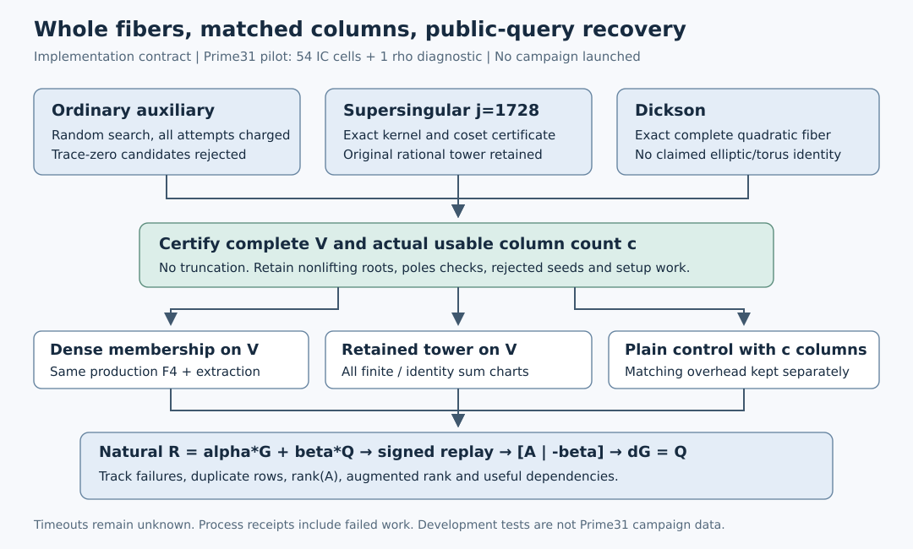

# Matched auxiliary factor bases on ordinary Prime31

**Implementation and development checks; the registered Prime31 campaign has not run.**
PR: [isogeny-labs/crypto#4923](https://github.com/isogeny-labs/crypto/pull/4923).
The current state and launch blockers are recorded in [RUN_STATUS.json](RUN_STATUS.json).
The [protocol](PROTOCOL.md) is a draft, with [machine-readable design](protocol.json)
and [native panel inputs](panel.json). It has not passed the current canonical
freeze gate. No speedup, complete Prime31 recovery, or comparison with optimized
rho is claimed [pcc:unverified].

## What this adds

The Rust instrument compares complete ordinary auxiliary, supersingular j=1728,
and Dickson fibers with plain controls having the same number of usable target
columns. Each structured fiber is also presented in two ways to the same actual
production F4 solver: its dense membership polynomial, and its original quadratic
tower. The complete fiber is retained, including coordinates that do not lift to
the target curve. Rejected construction seeds and failed construction attempts
remain in the setup ledger.

The algebraic oracle supports two, three, and four summands. It enumerates
sequential charts with finite or identity intermediate sums, leaves finite sum
coordinates unrestricted, and replays all original point signs and intermediate
sums before accepting a row. Limits and incomplete rational extraction remain
unknown outcomes. The unchanged production visitor performs F4 elimination and
root/domain extraction; any full-field extraction branches are reported. There
is no added exhaustive relation-search fallback.

The collector receives only the public curve, subgroup, generator, and target.
It generates each query as `R = alpha*G + beta*Q` before decomposition, with a
fixed reproducible query stream. It retains failures, duplicate coefficient
rows, zero rows, identity queries, rank of the factor-base coefficient matrix,
rank of the augmented system, and useful dependencies. A recovered scalar must
satisfy `d*G = Q` in both production arithmetic and an independent affine replay.



## Exact target and prepared panel

| Parameter | Value |
| --- | --- |
| Field prime p | 2147483647 = 2^31 - 1 |
| Curve | y^2 = x^3 + 847514846*x + 2087444724 |
| Prime group order n | 2147446831 |
| Generator G | (625037715, 2100627251) |
| Public target Q | (984837385, 1142774582) |
| Construction seeds | 0, 1, 1093; at most 8 seeded constructor calls each |
| Pilot depths / summands | 6 and 8 / 4 |
| Query stream | seed 4188, at most 64 natural queries per cell |
| Factor-base arms | ordinary, supersingular j=1728, Dickson |
| Presentations per base | dense, retained tower, matched plain |
| Prepared cells | 54 IC cells and 1 production A=1 rho diagnostic |

The target is the existing ordinary Prime31 fixture from
[`prime31_ic_20261115/native/lib.rs`](../prime31_ic_20261115/native/lib.rs).
Primality, nonsingularity, generator order and the cofactor-one Hasse certificate
are checked. Target preparation is recorded in
[target-fixture.json](target-fixture.json). Its fixture seed is public; the
collector API does not receive or derive the generated target logarithm.
Preparation of this known-answer input is not a relation-collection experiment.

The same initial construction seed is used again for each cold dense/tower arm;
setup is repeated and charged. Plain controls reconstruct the reference only to
learn its actual column count. That reference work is recorded separately as
matching overhead and stays in the total study cost. Plain construction, index
building, collection, extraction, signed replay, elimination and final scalar
checks remain visible. This distinction prevents charging an auxiliary search
as plain-base algorithm work or silently deleting it from the campaign bill.

Dense-versus-tower is the direct representation comparison on identical V.
Auxiliary-versus-plain also changes the number of nonlifting membership roots;
it compares usable-cardinality-matched algorithms and does not isolate that
single representation effect. Repeated identical plain configurations are
correlated controls, not independent statistical replicates.

## Correct recovery criterion

For each signed relation, `A*l = alpha + beta*d (mod n)`. The collector inserts
`[A | -beta]` with right-hand side `alpha`. A left dependency of A whose combined
beta is nonzero can pin d before all factor-base logarithms are determined.
Consequently, duplicate A rows are still processed, and full rank of A is not a
completion criterion. Conversely, a dependency with zero combined beta is not
scalar recovery. Independent RREF contract tests exercise both cases.

The independent JSONL auditor replays natural-query points, signed rows,
factor-base columns, modular ranks, and the final public-point check. It is an
offline verification stage; a truncated stream is explicitly incomplete.

## Source reuse and accounting

[`native/build.rs`](native/build.rs) selects pinned, exact byte ranges from the
production sources and preserves the real F4 module layout. It does not replace
the field engine, root extraction, auxiliary builders, group arithmetic, or
incremental elimination with stand-ins. The release profile is optimized.
`source-manifest` emits the production dependency closure and all study Rust
source/test hashes. `source-check ROOT` compares those embedded hashes with the
tracked checkout and records the executable hash.

The production root library is not compiled by this isolated crate. Passing
these contract tests therefore does not imply that the full monolithic crate
passes its test suite. The imported A=1 rho control is the actual historical
production reference; it is not the tuned negation-aware incumbent.

Native counters include group and field operations, auxiliary search stages,
polynomial construction, F4 arithmetic, extraction, signed lifting, and modular
elimination. They remain explicitly partial: some certification, hashing,
allocation, field additions and engine bookkeeping are unpriced. Search-stage
GAE fields overlap and must not be summed. The outer process receipt covers
observed total elapsed time, including serialization and failures, but is
diagnostic rather than an admitted L2 timing measurement. No ratio combining
unlike partial units is reported.

## Reproduce development checks

From the repository root:

```sh
cargo test --release --offline \
  --manifest-path research/prime31_aux_matched_20261122/native/Cargo.toml \
  --tests -- --test-threads=1
cargo build --release --offline \
  --manifest-path research/prime31_aux_matched_20261122/native/Cargo.toml
research/prime31_aux_matched_20261122/native/target/release/prime31-aux-matched source-manifest
```

The fixed small-field tests check independent group arithmetic, full fiber
certificates, corrupted inputs, every identity chart, real multi-level fibers,
natural-query recovery and independent rank calculations. Their evidence is
kept in [development-checks.json](development-checks.json). They are correctness
fixtures, not benchmark samples or substitute Prime31 campaign results.

`make-target 20261122` reproduces the public input. `panel panel.json NEW_DIR`
materializes 54 IC input files without running them. The additional rho input
has cell ID `p31aux-v1-rho`. The checked-in [cells](cells) are the launch inputs.

## Launch contract and current impediments

The existing IsoLab admission path must first validate and freeze the canonical
protocol, publish exact source and inputs, checkpoint the source, reconcile live
daily/monthly/lane budget headroom, and record one absolute campaign deadline.
The proposed aggregate ceiling is USD 5 including builds, idle capacity, failed
attempts and storage; it is not a statement of available budget. Concurrency is
one, with no automatic retries.

The thin [run-cell.sh](run-cell.sh) wrapper requires tracked, unchanged inputs,
an embedded-source check, existing publication and budget receipts, and the
repository checkpoint gate. It uses two affinity-bound CPUs, two Rayon threads,
a 4096 MiB address-space limit, TERM at 115 seconds and KILL after five seconds.
These match the proposed pilot. Kubernetes admission must enforce the requested
CPU/memory resources as well. A child failure leaves start and exit receipts;
if the wrapper or pod itself is killed, the external Job/Pod receipt is required.
Exit 137 alone does not identify the cause. Peak RSS is unavailable in the
wrapper and is recorded as null.

```sh
# On the admitted backend, after all existing gates have passed:
bash research/prime31_aux_matched_20261122/run-cell.sh run \
  /ABSOLUTE/PUBLISHED/REPO/research/prime31_aux_matched_20261122/cells/p31aux-v1-ordinary-t6-s0-m4-dense.json \
  /ABSOLUTE/NEW/OUTPUT
# Independent post-run replay:
research/prime31_aux_matched_20261122/native/target/release/prime31-aux-matched \
  replay /ABSOLUTE/NEW/OUTPUT/events.jsonl
```

This session can publish the PR but has no IsoLab MCP, AWS CLI/identity or
authenticated GitHub workflow-dispatch path, no working checkpoint uploader,
and no current budget headroom receipt. The current canonical protocol sources
are VLT1 binary envelopes through both available repository read paths; only an
already committed plaintext schema snapshot could be used for structural
validation. The draft therefore remains unfrozen. These are recorded admission
impediments, not mathematical or performance results.

## Relationship to prior work and reports

This instrument reuses production construction and F4 work and complements
[#4920](https://github.com/isogeny-labs/crypto/pull/4920) and
[#4922](https://github.com/isogeny-labs/crypto/pull/4922). It does not replace the
historical auxiliary studies, reinterpret constructed-target tests as natural
queries, or assert that those earlier experiments never ran. It supplies the
controlled whole-fiber and complete-recovery measurement path missing from
that comparison.

[REPORT.md](REPORT.md), [REPORT.pdf](REPORT.pdf), the editable
[diagram](pipeline.svg), and [run status](RUN_STATUS.json) accompany the code.
The canonical scoreboard and progress timeline receive no new performance
point: this change has no executed Prime31 comparison result.
