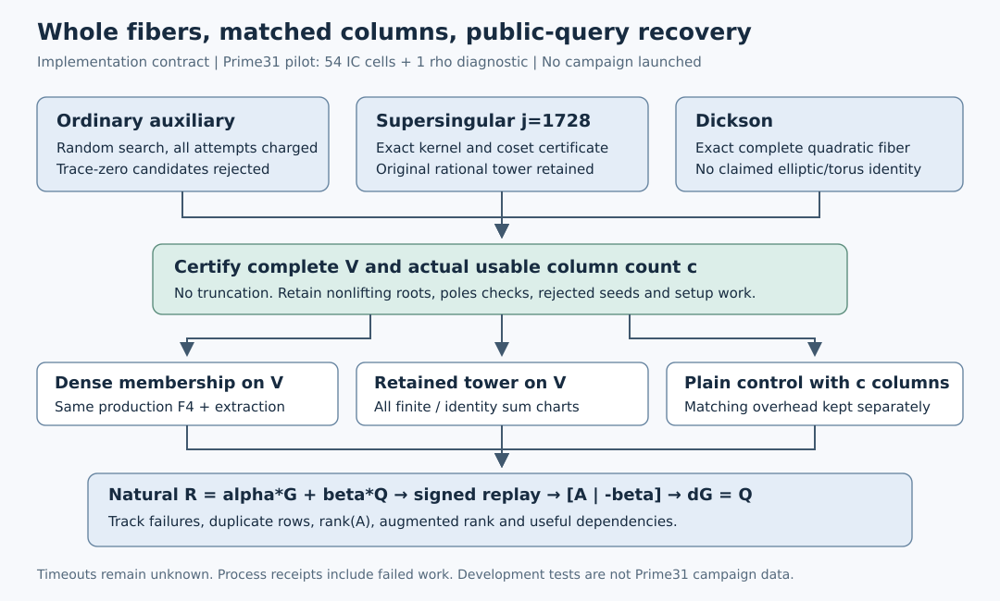

# Matched auxiliary factor bases on ordinary Prime31

Implementation report - 2026-11-22 - PR #4923

## Outcome and evidence boundary

The Rust instrument is implemented. It compares complete ordinary auxiliary,
supersingular j=1728 and Dickson fibers against plain controls matched by usable
target-curve columns. Dense and retained quadratic presentations use the same
complete fiber and actual production F4 solver. The collector generates natural
public-target queries and checks complete scalar recovery [pcc:unverified].

The optimized development suite covers independent group arithmetic and fiber
certificates, finite and identity intermediate sums, multi-level dense/tower
agreement, useful dependencies, independent modular rank replay and stale-source
rejection. Exact test counts and command receipts are in development-checks.json.
These are fixed correctness fixtures, not campaign measurements.

The requested Prime31 campaign remains blocked before launch. Of 55 prepared
cells, zero have been attempted, zero completed, and 55 are blocked. No Prime31
relation or target logarithm has been recovered by this study. There is no speed
estimate or asymptotic conclusion. Source: RUN_STATUS.json.

## Algebraic and recovery contracts

The oracle uses the production general F4 visitor with exact S3 equations for
two, three or four summands. Every sequential intermediate sum is represented
by a finite or identity chart. Finite sum coordinates are unrestricted. Original
signed points, finite coordinates, identity prefixes and the final target are
replayed before a row is accepted. Incomplete extraction cannot establish a
complete negative answer. The inherited visitor's root/domain extraction and
full-field branches remain separately counted; no extra grid fallback is added.

For each natural R = alpha*G + beta*Q, the accepted row satisfies
A*l = alpha + beta*d modulo n. The collector reduces [A | -beta] with right-hand
side alpha. A dependency with nonzero combined beta can determine d before full
rank of A. Repeated A rows must therefore be retained. A dependency with zero
combined beta does not recover d. Recovery requires independent d*G = Q replay.

---PAGE---

## Exact problem and comparison

| Item | Prepared value |
| --- | --- |
| Field | p = 2147483647 |
| Ordinary target curve | y^2 = x^3 + 847514846*x + 2087444724 |
| Prime group order | n = 2147446831 |
| Generator | G = (625037715, 2100627251) |
| Public target | Q = (984837385, 1142774582) |
| Auxiliary initial seeds | 0, 1, 1093; at most eight seeded constructor calls |
| Pilot depths and summands | depths 6 and 8; four summands |
| Query stream | seed 4188; at most 64 queries per cell |
| IC cells / rho diagnostic | 54 / 1 |

The target reuses the existing Prime31 fixture. Public-input preparation was
performed once by the native make-target command and independently replayed;
target-fixture.json preserves its seed and group/field ledger. Neither the
collector nor the relation oracle receives the target scalar. A prepared target
is not evidence that an attack was run.

Every auxiliary fiber is kept whole. Independent certificates recompute the
kernel order, auxiliary coset and curve transitions, rational-map numerator and
denominator, terminal fiber polynomial, every root, pole exclusions and usable
target lifts. Ordinary candidates of trace zero are rejected and charged.
For each accepted fiber, the plain control has exactly its actual usable column
count. Dense-versus-tower isolates the presentation of the same V; the plain
comparison also changes nonlifting membership roots. Repeated identical plain
configurations are correlated controls.

---PAGE---

## Implemented measurement path

This diagram describes the implemented instrument and proposed experiment.
It contains no measured performance values. Each path preserves setup failures,
query failures and incomplete extraction. The complete source is in native/src/;
the editable diagram is pipeline.svg.

---PAGE---

## Provenance, costs and process limits

The standalone optimized crate imports pinned, exact production byte ranges
and whole modules. It reuses real F4/root extraction, auxiliary constructors,
field/group arithmetic and incremental elimination. It does not compile the
entire root library. The embedded source manifest inventories production files,
study code and tests, manifests, lockfile and build script. The source checker
compares hashes to tracked HEAD files and identifies the running executable.

Independent post-run JSONL replay recomputes natural-query points, signed column
rows, batch modular ranks and public scalar checks. It treats interrupted streams
as incomplete. It does not certify negative F4 exhaustion, operation counts,
timing conditions or PCC standing merely by accepting a relation witness.

The setup ledgers retain unsuccessful constructor invocations, rejected seeds,
usable and nonlifting coordinates, group arithmetic and available native stage
counters. Plain matching overhead is separate from plain algorithm work and
remains part of campaign cost. Native units are explicitly partial: unpriced
bookkeeping, allocation, hashing, some certification and field additions remain.
Overlapping search and point-count GAE counters must not be summed.

The outer wrapper captures input/source/binary hashes, process start, exit,
diagnostic elapsed and CPU time, and raw events. The registered pilot uses two
affinity-bound CPUs, two Rayon threads, 4096 MiB of address space, TERM at 115
seconds and KILL after five seconds. Internal collection is capped at 100 seconds
and each query at 1000 ms, with a common degree cap of 512. Native cooperative
deadlines do not replace the outer process and Kubernetes resource envelope.
Peak RSS is absent rather than inferred. A killed pod requires an external job
receipt; exit 137 does not establish the cause by itself.

The one rho diagnostic imports the production A=1 reference with a one-million
step cap. It is not the tuned negation-aware baseline. Neither partial native
counters nor command-job clocks establish an optimized IC/rho speed ratio.
Any timing comparison requires separate L2 and A/A qualification.

---PAGE---

## Blockers and next admissible execution

No IsoLab MCP or authorized local AWS submission route is available. GitHub
commit/PR publication works, but local gh is unauthenticated and the connector
has no workflow-dispatch operation. The repository checkpoint gate was attempted
with a completed resume note and failed because no uploader credential exists.
Current budget headroom is unknown. No cloud job was submitted or spending
initiated by this study.

The current canonical protocol sources are VLT1 envelopes through both available
repository paths. An existing plaintext schema snapshot gives structural
validation only. protocol.json therefore remains draft, with no canonical freeze
claim. Execution requires readable canonical tooling, source/input publication,
a successful source checkpoint, reconciled daily/monthly/lane headroom, and one
original absolute campaign deadline. The proposed aggregate ceiling is USD 5,
serial execution and zero retries. It is not a statement of available funds.

After those existing gates pass, run each checked-in cell through the bounded
wrapper, preserve every failure, upload hash-addressed evidence, run independent
replay, and create the canonical export. The scoreboard and progress timeline
were inspected and left unchanged because no campaign result exists.

## Source map

| Evidence or implementation | Repository-relative source |
| --- | --- |
| Exact design and prepared inputs | PROTOCOL.md; protocol.json; panel.json; cells/ |
| Development verification receipt | development-checks.json; evidence/ |
| Complete fibers and independent certificates | native/src/bases.rs |
| Signed algebraic oracle and identity charts | native/src/oracle.rs |
| Natural-query collection and scalar recovery | native/src/collector.rs |
| Independent stream and rank replay | native/src/audit.rs; native/src/replay.rs |
| Production source selection and hash guard | native/build.rs; native/src/provenance.rs |
| External limits and failure receipts | run-cell.sh |
| Campaign flow and impediments | RUN_STATUS.json; RESUME.md |
| Related concurrent integration | GitHub PRs #4920 and #4922 |

Repository: https://github.com/isogeny-labs/crypto/pull/4923. All findings in this
implementation report retain unverified PCC standing [pcc:unverified].
