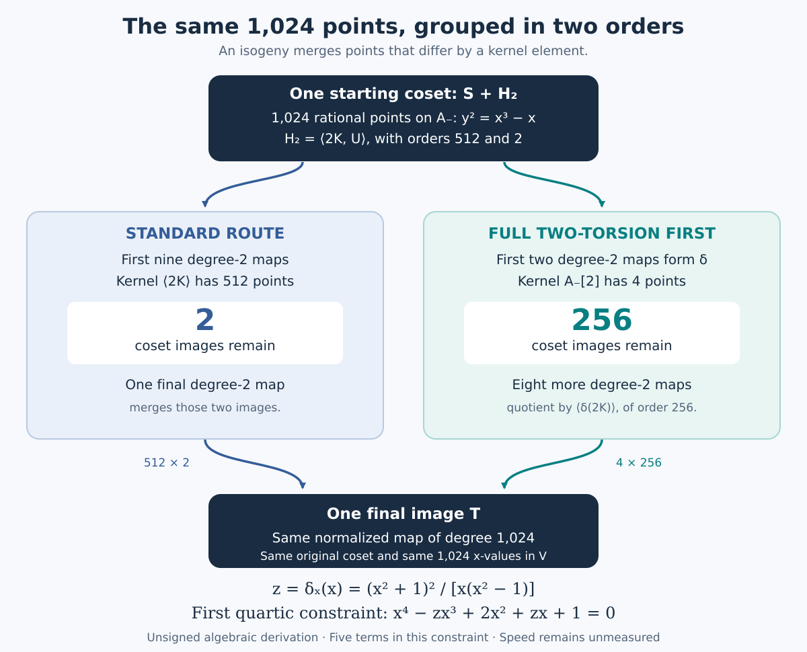

# The sparse full-two-torsion route for H₂

**Status:** algebraic derivation and implementation contract; unsigned producer evidence. The new qualification tests and certificate issuer are bound below, but this note does not assert that they have run or passed. An immutable qualification receipt is a separate artifact. No timing, solver speedup, or recovered discrete logarithm is asserted here. [pcc:unverified]

## 1. What an isogeny does in this construction

An isogeny is a map between elliptic curves that respects their point-addition laws. Its **kernel** is the set of points sent to the identity point, written \(O\). If \(h\) is in the kernel, then

\[
\phi(P+h)=\phi(P)+\phi(h)=\phi(P).
\]

Consequently, every point in a coset \(P+H\) has the same image under a quotient with kernel \(H\). A separable isogeny of degree \(d\) has \(d\) kernel points. These are standard isogeny facts; see [Sutherland, Lecture 5](https://ocw.mit.edu/courses/18-783-elliptic-curves-fall-2025/mit18_783_f25_lec05.pdf), especially the discussion of kernels and Theorem 5.11.

Here the desired kernel contains **1,024 points**. We can merge them in either of two orders. The standard route first merges groups of 512, then merges the two remaining images. The alternate route first merges groups of four, then merges the 256 remaining images. Both routes are intended to be the same complete quotient:

\[
512\cdot2=4\cdot256=1024.
\]

The internal equations change; the original kernel and the final map do not. This equality is proved below and is also the subject of exact coefficient comparisons in the new focused tests. [pcc:unverified]

*The diagram counts images of the fixed coset under each partial quotient. It is a kernel-factorization diagram, not an isogeny volcano or a performance chart. Its arrows represent algebraic maps; no timing information is encoded. [pcc:unverified]*

## 2. The fixed field, curve, and subgroup

All arithmetic in the construction is modulo the prescribed prime

\[
p=2^{31}-1=2147483647.
\]

The auxiliary curve is

\[
A_-:y^2=x^3-x.
\]

The fixed input points and their intended exact orders are:

| Symbol | Point or definition | Exact order |
|---|---|---:|
| \(S\) | \((4,639874715)\) | \(2^{30}\) |
| \(K\) | \([2^{20}]S=(1724938470,923814573)\) | 1024 |
| \(2K\) | Twice \(K\) using the elliptic-curve group law | 512 |
| \(U\) | \((0,0)\) | 2 |

These constants come from the frozen [kernel fixture](../isogeny-choice/fixtures/kernel_correctness_fixtures.json). The constructor checks point membership, the power-of-two orders, and the complete kernel and coset. They are fixture claims, not signed verdicts. [pcc:unverified]

The subgroup of interest is

\[
H_2=\langle 2K,U\rangle
   =\{[j](2K):0\leq j<512\}\ \cup\
     \{[j](2K)+U:0\leq j<512\}.
\]

The two sets are disjoint: the unique nonzero point of order two in the cyclic group \(\langle2K\rangle\) is \([512]K=(1,0)\), whereas \(U=(0,0)\). Thus \(H_2\) has structure \(C_{512}\times C_2\), and it has 1,024 points. It is a subgroup with two generators; replacing it by a cyclic subgroup would change the problem. [pcc:unverified]

For the fixed example, the selected coset is \(S+H_2\), and the useful set of field elements is

\[
V=\{x(S+h):h\in H_2\}.
\]

The code also permits the same construction with \([c]S+H_2\) for a nonzero odd \(c<2^{20}\). The focused equality tests bind the original example \(c=1\); they do not constitute a sweep of other cosets. [pcc:unverified]

## 3. Why quotienting by all two-torsion first is possible

The full two-torsion on this auxiliary curve is rational:

\[
A_-[2]=\{O,(0,0),(1,0),(-1,0)\}.
\]

All four points lie in \(H_2\): it contains \(U=(0,0)\), \([512]K=(1,0)\), and their sum \((-1,0)\). Therefore it is valid to remove this four-point subgroup first. [pcc:unverified]

The existing normalized degree-two formula for a kernel generated by \((\alpha,0)\) on \(y^2=x^3+ax+b\) is

\[
r(x)=x+\frac{\tau}{x-\alpha},\qquad
\tau=3\alpha^2+a,
\]

with full point map \((x,y)\mapsto(r(x),yr'(x))\). The new route uses two instances of exactly this existing formula:

| Step | Kernel generator | \(x\)-map | Codomain |
|---|---|---|---|
| First | \((0,0)\) on \(A_-\) | \(r_1(x)=x-1/x\) | \(y^2=x^3+4x\) |
| Second | The image of \((1,0)\), namely \((0,0)\) | \(r_2(t)=t+4/t\) | \(B:y^2=x^3-16x\) |

Substitution gives the degree-four prefix

\[
\begin{aligned}
\delta_x(x)
 &=r_2(r_1(x))\\
 &=\frac{(x^2-1)^2+4x^2}{x(x^2-1)}\\
 &=\boxed{\frac{(x^2+1)^2}{x(x^2-1)}}.
\end{aligned}
\]

The full map away from its poles is

\[
\delta(x,y)=\left(
\frac{(x^2+1)^2}{x(x^2-1)},\;
y\frac{(x^2+1)(x^4-6x^2+1)}{x^2(x^2-1)^2}
\right).
\]

The second coordinate is \(y\delta_x'(x)\), which is essential when checking that the map respects the curve and its normalization. An isolated \(x\)-formula does not establish the full point-map contract. [pcc:unverified]

### Connection with doubling

The ordinary doubling formula on \(A_-\) gives

\[
x([2]P)=\frac{(x(P)^2+1)^2}{4x(P)(x(P)^2-1)}.
\]

Therefore

\[
\delta(P)=(4x([2]P),8y([2]P)).
\]

Doubling followed by this coordinate scaling lands on \(B:y^2=x^3-16x\). It is a degree-four map, with kernel exactly \(A_-[2]\). It is also **normalized**: with invariant differential \(\omega=dx/(2y)\), doubling pulls \(\omega\) back to \(2\omega\), and the scaling \((x,y)\mapsto(4x,8y)\) contributes the factor \(1/2\). Their composition pulls \(\omega_B\) back to \(\omega_{A_-}\). [pcc:unverified]

## 4. The remaining kernel has order 256

The point \(2K\) originally has order 512. Its cyclic subgroup intersects \(A_-[2]\) in two points: \(O\) and \((1,0)\). Hence its image under \(\delta\) has order

\[
\frac{512}{2}=256.
\]

Also \(\delta(U)=O\). Thus

\[
\delta(H_2)=\langle\delta(2K)\rangle,
\]

which is a cyclic subgroup of order 256 on \(B\). The residual map \(\psi\) is the normalized quotient by this subgroup, constructed by the existing cyclic routine as **eight degree-two maps**. The full alternate route is

\[
A_-\ \xrightarrow{\ \delta,\;4\ }\ B
\ \xrightarrow{\ \psi,\;256\ }\ C,
\qquad \phi=\psi\circ\delta.
\]

Its degree is \(4\cdot256=1024\), and its kernel is exactly \(H_2\). In particular, the residual generator must be \(\delta(2K)\); \(\delta(K)\) has order 512 and would specify a different quotient. [pcc:unverified]

## 5. Why the final map and V stay exactly the same

The standard route and the alternate route are both separable normalized quotients from the same short Weierstrass model with the same kernel \(H_2\). Quotients with a given kernel are unique up to a target isomorphism. In characteristic greater than three, a normalized isomorphism between short Weierstrass models has unit coordinate scaling and zero translation, so here the two final models and point maps agree exactly. The normalization rules out an unnoticed rescaling of \(x\). This uses the quotient uniqueness theorem cited in Section 1. [pcc:unverified]

The frozen \(c=1\) fixture fixes the common endpoint and final model as

\[
C:y^2=x^3+1654384827x+260747618,
\qquad T=(1135030993,876134324).
\]

The new test compares these values, every original kernel point, the entire sorted \(V\), and every coefficient of the dense numerator and denominator. It also compares the complete cold certificate against the standard route and compares \(V,N,D\) against the unchanged frozen fixture. These are checks in source, with execution status supplied separately. [pcc:unverified]

The constructor requires \(T\) to be finite and not two-torsion. This makes the 1,024 coset points have distinct \(x\)-coordinates: if two different coset points had the same \(x\), they would be negatives, so their common image would satisfy \(T=-T\), a contradiction. [pcc:unverified]

Writing the common \(x\)-map as \(N(x)/D(x)\), the intended exact polynomial certificate is

\[
\deg N=1024,\quad \deg D=1023,\qquad
N(x)-x(T)D(x)=\prod_{v\in V}(x-v).
\]

The constructor additionally checks that \(D(v)\ne0\) on every \(v\in V\), and that every finite kernel \(x\)-coordinate is an actual pole with \(D(x)=0\) and \(N(x)\ne0\). Thus a hidden \(0/0\) is excluded from both the coset certificate and the finite-kernel pole checks. [pcc:unverified]

## 6. Where the sparsity enters the polynomial system

Introduce \(z=\delta_x(x)\). Clearing the denominator gives

\[
\begin{aligned}
(x^2+1)^2-zx(x^2-1)&=0,\\
\boxed{x^4-zx^3+2x^2+zx+1}&=0.
\end{aligned}
\]

This is a five-term quartic equation. It is exactly the equation produced when the existing `Tower4` presentation groups the first two degree-two maps. No new polynomial-system representation or relation solver is required. [pcc:unverified]

### Denominator clearing does not add pole roots

The original poles are \(x=0,1,-1\). At each one, the coefficient of \(z\) is zero, while the remaining value is respectively \(1,4,4\). These values are nonzero modulo the prescribed odd prime. Therefore no finite \(z\) makes a pole solve the cleared equation. The poles map to \(O\) on the elliptic curve; they are not finite solutions of this membership equation. [pcc:unverified]

### The variable counts do not change

For the existing \(m=3\) relation system with a finite intermediate summation point, the layouts are:

| Presentation | Membership variables per candidate \(x_i\) | Additional summation variable | Total |
|---|---:|---:|---:|
| `Tower`: ten quadratic stages | 10 | 1 | 31 |
| `Tower4`: five quartic blocks | 5 | 1 | 16 |
| `Dense`: one degree-1024 membership equation | 1 | 1 | 4 |

The corresponding chart whose intermediate summation point is \(O\) omits that extra variable, giving 30, 15, and 3. These counts are for the existing coordinate layouts, not independent relation variables or a complexity bound. The new tests inspect equation generation directly; they do not run F4 or collect relations. [pcc:unverified]

Five initial terms might help a polynomial solver. It does not follow that fewer terms survive elimination, that solving degree falls, or that total discrete-log cost improves. Those questions require a matched experiment including setup, filtering, relation collection, linear algebra, failure handling, and the matched generic reference. Nothing in this algebraic derivation measures them. [pcc:unverified]

## 7. Which curve is twisted?

There are two independent roles. The **auxiliary** curve creates \(V\). The **target** curve holds the discrete logarithm \(Q=[s]G\) and decides which elements of \(V\) lift to usable target points. Changing the factorization above keeps both roles' curves fixed. [pcc:unverified]

### Twisting the target

For a target \(E:y^2=f_E(x)\) and a nonsquare \(d\in\mathbb F_p\), the same-\(x\) twist model is

\[
d y^2=f_E(x).
\]

The auxiliary \(V\) can stay unchanged in these coordinates. For a nonzero value \(f_E(v)\), square and nonsquare lift outcomes interchange; roots with \(f_E(v)=0\) need separate treatment because they lift on both models. In a monic twist model, setting \(X=dx\), \(Y=d^2y\) gives

\[
Y^2=X^3+d^2aX+d^3b,
\]

and the corresponding candidate coordinates are \(dV\). The rational orders satisfy

\[
\#E^{(d)}(\mathbb F_p)=2(p+1)-\#E(\mathbb F_p).
\]

See [Sutherland, Lecture 7](https://math.mit.edu/classes/18.783/2021/LectureNotes7.pdf), Section 7.6, for this twist model and point-count identity.

For the fixed target in this study, the original order is 2147446831, while the twist order is 2147520465. Thus the original prime-order subgroup is not a subgroup of this twist group. A target-twist experiment would need its own valid subgroup order, generator, public target \((n,G,Q)\), target-lift fixture, and matched generic reference. Solving a discrete logarithm on that twist does not automatically recover the scalar of the original target. [pcc:unverified]

### Twisting a target isogeny

Suppose an existing normalized isogeny defined over \(\mathbb F_p\) is

\[
\eta:E\longrightarrow E_1,\qquad
\eta(x,y)=(r(x),yr'(x)).
\]

Twisting both curves by the same \(d\) gives the corresponding map between their monic twist models:

\[
\eta_d:E^{(d)}\longrightarrow E_1^{(d)},\qquad
\eta_d(X,Y)=\left(d\,r(X/d),\;Y r'(X/d)\right).
\]

Thus its \(x\)-map is \(r_d(X)=d\,r(X/d)\). This follows by conjugating \(\eta\) by the coordinate twist maps; the two factors involving \(\sqrt d\) cancel. The resulting rational formulas are defined over \(\mathbb F_p\). Their existence does not supply a rational transport of the original target's prime-order subgroup to its quadratic twist. The current follow-up remains on the fixed \(E\) and \(E_1\); this subsection is adaptation guidance, not a new implemented or executed twist arm. [pcc:unverified]

### Twisting the auxiliary curve

The monic quadratic twist of the auxiliary model is

\[
A_-^{(d)}:Y^2=X^3-d^2X.
\]

Its full two-torsion remains rational, at \(X=0,\pm d\), and the analogous normalized prefix is

\[
\delta_{d,x}(X)=\frac{(X^2+d^2)^2}{X(X^2-d^2)},
\qquad \text{codomain }Y^2=X^3-16d^2X.
\]

It satisfies \(\delta_{d,x}(dx)=d\delta_x(x)\). However, the canonical twist isomorphism

\[
\tau_d(x,y)=(dx,d\sqrt d\,y)
\]

is defined over \(\mathbb F_{p^2}\). For an original rational point, Frobenius sends its image to its negative. Therefore the canonical image of the 1,024-point rational \(H_2\) contains only four rational points: its two-torsion. It is stable under Frobenius as a set, which can define a rational isogeny, but that is weaker than having 1,024 rational kernel points and a rational coset as required here. [pcc:unverified]

There is a useful special feature at this particular \(p\equiv3\pmod4\). Since both \(d\) and \(-1\) are nonsquares, \(-d\) is a square. Choose \(u\in\mathbb F_p\) with \(u^2=-d\). Then

\[
J(x,y)=(u^2x,u^3y)
\]

is an \(\mathbb F_p\)-isomorphism from \(A_-\) to \(A_-^{(d)}\). Using **this** map preserves all rational kernel and coset points, and sends \(V\) to \(u^2V=-dV\). It differs from the canonical map \(\tau_d\); the distinction matters when transporting a rational subgroup. [pcc:unverified]

Finally, \(A_+:y^2=x^3+x\) and \(A_-:y^2=x^3-x\) belong to different quartic twist classes over this field. They are not a quadratic-twist pair. The existing target degree-three isogeny \(E\to E_1\) is also a separate operation from either kind of twist. The fixed sparse-H₂ implementation adds no generic twist-input feature; these formulas explain how a future adaptation would need to preserve rationality and coordinates. [pcc:unverified]

## 8. Source, tests, and certificate scope

| Artifact | What it binds |
|---|---|
| [kernel_fibers.rs](../native/src/kernel_fibers.rs) | `KernelFactorization`, two-torsion-first prefix, exact residual order 256, complete cold kernel/coset/map checks |
| [sparse_h2_contract.rs](../native/tests/sparse_h2_contract.rs) | Equality with the standard route and frozen \(V,N,D\); full point normalization; five terms; pole behavior; layout counts; invalid route rejection |
| [Frozen fixture](../isogeny-choice/fixtures/kernel_correctness_fixtures.json) | Existing four-arm arithmetic inputs and outputs; read without modification |
| [sparse_identity.rs](../native/src/sparse_identity.rs) | The fixed quartic expansion, using the repository's existing identity-certificate issuer/checker |
| [identity_main.rs](../native/src/identity_main.rs) | Non-overwriting `issue ABSOLUTE_NEW_OUTPUT_DIRECTORY` command, certificate plus separate audit record |
| [identity_contract.rs](../native/tests/identity_contract.rs) | Certificate-format replay and deliberate mutation refusal paths |
| [Native identity contract](../../../docs/identity-certificates/README.md) | `identity.certificate/v1` semantics and its limits |

The alternate route serializes as `"factorization":"full_two_torsion_first"`. The default remains `standard`; old inputs deserialize to it, and standard records omit this field. The alternate factorization is accepted only for `AminusH2`. It retains ten existing `KernelStep` values and the existing `TowerDescription::Velu`; the oracle still chooses its established quadratic, grouped-quartic, or dense presentation. [pcc:unverified]

The identity issuer is prepared to record exactly

\[
(x^2-1)^2+4x^2-zx(x^2-1)
=x^4-zx^3+2x^2+zx+1.
\]

Its protocol is 64 issuer points with seed 4188 and 32 extra checker points with seed 20261123, through the existing native implementation. It also requires refusal of a constant-one mutation, a statement changed under the retained identifier, and a changed value digest. The certificate has `proof: null`, and the audit explicitly says `signed_verdict: false`. [pcc:unverified]

The certificate format evaluates in \(\mathbb F_{2^{61}-1}\), **not** in the construction's \(\mathbb F_{2^{31}-1}\). This expression expansion is also a direct integer-polynomial identity, as shown above; a finite evaluation record alone does not prove that stronger statement. Fixed, reproducible seeds provide no unconditional random-sampling soundness guarantee. The certificate neither establishes the rational kernel nor checks complete ECDLP recovery or performance. Its identifier and actual verdicts belong to the issued artifact and the accompanying immutable receipt; none is invented here. [pcc:unverified]

## 9. A step-by-step checklist

1. **Fix the field.** Work modulo the prescribed \(p=2147483647\).
2. **Keep the curve roles separate.** \(A_-\) constructs \(V\); the target curve carries \(Q=[s]G\).
3. **Identify the desired kernel.** Use the two generators \(2K\) and \(U\), giving \(H_2\) of size 1,024.
4. **Find a small subgroup inside it.** All four points of \(A_-[2]\) are in \(H_2\).
5. **Remove those four first.** Compose \(x-1/x\) and \(t+4/t\), obtaining \(\delta_x=(x^2+1)^2/[x(x^2-1)]\).
6. **Use the correct residual point.** Compute \(\delta(2K)\), whose exact order is 256.
7. **Finish with the existing cyclic routine.** Eight more degree-two steps quotient by that order-256 subgroup.
8. **Compare the complete map.** Require the same kernel, final curve, endpoint, \(V\), dense \(N,D\), and fiber polynomial as the standard route.
9. **Use the sparse equation in the grouped layout.** The first quartic constraint is \(x^4-zx^3+2x^2+zx+1=0\); explicitly exclude denominator-pole artifacts.
10. **Separate algebra from performance.** Read the qualification and any later matched-run receipts before making execution, recovery, or speed claims. All checks described in this note remain unsigned until a separate signed verifier establishes their standing. [pcc:unverified]
