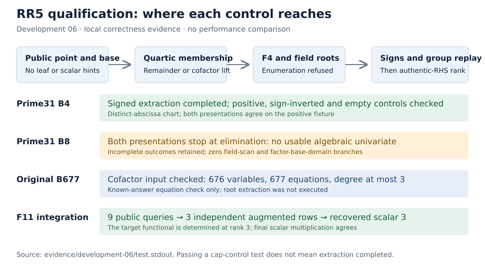
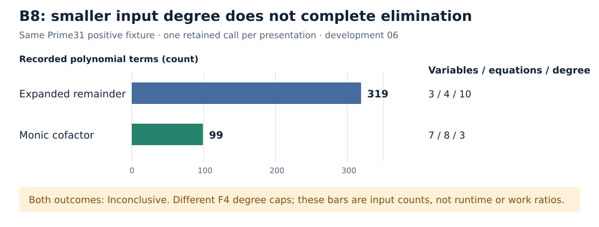

# Result and scope

The existing RR5 monic-quartic construction now has an additive native-Rust
implementation that extracts signed four-point relations, checks their actual
group equations, and feeds authentic public relations into exact modular rank
and target-scalar recovery. Local Prime31 B4 extraction controls pass. An
integrated small-field public-target control recovers its scalar using three
independent **augmented** rows and verifies the answer by scalar multiplication.
The implementation refuses enumeration fallbacks before they execute.

The larger controls identify the remaining technical boundary. Both B8
presentations remain inconclusive under their frozen elimination caps. The
original B677 expanded input reaches its symbolic-size cap. An exact cofactor
lift removes that construction obstacle: all 677 equations are built and a
test-only known-answer assignment satisfies them. **No B677 relation extraction,
complete Prime31 recovery, or matched cost comparison is reported.**
[pcc:unverified]

The principal fixture is unchanged:

\[
\begin{aligned}
E/\mathbb F_p &: y^2=x^3+847514846x+2087444724,\\
p&=2147483647,\qquad n=2147446831,\\
G&=(625037715,2100627251).
\end{aligned}
\]

Its source is the original `prime31_ic_20261115/native/lib.rs`. B4 and B8
controls use the first eligible public abscissae, explicitly for correctness.
The B677 control uses the original 509-point Dickson base plus the actual frozen
168-point RUN66 CSV. These populations are not interchangeable.

## Requirement-to-evidence map

| Requested result | Current evidence | Status |
|---|---|---|
| Nonenumerative four-summand extraction | Original F4 and rational-root factoring recover Prime31 B4 signed rows; no field/domain scan branches | Qualified locally for the stated B4 chart |
| Signed, independent public relations | Group-checked general rows for actual `aG+bQ`; exact rank and duplicate/dependency dispositions | Implemented and locally checked |
| Complete scalar-recovery integration | F11 public loop: nine queries, three independent augmented rows, scalar 3, final replay | Small-field control complete; Prime31 open |
| Requested-size factor base | Original B677 cofactor equations and known-answer equation check | Input construction only |
| Fully charged best-IC and optimized-rho comparison | Source audit and phase-by-phase gate; no admitted panel | Open |
| Growing-family complexity claim | No family or admitted measurements | Not attempted |

Passing a unit test that checks correct handling of an inconclusive result is
not a successful extraction. The result tables below preserve that distinction.

# Construction and what makes extraction nonenumerative

Let the supplied finite public target be $Q=(r,s)$, and let the chosen base
have distinct abscissae and nonzero ordinates. Set

\[
h(X)=\prod_i(X-x_i),\quad V(X)=X+b,\quad L(X)=cX+d,
\]

where $b,c,d$ are unknown coefficients. The function

\[
\ell(X,y)=(X-r)L(X)+(s+y)V(X)
\]

vanishes at $-Q$ and has pole order five at the identity. The residual norm
identity gives the monic quartic

\[
U(X)=(X^2+rX+r^2+A)V(X)^2-(X-r)L(X)^2-2sL(X)V(X).
\]

The four coefficients of $h\bmod U$ are the equations in the expanded
presentation. Solving these equations over the field determines the quartic;
factoring it determines the four abscissae. Each ordinate is recovered uniquely:

\[
y_i=-s-\frac{(x_i-r)L(x_i)}{V(x_i)}.
\]

The implementation looks each root up in the original base, recovers its sign,
and checks that the four points sum to the supplied target. It does not scan
base pairs, four-tuples, multisets or the entire field to discover a row.
Tiny exhaustive signed-tuple oracles occur only in test code for validation;
their outputs are never supplied to the candidate. An independently written
integer group law supplies separate replay controls.

The native traced visitor retains the original generators. Before any fallback
branch, its trace sink requires an actual nonconstant univariate or an exact
inconsistency. Without a usable eliminant, it stops as inconclusive. It admits
only branches labelled `univariate_roots`; finite-domain and full-field branches
are rejected before specialization. Field factoring uses the original counted
Frobenius/root routine. A completed traversal is meaningful only with all
original equations and signed group replays checked.

The chart excludes the identity target, a target abscissa in the base,
repeated leaf abscissae and rational two-torsion leaves. Those omitted cases are
reported explicitly; they are not silently accepted or treated as global
absence proofs. The denominator lemma and converse are proved in
[MATHEMATICS.md](MATHEMATICS.md). Under the stated assumptions, every quartic
dividing the squarefree split selector has an invertible denominator, and
every distinct-abscissa signed decomposition yields its unique normalized
function. The written proof is not a Lean or signed-PCC proof.

## Prior work and exact contribution

This is a specialization and integration of the existing RR9 method. A
concurrent merged implementation in `examples/prime31_rr5_quartic.rs` (#4942)
uses the same quartic and remainder ideal under the exact parameter change
$u=r$, $v=-s$, $t=b$, $\beta=c$, $\alpha=d$. Horner remainders versus long
division do not constitute a different mathematical construction.

The additive contribution here is the original traced visitor integration,
strict failure states, independently replayed signed-row consumer, general
authentic RHS, exact target-functional stopping, retained bounded transcripts,
and an alternative coefficient presentation. [SOURCE_AUDIT.md](SOURCE_AUDIT.md)
records the inspected source blobs and the differences. No first-extractor,
novel-index-calculus or asymptotic claim is made.

# Signed rows, independence and scalar recovery

For a public query generated as $R=aG+bQ$, a verified signed decomposition
supplies

\[
\sum_i c_iP_i=aG+bQ.
\]

Writing $P_i=x_iG$ and $Q=dG$ gives the exact mod-$n$ equation

\[
\sum_i c_i x_i-bd=a.
\]

The consumer therefore inserts the augmented coefficient row
$[c_0,\ldots,c_{B-1},-b\mid a]$. It consolidates signs, checks leaf indices,
checks the original group equation, deduplicates scalar-equivalent labelled
rows, and performs exact modular elimination. Duplicate and dependent rows
are distinguished from rank increases. A false RHS cannot create useful rank.

The target is recoverable when its coordinate functional is determined by the
row space; all factor-base logarithms need not be determined first. The result
is accepted only after a final $dG=Q$ check. Query generation accepts public
curve data, public base points, public target, limits and a coefficient-stream
seed. It does not accept the target's logarithm or the leaf witness.

The integrated control uses $y^2=x^3+x+6$ over $\mathbb F_{11}$,
$n=13$, $G=(2,7)$, base $(2,4),(3,5),(5,2),(7,2)$ and public target $(8,3)$.
The original SplitMix64 coefficient mapping, seed `0x525235`, generates the
actual RHS points. All nine attempts are retained. Six queries hit an explicitly
unsupported chart; the other three supply accepted rank increases and recover
$d=3$.

| Accepted query | Canonical coefficients $c$ | Canonical $a,b$ | Augmented rank |
|---:|---|---|---:|
| 1 | $(1,-1,-1,1)$ | $(1,7)$ | 1 |
| 4 | $(1,1,1,1)$ | $(3,0)$ | 2 |
| 9 | $(1,1,1,1)$ | $(12,10)$ | 3 |

The last two rows have the same factor-base coefficients and different labelled
RHS. Their difference determines the target coordinate. Thus the stated rank
three is rank of the augmented system, not three independent factor-base
coefficient vectors. This is a small-group integration control with a
known-answer fixture; it establishes neither natural Prime31 yield nor cost.
Source: the full `RR5_INTEGRATED_F11` object in development-06.

Static review also corrected transcript-accounting defects: a query is retained
even if point construction consumes the remaining budget; row consumption stops
after target determination; relation failures retain the partial transcript;
and the absolute cooperative deadline includes consumer setup and validation.
Native timeout and output-limit states take precedence over fallback or replay
diagnostics. A late verified recovery is explicitly `solved_after_deadline`.

# Larger inputs and retained development outcomes

The coefficient lift introduces a monic $W$ of degree $B-4$ and imposes

\[
U(X)W(X)=h(X).
\]

The quotient is unique because $U$ is monic. Eliminating its coefficients gives
exactly the original remainder equations, so this lift does not add a solution
or choose a tuple. It has $B-1$ variables, $B$ equations and total degree at
most three. This removes expanded symbolic remainders at the price of more
variables; elimination can still be expensive.

| Development-06 control | Input | Observed extraction outcome |
|---|---|---|
| Prime31 B4, expanded | 3 variables; 4 quadratic equations | Signed positive and empty controls complete |
| Prime31 B4, cofactor | 3 variables; 4 quadratic equations | Same positive signed row recovered |
| Prime31 B8, expanded | 3 variables; 4 equations; 319 terms; degree 10 | Positive and empty queries inconclusive |
| Prime31 B8, cofactor | 7 variables; 8 equations; 99 terms; degree 3 | Positive query inconclusive |
| Original B677, expanded | 20,000-term per-polynomial cap | Construction limit, before F4 |
| Original B677, cofactor | 676 variables; 677 equations; 13,480 terms; degree 3 | Known-answer input check passes; no extraction call |

For the two B8 positive calls, the observed native maxima are 208 rows / 3,752
columns (expanded) and 9,414 rows / 14,106 columns (cofactor). These are traversal
diagnostics, not peak RSS or a matched runtime comparison. Both calls preserve
zero full-field branches and zero finite-domain evaluations. Their failure to
produce a univariate is bounded evidence, not a proof that this ideal cannot be
solved algebraically. [pcc:unverified]

## Frozen attempts and failures

| Attempt | Outcome | Interpretation |
|---|---|---|
| Development 01 | Build failed | Workspace metadata problem; no tests |
| Development 02 | Build failed | Existing selector rejected changed whole-file source pin; no tests |
| Development 03 | 14 tests passed | Original B4, chart, independent replay and consumer checks |
| Development 04 | 17 tests passed | Adds B8/B677 bounded outcomes and integrated F11 recovery |
| Development 05 | Build failed | Missing `hex` dependency metadata for the unchanged identity checker |
| Development 06 | 21 tests passed | Corrected accounting, cofactor input, identity checks and deadline control |
| Development 07 | One setup test failed | Inherited eighth coset constant disagreed with its seventh-power witness |
| Development 08 | One setup test passed | Corrected RUN52 constant; complete CSV/fibre/union setup certificate, independently frozen |

Build, pre-call and post-call manifests are separate. Test executables are copied
to immutable paths before calls. Failed builds have no fabricated execution
receipt. The early manifests also list generated source copies; those historical
manifests are preserved unchanged. Later snapshots explicitly exclude build
directories. All recorded test timings are ordinary development-run output and
are not promoted into performance values.

Development07 also records a pre-call current-source mismatch in the separate
metadata-only CLI module, which was hardened after compilation. Its original
bytes are preserved and the library executable was pre/post hashed; the failed
test is not admitted as a passing certificate. Development08 required every
source check to pass, and used a new immutable library executable and a separately
frozen metadata CLI. Its one passing setup test does not turn development06 into
a new 22-test run.

Two original native identity records accompany the norm and denominator
identities: `IDC1h140ede2d54279ca7` and `IDC1h660312477c7469f3`.
Each uses 32 issuer points plus 32 additional fixed checker-stream points over
$2^{61}-1$, with `proof=null`. These are deterministic producer-local sampled
identity checks; distinct streams do not establish independent execution or a
formal proof over the integers. The raw certificate and checker verdict occur
in development-06 and are exported without changing the statement.

# Exact compact-selector route

The original B677 base has more structure than its expanded degree-677 product
shows. Let $f(X)=X^3+AX+B$ and let $c_1,\ldots,c_8$ be the existing public
seventh-power coset constants. Define

\[
H_D(X)=D_{1024}(X,1)-1616683971,\qquad
H_Y(X)=\prod_{j=1}^{8}\big(f(X)^7-c_j^2\big).
\]

The development08 source-data certificate checks the actual CSV, the entire 1024-element
Dickson fibre, all eight 21-element extra fibres, disjointness and canonical
union. The product $H=H_DH_Y$ has 1192 distinct rational abscissa roots. Exactly
677 lift to the original base; the remaining 515 have nonsquare curve RHS.
The setup check runs neither circuit solving nor relation extraction.

The initial check exposed an inherited constant error in the later cubic-factor
example. The original RUN52 source and the actual CSV agree on
$c_8=1852957275$, with anchor $(227959902,136769428)$. This study uses that
corrected value and preserves both the historical source and development07's
failed receipt. The exact census above is bound to development08's
`COMPACT_SELECTOR_SETUP` object, not inferred from the earlier failed check.

There is a useful four-leaf argument for removing those extra geometric
possibilities. For a nonzero rational target with $h(r)\ne0$, outside both
signed lifts of every base point, on an odd-order
curve, write a four-leaf relation as $Q=T+Z$, where $T$ sums rational leaves
and $Z$ sums leaves whose ordinates are negated by Frobenius. Frobenius gives
$Q=T-Z$, hence $2Z=O$ and $Z$ is rational. Odd rational group order forces
$Z=O$. One such leaf cannot sum to zero; two require identical abscissae;
three leave a rational base point equal to $Q$; four force $Q=O$. All are
excluded by the chart assumptions. Thus every geometric RR5 solution of
$U\mid H$ uses only the original 677 abscissae.

[COMPACT_SELECTOR.md](COMPACT_SELECTOR.md) gives the full hypotheses and proof.
It does not extend automatically to five or more leaves, repeated abscissae,
identity or base targets, or even rational group order.

The selector can be evaluated modulo the quartic with 22 quotient-ring
multiplication gates: ten for the Dickson ladder, four for $f^7$, seven for the
eight-factor product, and one final multiplication. Encode each gate exactly
by $AB=UQ+R$, with $\deg Q\le2$ and $\deg R\le3$. A conservative lifted
description has 157 variables and 158 quadratic equations. Those counts are
derived from the written circuit, not a measured solver result. Its root
extractor remains to be implemented and qualified; compact input alone gives
no small elimination bound.

# What the requested comparison still requires

The primary comparison remains **one unknown public target from a cold start**.
It must charge base selection and construction, selector and equation setup,
every unsuccessful and successful query, elimination, roots, signs, exceptions,
row handling, useful rank, final linear algebra, recovery, verification and peak
memory. Multi-target amortization is a separately labelled secondary result.

The source audit identifies the original algebraic solver and production
`PkmSemaevOracle` family as IC candidates, the optimized generic IC controls in
`prime_fast`, and `prime_fast::rho_parallel` with `RhoConfig::tuned(n)` as the
optimized negation-map wall reference. The existing `rho.negation` counted arm
must also be retained. The best applicable IC configuration must be selected
from reproducible evidence before the matched experiment; this report does not
declare whichever implementation is easiest to call to be the incumbent.

The present counters are explicitly incomplete. In particular, symbolic map
work and allocation, some coefficient evaluations and powers, F4 memory,
input setup and complete native-word costs are not fully priced. Consumer setup
arithmetic is already included in cumulative consumer arithmetic and must not
be counted twice. The source flags `phase_accounting_complete=false` and
`complete_cost_accounting=false` remain correct.

There are also observed execution dependencies. The documented main-branch
EKS route builds the root ecbench executables; its source-checkpoint allowlist
does not include this standalone RR5/arithmetic source closure. A supported
image/command integration is required. The available runtime has no authenticated
EKS/AWS client or exposed workflow-dispatch operation, and the actual checkpoint
preflight failed for lack of upload authentication. No paid job was launched.
These are execution constraints, distinct from the observed B8 elimination
limit. Exact source checks are in [SOURCE_AUDIT.md](SOURCE_AUDIT.md).

The inherited root manifest syntax was repaired on current main while this
work proceeded. Its initial failure is historical. The current-main no-run
build reached its 60-second cap; a separate invocation of the required
`cargo test --release --locked --offline --lib -- --test-threads=1` reached
its 300-second process cap while compiling dependencies, both with exit124.
No root-library test result or new source compilation defect was established.
The unchanged-source closure qualification is a narrower gate. No full-library
pass or signed standing validation is inferred from the component tests.

# Reproduction, evidence and next technical step

The runnable sources, protocol, raw output and exact hashes are in this study.
The read-only source selector copies the actual full F4 parent/child modules
and byte-identical dependency ranges; it does not replace their algorithms.
Original curve arithmetic is linked from its existing Rust source. See
[README.md](README.md) for the build entry point and the protocol for immutable
execution details. The native metadata exporter preserves raw pins, marker
records and sampled identity certificates; unsigned registration is an
attestation, not an execution proof or trusted verdict.

The completed [native export](reports/development-export/observation.json)
pins116 raw files and preserves23 parsed stdout records and2 sampled identity
certificates. It records failed builds, failed setup, capped library gates and
the upload preflight alongside successes. Its standing is unverified; no
independent executor or trusted verifier is claimed.

The immediate algorithmic step is to obtain an exact algebraic eliminant for
the B8 control, then implement and qualify the source-certified compact-selector
presentation at B677. A successful input check does not satisfy that step.
After actual public relations at the requested base size can drive scalar
recovery, the frozen cold comparison can be admitted on matched resources.

The canonical IC scoreboard, progress timeline and performance-gain graphs
remain unchanged: this checkpoint contributes correctness and retained cap
evidence, with no newly admitted cost value or curve ranking. The two figures
here describe the new observations at their actual scope. [pcc:unverified]
