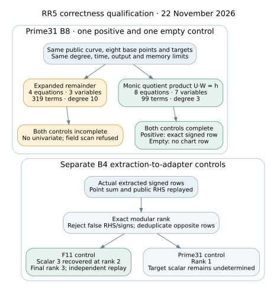

# RR5 public four-summand extraction: correctness qualification

Updated 2026-11-22 Pacific; execution receipts use 2026-11-23 UTC. This [publication branch](https://github.com/isogeny-labs/crypto/tree/lane/prime31-rr5-complete-controls-20261122) continues the work tracked in merged #4938, #4942, and tracking-only [#4949](https://github.com/isogeny-labs/crypto/pull/4949). Status: **unsigned local correctness evidence**; see [claim status](CLAIMS.md). B8 now passes; requested-size extraction, full-root qualification, CI, and complete-cost comparison remain open. [pcc:unverified]

## 1. Executed result

The final native executable passed **17 component tests and two separately invoked B8 tests: 19 distinct tests in total**. The 17-test invocation explicitly filtered out the two B8 gates; each separate gate ran one test and filtered out the other eighteen. No test was ignored. The independent public example passed eight tests in its separate production-source qualifier. These results do not establish a full-root-library pass.

| Gate | Observed result | Raw evidence |
| --- | --- | --- |
| Initial component | 14 passed | [qualification-initial](evidence/qualification-initial/stdout.txt) |
| Extractor-to-adapter integration | 16 passed | [qualification-04](evidence/qualification-04/stdout.txt) |
| Pre-compact component recheck | 16 passed; B8 separate | [qualification-05](evidence/qualification-05/stdout.txt) |
| Final component and construction check | 17 passed; B8 separate | [qualification-06](evidence/qualification-06/stdout.txt) |
| Compact B8 positive | `Complete`, exactly one signed row | [b8-positive-02](evidence/b8-positive-02/stdout.txt) |
| Compact B8 generator | `Empty`, no signed rows | [b8-empty-02](evidence/b8-empty-02/stdout.txt) |
| Public example | 8 passed | [public-example-01](evidence/public-example-01/stdout.txt) |
| Norm identity checker | Evaluated; false cross-term control rejected | [identity-01](evidence/identity-01/stderr.txt) |
| Full root-library attempts 03 and 04 | Both timed out during dependency compilation, exit 124 | [03](evidence/root-library-03/exit-status.txt), [04](evidence/root-library-04/exit-status.txt) |

The diagram summarizes correctness gates, not comparative performance. Observations remain `[pcc:unverified]`.

## 2. Public equations and exact chart

The candidate uses the unchanged ordinary [PRIME31 fixture](../prime31_ic_20261115/native/lib.rs):

\[
p=2^{31}-1,\qquad E:y^2=x^3+847514846x+2087444724,
\qquad n=2147446831.
\]

For public target \(R=(r,s)\), the supplied base has distinct abscissae \(x_i\) and chosen nonzero ordinates. Set \(h(X)=\prod_i(X-x_i)\). For RR5 parameters \(u,v,w\), called `b,c,d` in source, define

\[
V=X+u,\quad L=vX+w,\qquad
U=(X^2+rX+r^2+A)V^2-(X-r)L^2-2sLV.
\]

The exact norm identity is

\[
(X^3+AX+B)V^2-\big((X-r)L+sV\big)^2=(X-r)U.
\]

The monic quartic must divide \(h\). Each recovered root \(z\) is lifted by

\[
y_z=-s-\frac{(z-r)L(z)}{V(z)}.
\]

The implementation checks signed-base membership and literally replays the four-point sum. [MATHEMATICS.md](MATHEMATICS.md) supplies written soundness, completeness, rationality, and reducedness arguments. These remain unverified; the evaluated identity below has narrower scope.

The chart requires a nonsingular odd-characteristic curve, four distinct supported abscissae, nonzero leaf ordinates, a finite target, and \(h(r)\ne0\). Identity and target-in-base cases are explicitly unsupported. Repeated points, inverse-pair cancellations, and two-torsion leaves need separate treatment; an empty chart says nothing about those omitted decompositions.

### Compact membership equations

B4 retains four equations from \(h\bmod U=0\), equivalently \(U=h\). For base sizes **5 through 8**, the [final extractor](native/extractor.rs) introduces a monic cofactor

\[
W=X^{B_{\mathrm{FB}}-4}+\sum_{j=0}^{B_{\mathrm{FB}}-5}q_jX^j
\]

and enforces **all \(B_{\mathrm{FB}}\) lower coefficients of \(UW-h=0\)**. B8 has seven unknowns and eight equations of degree at most three, solved with Grevlex. B4 and bases larger than eight retain the expanded presentation. [pcc:unverified]

The equivalence is exact: monic long division determines \(W\) uniquely. The highest \(B_{\mathrm{FB}}-4\) equations force its coefficients triangularly, each with coefficient one; the remaining four force the remainder to vanish. No parameter division or extra affine component is introduced. Squarefree \(h\) and \(h(r)\ne0\) still imply \(\gcd(U,V)=1\): \(U(-u)=(u+r)(w-uv)^2\), whose alternatives force either the excluded target root or a repeated root of \(U\).

The construction test compares coefficient evaluations with scalar monic long division at fixed parameter triples for sizes 5–8 and checks every auxiliary-coefficient mutation. Native traversal checks all original equations on the full assignment before projecting to three parameters; evaluation of \(U\) asserts that omitted auxiliary exponents are zero.

Cubic inputs do not bound solving degree or cost. A complete Grevlex basis need not display a pure univariate. Raw homogenized compact generators admit auxiliary directions at infinity, so the B4 degree-five/no-infinity argument does not transfer. [pcc:unverified]

## 3. Preserved B8 failures and completed controls

Both presentations received the same public natural-x base and fixed targets. The positive target is \((92816593,1965281801)\), constructed test-side from the first four points with signs \((+,-,+,+)\). The empty control is public generator \((625037715,2100627251)\). A separate integer group-law oracle checks all \(70\times16=1120\) signed subsets per target. Oracle rows, construction witnesses, and scalars never enter the extractor.

| Presentation and control | Targets | Variables / equations | Terms / input degree | Status / returned rows | Native max rows / columns |
| --- | ---: | ---: | ---: | --- | ---: |
| Expanded, positive | 1 | 3 / 4 | 319 / 10 | `Inconclusive` / 0 | 208 / 3752 |
| Expanded, generator | 1 | 3 / 4 | 319 / 10 | `Inconclusive` / 0 | 208 / 3752 |
| Compact, positive | 1 | 7 / 8 | 99 / 3 | `Complete` / 1 | 1085 / 1121 |
| Compact, generator | 1 | 7 / 8 | 99 / 3 | `Empty` / 0 | 1085 / 1121 |

Expanded [positive](evidence/b8-positive-01/stdout.txt) and [empty](evidence/b8-empty-01/stdout.txt) attempts failed their required gates with `no algebraic univariate; enumeration refused`. Their zero rows were not emptiness evidence; both failures remain intact. Compact traversal reported solving degree four, exact oracle agreement, and zero rejected assignments. All four calls reported zero native full-field branch attempts and domain evaluations. The compact positive call traversed seven F4 nodes; the empty call closed at its first node. [pcc:unverified]

These are two fixed controls, one target each. Changing both presentation and ordering does not isolate a performance cause. Lower input degree, fewer terms, and completed traversal establish no speed ratio or cost advantage. Observed matrix columns decreased while rows increased.

## 4. Discovery, replay, and authentic RHS

The candidate accepts curve, public base, public target, and limits. Algebraically derived univariates provide branches over all field roots. Traced traversal preserves incoming generators and checks terminal assignments against the original input. It refuses finite-domain and full-field fallback branches; exhaustive oracles remain test-only.

| Status | Interpretation |
| --- | --- |
| `Complete` | Algebraic traversal finished and signed chart replay succeeded. |
| `Empty` | Completed chart has no rows, or fewer than four base abscissae make the requested support impossible. |
| `UnsupportedChart`, `InvalidInput` | Chart exclusion or invalid input; neither proves general emptiness. |
| `BuildLimit`, `Inconclusive`, `Deadline`, `OutputLimit` | Complete coverage was not established; partial valid rows retain that qualification. |

A failed signed lift changes completion to `Inconclusive`. The forced low-degree control confirms refusal before native field/domain activity. `forbidden_branch_attempts` names a counter incremented before a sink could reject specialization; historical receipts retain the previous name.

For unknown \(T=[d]G\) and public query \(R=[a]G+[b]T\), a genuine signed row gives

\[
\sum_i\varepsilon_i\log_G(P_i)-bd=a\pmod n.
\]

The [adapter](native/relation_adapter.rs) checks point equality before insertion, normalizes multiplicities/global signs, recognizes duplicates, and computes exact incremental rank modulo the checked prime order. Recovery requires the target coordinate functional in the row space, followed by \([d]G=T\).

The [final integration receipts](evidence/qualification-06/stdout.txt) distinguish useful rank from extraction:

- **F11 known-answer control:** \(y^2=x^3+x+6\), order 13, \(G=(2,7)\), target \((8,3)\). Scalar 3 is test-side setup and expected output; neither it nor base logarithms enters the candidate. Labels 1–12 include four eligible queries and eight chart exclusions. Recovery occurs at **rank two**, when public label 3 supplies the second independent equation. Completing the schedule leaves **final rank three**, three duplicates, two rejected mutations, and one scalar replay. Independent integer arithmetic confirms the target. This labelled small-group schedule is a correctness control, not a solving-cost experiment.
- **Prime31 boundary:** actual positive and negative B4 rows reach **rank one**; repeated and globally negated equations are duplicates. Wrong-RHS and sign mutations are rejected before rank changes. The recovered scalar remains `null`.

## 5. Evaluated identity and requirement map

[IDENTITY.json](IDENTITY.json), identifier `IDC1h16239a628042ecea`, records the production checker’s norm expression after substituting \(B=s^2-r^3-Ar\). It uses syntactic degree bound six, 32 certificate evaluations and 32 additional deterministic evaluations over \(2^{61}-1\), rather than PRIME31. [Checker output](evidence/identity-01/stderr.txt) retains an unequal-value counterexample when the signed cross term is omitted.

This is same-team evaluated evidence with `proof: null`, not a signed independent verdict or formal theorem. It checks an explicit expression, source-reviewed against the constructor; its historical `::system` label does not mechanically bind the refactored builder. It proves neither the divisor-chart argument nor the identity over every field, and supplies no complexity bound. Fixed deterministic seeds are not a new probabilistic soundness claim. [pcc:unverified]

| Requirement | Evidence | Remaining scope |
| --- | --- | --- |
| Public discovery and exact signs | B4/F11 oracles; compact B8 gates | B677 unqualified; omitted charts remain |
| Honest empty/incomplete distinction | Empty controls, expanded failures, forced-cap test | No general extraction bound |
| No enumeration fallback | Native counters and trace refusal | Factoring/elimination still require work |
| Authentic RHS and useful rank | Extracted rows, duplicate and mutation controls | Large-base relation yield unknown |
| Final scalar replay | F11 recovery at rank two | Prime31 boundary recovers no scalar |
| Norm identity check | Evaluated certificate and false-expression counterexample | Chart proofs remain unverified |
| Public example integration | Eight tests on pinned production closure | Full-root and CI open |
| Requested-size and complete cold comparison | Protocol requirements retained | Not executed |

## 6. Provenance, failures, and publication limits

Final native test binary SHA-256 is `ff3c88b62f483d2a78c738a19f70b3748403d25460db1281298872f38f563b93`; all three final invocations reference that frozen executable. Its [pre-call inventory](evidence/qualification-06/pre-call-sources.sha256), build/post-call checks, command, and exit status remain separate. Reviewed extractor hash: `4bf24b3e3c748f84a7c4f0e37552b64b2728dde3e2133e0b5d8669e3adede3df`.

The declared closure includes complete production F4 modules, explicitly selected verbatim dependency sections, and the complete original Prime31 arithmetic plus tower-module dependencies. This qualifies that source closure, not a hermetic system image or full-root build. The unchanged public example has its own [inventory](evidence/public-example-01/pre-call-sources.sha256).

Earlier 16-test sources were uncommitted. Their [archival recovery](evidence/source-snapshots/qualification-04/README.md) restores all twelve study/native source/configuration files exactly to the original hashes. Recovery was administrative and post-call; frozen receipts were not rewritten and no rerun is implied.

| Retained attempt | Observation |
| --- | --- |
| [development-01](evidence/development-01/build.stderr) | Nested workspace roots blocked compilation. |
| [development-02](evidence/development-02/build.stderr) | Whole-file source pin rejected changed surrounding source. |
| development-03 / 04 | Successful initial/revised builds; original receipts retained. |
| [root-library-01](evidence/root-library-01/stderr.txt) | Duplicate manifest key exposed missing target-table headers. |
| [root-library-02](evidence/root-library-02/stderr.txt) | Offline resolution lacked sparse-checkout `isogeny_algos`. |
| [root-library-03](evidence/root-library-03/stderr.txt) / [04](evidence/root-library-04/stderr.txt) | Exit 124 during dependency compilation; neither reached a full-root pass. |

The inherited `groebner_f4.rs` pin changed from prefix `576eceef9f2abd24` to `36b0bc3232df109b`; the selected monomial-ordering range was byte-identical. This reviewed surrounding-file change did not replace the selected algorithm. Group/Cargo fixes are already in main through [#4946](https://github.com/isogeny-labs/crypto/pull/4946); this continuation does not republish them.

Raw test/checker outputs accompany the study. Two legacy verbose Cargo JSON logs from development-03/04 remain locally preserved with hashes in [pending-artifacts.json](evidence/pending-artifacts.json). Artifact-store publication is open because the uploader had no AWS credentials; no remote upload is claimed.

## 7. Resource and cost boundary

The [protocol](PROTOCOL.md) and [addendum](QUALIFICATION_ADDENDUM.md) retain their original bytes and historical tracking labels. B4 has a five-second deadline. B8 uses degree cap ten, a shared thirty-second deadline, 20,000 terms per intermediate construction polynomial, and 4,096 assignments. Qualification uses one Rayon/test worker, a 180-second process timeout, and a 2 GiB address-space ceiling.

The term guard does not bound F4 matrices. The degree option bounds critical-pair LCMs, not allocation; external limits remain material. Process failures cannot become passing inconclusive gates.

No comparative clock graph is produced: these are correctness executions, and durations are not benchmark samples. Complete phase accounting remains false; canonical performance graphs and leaderboards are unchanged. Requested B677 extraction, useful independent rank at that size, exceptional-chart treatment, and an admitted cold single-target comparison against the strongest applicable reproducible algebraic IC and optimized negation-map rho remain open. Charge setup, every attempted query, elimination, roots, signs, replay, rank, linear algebra, recovery, verification, and memory; keep amortized results separate.

Prior-art pointers remain [Semaev 2004/031](https://eprint.iacr.org/2004/031), [Faugère et al., EUROCRYPT 2014](https://www.iacr.org/archive/eurocrypt2014/84410158/84410158.pdf), and source-linked RR9 notes. The protocol records unavailable KB tools and earlier PDF retrieval failures. No novelty, asymptotic improvement, or complete-cost advantage is claimed. [pcc:unverified]
