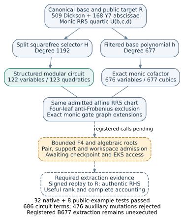

# RR5 B677 selector circuit: construction and qualification

2026-11-22 Pacific; execution receipts use UTC. Continuation of [the four-summand study](../REPORT.md), initially tracked in [PR #4967](https://github.com/isogeny-labs/crypto/pull/4967). This report distinguishes a public algebraic construction, local correctness controls, and the registered B677 extraction requests. The [protocol](PROTOCOL.md) fixes the requests and limits. Evidence is unsigned and independently reviewed only within the same team. [pcc:unverified]

The source and raw evidence are published at [commit 5e536ed93302](https://github.com/isogeny-labs/crypto/commit/5e536ed93302def2122968aa880b22c4b675d516). Its Git tree is identical to the reviewed local publication tree. The separate [GitHub qualification run](https://github.com/isogeny-labs/crypto/actions/runs/45118811731) was observed in progress on that exact commit; its conclusion is not part of these local test receipts.

## 1. Observed standing

The corrected native suite passed **all 32 tests**, and the separate public-example suite passed **all eight**, with none ignored or filtered out. The native constructor observed 122 variables, 123 quadratic equations and 686 terms, and rejected all 476 individual auxiliary mutations. The fixed B677 driver compiled successfully. No registered B677 extraction request has run: the checkpoint gate failed, and an authenticated EKS route for this exact executable remains unavailable.

The first build's suite had **27 passes and five failures**, all caused by the same rejected Y7 fixture constant before its B677 assertions. That failure, the independent scalar diagnostic and the corrected rerun are preserved separately.

| Gate | Observed outcome | Evidence |
| --- | --- | --- |
| Native and public-example compilation, build 01 | Exit 0; source and frozen-binary checks passed | [Build receipt](evidence/build-01/exit-status.txt), [source manifest](evidence/build-01/source-manifest.json) |
| Native suite 01 | Exit 101; 27 passed, 5 failed, none ignored | [Output](evidence/native-tests-01/stdout.txt), [failures](evidence/native-tests-01/stderr.txt) |
| Independent coset-7 diagnostic | Exit 0; two scalar paths agree on 1852957275 | [Diagnostic output](evidence/coset7-check-01/stdout.txt), [native source](controls/coset7.rs) |
| Checkpoint admission | Exit 1; checkpoint upload unavailable | [Failure receipt](evidence/admission-01/stderr.txt) |
| Corrected build 02 and native suite 02 | Exit 0; 32 passed, none failed, ignored or filtered | [Build](evidence/build-02/exit-status.txt), [native output](evidence/native-tests-02/stdout.txt) |
| Public-example execution | Exit 0; all 8 passed, none ignored or filtered | [Public output](evidence/public-example-01/stdout.txt) |
| Fixed-driver compilation | Exit 0; driver not launched | [Build command](evidence/driver-build-01/command.txt), [exit](evidence/driver-build-01/exit-status.txt) |
| Full root-library gate | Exit 124 at the 180-second limit; AWS SDK metadata allocation failed before timeout; no tests executed | [Command](evidence/root-library-01/command.txt), [diagnostic](evidence/root-library-01/stderr.txt), [exit](evidence/root-library-01/exit-status.txt) |
| Registered B677 positive/reference/H0/W0 calls | Unexecuted | [Admission record](ADMISSION.md) |

The first fixture failure was **“public Y7 coset 7: y0^7 differs from its frozen constant.”** Four fixture/API controls and the circuit constructor test aborted at this check. The failed run therefore supplies no observation of the circuit term count or its 476 planned auxiliary-mutation checks. Source and binary post-call checks both returned zero, so the failure belongs to the recorded immutable build rather than a changed executable.

The [independent native diagnostic](evidence/coset7-check-01/stdout.txt) subsequently computed the seventh power of 136769428 modulo 2147483647 by repeated multiplication and a separate addition chain. Both returned **1852957275**. The earlier source spelling was correct; the later 1852955275 spelling was a typo, and the first implementation had reversed that inference. The [source correction](SOURCE_CORRECTION.md) changes only the new fixture constant and its independent assertion, retaining the wrong value as a negative assertion. Historical sources, the CSV, protocol targets and limits remain unchanged. The corrected suite reran the same 32 tests successfully.

{width=100%}

Figure: algebraic dependencies, observed local controls and admission boundaries. Variable/equation counts are analytic source quantities, confirmed for the circuit by its constructor control. Arrows beyond admission describe the registered procedure, not an executed B677 solve. There is no comparative timing graph because this continuation has no benchmark samples.

## 2. Exact original base and selector conditions

The requested instance is the original PRIME31 curve
\[
p=2147483647,\quad y^2=x^3+847514846x+2087444724,
\quad \#E(\mathbb F_p)=2147446831.
\]
The [original arithmetic](../../prime31_ic_20261115/native/lib.rs) validates a nonidentity generator of prime order and a Hasse-bound condition establishing full curve order. The canonical base combines the depth-ten Dickson fibre's **509 rational nonzero-y abscissae** with **168 frozen Y7 abscissae**, with canonical signs and sorted distinct x-values.

The extra CSV is [RUN66_Y7_EXTRA168.csv](../../prime31_f4_admission_20261121/RUN66_Y7_EXTRA168.csv), SHA-256
`fc484615394ee423190747d05001cea526580fb0df0279fbcf789ab6cafc0c46`.
A natural-x B677 scan would be a different experiment.

Write \(f=X^3+AX+B\), \(D_1=X\), \(D_{2m}=D_m^2-2\), and
\[
H=(D_{1024}-\tau)G(f^7),\qquad
G(T)=\prod_{i=1}^{8}(T-c_i^2).
\]
The raw selector has degree \(1024+168=1192\); the filtered base polynomial
\(h=\prod_{x\in S}(X-x)\) has degree 677. The raw Dickson fibre includes 515 noncurve x-values.

The [fixture constructor](../native/b677_fixture.rs) requires 1,024 distinct Dickson roots, checks their selector evaluations and exact rational filtering, and validates the extra roots against the unchanged CSV. For each Y7 coset, it checks the complete degree-21 coefficient factorization, distinctness, disjointness from the full Dickson fibre, and signed ordinates. Its additional horizontal-triple checks concern public setup identities. They do not supply extracted target relations. These checks must pass before the structured candidate accepts the descriptor.

The theorem requires \(H\) to split simply over the field and its nonzero-y on-curve roots to equal the supplied base exactly. It also requires the **full rational group** to have odd order, a finite target \(R=(r,s)\), and \(H(r)\ne0\). The first build failed fixture admission; the corrected fixture and independent replay controls passed in [suite 02](evidence/native-tests-02/stdout.txt). Their success remains unsigned execution evidence for these exact public data.

## 3. Why the additional roots preserve the RR5 chart

For three coefficient parameters \(b,c,d\), set
\[
V=X+b,\quad L=cX+d,\quad
U=(X^2+rX+r^2+A)V^2-(X-r)L^2-2sLV.
\]
The monic quartic satisfies
\[
fV^2-\big((X-r)L+sV\big)^2=(X-r)U.
\]
The candidate enforces \(U\mid H\). Squarefreeness and target exclusion imply \(\gcd(U,V)=1\): a common root would force either the excluded target abscissa or a repeated factor of \(U\). Thus every quartic root \(z\) has the unique signed lift
\[
y_z=-s-\frac{(z-r)L(z)}{V(z)}.
\]
The associated function has four lifted zeros and \(-R\), with pole divisor \(5(O)\), so the four leaves sum to \(R\).

The extra geometric point issue is resolved by the four-leaf argument in [MATHEMATICS.md](MATHEMATICS.md). Points with x in \(\mathbb F_p\) are rational or anti-Frobenius. Their two subgroups intersect in rational two-torsion, hence only in \(O\) here. The sum of anti-Frobenius leaves must therefore be zero. One such leaf would be \(O\); two would share x; three would force the remaining leaf to be \(R\); four would force \(R=O\). Each alternative violates an admitted condition. All four leaves consequently lie in the canonical rational base, even for coefficient solutions initially considered over the algebraic closure.

The note also proves reducedness using the tangent equations for squarefree divisibility and the pole bound on a varying normalized RR5 function. Consequently the four remainder ideals \(I_H\) and \(I_h\) agree as affine schemes. No parameter saturation or denominator inversion is added. These are written, unsigned arguments. The earlier evaluated RR5 norm certificate does not certify this selector replacement, reducedness, or its implementation. [pcc:unverified]

## 4. Exact circuit and analytic dimensions

Four quadratic equations bind explicit quartic coefficients \(z_j\) to the RR5 expressions. A modular product of cubic residues introduces a cubic remainder \(C\) and a quadratic quotient \(Q\), then imposes all seven coefficients of
\[
AB-\widehat UQ-C=0,\qquad
\widehat U=X^4+z_3X^3+z_2X^2+z_1X+z_0.
\]
The monic high coefficients determine all three quotient coefficients with unit pivots; the remaining equations determine the four remainder coefficients. Every acyclic gate is therefore a polynomial graph extension over arbitrary coefficient algebras. Special degree drops introduce no exceptional division.

The [circuit](../native/selector_circuit.rs) inlines \(D_4\bmod U\), uses eight squarings to reach \(D_{1024}\), four products for \(f^7\), and four products for the degree-eight blocked evaluation of \(G\). Its final product uses only three quotient variables and imposes all seven coefficients with remainder fixed to zero.

| Analytic source quantity | Structured selector | Exact cofactor reference |
| --- | ---: | ---: |
| Selector/base polynomial degree | 1192 | 677 |
| Original RR5 parameters | 3 | 3 |
| Additional variables | \(4+16\cdot7+3=119\) | 673 |
| Total variables | **122** | **676** |
| Equations | \(4+17\cdot7=\mathbf{123}\) | **677** |
| Maximum input total degree | **2** | **3** |
| Monomial ordering | Grevlex | Grevlex |

For the reference, \(W=X^{673}+\sum_{j=0}^{672}q_jX^j\), and all 677 lower coefficients of \(UW-h=0\) are imposed. Both presentations encode the same admitted chart. Lower input degree and fewer variables establish no solving-degree, matrix-size, or speed bound. The circuit may still have difficult elimination and auxiliary directions at infinity after naive homogenization.

The constructor control independently forms the dense degree-1192 selector and performs scalar monic division at four fixed parameter triples. It compares the final remainder and perturbs each of 119 auxiliary coordinates once per triple. Its first invocation stopped at fixture admission. The corrected [B677_CIRCUIT record](evidence/native-tests-02/stdout.txt) reports **122 variables, 123 equations, 686 terms, maximum total degree two, 17 modular product gates, four parameter controls and 476 rejected auxiliary mutations**. Its 1,899 symbolic additions and 1,139 symbolic multiplications count constructor work only. These are neither extraction-operation totals nor a timing comparison. No coefficient witness enters a registered extraction call.

## 5. Bounded F4 and regression scope

The [production F4 changes](../../../src/cryptanalysis/f4_fp.rs) add opt-in admission for critical pairs, symbolic support, retained polynomial terms, matrix workspace, recording copies and contributor storage. Checks precede the corresponding growth. Bounded calls use guarded scalar final interreduction. Optional modes without admission coverage are explicitly refused.

A resource stop carries a diagnostic limit and remains incomplete. Native traversal stops before another root branch or solution callback; the ordinary solver returns `Undetermined`. The [extractor](../native/extractor.rs) distinguishes `ResourceLimit` from `Empty` and bypasses the univariate-availability diagnostic for an already interrupted native call. Defaults retain the prior algorithms and serialization when resource limits are absent.

The frozen limits are degree 10, a shared 30-second construction/solver/root deadline, 20,000 terms per intermediate construction polynomial, 4,096 assignments, 20,000 admitted pairs, 8,192 symbolic monomials, and 2,000,000 conservatively reserved matrix entries. Execution uses one worker, an outer 180-second timeout, and a 2 GiB address-space limit. The native counters bound admitted populations; caller storage, exponent widths and allocator overhead still require the process bound.

All eight new guard controls passed in both native suites: bounded/default equality, pair refusal, symbolic growth, recorded-workspace admission, replay under current limits, final-reduction expansion, unsupported modes, and deadline classification. The nineteen inherited native tests also passed, including both fixed B8 oracle gates and extractor-to-adapter checks. [Suite 02](evidence/native-tests-02/stdout.txt) additionally passed four B677 fixture/API controls and the circuit constructor, giving 32 distinct tests. The zero-budget API control refuses before algebraic search; it does not execute a registered positive or public-target request.

Their scope remains unchanged. The F11 known-answer schedule recovers scalar 3 at rank two and ends at rank three. The PRIME31 B4 adapter boundary ends at rank one with recovered scalar `null`. The B8 controls compare against 1,120 test-only signed subsets per target. These small controls do not establish B677 extraction, rank, or complete ECDLP cost. The separate [public-example run](evidence/public-example-01/stdout.txt) passed eight tests covering B4 extraction, exact signs/RHS, incomplete branches, invalid inputs and target-in-base exclusion.

## 6. Provenance and execution admission

[Build 01](evidence/build-01/command.txt) used Rust 1.100.0 and the actual production F4 closure plus the study modules. Its [pre-build inventory](evidence/build-01/pre-command-sources.sha256) binds 69 files; the [post-build check](evidence/build-01/post-command-source-check.txt) preserved those bytes. The [source-selection manifest](evidence/build-01/source-manifest.json) identifies complete modules and exact verbatim dependency ranges. It explicitly does not claim a complete hermetic build or a full root-library pass.

The [corrected build inventory](evidence/build-02/pre-command-sources.sha256) again binds 69 files. Both builds, the two native suite calls and the public-example call retain successful source/binary checks. Native and public-example executables were copied read-only and [hashed separately](evidence/build-02/frozen-binaries.sha256). The final native test binary has SHA-256 `a59a6d046edeef795cf13186da0af8c8d5cb21d96d0139831ace39c799a079da`; the [suite command](evidence/native-tests-02/command.txt) pins that copy. The public-example binary retained the same hash across the two builds.

The first-build fixture and controls were copied before correction into the [source snapshot](evidence/source-snapshots/build-01/SNAPSHOT.md), whose hashes match the initial inventory. The independent diagnostic and failed run remain unchanged. The fixed driver's [separate compilation](evidence/driver-build-01/exit-status.txt) is successful; no launch receipt exists. Compilation, execution and mathematical proof remain separate evidence categories.

The separate [root-library call](evidence/root-library-01/command.txt) ended at its 180-second outer limit with exit 124. Before timeout, `aws-sdk-s3` compilation reported an encoded-metadata allocation failure (`Cannot allocate memory`, OS error 12), after which Cargo waited for other jobs. No root test executable or test outcome was produced. All 1,629 inventoried source/configuration files passed the post-call hash check. This incomplete build leaves the full-library gate open; it does not negate or extend the scoped test observations.

The [admission inspection](ADMISSION.md) identifies a concrete operational blocker. The attempted [checkpoint gate](evidence/admission-01/command.txt) exited 1 because neither the configured AWS profile nor the checkpoint upload token was available. No authenticated AWS/EKS caller or submitted job is established. This is an unavailable configured route, not a solver outcome or an IAM rejection.

The inspected standard EKS workflow builds other maintained payloads and has no RR5 payload selection. A changed specification path cannot supply this executable. The supported continuation needs an authorized command route and digest-pinned image containing the tested revision, or reviewed workflow support, together with checkpoint, publication, capacity and spending admission.

## 7. Exact next gate and accounting boundary

The fixture correction, scoped regressions and driver compilation are complete. The next scientific gate is to satisfy the existing execution admission requirements, preserving the exact tested source, frozen targets and limits. The separate root-library and publication checks must retain their own outcomes.

The registered positive target is built grader-side from the first two canonical Dickson points and first two extras with signs \((+,-,+,+)\). Only the public curve, base, target and limits enter the candidate. Run the structured presentation once, then the exact cofactor reference once. Run \(H_0=(18,221278090)\) and \(W_0=(101000006,1077058598)\) only if the structured positive completes with independent signed replay.

The positive gate requires `Complete`, the expected row, exact replay of every returned row, full original-equation checking, and zero forbidden field/domain branches. A cap or missing univariate fails completion. The public x-walk targets have no supplied scalar labels.

Setup validation, symbolic construction, elimination, root recovery, signed replay, authentic-RHS rank and full cold cost must remain separately reported. For a genuinely labelled query \(R=[a]G+[b]T\), the row equation is
\[
\sum_i\varepsilon_i\log_G(P_i)-b\,d=a\pmod n.
\]
No B677 row, useful rank, recovered scalar, or complete-cost result is available. Canonical performance graphs and leaderboards remain unchanged.

## Sources and evidence standing

The self-contained proof and source discussion are in [MATHEMATICS.md](MATHEMATICS.md). Paterson–Stockmeyer's [1973 paper, DOI 10.1137/0202007](https://doi.org/10.1137/0202007) motivates the blocked evaluation upper construction; it supplies no finite-field extraction lower bound. Faugère–Mou's [Sparse FGLM algorithms, arXiv:1304.1238](https://arxiv.org/abs/1304.1238) presuppose an available finite quotient/multiplication action and do not solve the present front-end elimination.

Prior context remains [Semaev 2004/031](https://eprint.iacr.org/2004/031), [Faugère et al., EUROCRYPT 2014](https://www.iacr.org/archive/eurocrypt2014/84410158/84410158.pdf), and the linked RR5/RR9 repository notes. The protocol records unavailable KB tools and the named-source fallback. No exhaustive novelty review, performance advantage, signed independent verification, or Lean proof is claimed. [pcc:unverified]
