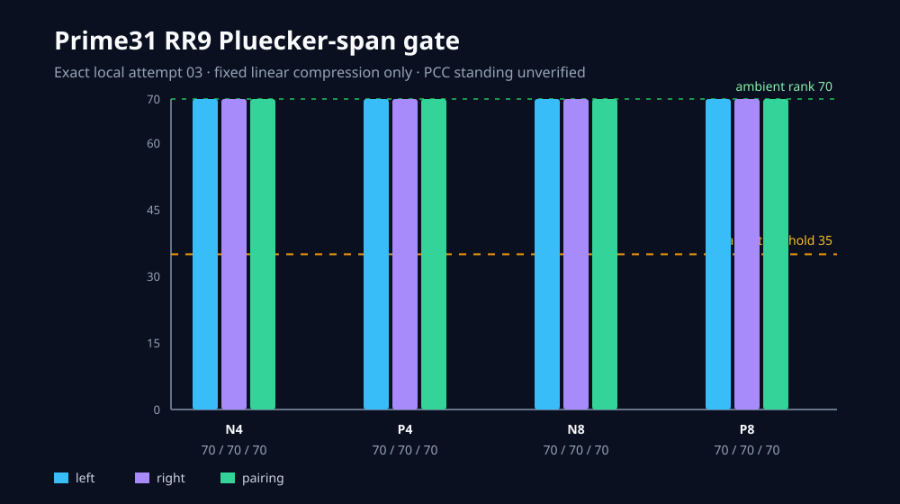

# Prime31 RR9 exterior-four span gate: local result

Date: 2026-11-19 UTC. PR #4779. Claim record
`PCC-20261119-50ffe2` has standing **unverified**. Every result statement below
is `[pcc:unverified]`.

## Outcome

All four frozen cases produced left span rank 70, right span rank 70, and
restricted complementary-minor pairing rank 70. Both B8 cases therefore meet
the preregistered `KILL_FIXED_LINEAR_COMPRESSION` rule. `[pcc:unverified]`

This result closes only lossless fixed linear compression of the registered
70-coordinate exterior-four message on these fixtures. It does not test or
disprove nonlinear indexing, Boolean/tensor SAT, F4, XL, subquadratic
orthogonal-vector search, relation yield, scalar recovery, or an end-to-end
ECDLP speedup. `[pcc:unverified]`



## Analytic strengthening

The merged companion argument proves that if each of four slots spans
`F_p^8`, multilinearity makes its four-fold wedge span all
`Lambda^4(F_p^8)`, of dimension 70. If this holds on both halves, the signed
complement pairing is nonsingular and its restricted rank is also 70.
`[pcc:unverified]`

For four signed point pairs in one slot, the exact 8x8 row determinant is

```text
16 * product_i ((x_i-r)y_i) * product_{i<j} (x_j-x_i)^2.
```

The corrected local Rust certificate recomputed all 16 unique N/P slot
determinants by both Gaussian elimination and this formula; every determinant
is nonzero. B4 and B8 reuse the same first four base points, so these are 32
case-slot certificate applications across N4/P4/N8/P8. `[pcc:unverified]`

The certificate also found 32 distinct weighted support abscissae. Therefore
the same explicit witness proves rank 70 for every finite target on this fixed
Prime31 group except at most 64 target points, for any `B>=4` support retaining
the canonical first four base points. Those exceptional points are unproved by
this witness, not counterexamples. Claim record `PCC-20261119-a9e2e9` remains
unverified. `[pcc:unverified]`

The analytic Rust validation retained three preliminary failures: unformatted
source, then two incorrect P-case frozen constants. The independently
recomputed values and companion report exposed both transcription errors;
attempt 04 passes the focused test and two byte-identical executions.
`[pcc:unverified]`

## Exact observations

| Case | Vectors/side | Examined L/R | Rank L | Rank R | Pairing rank |
|---|---:|---:|---:|---:|---:|
| N4 | 4,096 | 2,049 / 2,049 | 70 | 70 | 70 |
| P4 | 4,096 | 2,049 / 2,049 | 70 | 70 | 70 |
| N8 | 65,536 | 16,385 / 16,385 | 70 | 70 | 70 |
| P8 | 65,536 | 16,385 / 16,385 | 70 | 70 | 70 |

Every displayed rank-70 certificate has a nonzero determinant in
`producer-a.json`; the independent permutation-minor checker reconstructed all
four rank tuples as 70/70/70. `[pcc:unverified]`

| Case | Left determinant | Right determinant | Pairing determinant |
|---|---:|---:|---:|
| N4 | 1,907,250,672 | 162,115,678 | 1,293,780,219 |
| P4 | 1,573,700,009 | 732,756,365 | 1,924,240,935 |
| N8 | 76,436,789 | 1,912,721,374 | 2,107,085,659 |
| P8 | 380,450,643 | 1,399,734,726 | 1,115,076,500 |

## Controls and replay

- The deterministic random control reported ranks 70/70/70, and the synthetic
  control reported 7/7/7. `[pcc:unverified]`
- Two producer outputs and two checker outputs were byte-identical.
  `[pcc:unverified]`
- The independent checker rejected mutations of the target, source word,
  vector coordinate, pivot, determinant, and rank. `[pcc:unverified]`
- Every recorded step exit code is zero, and `SHA256SUMS` rechecks all bound
  source and output files. `[pcc:unverified]`

The producer used Gaussian 4x4 minors and Mersenne-field arithmetic. The
checker independently used permutation-expanded minors and u128 modular
arithmetic, replayed the exact span stopping counts, and checked the pairing
certificates. `[pcc:unverified]`

## Execution history and limits

The owner authorized one local run with Git-resident artifacts after the S3
resume checkpoint could not authenticate. This differs from the original
source-bound GitHub-runner venue and supplies no CI execution attestation.
`[pcc:unverified]`

Attempt 01 exited 128 before compilation because the first runner applied the
4 GiB limit during Git checkout. Attempt 02 passed formatting, original
library tests, both focused test suites, and release compilation, then exited
127 before invoking the producer because `/usr/bin/time` was absent. Both
attempts are retained in full. `[pcc:unverified]`

Attempt 03 used GNU Time 1.9 from the isolated workspace tools directory and
applied the 4 GiB limit only to producer/checker processes, matching the frozen
workflow placement. Producer A/B used 2,536/2,340 KiB peak RSS and
2.66/2.91 seconds; checker A/B used 4,500/4,496 KiB and 3.10/3.30 seconds.
These are operational metadata, not benchmark measurements. `[pcc:unverified]`

## Evidence map

- Compact machine-readable result: `SUMMARY.json`
- Exact producer outputs: `attempt-03/producer-{a,b}.json`
- Independent replay: `attempt-03/checker-{a,b}.json`
- Negative controls: `attempt-03/mutations.json`
- Source/output bindings: `attempt-03/SHA256SUMS`
- Tests, exit codes, host/toolchain, and RSS: `attempt-03/`
- Preserved failures: `attempt-01/` and `attempt-02/`
- Analytic theorem/certificate: `../RR9_SPAN_FULLRANK_SHORTCUT_20261119.md`
- Analytic local attempts: `../analytic_span_local_20261119/`
- Frozen question: `../RR9_PLUCKER_SPAN_PROTOCOL_20261119.md`
- Local waiver/amendments: `../RR9_PLUCKER_SPAN_LOCAL_RUN_*.md`

## Next discriminator

The result supplies no linear message reduction for the public-only
unknown-index B8 lane in #4692. The next separate experiment should test a
canonical Boolean/tensor encoding before committing to a SAT solve: generate
the exact predicate IR, compare bit-blasted and finite-field encodings, verify
tiny instances exhaustively, measure clause/monomial growth through B4/B6/B8,
and advance SAT only if held-out scaling beats exhaustive 16^8 pairwork after
including witness extraction and verification. `[pcc:unverified]`
