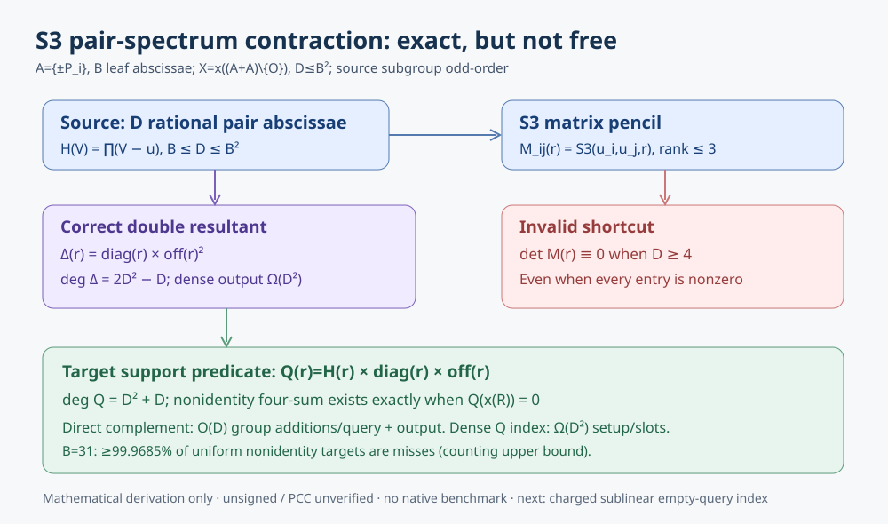

# Prime31 iteration 10 — the S3 double-resultant and rank-three trap

**Mathematical gate, 2026-11-23 UTC. [pcc:unverified]** This narrow continuation follows [merged #4951](https://github.com/isogeny-labs/crypto/pull/4951). It adds an exact structural factorization and a stronger uniform-target miss bound, **not** a new relation-finding implementation or an asymptotic speedup.



## What was derived

For the original odd-order rational pair spectrum X of size D≤B² and the classical S3, the double resultant over X is

```text
Delta(r) = Res_V(H(V), Res_U(H(U),S3(U,V,r)) mod H(V))
         = diag(r) * off(r)^2,

diag(r) = product_i S3(u_i,u_i,r),
off(r)  = product_(i<j) S3(u_i,u_j,r).
```

Each diagonal S3 has **degree one** in r, not two. Every off-diagonal factor has two **rational** roots x(S_i+S_j), x(S_i-S_j). Consequently deg(Delta)=2D²-D and the shorter target-only predicate Q(r)=H(r)diag(r)off(r) has degree D²+D and vanishes **exactly** at nonzero four-sum target abscissae (with repeated roots allowed). Full signed witness recovery still needs retained pair labels and group replay. [Complete proof](DOUBLE_RESULTANT_AND_SUPPORT.md).

A tempting but incorrect shortcut is to take a determinant of the D×D matrix M_ij(r)=S3(u_i,u_j,r). Although M has rank at most three by its explicit 3×3 quadratic coefficient pencil, **det M vanishes identically for D≥4**, even on targets where every matrix entry is nonzero. Thus low ordinary matrix rank cannot certify componentwise zero support. This is a falsifiable, representation-specific obstruction; no lower bound on all possible succinct indexes is inferred.

## Stronger exact blind-target miss cap (no sampling)

Permuting four signed leaves does not change their sum. Negating a signed multiset changes its target to its negative, and negation-fixed four-multisets necessarily sum to the identity. Counting these orbits gives at most

```text
[binom(2B+3,4) - binom(B+1,2)] / 2
```

distinct nonidentity target abscissae. At the inherited B=31 Prime31 subgroup order n=2147446831 this is:

| Quantity | Exact value |
| --- | ---: |
| Four-leaf signed multisets | 677,040 |
| Negation-fixed zero-sum multisets | 496 |
| Nonzero target-abscissa support upper bound | **338,272** |
| All nonidentity subgroup abscissae | 1,073,723,415 |
| Guaranteed missed abscissae | **1,073,385,143** |
| Uniform blind-target miss fraction, at least | **99.9684954%** |

The earlier raw ordered-tuple bound of 99.31% is true but much looser under the same signed B=31 model. This sharper cap changes how sparse a blind-query workload is expected to be; it does **not** measure successful decompositions, useful independent rank or cold ECDLP time.

## Charged alternatives

| Candidate | Setup | Empty-inclusive query | Stored representation |
| --- | --- | --- | --- |
| Existing signed pair-complement hash | O(B²) point additions + indexed labels | O(D) point subtractions/hash probes, D≤B² | O(D) pair sums and preimages |
| Full target dictionary | O(D²) group additions, plus labels/collisions | Expected O(1) membership | O(D²) explicit candidate labels |
| Dense Q coefficients | Ω(D²) field writes, plus construction | O(D²) dense Horner evaluation without further indexing | D²+D+1 field slots |
| Determinant of rank-three S3 matrix | Not an exact membership index | Invalid: always zero for D≥4 | N/A |

An idealized full B⁴ target dictionary with constant online lookup still has conditional cold exponent **4/7** for m=4, setup/space charged and uniform-target full-independent-row assumptions. The existing B² pair-complement scan has optimistic **2/3** in that model. Neither reaches the desired sub-square-root gate. The current problem remains the same: a lossless source-target index with setup exponent σ≤2 and empty-query exponent τ<1, plus complete root, sign, output and rank costs.

## Validation and custody

The source polynomial was cross-checked against `src/cryptanalysis/semaev_prime_poly.rs` (blob `123ccac36794ed3ce043e01b3a9c27ed3e2ca096`). After the proof note was committed, a local SymPy *symbolic algebra* check expanded and reduced the off-diagonal addition-law identity by y²−f(u) and z²−f(v), and expanded the diagonal identity and rank-three matrix expression. **All three residuals simplified to zero.** This is not an original-arithmetic Rust run, independent proof certificate, native benchmark or signed verifier result. Its successful second attempt and the earlier input-coercion failure are recorded in [validation notes](VALIDATION.md).

No native agent worker launcher, Rust compiler, research KB connector or authenticated EKS route was exposed. Independent GitHub read operations were parallelized by the coordinator; no worker result or elapsed-time scaling is attributed to them. The original pair-spectrum Rust/STATE/workflow/report, iteration8 and historical failures are unchanged.

**Next gate:** independently implement and exhaustively test these exact identities and their known-root/support semantics with original Rust on a source-frozen small odd-order curve, including all misses, the determinant false-positive fixture and signed duplication/rank. More importantly, seek a succinct *different* exact target index satisfying the charged σ+τ<3 criterion for m=4. The published diagram is explanatory, not timing data.

Prior work: [Semaev 2015](https://arxiv.org/abs/1504.01175), [Karabina 2015](https://arxiv.org/abs/1504.02347), [Golovnev et al. 2019](https://arxiv.org/abs/1907.08355), [Chung–Larsen 2023](https://doi.org/10.1137/1.9781611977554.ch19), [Chan et al. 2026 preprint](https://arxiv.org/abs/2610.42012). None is claimed to provide an elliptic-indexing reduction.
