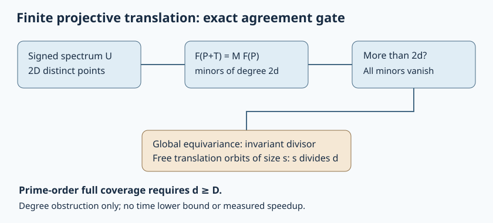

# Finite projective translation gate for the actual signed pair spectrum

2026-11-24 UTC; PR #5131; frozen source main 9ef955b17dc3b0eb1d1ac49985cf1cdb0dbf4598. Written algebra and coordinator adversarial proof review only; no independent PCC signature, formal proof, cryptographic experiment or measured speedup. [pcc:unverified]

## Candidate being challenged

Let E be the inherited nonsingular ordinary Prime31 curve over p=2147483647, with its established odd-order subgroup G (order r, not p). No new parameters or subgroup were selected. Let A be the actual signed rational base, U=(A+A) minus {O}, X=x(U), D=|X|; then |U|=2D. A possible indexing shortcut is to map U to a low-degree algebraic code F and make translation by a query T act by a single projective matrix M_T on that code, even if the identity holds only on U rather than all E. This would be a route to linear or Möbius shift reuse; it is not a necessary property of all indexes.

## Lemma (finite agreement versus translation order)

Over an algebraic closure k of the coordinate field, let F:E→P^n be a nonconstant morphism and d=deg(F*O(1))>0. Let t_T(P)=P+T where T has finite geometric point order s>1. For any M in PGL_(n+1)(k), if s does not divide d, then

    #{P in E(k): F(P+T)=M F(P)} <= 2d.                 (1)

In particular this holds for d<s. If more than 2d distinct agreements occur, then s divides d and the agreement holds as a morphism identity on the whole curve. [pcc:unverified]

Proof: put L=F*O(1), L'=t_T*L; both have degree d. Pull back homogeneous coordinates to basepoint-free sections a_i of L' for F∘t_T and b_i of L for M∘F. Agreement is the simultaneous vanishing of a_i b_j-a_j b_i, each a section of L'⊗L of degree 2d. If any is nonzero, its effective zero divisor has total degree 2d, proving (1) as a bound on distinct points even with inseparability or multiplicity. If all vanish identically then the two morphisms agree everywhere, since both systems are basepoint-free. This argument also handles infinity and does not divide by an affine denominator.

For global agreement, the linear span W of F(E) is M-invariant: translation is surjective, so M F(E)=F(E). Restrict M to W to make the image linearly nondegenerate. Since k is algebraically closed, the dual linear transformation has a nonzero eigenvector l, hence an invariant hyperplane H in P(W). Its pullback Z is an effective divisor of degree d, not the whole curve (nondegeneracy), and t_T*Z=Z as divisors, including multiplicities. Translation acts freely on geometric points, every orbit has exactly s elements, and multiplicities are constant on each orbit. Therefore s divides d. Contradiction if s does not divide d. This proof uses no assumption of separability, diagonalizability or generic distribution. It is a scoped application of standard divisor and line-bundle facts, not a novelty claim.

## Application to the actual pair support

For a nonzero shift in a prime-order subgroup of order r, a nonconstant code of d<r can agree on at most 2d distinct signed inputs. Thus a single projective shift rule valid for all 2D elements of U requires d>=D (also true when d>=r because 2D<=r-1). For an odd composite subgroup use the actual shift order s; when s<=d and divides d, (1) does not exclude full agreement. A fixed degree d cannot cover an expanding full signed spectrum with large-order shifts. For an x-only rational map phi of degree delta on P^1, F=phi∘x has d=2delta; a full signed shift rule in the prime-order case therefore requires delta>=ceil(D/2). The ordinary x-coordinate alone has d=2, so a single Möbius rule can agree on at most four geometric points for any shift of order >2. This is not a count of M31 hits or a measured fibre histogram.

The same per-shift reasoning applies to a finite chart cover by nonconstant codes F_j of degrees d_j with a specified projective M_j for each chart. If no d_j is divisible by s, full coverage of U forces sum_j d_j>=D (union bound on agreement sets). Overlap cannot improve coverage. For prime r the same total-degree necessity holds if any d_j>=r. Chart assignment, matrix derivation, verification, storage, rationality, duplicate buckets and signs would need to be priced separately. No claim about arbitrary rational correspondences or implicitly represented high-degree codes follows.

## Adversarial review and cost boundary

- Constant code is excluded: d=0 and all points can agree, but it provides no discrimination. It cannot serve as a standalone lossless code.
- Omitted points and affine poles reduce the number of claimed agreements. Rational maps from the smooth complete curve extend to morphisms after removal of basepoint factors; count actual pullback degree, not a naive input polynomial degree. A partial chart that never evaluates the exceptional points cannot claim full coverage.
- Global equality really implies an invariant effective divisor, not just a linearly equivalent one. The eigenhyperplane is essential; arbitrary hyperplanes need not be invariant. If the original image is degenerate the span reduction is essential.
- Inseparable maps and unipotent matrices do not break the divisor argument. A translation by a small-order point can have d a multiple of its order; do not extend the large-order exclusion to that case.
- This gate does NOT exclude a high-degree but logarithmic-depth Dickson circuit, nonlinear target-dependent lookup, one-sided hash filter correct only on true pairs, different chart transitions, arbitrary table encodings, or another exact S3 contraction. In particular degree is not circuit evaluation cost and neither sum d_j nor d is a lower bound on time or storage without extra assumptions. A finite-field label equality that is not a projective morphism equality is outside the lemma.
- No D value was inferred from B=31. D<=B^2 is a cap, not a census. No scalar labels or target witnesses were generated. Coordinate p and subgroup r remain distinct.

For exact nonidentity target R the maintained baseline checks U∩(R-U), plus the zero-pair branch when R belongs to U. A full candidate must price setup, empty queries, signs, repeated leaves, duplicate recovery and proof traffic. This note rejects only a low-degree full-support projective shift oracle. It does not improve the current ~O(D) signed scan or establish theta<1 (component) / theta<1/2 (conditional pipeline). No Rust implementation selected. [pcc:unverified]

## Validation handoff

Independent reviewer should check (a) degree of each minor section, (b) exact span invariance, (c) eigenhyperplane noncontainment, (d) orbit multiplicities and characteristic-p case, (e) the 2D distinct signed inputs, and (f) x-map degree two. A later M31 Rust control, only after source freeze/admission and explicit seed manifest if randomized, can enumerate the actual U and test a specified F,M_T with all signs, O/poles, all agreement counts and compare exact signed scan. Freeze public curves, source, targets, masks and candidate matrices; do not reroll. A/A and paired timing controls are mandatory if timing is proposed. That would be a falsification control, not a proof of an asymptotic query or a performance claim. No random experiment, native Rust execution, or paid job occurred here; seed manifest is not applicable to this written proof.

## Sources and coordination

Pinned upstream notes: iteration10/torus_rotation_followup/NO_SINGLE_COVER_FFT.md blob 10fa37933284834afa839d721e33aaed56f7aa1d; quotient_degree_followup/BOUNDED_DEGREE_QUOTIENT_GATE.md blob 7fa53b286259ab7062c2cee97e614b275b1eb4df; quotient_followup/DICKSON_PAIR_NORM_REVIEW.md blob 953b48e251bdbd6fce9b7748cd4b05c5d60afb7c; problems/prime31-exact-pair-spectrum-query.md blob 2c98ef25c8ae6fb815776720571800587889dad5. Prior two PRs #4977 and #4979 were observed merged, so no maintenance or merge attempt. The finite-agreement result concerns elliptic translation rather than torus-shift lifting or the previous single-coordinate fibre-count dimension bound. Literature: [Stacks Project, Degrees on curves §33.44](https://stacks.math.columbia.edu/tag/0AYQ) (degree/sections), [Semaev 2015](https://arxiv.org/abs/1504.01175) (chained summation baseline). GitHub search of Prime31 projective translation, rational hash/pair-spectrum and equivariance returned no specifically matching successor; not an exhaustive novelty audit. KB/Conductor and native worker dispatch were not exposed. Coordinator parallelized repository reads and did the written proof/adversarial review; no independent worker or signed verdict. No PCC issuer executed; retain unverified standing.

Next gate: seek a different exact target-to-fibre selector or a non-projective, source-specific contraction with charged miss and output bounds. Keep rank and original-source execution gates separate. Impact score: 4/10 — new scoped written obstruction for low-degree projective shift codes, no independent validation or faster query. [pcc:unverified]
