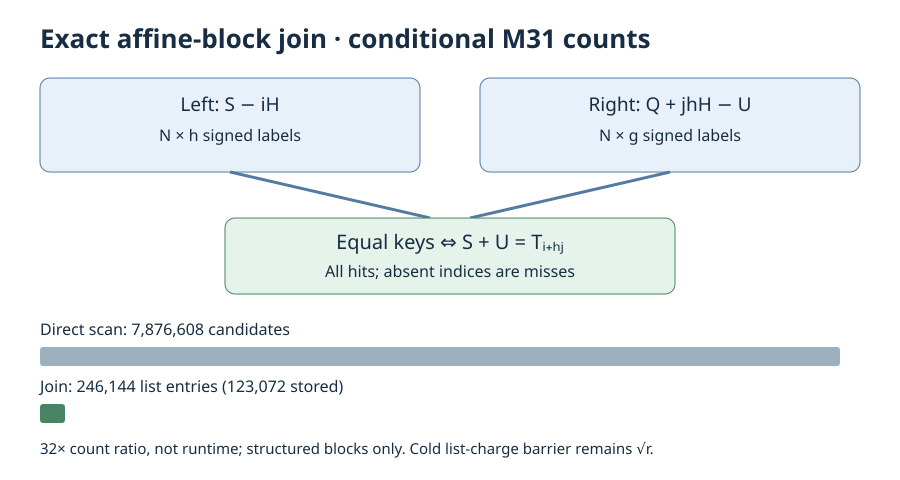

# Exact affine-block pair-spectrum join and its charged first-hit barrier

2026-11-25; disjoint mathematical continuation of draft PR #5131 at a5ec913a36c6f4d6188b927b25476bb2b7285e4f. Written producer derivation [pcc:unverified]. This is an exact structured-batch comparator, not a new arbitrary-target S3 solver or an achieved non-generic speedup.

## Input and prior art

Keep the inherited ordinary cofactor-one M31 source: p=2147483647, a=847514846, b=2087444724, r=2147446831, G=(625037715,2100627251). Parameters are inherited from chord_slope_gcd/GATE.md, not recertified. No new curve or field computation. Let A={+/-P_i}, Y=A+A including O, D=|x(Y minus O)|, N=|Y|=2D+1. All signed pair buckets retained. Work in the prime-order subgroup, not coordinate-field scalar arithmetic.

The previous moment gate provides a diagnostic for arbitrary batches, not exact collision reporting. The prior generic_collision_followup/GATE.md treats fresh uniform individual queries with a fixed storage cap and explicitly leaves structured target generation outside its proof. We now price one structured batch architecture. This uses standard interval meet-in-the-middle/baby-step giant-step ideas, not a novelty claim. Primary background: Galbraith, Wang and Zhang, DOI https://doi.org/10.3934/amc.2017038 (publisher introduction, interval BSGS, simultaneous inversion and signed arithmetic); Bohman, Cooper and Frieze, DOI https://doi.org/10.37236/1504 (affine permutation family in abstract). Repository default-branch searches for arithmetic progression target, baby giant target batch, affine target progression, target grid, batch target interval found adjacent trace_incidence_20261116/setup_20261123 progression-pool generation, prime_target_batch_20261116_v95b discriminant caching and multi-target BSGS controls; no claim of exhaustive prior-art search. Shared KB/Conductor and native worker dispatch unavailable.

## 1. Exact batch join, including every miss

For positive integers h,g, let M=hg<=r. Public block targets are T_k=Q+kH, 0<=k<M, with H a nonidentity subgroup point. Every k is uniquely i+h*j, 0<=i<h, 0<=j<g. Since H has order r, all T_k are distinct.

Construct a dictionary from keys S-iH, for every S in Y and i in [0,h), retaining all (S,i) labels even on collisions. Enumerate keys Q+jhH-U for all U in Y, j in [0,g), and report every equal-key label pair.

    S-iH = Q+jhH-U   iff   S+U = T_(i+h*j).

This is a bijection between ordered point splits and join records: no free discrete-log labels, no field-root extraction, no spurious hits or missed targets, including identity, tangent and cancellation cases. A non-hit index has no record. Unordered split reporting can canonically retain S<=U in a fixed public signed-point order; all original leaf buckets must be expanded and normalized/deduplicated if that is the output contract. Equality of x alone is insufficient; use exact signed keys and an infinity sentinel. Distinct-index restrictions require explicit leaf-label tests. A miss is certified by complete execution of the join on an authentic spectrum, not by trusting the sparse output alone.

Building Y costs O(B^2) point operations and label storage as before. For each block, hH, Q and H are charged (if public scalar-generated, include their generation). Consecutive signed keys are formed by exact additions/subtractions; include normalization/inversions and equality checks. This generates N(h+g) list entries versus NM direct-complement candidates for the same block. One stored side needs Nh labels (choose the smaller side) and the other may stream. Group-operation, expected dictionary lookup and record-processing costs are O(N(h+g)+Z) for Z ordered point-split matches; deterministic sorting or balanced dictionaries add logarithmic factors. Explicit all-M status or target materialization adds O(M), whereas the sparse output plus the agreed block descriptor represents every miss without enumerating target statuses. Charge leaf-label expansion, deduplication, authentication, and any rank/certificate traffic separately. With h,g approximately sqrt(M), the join component is O(N sqrt(M)+Z) and storage O(N sqrt(M)) beyond source buckets. This does not supply a near-linear-space exact sublinear single-query index, and it requires a different target workload.

For a nonrectangular requested length one can use a full rectangular prefix and one smaller rectangle or filter the final baby-index range before label expansion; the stated counts use exactly M=hg, so no uncharged padding or wrap duplicates.

## 2. Uniform marginals and exact rank-hit probability

For the mathematical sampling model only, take Q=uG with u uniform in Z/r and H=vG with v uniform in (Z/r)^*, independently. A fixed public group shift can be added to Q without changing the distribution. For different i,j in [0,M), the map (u,v) -> (u+i v,u+j v) is a bijection onto ordered distinct residues because j-i is invertible modulo the prime r. Thus the targets are marginally uniform, pairwise uniform without replacement, but NOT jointly independent.

For a current fixed row span W let L_W be any fixed set of J>0 useful target points, defined by existence of an admissible rank-extending witness under the required output contract. Let X count indices whose target lies in L_W. Write f=J/r and mu=Mf. Then

    E[X]=mu,
    Var(X)=M f(1-f)(r-M)/(r-1),
    Pr(X>0) >= mu^2/(mu^2+Var(X)) >= mu/(1+mu).

The variance follows from Pr(T_i,T_j both useful)=J(J-1)/(r(r-1)); the probability bound is Cauchy--Schwarz on X*1_(X>0). It holds for an arbitrary fixed useful set, not an independence or random-factor-base heuristic. Including O as an ordinary possible draw is intentional; the useful set may exclude O. If complete output is available, any useful hit supplies at least one rank extension. Conditional on W and fresh independent block coins, M>=r/J gives probability at least 1/2. It does not guarantee B independent rows from one block, nor apply to first-witness selection unless L_W is defined for that actual selector. For each ordered (S,U) in Y^2 the probability that its sum belongs to the block is M/r. Thus E[Z]=M N^2/r even with collisions; Z is a point-split count, not leaf tuples, independent rank, or target count.

No randomized draw was performed. For a future benchmark, freeze evaluator-owned block parameters and paired ordered public points and labels, independent replicate blocks and their seed/stream mappings before execution; compare the direct scan and join on the SAME progression blocks. Use a separate, labelled independent-target reference to audit workload changes. Correlated indices are not independent trials; intervals/uncertainty must be at block or independent-replicate level. The evaluator must withhold any target-answer-revealing scalar metadata from solver inputs. Existing seed/approval/resource rules remain binding.

## 3. Scoped cold first-hit price: batching alone cannot beat the square-root scale

For each freshly built, fully charged block with M=hg and uniform origin Q conditional on the pre-block history, even a fixed nonzero step H gives

    Pr(any representable target in block | history) <= M |Y+Y|/r <= M N^2/r.

If c=N(h+g) is the charged list-entry count for that whole block, AM--GM gives M N^2 <= c^2/4. For any schedule (possibly adaptive after misses) of these full block joins with a deterministic total charged entry cap C, the conditional union bound and sum(c_i^2)<=C^2 give

    Pr(at least one hit) <= min(1,C^2/(4r)).

This counts first representable target, before useful rank, output, or scalar recovery. To obtain at least 1/2 success probability within this architecture necessarily C>=sqrt(2r). This is a lower bound on a specified full-list charge model, NOT on arbitrary elliptic algorithms, early-exit/partial list schemes, reused cross-block indexes, nonuniform planted targets, compressed non-enumerative operations, or a bound on elapsed time. Source setup and output add cost. It is consistent with the generic collision obstruction and explains why the apparent amortized sublinear target scan does not alone deliver a cold asymptotic advantage.

## 4. Conditional M31 calibration (counts only)

Using archived B31 D=961 as a conditional input, N=1923, h=g=64 and M=4096:

| Quantity | Exact count / model expectation |
|---|---:|
| Direct signed complement candidates | 7876608 |
| Join generated list entries (both sides) | 246144 |
| Stored-side labels | 123072 |
| Ratio of the two differently scoped counts | 32 |
| Expected ordered point splits on fresh affine block | 7.053360747 |

The 32 is an entry/candidate count ratio, not runtime, measured cost or a comparison to the strongest independently optimized baseline. The inherited all-output J>=1922 floor (sumset_rank_floor) would only guarantee mu>=1 at M>=1117299, before rounding to a rectangle; this reinforces that the 4096 panel is not a guaranteed rank-positive panel. Half-success necessary total full-list entries in the scoped model: >=65536. None of these numbers is an empirical result. No actual M31 curve points were processed.

## 5. Validation and next gate

CHECK.js replays 16 integer-scaled variance identities at predeclared M31-order count values, 4096 integer mixed-radix indices, exact count ratio, rank-floor block threshold and necessary budget rounding. The same coordinator executed these deterministic combinatorial arithmetic checks in JavaScript; no native cryptographic computations, tests, timing or random experiment. No seed manifest applicable. Independent native/Lean/PCC verification remains outstanding. Original-source Rust validation (only after ownership and admission) must compare complete signed split sets and expanded witness/rank outputs against the original complement oracle, include all empty indices and collisions, and test the authentic inherited curve and public block construction. Do not duplicate #5128 root qualification or #5157 alternate-curve benchmark. 

The next research gate is still an actual Dickson-specific coordinate contraction which beats the full-list work without requiring structured target generation, or a priced alternative batch predicate that evades the above explicitly scoped charge model. Preserve single-query exact S3 and complement baselines. No new production edits, paid jobs, merge, signed claim or Space mutation; previous Space read required interactive input. Coordinator parallelized independent repository reads; native workers unavailable. Branch and main logs retained separately pending normal integration.

Impact score: 4/10 — exact structured-batch reporting comparator with a proved uniform-marginal rank-hit bound and a scoped cold first-hit obstruction. No independent execution, measured speedup, or arbitrary-target sublinear extractor. [pcc:unverified]
