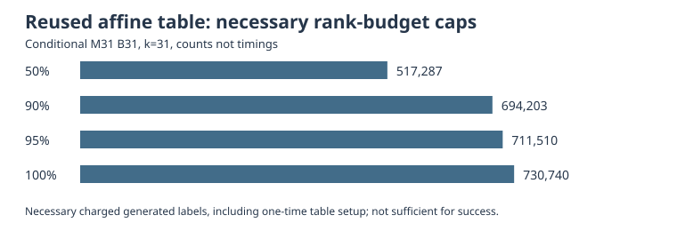

# Reused affine-block table: cold rank-budget bound

2026-11-25; disjoint mathematical continuation of draft PR #5131 at 1a6851a797938aef57ea47e0f47b89db9d87c6f9. Written producer derivation [pcc:unverified]. This closes a specific reuse loophole in affine_block_join/GATE.md, not a universal data-structure lower bound.

## Source and scope

Inherited M31 p=2147483647, a=847514846, b=2087444724, r=2147446831, G=(625037715,2100627251), cofactor one, B31. No new field or curve computation. Let Y=A+A be the signed distinct point spectrum including O, N=2D+1. Preinclude the authentic homogeneous pair-collision span W from homogeneous_quotient_followup/GATE.md (charged separately), and let k be the initial coefficient-rank deficit. For known-RHS rows or the coefficient-only contract, all zero-target rows lie in W. The same argument applies to an augmented system only if the zero target adds no new appended direction and k denotes the appropriate deficit. Do not claim rank-completeness for strict-only rows without W on both arms.

Sources: affine_block_join/GATE.md blob 999276d36d89d84df56b1e3979655c817c99a607; homogeneous_quotient_followup/GATE.md blob c0ce8350ac0e9affa6f5457e3b83027bcb7fe5a8; rank_output_contraction/GATE.md blob f95d9b81f4c646c6bd1577c781dff804ae2577da. Primary interval BSGS: https://doi.org/10.3934/amc.2017038 (abstract and introduction, classical reused tables and negation); different advice model https://people.eecs.berkeley.edu/~henrycg/pubs/eurocrypt18discrete/ (abstract, not imported as theorem). Default-branch searches "affine block join reusable rank budget", "baby giant reused table rank relation" found adjacent stride and matched APS/BSGS work; read STRIDE_COST_GATE.md and APS_VS_BSGS_COLD_RESULT_20261116.md at 53df0c3d. No exhaustive novelty claim. KB/Conductor/native agent tools not exposed.

## 1. Explicit reuse model

Allow the baby table for H to persist over arbitrarily many independent origins Q_j. Block j chooses width h_j and giant count g_j before Q_j is drawn, using all previous history. Require H nonidentity and h_j*g_j<=r. Q_j is uniform in the full subgroup conditional on history and these choices. All S-iH labels are generated and retained for i<h_j; all U-side translated labels for each giant index are enumerated. Charge every generated labelled entry, even when several labels share a point key. Allow adaptively extending a table or switching to another charged table with a different step, with no free labels. For one reused prefix table let Htot be the total number of generated full N-label baby slices (max h_j if extended once per slice). With multiple charged tables count all their generated slices. Let Gtot=sum_j g_j. Then h_j<=Htot and sum_j h_j*g_j<=Htot*Gtot pathwise. The cold list-entry cap C is N*(Htot+Gtot), or an upper bound on it. This deliberately charges reuse once, not once per block. Partial scans, compressed generation, free external advice, post-origin adaptive choice of offsets and uncharged cross-table relabelling are outside the model.

## 2. Rank bound including all collisions and adaptive blocks

There are N(N+1)/2 unordered point splits, with repetition, from Y. Exactly (N+1)/2 sum to O because Y=-Y and the subgroup has odd order: (O,O) and one {S,-S} for each nonzero opposite pair. Let K=(N^2-1)/2 count the remaining splits, including diagonal doubles.

Within a fixed matched split, every possible leaf coefficient row has the same image in the quotient by W, by the prior homogeneous quotient proof. Thus at most ONE incremental rank direction is supplied per nonzero matched unordered split, even if the target has many leaf witnesses. Distinct-index restrictions can only reduce the count. Zero targets supply no increment under the stated contract. This is a necessary condition for full rank, not equality of rank and count.

Conditional on block history and fixed h_j,g_j,H_j, each of the K nonzero unordered splits has probability h_j*g_j/r of appearing in that block, since Q_j is uniform and the progression has distinct targets. Hence if R_j is incremental useful rank,
    E[R_j | history] <= K*h_j*g_j/r.
Repeated targets across blocks, repeated directions, inadmissible outputs and dependent rows only decrease R_j. No independence of targets WITHIN the block is needed. For an adaptive stopping schedule of complete blocks, sum conditional bounds using nonnegative sums and the pre-origin measurable decision to attempt each block. With deterministic total list cap C,
    E[sum R_j] <= (K/r) E[sum h_j*g_j]
                 <= (K/r) floor(floor(C/N)^2/4).
Markov's inequality therefore gives
    Pr(rank deficit k eliminated by C)
      <= min(1, K floor(floor(C/N)^2/4)/(r*k)).
A necessary charged cap for success probability epsilon is
    Htot*Gtot >= ceil(epsilon*r*k/K) in the optimal cap sense,
    C >= N * min{s integer : floor(s^2/4)>=ceil(epsilon*r*k/K)}.
The continuous relaxation is C >= sqrt(8 epsilon r k N^2/(N^2-1)). For k growing and fixed epsilon this particular architecture needs Omega(sqrt(r*k)) charged labels, even with reused tables and collision-heavy buckets. This strengthens the earlier first-hit-only bound for the stated rank contract. Not a runtime bound or a generic group lower bound. W computation, source construction, normalization, hashes, proof/output and LA add costs. If k falls because of useful homogeneous rank found outside these joins, charge that acquisition and use the residual deficit; no universal k=B assertion.

## 3. Conditional M31 calibration

Using the archived D=961, N=1923, W=0 and k=31 coefficient deficit conditional on the earlier census, K=1848964. For a single M=4096 block, E[incremental rank]<=3.5266794198 and Pr(full coefficient rank)<=0.1137638523. These are upper bounds, not observed rank or likelihood estimates.

| Necessary success probability | Minimum product ceil(epsilon*r*k/K) | Minimum full-list entry cap |
|---|---:|---:|
| 50% | 18003 | 517287 |
| 90% | 32404 | 694203 |
| 95% | 34205 | 711510 |
| 100% | 36005 | 730740 |

The final row is a necessary deterministic cap for sure success, not a sufficient guarantee or expected runtime. The earlier 32x batch count reduction remains exact for its two differently scoped counts; it is not evidence of full-rank collection. Table reuse does not circumvent this charged rank budget within the specified model. It remains legitimate for amortized work, and non-enumerative coordinate predicates are not ruled out.

## 4. Validation and next gate

CHECK.js verifies the integer rounding for the four thresholds, the symmetric split count, and the 4096-block rank upper bound. Same-coordinator deterministic count arithmetic, no randomized draws, group arithmetic, timing, native execution, independent review or seed manifest. The receipt records this scope. No new production source, jobs, merge or paid compute. #5128 owns native qualification and #5157 the alternate-curve timing arm. Preserve the source-exact complement and full output controls. Future comparison must charge construction and reuse in both arms, replay the same progression blocks with evaluator-owned metadata, record independent block-level seeds and uncertainty, and test mutual span inclusion relative to W, not just count.

The next gate is a coordinate-based selector which avoids generating all translated labels, or an independently challenged algorithm for a different charged architecture; do not rerun the reuse proof. The current exact arbitrary-target sublinear query remains open.

Impact score: 3/10 — scoped reused-table rank-budget extension and exact integer calibration; not an independently validated result or faster extractor. [pcc:unverified]
