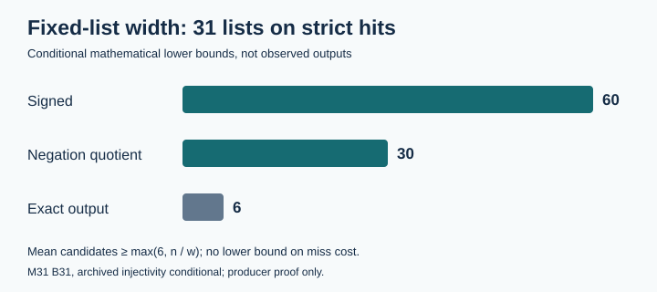

# Prime31: exact Boolean cover and one-sided fixed-list width gate

2026-11-24 Pacific; PR #5131; parent 0dcb00249e9e6e09644cac1c16c2292579f5b2dd. Written producer proof, [pcc:unverified]. No field experiment or timing.

## Model and hypotheses

Reuse the inherited ordinary cofactor-one source: p=2147483647, a=847514846, b=2087444724, r=2147446831, G=(625037715,2100627251), B=31. Assume the archived injectivity of the even weight <=4 coefficient nets, conditional on historical run 44215701063 and its source reconciliation. The prior signed incidence gate identifies full matrices C,Cx and strict distinct-index matrices M,Mx. A strict row contains exactly six true pair columns. The signed strict matrix has n=4*C(B,2) columns and the orbit matrix n=2*C(B,2). Each column has t=4*C(B-2,2) true rows in its respective row universe.

A fixed-list Boolean filter has w fixed subsets L_i of pair columns. For any target, it selects an arbitrary subset of lists (possibly by adaptive or nonlinear logic) and emits their union. Exact filtering requires this union to equal the true row; one-sided filtering only requires it to contain every true column. The activation rule, construction, list storage and checking are not presumed free. This is a model of OR-list reporting, not every data structure or every Boolean circuit.

## 1. Exact Boolean width

An exact representation is a cover by all-one rectangles: each list is the column side, and its activation targets are the row side. For C and Cx the unit triangular minor from the previous gate has n true diagonal entries; two distinct diagonal entries cannot be covered by a single all-one rectangle, since at least one cross cell is zero. Hence at least n rectangles are necessary and the singleton-column representation attains n.

For strict M and Mx, two different columns have at most 2(B-3) common rows for B>=4. For signed columns with one shared leaf and compatible signs, choose the remaining index and either sign; disjoint columns have at most one common row, same-support distinct columns none. For orbit columns, orient at the shared leaf, giving the same shared-index count; disjoint orbit columns have two possible relative signs modulo simultaneous negation, and same-support different relative signs cannot coexist. These are counts of rows under injectivity, not solver-accessible scalar labels.

Every all-one rectangle with at least two columns has at most six columns (strict row weight), and its row side has size at most 2(B-3). Its area is therefore <=12(B-3). For B>=8 this is <= t=2(B-2)(B-3). A singleton-column rectangle also has area <=t. The total number of true entries is nt, so at least n rectangles are necessary. Singleton columns attain this bound even with arbitrary overlap permitted. This proves exact Boolean rank n for both strict matrices in this range, without relying on field rank or the characteristic. At B31, t=1624 and the multi-column rectangle area cap is 336.

## 2. One-sided filter: average candidate-list lower bound

Let s_j=min{|L_i|:j in L_i}. Every column occurs in some true row and hence in at least one list, so the minimum exists. For each column j select a smallest containing list; break ties by a fixed ordering. If g_i columns select list i, |L_i|>=g_i and sum_i g_i=n. Thus

    sum_j s_j = sum_i g_i |L_i| >= sum_i g_i^2 >= n^2/w.

For a strict row T with six true columns J(T), every j in J(T) must be covered by at least one activated list. Its entire list is included in the candidate output F(T), so |F(T)|>=s_j for each such j. Consequently

    |F(T)| >= (1/6) sum_{j in J(T)} s_j.

Average over uniformly chosen strict positive rows, using regularity (each column occurs t times and 6 times row_count = nt):

    E[|F(T)| | strict hit] >= (1/n) sum_j s_j >= n/w.

Also the mean is at least six. Subtracting six gives a nonnegative lower bound max(0,n/w-6) on mean false candidate count. This covers overlapping lists, arbitrary target-dependent activation, duplicate elimination in the union, and arbitrary computational strength of the activation procedure. It does not cover intersection/refinement before emission, succinct symbolic outputs not individually checked, or algorithms that only need one witness rather than complete pair-column reporting.

For w=31, the signed strict n=1860 gives at least 60 mean candidates and at least 54 false candidates; the orbit n=930 gives at least 30 and 24. Those are 10x and 5x the exact six-column output size, not measured work or runtime. More generally w=o(n) forces a diverging mean candidate count on strict hits. This is conditional on uniformly sampled strict positive rows and the archived injectivity; no conclusion on the overwhelmingly dominant misses follows.

## 3. Additional one-sided finite audit on full triangular minor

On the selected n by n triangular minor, assign each true diagonal to a covering rectangle. Let the sizes of these groups be g_i. Every rectangle contains the square block of rows and columns of its assigned diagonal entries, and the groups' blocks are disjoint. They include at least sum_i g_i^2 cells. The total number of true cells anywhere in the minor is 2n-d, where d is the number of double-column pivots (2B signed; B orbit). Thus the number of distinct false cells in the union is at least

    max(0, (w-b)*a^2 + b*(a+1)^2 - (2n-d)),

where n=wa+b, 0<=b<w, by convexity and integer balancing. At w=31: signed n=1922,d=62 implies >=115382 false cells; orbit n=961,d=31 implies >=27900. This is on witness-chosen audit rows only, not an average over natural targets. Off-diagonal cells cannot be hidden by overlaps since the assigned square blocks are disjoint.

## 4. Decision and challenge

Do not pursue exact sublinear-width fixed OR-list compression on the archived fixture. For a one-sided filter, price the deduplicated candidates and exact signed replay; a small number of lists does not imply a small positive output. Nevertheless even a large positive-only lower bound can be negligible when weighted by the very small natural hit probability. No miss-time or general query lower bound, no faster solver, and no asymptotic claim outside a growing injective family. Nonseparable indices, nonlinear predicates, intersections of dynamically selected lists, and genuinely succinct high-degree evaluation remain open. Native source qualification stays with #5128, no duplicate execution. Next: seek a different empty-inclusive selector rather than extending the same fixed-width representation.

Validation preparation: the prior unit minor plus strict row/column weights and pairwise overlap counts give an exact evaluator-side fixture; the candidate may not receive witness labels. Arithmetic below is deterministic integer accounting, not a cryptographic experiment. No field arithmetic was executed, no new seed panel needed, historical A/B provenance not requalified. No native Rust or Lean test, independent worker, PCC signature, paid job, or merge. Native dispatch, KB and Conductor tools not exposed; coordinator used parallel reads and a same-producer proof challenge. Main and branch journals differ; keep both at integration. Space not mutated.

Prior art checked: rectangle cover definition and triangular-minor lower bound in Proposition 2 of https://www.math.ias.edu/~avi/PUBLICATIONS/MYPAPERS/SAKS/KCOVER/JOURNAL/kcover.pdf ; standard fractional cover literature https://doi.org/10.1137/S0895480192238482 ; Boolean factorization distinctions https://doi.org/10.1145/3522594 . No novelty claim. Repository sources: ../signed_incidence_rank/GATE.md and RECEIPT.json; ../historical_collision_reconciliation/RECEIPT.json; problems/prime31-exact-pair-spectrum-query.md. Bounded open PR search for pair-spectrum and Boolean found no match; not an exhaustive priority audit.

[Illustrated PDF](REPORT.pdf)

Impact score: 3/10 — conditional Boolean width and one-sided candidate-output lower bounds extend the numeric-only gate; no independent native validation or faster misses. [pcc:unverified]
