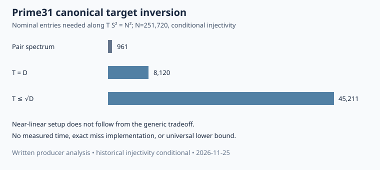

# Prime31 canonical strict-target inversion: charged tradeoff audit

2026-11-25; parent 550972be7b7c1c29defd1ed744eea6d1e09b85a9; draft PR #5131. Written producer analysis, [pcc:unverified]. No algorithm execution.

## 1. Canonical domain, not free scalar labels

On the inherited ordinary cofactor-one curve y^2=x^3+847514846x+2087444724 over p=2147483647, r=2147446831 and G=(625037715,2100627251), consider strict four-distinct-index support. Fix the sign of the smallest of four sorted distinct indices to +, leaving eight sign patterns per four-subset. Each domain element maps to the abscissa of its signed four-point sum, with a separate identity symbol. This is an explicit public-coordinate function with N=8*C(B,4); evaluating it needs three group additions and an affine conversion, not a discrete-log label. Domain indexing is combinatorial. Under the archived B31 even-weight-net injectivity assumption, every strict sum is nonidentity and the function is injective: equality of abscissae means equality or negation of the points, and canonical sign fixes global negation. Hence N=251720 and maximal indegree Delta=1. Without that assumption the function still exists but Delta and collision handling must be priced, and one cannot assert injectivity for larger bases.

This is a strict-support query only. A complete witness requires recovering orientation against the actual signed target and expanding the three unordered pair partitions, plus original arithmetic replay. Unrestricted repeated-index and zero-subtotal output require separate coverage. No runtime or field experiment performed. [pcc:unverified]

## 2. Translate the published tradeoff, rather than assume cheap setup

Vannimmen, *From Function Inversion to Preimage Reporting* (arXiv:2611.09656, 6 Nov 2026), states in the accessible primary abstract a general time/space guarantee TS^2=N^2 Delta for preimage reporting. Fiat--Naor (SIAM J. Comput. 2000, DOI 10.1137/S0097539795280512) gives a collision-probability-dependent inversion tradeoff. For an injective function its collision probability is 1/N, giving the same nominal expression. These are algorithmic guarantees, not universal lower bounds. We did not access full implementation/preprocessing/error parameters of the new reporting paper, and do not claim an exact Las Vegas miss guarantee from its abstract.

In this favorable conditional canonical domain, the nominal curve is T=(N/S)^2. Ignore polylogarithms, constants, implementation overhead, construction, error amplification, and certificate traffic ONLY for this cost-model screen. The actual pair-scan baseline uses D=961 negation orbits (1922 signed points). Units here are abstract domain evaluations / data-structure entries, not field operations or elapsed time.

| S (entries) | Nominal T | Interpretation |
|---:|---:|---|
| 961 | 68610.20 | comparable orbit-table entry count, much larger nominal query budget |
| 8120 | 961 | first nominal crossover with D |
| 45211 | below 31 | nominal square-root-of-D threshold |
| 251720 | 1 | full canonical target table |

Exact integer checks: N=8*31465=251720; D=31^2; N=8120*31; (45210)^2*31 < N^2 <= (45211)^2*31. S=8120 is 8.45 times D, and S=45211 is 47.05 times D. This is an illustrative substitution in a tradeoff, not measured query work, a recommended budget, or a lower bound on any particular implementation. Output-sensitive variants may improve other regimes, but must be evaluated at actual misses and charged construction.

## 3. Growing-family implication

In a hypothetical injective strict family with D=Theta(B^2), N=Theta(B^4)=Theta(D^2), set S=D^s, 1<=s<=2. The above guarantee has nominal query exponent 4-2s in D, and storage materialization alone charges at least S entries. Comparable near-linear D storage (s=1) yields nominal D^2 query work, worse than the scan. Sublinear nominal query requires s>3/2; the stronger D^(1/2) threshold requires s>7/4. In the stated conventional pipeline model, translating the optimistic cost schedule gives alpha=2s (pricing only S writes and B^2 matrix work) and tau=8-4s. Its sum is 8-2s>=4, so this schedule does not meet alpha+tau<3, even before construction and miss/output verification. The full-table endpoint gives the previously known optimistic exponent 4/7; no new asymptotic gain. This is a screening calculation for the advertised cost schedule, not a lower bound excluding better inversion algorithms, alternative batch models or all succinct representations. [pcc:unverified]

## 4. Decision and validation

Keep generic function inversion as a priced offline/many-query comparator, not the proposed near-linear-setup solution. The next technical gate must lower the effective domain or exploit structure of actual point coordinates without encoding all strict targets, and must recover exact outputs including misses. No native execution or new seed manifest: only written proof and deterministic integer arithmetic. Existing #5128 owns root qualification; no duplicate job. No source or seed changes to historical evidence, no paid work, no independent verification, no PCC issuance or signed promotion. Native worker dispatch, Conductor and research-KB not exposed. Coordinator performed parallel repository reads and checked the algebra. Space unchanged.

Sources checked: previous historical_collision_reconciliation/RECEIPT.json and pair_path_invariants/GATE.md; prior boolean_list_filter_gate/GATE.md; named problem; https://arxiv.org/abs/2611.09656 (primary abstract, full details not reviewed), https://doi.org/10.1137/S0097539795280512, https://arxiv.org/abs/2610.17420 (primary abstract: integer or fixed-exponent group cases, not a charged elliptic coordinate reduction). The latter does not establish a uniform reduction for growing prime-order elliptic curves. Bounded open PR searches for Fiat and preimage reporting returned no matching results; KB unavailable, no novelty claim. Preserve divergent main and branch tracker/journal histories.

Impact score: 3/10 — new conditional canonical-domain cost calibration distinguishes a plausible generic comparator from the near-linear-setup query goal; no native result or faster extractor. [pcc:unverified]
