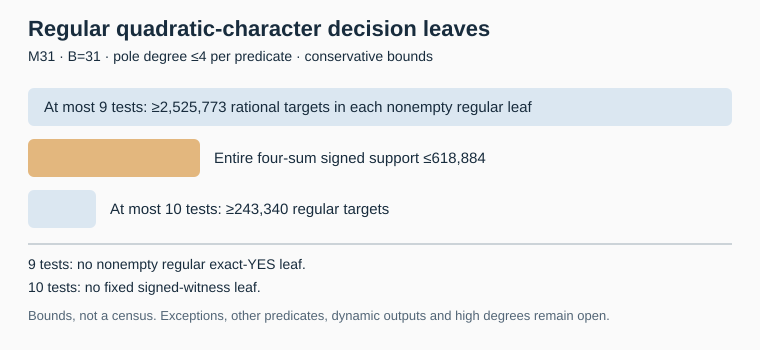

# Regular quadratic-character decision leaves on Prime31

2026-11-24 UTC; parent c5afb9fc5e30f184b924dcb1bf5f3ed43df6d754; PR #5131. Written producer derivation [pcc:unverified]. No experiment or claimed faster extractor.

## Scope

The previous equality-only obstruction leaves coordinate predicates open. This gate distinguishes low-pole-degree quadratic-character predicates, which can partition many targets, from exact sparse support identification. The inherited curve is y²=x³+847514846x+2087444724 over p=2147483647, prime group order r=2147446831, cofactor one, generator (625037715,2100627251); inherited parameters, not reverified. Let A be the signed B=31 base. For nonidentity targets the cancellation-reduced support bound from iteration10/parallel_review/REVIEW.md is H <= 2*309442=618884 signed targets. This is not a support census.

Consider an adaptive decision tree whose predicates on a fixed root-to-leaf path are the quadratic characters of nonzero rational functions f_i in F_p(E)*, i=1,...,q. The regular path requires every f_i to be a finite nonzero value; the prescribed signs are ±1. Predicate choices may depend on earlier signs, but the functions are fixed on that path. No other target-dependent conditions are assumed. Include O in the excluded set if the query contract excludes it. Let e be the number of geometric points excluded by all poles/zeros and any additional explicitly named finite exclusion (including O); let d_i be the pole-divisor degree of f_i. Thus e <= 2 sum d_i + 1 in the nonidentity contract. These are geometric degrees, not expression or circuit sizes.

## Character-cell theorem

Let k be the dimension of the span of the f_i square classes in F_pbar(E)*/F_pbar(E)*². Choose k of the functions as a basis. Let s be the number of geometric points at which at least one basis function has odd valuation; s <= 2 sum_basis d_i. If the regular leaf is nonempty, the number N of distinct rational targets reaching it satisfies

    N >= (p+1)/2^k - (2/2^k + s/2)*sqrt(p) - e.

In particular a negative right hand side gives no information. This statement is for the entire E(F_p) (as in the inherited cofactor-one fixture), not automatically a proper subgroup.

Proof: For the independent basis functions choose constants c_j of the prescribed quadratic character; over F_p let C be the smooth projective normalization obtained by adjoining sqrt(c_j f_j). Geometric independence ensures the extension has geometric degree 2^k and C is geometrically integral. For k=0 take C=E. At a regular rational target the cover has 2^k rational points above it if all basis signs match and none otherwise. This follows from the local unit square-root criterion or from the split quadratic equations over the residue field. A geometrically dependent function satisfies f_i=c u² times a product of basis functions with c in F_p*, u in F_p(E)*. To see the constant descent, the quotient is a square g² over the algebraic closure, so Frobenius sends g to ±g. In the minus case divide by a constant square root of a nonsquare; the resulting u is Frobenius-fixed. At all regular points the quotient is a unit, as is u. Consequently each dependent sign is fixed by the basis signs and a constant, and a nonempty full path has the same regular points as the basis path after the common exclusions. Constant or repeated predicates add no independent sign constraints.

The geometric cover has elementary abelian 2-group as Galois group. In odd characteristic its inertia is cyclic (tame) and has exponent at most two, hence index two precisely at the s points with an odd basis valuation, and is trivial elsewhere. Riemann-Hurwitz over the genus-one base gives 2g(C)-2 = 2^k*s/2, i.e. g(C)=1+2^(k-2)*s for k>=1 (g=1 at k=0, s=0). Hasse-Weil gives #C(F_p) >= p+1-2g(C)sqrt(p). At most 2^k e rational points lie over the excluded locus. Divide the remaining point count by 2^k using the split-fibre criterion. Substitution gives the stated bound. No independence or random-position hypothesis on the actual factor base enters.

## Exact numeric screen, not measurement

For at most q predicates of pole degree <=4, k<=q, s<=8k, e<=8q+1. With u=46341 > sqrt(p) (u²=2147488281 > p), the following deliberately conservative integer lower bound holds for any nonempty regular leaf:

    L(q) = floor((p+1-2u)/2^q) - 4q*u - 8q - 1.

The numerator is positive and the bound decreases with q, so replacing k by q is valid even for dependent predicates. Exact integer arithmetic:

| q | Conservative lower bound on regular targets |
|---:|---:|
| 8 | 6905268 |
| 9 | 2525773 |
| 10 | 243340 |
| 11 | -990563 (vacuous) |

At q<=9, every nonempty regular leaf contains more than the entire inherited four-sum support cap H=618884. Hence no such leaf can affirm exact membership; a one-sided affirmative filter using such a leaf necessarily includes at least L(q)-H false positives. At q<=10, every nonempty regular leaf contains more than one target, so no such leaf can return a fixed explicit signed witness (a fixed tuple sums to one target only). These statements do not forbid successful exceptional zero/pole paths, extra numerical predicates, larger degrees/depths, or target-dependent witness outputs. A low-degree character test can nevertheless be a useful rejection filter; its completeness and charged survivor cost remain candidate-specific.

## Challenge and next decision

- The geometric square-class rank matters: taking the rank over F_p(E) alone could count a nonsquare constant as an independent geometric branch and falsely predict a connected cover. The constant compatibility argument explicitly handles it.
- Even-order valuations can produce unramified but nontrivial quadratic covers; geometric square-class independence, not disjoint ramification, is the hypothesis. The genus-one unramified case is retained.
- All tests on the path may be adaptive; no independent distribution of signs is assumed. The proof applies only after the path fixes the functions. It is not a bound on arbitrary coordinates or roots used as new inputs later.
- Degenerate target zero/pole exits, equality predicates, target-indexed constants, arbitrary bit operations, variable rational-function degrees, algebraic roots of unknown x, proper subgroups and nonconstant leaf outputs require separate analysis. This is not a query-time lower bound: high-degree functions may have succinct circuits, and even shallow character trees may be useful prefilters.
- No source of candidate functions is proposed by the theorem. For any actual predicate candidate, freeze its functions, calculate geometric pole degrees, basis square classes, branch locus and exceptions, then compare charged complete filtering and signed recovery against the original pair-complement control. Do not assume a filter that merely rejects a fraction of targets supplies a sublinear exact selector.
- Proof obligations for independent review: constant descent, tame local inertia and split-fibre criterion; check the same finite-field point count with an independent character-sum expansion. All remain producer-only.

Sources checked: Stacks Project, Riemann-Hurwitz §53.12 (https://stacks.math.columbia.edu/tag/0C1B); Terence Tao, Hasse-Weil bound exposition (https://terrytao.wordpress.com/2014/05/02/the-bombieri-stepanov-proof-of-the-hasse-weil-bound/); pinned iteration10/parallel_review/REVIEW.md (blob 0e295d7d5e6ef1d84f59c1889ae81d6cbcaa7fb9); iteration11/squareclass_selector_followup/GATE.md (blob e14c9184ecc44dc5ea73d3d15893a632c2ad5274); iteration11/generic_collision_followup/GATE.md (blob b447d710804426e805e25aa5f406e9a73ab6c67b). Bounded default-branch searches across crypto, cryptanalysis and crypto-autoresearcher for "quadratic character filter" and "multiquadratic cover Hasse Weil" returned related prime one-shot rationality and zero-filter work; inspected rationality.md blob 1dcdf3469beefe29ef4765017ce43361b09956ea and prime_ic_zero_filter README blob 4223945baf2c286dccdf5c72fdbf35f77447e0ab. Their Kummer coset rationality/low-rank zero-filter scopes differ; no novelty assertion or exhaustive review. KB/Conductor/native worker dispatch not exposed; coordinator parallelized independent read operations, then wrote and challenged the argument. Space bounded content read returned user-input-required; no mutation replayed. No new Rust, randomness, timing, paid jobs, formal proof, signed validation or original-root qualification. No seed manifest required for this written derivation and deterministic integer arithmetic. [pcc:unverified]
