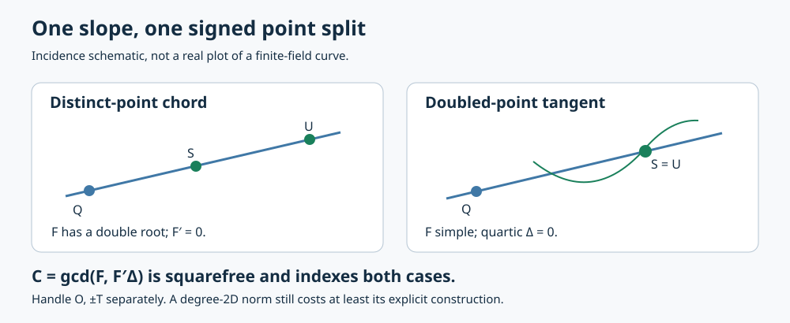

# Exact chord-slope collision contraction for signed pair spectra

2026-11-25; PR #5131, parent 728a2b1dad23b9fbc9bd7ad9b911d4137cfe3eac. Written producer derivation [pcc:unverified]. No new native test, curve experiment, random draw or timing.

## Scope and input

Inherited ordinary cofactor-one M31: p=2147483647, a=847514846, b=2087444724, r=2147446831, G=(625037715,2100627251), B=31; parameters not recertified. All field formulas are over F_p; relation rows over F_r. Let A={+/-P_i}, Y=A+A (including O), X=x(Y minus O), D=|X|, H(Xvar)=product over u in X of (Xvar-u). Odd order excludes nonidentity 2-torsion, so all x in X have two distinct rational signs. Pair bucket labels, collisions and normalized signed leaf witnesses are retained. T is an actual public target point, not a supplied decomposition.

Prior art: standard chord/tangent law (https://crypto.stanford.edu/pbc/notes/elliptic/explicit.html; Angdinata-Xu arXiv:2302.10640); the repo's different-j chord resultant at 969445bc449c7f8c86034eee736ff9ae7ebac908/research/isogeny_torsion_fibers_20261012/chi_polynomial_20261015/different_j_resultant_20261016/RESULTS_V1.md uses a per-signed-point eliminated cubic in a different coordinate and curve. Bounded default-branch code searches "slope collision", "slope resultant", "slope polynomial", "chord slope" returned related work; no novelty claim. Recent preprocessed 3SUM arXiv:2608.22355 and 2602.11363 use integer sets and do not supply free DLP-free additive labels or near-linear setup here. The preceding S3 pencil (blob da12c7a459405f4fdea44118cc03ade721d5eb90) and Dickson norm review (953b48e251bdbd6fce9b7748cd4b05c5d60afb7c) are controls. KB/Conductor unavailable.

## 1. A different target-specific univariate contraction

For T != O write Q=-T=(q,v). Remove q from X if present, giving X0, d=|X0|, and monic H0. For each signed point S=(u,y) with u in X0 define m_Q(S)=(y-v)/(u-q). Form the monic slope polynomial

    F_Q(Z) = product_(u in X0) [((u-q)Z+v)^2-f(u)]/(u-q)^2
           = Res_U(H0(U), ((U-q)Z+v)^2-f(U))/H0(q)^2.

It has degree exactly 2d, including the empty product 1, and its roots are the slopes of actual signed points, each counted once per point. All denominators are nonzero, and f(u) is a nonzero square. No resultant root from an extension-only point is admitted.

The line through Q of slope z intersects E according to

    f(U)-(v+z(U-q))^2=(U-q) R_z(U),
    R_z(U)=U^2+(q-z^2)U+q^2+a+q z^2-2vz,
    Delta_Q(z)=disc_U(R_z)=z^4-6q z^2+8vz-3q^2-4a.

The identity uses v^2=f(q). The residual quadratic contains at most two distinct abscissae; each determines a unique ordinate on this line. Thus every root of F_Q has multiplicity one or two (even when the line is tangent at Q). Multiplicity two occurs exactly when distinct signed points S,U in the retained set satisfy S+U=T by the chord law. A repeated root of R_z, if a slope of a retained point, occurs exactly when S=U and 2S=T. A flex at Q cannot pass this latter test because q was removed. A repeated root of F_Q never has Delta_Q=0, since it requires two distinct residual abscissae.

Consequently

    C_Q(Z)=gcd(F_Q(Z), F_Q'(Z) Delta_Q(Z))

is monic squarefree. Its roots correspond bijectively to unordered *generic signed point splits* S+U=T (both nonidentity, x(S),x(U) != q), including doubled S=U. Indeed double roots of F_Q contribute one copy via F_Q' since p>3, and simple roots contribute exactly when Delta_Q vanishes. This works also for constant F_Q, with gcd(1,0)=1. There is at most one doubled split in an odd-order subgroup, so 2*offdiag+diag<=2d and diag<=1 imply deg C_Q<=d. This is point-split count, NOT normalized leaf tuple count or useful rank.

## 2. Exceptional cases and recovery

For T!=O, separately add the unordered split {O,T} if T in Y, and {-T,2T} if both -T and 2T are in Y. These are exactly the splits with a point excluded from the slope list: O, T, or -T. If 3T=O the second can be a repeated point; do not double-count it. For T=O use all unordered {S,-S}, including {O,O}, with the original buckets. On the inherited r>3 group the two nonidentity-target exception branches are distinct. No root of C_Q can overlap an exception since its abscissae are both retained.

For each C_Q root z, solve R_z or use the signed slope labels and its multiplicity: a double slope gives both distinct points, while a simple slope with Delta_Q(z)=0 gives the single doubled point. Recover y=v+z(u-q), then perform original group replay and exact bucket lookup. Expand the Cartesian label products, including cancellation and repeats, if complete normalized witness reporting is requested; deduplication and output cost must be charged. For restricted distinct-index or affine-intermediate charts use their separately verified predicates, not generic slope support alone.

Miss iff C_Q=1 and neither exception succeeds. The generic miss admits a single Bezout identity U F_Q + V (F_Q' Delta_Q)=1, with deg U<2d+3 and deg V<2d for nonconstant F_Q (or a trivial certificate for F_Q=1). This proves coprimality of the given F_Q; provenance that F_Q is the exact slope norm must ALSO be checked. It is not a succinct proof of an uncomputed norm.

## 3. Charged algorithm and remaining gate

Source chart O(B^2) point operations/labels, and H plus distinct signed points O(D) words beyond labels. For a fixed T, batch invert the d nonzero u-q values (one inversion plus O(d) multiplications), form the 2d slope roots from stored signed points or the d monic quadratic factors using x alone. A product tree and fast gcd cost O(M(d) log(d+1)) field operations, with O(d log(d+1)) straightforward tree storage, or O(d) level-reuse storage. Delta_Q has degree four and constant coefficient cost. A deterministic signed-slope sort gives a separate O(d log(d+1)) comparison, O(d) word control, and a hash variant has expected O(d) lookup operations under a declared hash protocol. Sorting or direct group-complement scan avoids polynomial factorization; if using the polynomial route without retained slope labels, charge rational root isolation and signed lifting, not just gcd degree. Replaying and expanding witnesses costs at least their output size. No field-independent sorting shortcut or sublinear miss scan is claimed. The strongest group-complement baseline already costs linear work in D (expected dictionary model); this new route is a field-only algebraic comparator, not a proved asymptotic improvement over it.

Conditional archived B31 D=961: for T outside Y, degree F_Q=1922, degree F_Q' Delta_Q<=1925, degree C_Q<=961; for T in Y, the corresponding degrees are 1920, <=1923 and <=960. Compare the prior dense target-only Q of degree D^2+D=924482, which is reusable across targets, whereas F_Q must be rebuilt for each target. Do NOT divide these degree counts to claim speedup. The key possible research benefit is a different squarefree slope-selection primitive with an exact quartic diagonal guard, rather than the D-dimensional S3 column-product zero query. The remaining proof obligation is a reusable actual-Dickson slope collision index that avoids processing d slopes on a miss. Standard projection from a point is known geometry, and this derivation gives no such index.

## 4. Validation and challenge

The four symbolic integer-ring residuals in CHECK.py reduced to zero using SymPy 1.14.0. This checks expansion, discriminant, double-root identity, and sign factorization only; no finite-field curve operation, native Rust test or independent PCC validation was executed. For original-source native validation compare signed point splits and expanded row sets against exact group-complement and S3 controls, including T outside Y (miss and hit), T in Y, tangent at retained S, tangent at Q, zero slope, opposite y signs, identity, and colliding leaf buckets. Compare actual ordered target/label hashes, authenticate witnesses and compare augmented rank over r. Freeze sources, independent replicate panel and seed mappings, resource/admission rules and paired A/A protocol before any randomized/timed experiment. No seed manifest is required for this purely symbolic derivation; no historical seeds invented.

Native workers unavailable; coordinator parallelized reads, performed symbolic expansion, and challenged tangent, infinity, sign and multiplicity cases. #4977/#4979 merged; #5131 open; #5128 owns current-root qualification; #5157 owns its different-curve component measurements. No production edits, native jobs, paid compute, Space mutation, signed PCC proof or merge. Main and branch shared log histories must be preserved at integration.

Impact score: 3/10 — exact alternative univariate signed point-split certificate with a quartic tangent guard and explicit exceptional branches; only symbolic producer checks, no sublinear miss index or measured advantage. [pcc:unverified]
