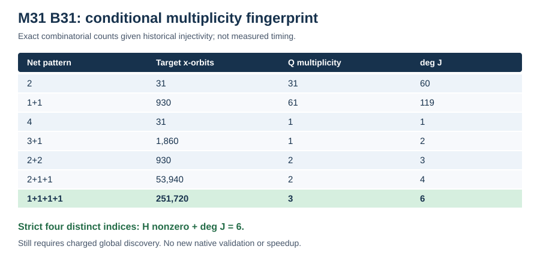

# Exact multiplicity fingerprint for the inherited collision-free B31 chart

2026-11-24 Pacific; parent 170b97c6ee15e0ca3e8b74f6f853aff4522366ae; PR #5131. Written combinatorial/algebraic validation gate only. [pcc:unverified]

## Scope and assumptions

Reuse the inherited ordinary M31 curve y²=x³+847514846x+2087444724 over p=2147483647, r=2147446831, G=(625037715,2100627251), cofactor one, B=31. All facts about injectivity below are conditional on the source-matched historical census in historical_collision_reconciliation/GATE.md; no new point operations or census. Let N2 consist of integer coefficient vectors of l1 norm 2, N4 those of norm 0,2,4. Assume the group evaluation of N4 is injective. In particular the signed nonzero pair nets in N2 correspond one-to-one to points of U and their negation orbits give D=B² abscissae. Use H, diag, off, Q=H diag off and J_T=gcd(H,K_T) from iterations 9 and 10. Q is understood up to its nonzero leading scalar; J_T is monic. Polynomial operations use F_p; any subsequent row rank uses F_r, not p.

## Theorem and proof

For a nonidentity target T, write c for its unique net in N4 if it exists. For a miss, Q(x(T)) is nonzero and deg J_T=0. For a hit, the following table gives the multiplicity e of x(T) in Q, the degree j of J_T, and the number of x-orbits of each net pattern. Signs are absorbed into the signed coordinate unit vectors; distinct letters refer to distinct base indices.

| absolute partition of c | x-orbits | e | j |
|---|---:|---:|---:|
|2|B|B|2(B-1)|
|1+1|2 binom(B,2)|2B-1|4B-5|
|4|B|1|1|
|3+1|2B(B-1)|1|2|
|2+2|2 binom(B,2)|2|3|
|2+1+1|4B binom(B-1,2)|2|4|
|1+1+1+1|8 binom(B,4)|3|6|

For nonzero target and nonzero pair subtotals, every valid signed pair split gives two nets d,e in N2 with d+e=c, by injection on N4. Conversely every such split is a rational group split. Unordered signed pair splits correspond bijectively to the factors of diag*off which vanish at x(T): an off-diagonal S3 factor has two distinct roots x(S+V),x(S-V), since equality would imply 2S=O or 2V=O. For each root exactly one simultaneous-sign choice gives T up to ordering. Diagonal S3 is linear and corresponds to equal pair nets, not opposite ones (which sum to O). Thus e counts unordered nonzero splits, plus one if c lies in N2 (the separate H factor). J_T instead counts distinct abscissae among their participating pair nets; it does not count splits or leaf orderings.

If ||c||1=4 there can be no cancellation between d and e. The splits are:
* 4a: (2a,2a).
* 3a+b: (2a,a+b).
* 2a+2b: (2a,2b), (a+b,a+b).
* 2a+b+c: (2a,b+c), (a+b,a+c).
* a+b+c+d: the three unordered two-by-two partitions, with six distinct participating pair nets.
No two participants are opposite in this norm-four case, since all signs agree with the target net. This yields the five bottom rows.

For ||c||1=2, precisely one signed cancellation occurs between two length-two nets. If c=2a, the unordered splits are (a+k,a-k) for one representative k from each of the B-1 other indices. The same-index choice gives the forbidden zero subtotal. The resulting 2(B-1) pair abscissae are distinct. If c=a+b, every other index k contributes two splits (a+k,b-k) and (a-k,b+k); the two remaining splits are (2a,b-a) and (2b,a-b). These give 2B-2 unordered nonzero splits. The last two share exactly one abscissa, namely x(a-b), so j=4B-5. To check no other sign-overlap, if both d and -d participate then ||c+d||1=||c-d||1=2. The identity ||c+d||1+||c-d||1=2 sum_i max(|c_i|,|d_i|) forces |d_i|=|c_i| for all i. This gives no allowed overlap for c=2a and only the a-b sign orbit for c=a+b. Distinct signed participants cannot share a point by N4 injection. Both norm-two cases gain exactly one H factor; the full multiplicity of ordered leaf witnesses is a different quantity.

## Conditional numerical fingerprint (not new execution)

| Partition | x-orbits | Q multiplicity | deg J_T |
|---|---:|---:|---:|
|2|31|31|60|
|1+1|930|61|119|
|4|31|1|1|
|3+1|1860|1|2|
|2+2|930|2|3|
|2+1+1|53940|2|4|
|1+1+1+1|251720|3|6|

Exact integer cross-checks:
- Sum x-orbits = 309442. Sum orbit count times Q multiplicity = 924482 = D²+D.
- Sum of deg J_T over all nonidentity x-targets = 1845151 = (2D²-D) - 930. The 930 correction is precisely the one shared sign orbit for each norm-two distinct-index target; the ordered double resultant counts it twice.
- There are 1073413973 missed x-targets under the inherited order. The strict target set contains 251720 abscissae / 503440 signed points, conditional on the archived census.
- These are expected exact histograms under the assumption, not newly measured outputs or A/B timing.

## Exact strict-support factor and validation use

For B>=4 and characteristic p>2B-1, the strict four-distinct-index target predicate is exactly H(x(T)) != 0 and deg J_T = 6. Equivalently H(x(T)) != 0 and Q,Q',Q'' all vanish at x(T). The latter follows because exactly the strict norm-four class has multiplicity >=3. Let L_j be the monic gcd of Q and its first j formal derivatives. Then L_2/L_3 is the squarefree product of roots of multiplicity >=3; H divides it, and (L_2/L_3)/H is exactly the monic strict-support polynomial of degree 8 binom(B,4). At B31 this is 251720 rather than 924482 dense coefficient degree. This is standard derivative/gcd multiplicity extraction applied to the actual conditional chart, not a new squarefree algorithm. No root factoring is needed for the boolean contract, but finding an authentic signed witness still requires charged discovery and replay. If the archived injection fails, multiple nets may create the same degree or multiplicity; neither classifier may be used without independent qualification of that assumption.

The degree-three layer is useful as an exact independent correctness invariant for the existing native query: require J=1 for misses and the seven degree categories for positives; separately verify H, signed witnesses and useful independent rank. Keep cancellation/repetition fixtures and colliding bases: the histogram is not universal. Do not infer complete ordered witnesses from deg J, or conflate a nonzero H branch with a distinct-index success.

## Costs and decision

The dense Q build still has quadratic-in-D degree and factor construction, O(D²) or quasi-linear-in-D² polynomial work up to multiplication logs, and O(D²) dense storage; derivative/gcd processing with fast gcds is quasi-linear in that degree. The smaller strict-support polynomial remains Theta(B^4) on a growing injective family. If it is materialized explicitly, even evaluating by Horner is Theta(B^4) field operations. A direct dictionary is a separate charged control. Computing J_T through the existing pair spectrum still takes quasi-linear-in-D work, including misses; a degree test does not remove it. Any improvement to empty-inclusive online discovery must be established independently. No smaller field, Rust edit, random trial, timing, paid job, merge, PCC issuance or signature was performed.

## Provenance and next gate

Sources: iteration9/PAIR_SPECTRUM_RESULTANT.md blob e2348e91dc08141a663c5adb9798b6ca8f09424e; iteration10/DOUBLE_RESULTANT_AND_SUPPORT.md blob db62fd8a58435c9b103d767dc6a86d9da58e5ef7; iteration10/parallel_review/REVIEW.md blob 0e295d7d5e6ef1d84f59c1889ae81d6cbcaa7fb9; iteration11/historical_collision_reconciliation/GATE.md blob 5bbbbb76276b11d806194147a698c4719dd5f7c0; zero_test_degree_budget/GATE.md blob 5a519f2b7381aa2975fa792a734cdcdb0df419d6. Prior art: FLINT polynomial squarefree factorisation documentation (https://fredrikj.net/fdoc/html/algorithms/polynomials/squarefree.html), especially derivative multiplicity and Yun algorithm. Bounded GitHub PR searches for resultant multiplicity, pair split multiplicity and squarefree four plus current main ACTIVE/journal reviewed; no novelty claim. Research KB/Conductor and native worker dispatch not exposed; coordinator parallelized independent reads. Native Space read required user input, so no mutation attempted. No original Rust toolchain in this runtime; no independent proof. The root-qualification and dedicated extraction lanes retain ownership. Next: independently qualify actual signed histogram against frozen original Rust source using the mandatory paired seed protocol if any randomized trial is admitted; pursue a different exact global query contraction. Preserve all prior evidence.

Impact score: 3/10 — written exact conditional resultant/gcd multiplicity fingerprint and strict-support classifier, with degree-sum consistency checks; no new curve execution, independent validation or faster global query. [pcc:unverified]
