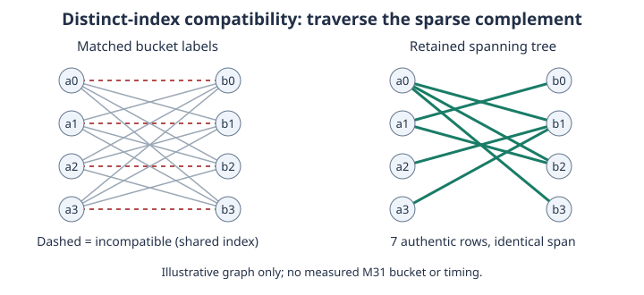

# Linear-work admissible forest for distinct-index four-leaf rows
2026-11-24; PR #5131 parent 37aef91d36376e9bf3b0ba8e58f62c09af5651be. Written producer proof [pcc:unverified]. No new experiment, timing or native execution.

## Sources and contract
Inherited ordinary cofactor-one M31: p=2147483647, a=847514846, b=2087444724, r=2147446831, G=(625037715,2100627251), B=31 (parameters inherited, not recertified). Row arithmetic over F_r. Previous rank-output contraction GATE.md blob f95d9b81f4c646c6bd1577c781dff804ae2577da and receipt b94454482fa8bd950dbced1271461671cbda7aed give the alternating-path span identity but leave admissible-edge discovery charged at up to mn checks. The named problem remains open.
Prior art: Dahlhaus–Gustedt–McConnell, Partially complemented representations of digraphs (2002), https://dmtcs.episciences.org/articles/303 (publisher abstract); Joeris–Lindzey–McConnell–Osheim, Simple DFS on the complement of a graph and on partially complemented digraphs, https://arxiv.org/abs/1311.1859 (full HTML text, introduction and algorithm). Linear traversal of sparse complements is established graph prior art. The application below uses the actual elliptic fibre incidence to avoid constructing even the forbidden lists. No novelty claim for complement traversal. KB/Conductor and native worker dispatch unavailable.

## 1. Fibre incidence and exact conflict bound
Assume distinct nonzero factor-base abscissae, with representatives P_i in an odd-order subgroup and both signs available. Use normalized unordered signed pairs with two distinct indices; each label has coefficient vector supported on exactly two indices. For fixed point S, a label containing epsilon P_i has its second signed point uniquely forced to S-epsilon P_i. The signed-base map is injective, so for each i and each of its two signs there is at most one such label in a bucket. Thus each index occurs in at most two labels in any bucket. Also a bucket contains at most B labels by counting two index incidences per label. The zero bucket has no distinct-index labels (distinct x forbids opposite points).

For a matched actual signed-point split S+U=T, form the bipartite graph with left and right copies of the buckets of sizes m,n. An edge is admissible exactly when the two supports are disjoint. Each vertex has at most four forbidden neighbors: its two indices each occur in at most two opposite labels. The number F of forbidden edges is therefore at most 4 min(m,n), with no randomness or Sidon assumption. Additional compatibility conditions, e.g. a separate orientation or affine intermediate guard, are NOT covered by this bound unless separately priced.

## 2. Forest construction without materializing edges
Maintain a mutable doubly linked list of undiscovered vertices on each side and a FIFO queue. Remove an undiscovered root and enqueue it. On popping v, scan only the opposite undiscovered list. Compare the two pairs' four possible index equalities. For disjoint supports, record the edge, remove the opposite vertex from its list and enqueue it; otherwise leave it undiscovered. Save the next list pointer before removal. When the queue empties choose another undiscovered root, including isolated vertices. Stop when both lists empty and all discovered vertices have been processed.

This is ordinary BFS in the admissible graph: it visits exactly all previously undiscovered neighbors, so each component is exhausted and the emitted edges form a spanning forest. A successful check deletes a vertex permanently; there are v-c such checks (v=m+n and c includes isolated components). Each failed check is a forbidden edge, examined at most once: when the first endpoint is popped, the other is undiscovered; the first endpoint can never later be undiscovered. Hence total checks <= v-c+F <= m+n-c+4 min(m,n) <= 3(m+n). Each check costs at most four index comparisons. List, queue and retained edges cost O(m+n) words. No random hashing, degree scan, conflict-list initialization or O(B) per-bucket clearing is needed. At m=n=31, at most 185 checks versus 961 exhaustive checks and at most 61 retained rows, conditional on those bucket sizes, not observed M31 multiplicity or timing.

If both sides have >=9 labels, the graph is connected: any two left vertices share a right neighbor because they jointly forbid <=8; every right vertex has a left neighbor because m>4. For smaller buckets do NOT assume connectivity; the traversal handles all components, including entirely forbidden products. For S=U use two separate copies and allow duplicate coefficient rows to be deduplicated after forest extraction; a self-edge between identical labels is forbidden by disjointness.

## 3. Rank completeness
Each emitted edge has four distinct indices and maps to T. With constant augmentation z_T, the row is R(a,b)=(a+b,z_T). An omitted admissible edge has endpoints connected by an odd-length forest path. The alternating signed sum of path rows equals that edge row, including the one copy of z_T. Every emitted row is an authentic admissible row, so span equality holds in both directions, relative to any initial row space and over F_r. It is not necessary to enumerate omitted edges or materialize paths in the production rank-only output; full enumeration/certificate requirements would cost extra. Equal numerical rank alone is not the validation criterion.

## 4. Charged global scope
All distinct-index pair labels across nonzero signed buckets number 2B(B-1). Given all matched unordered splits, each bucket appears at most once under S -> T-S; the possible unique self split needs two copies (at most B extra labels, since the subgroup has odd order). Hence the entire distinct-index rank-only compatibility stage costs O(B^2) in the worst case, O(sum of matched bucket sizes counting the self split twice) more precisely, with at most 2B(B-1)+B vertices. For B31 the latter is 1891, an upper bound not a census. Memory can be reused per split; source chart still costs O(B^2) labels, signed split discovery and unsuccessful global target queries retain their original cost. This is a provable linear versus quadratic post-match compatibility algorithm for the stated contract, not a new summation-polynomial zero selector or a full solver speedup. Sparse row creation, authentic group replay, rank elimination, setup and input/output still charged.

## 5. Challenge and validation preparation
Distinct abscissae are essential: duplicate signed base entries can invalidate the two-incidence bound. Repeated-index and zero-subtotal full-tuple contracts are separate. The forest proves only the disjoint-index graph, not the full RR5 oriented/affine chart if it excludes additional edges. A restricted component with only isolated vertices must return empty; an arbitrary anchor may be forbidden. An all-valid complete bipartite graph recovers a tree; a same-bucket split needs separate left/right copies. Validate actual signed point keys (not x-only), exact disjoint supports, mutual augmented span inclusion over r against exhaustive admissible rows, matched-split/empty agreement and duplicate handling. Record check count, discoveries, failed checks, component count and all source/replay costs; freeze the original Rust source, admitted resources, independent replicate seeds and identical input hashes before new runs. Retain full-output control and distinguish raw rows from useful independent rank. No native implementation/test/benchmark in this gate, no new seeds required for the written proof.

## Coordination
Read #4977/#4979 merged; #5131 open draft at exact parent; #5128 owns root baseline qualification, #4974/#4950 own native extraction admission. Read branch/main ACTIVE and newest journal, prior receipt and named problem. No production edits or duplicated jobs. No independent worker, signed PCC issuance, formal proof, paid compute or merge; coordinator used parallel read operations. Native Space remains unconfirmed; no uncertain write replay. Preserve both divergent shared logs/ACTIVE at eventual integration. 
Impact score: 3/10 — closes the specific restricted-edge discovery gap of the previous rank-output contraction for distinct-index pairs, with a deterministic linear post-match bound; original M31 implementation, actual multiplicity and faster global query remain open. [pcc:unverified]
